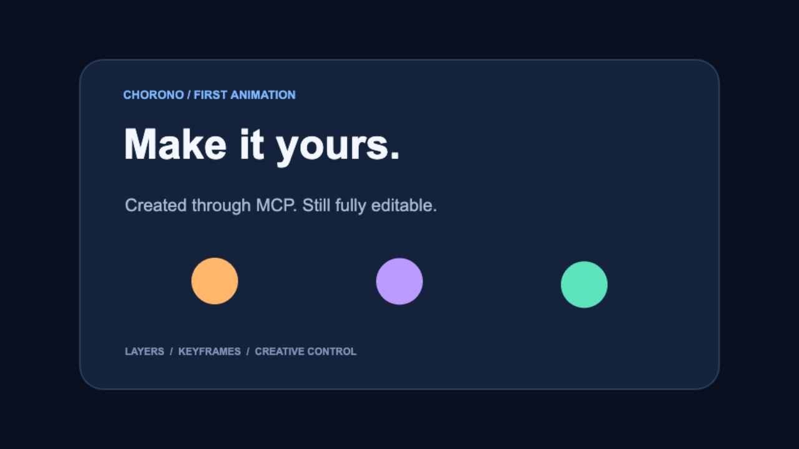

# Chorono

**Create animations with your AI agent. Refine every layer and keyframe visually.**

Chorono is an open-source, local-first 2D animation and motion graphics editor. Use Claude Code or Codex through MCP to create editable scenes, then adjust layers, keyframes, easing and timing in the browser.

- **Create with an agent or by hand.** Work through MCP or use the visual editor directly.
- **Keep creative control.** Refine shapes, text, particles and animation timing in the same scene.
- **Continue where you left off.** Save a portable editable project and reopen it for the next revision.

The editor runs on your computer with Node.js 20+, npm, Git and a modern browser.

[Website](https://www.chorono.com/) · [Install Chorono](docs/en/installation.md) · [Türkçe kurulum](docs/tr/installation.md) · [Editable example](examples/first-animation/README.md) · [Documentation](docs/README.md) · [Get help](#support)

See the working [text animation example](https://www.chorono.com/text-animation), [kinetic typography study](https://www.chorono.com/kinetic-typography) and [Claude Code animation tutorial](https://www.chorono.com/blog/make-animations-with-claude). Each includes a preview and an editable project to inspect.

## Try an editable example

Open the [first-animation example](examples/first-animation/README.md) to inspect a four-second scene with eight named layers and 51 editable keyframes. Change its headline or a circle's color, save the scene, and reopen it to continue editing.



## Set up and control Chorono from an agent

Claude Code or Codex can set up the editor, start it on your computer, and create editable animations through MCP. Start with the [installation guide](docs/en/installation.md) ([Türkçe](docs/tr/installation.md)) or the [documentation index](docs/README.md).

### 1. Install on your computer

Install **Node.js 20+**, npm, Git, and a modern browser. In Terminal on macOS/Linux or PowerShell on Windows:

```sh
git clone https://github.com/codie1982/chorono-editor.git
cd chorono-editor
npm ci
npm run cli:build
npm run chorono -- setup
npm run chorono -- start --background --open
```

`setup` installs missing editor dependencies, builds missing outputs, prepares MCP client settings, and installs the bundled skills. The default `--agent all` selects Codex, Claude Code and Claude Desktop for MCP; use `--agent codex`, `--agent claude-code` or `--agent claude-desktop` to select one. Filesystem skills are installed for Codex and Claude Code. Claude Desktop has a separate skill import mechanism.

Use `--project /path/to/animation-project` on setup, start and doctor to keep animation projects separate from the editor checkout. Existing checkouts are preserved; setup never pulls or resets them. The [installation guide](docs/en/installation.md) covers paths, client settings, stopping and rebuilding.

### 2. Connect the browser editor

Open the URL printed by `start` and choose **MCP → Connect this editor**. Reload your client's MCP connections or start a new agent session, then check:

```sh
npm run chorono -- doctor
```

Readiness requires a connected editor tab as well as a running server. Reconnect after a browser reload. Ask your agent:

> Use Chorono to create a scene with circles and text. Add intro, idle and outro animations, inspect preview frames, and save the editable project.

Portable projects are saved under `<animation-project>/projects/`. This local MCP workflow needs no model-provider API key. See [troubleshooting](docs/en/troubleshooting.md) ([Türkçe](docs/tr/troubleshooting.md)) if doctor reports an incomplete connection.

### 3. Understand and install the agent skills

| Skill | What it teaches the agent | Source |
| --- | --- | --- |
| `chorono-setup` | Install/start the editor, configure MCP clients, diagnose connections and manage skills | [SKILL.md](skills/chorono-setup/SKILL.md) |
| `chorono` | Create/edit scenes, keyframes and timelines; inspect preview images; validate and save editable projects | [SKILL.md](skills/chorono/SKILL.md) |

The source structure keeps the main instructions short and loads topic references when needed:

```text
skills/
├── chorono-setup/
│   ├── SKILL.md
│   └── agents/openai.yaml
└── chorono/
    ├── SKILL.md
    ├── agents/openai.yaml
    └── references/
        ├── connection.md
        ├── animation.md
        ├── interaction.md
        └── media-and-output.md
```

Setup already installs these skills for the selected agents. To manage only skills from a checkout after `npm run cli:build`:

```sh
npm run skills -- list
npm run skills -- install --dry-run
npm run skills -- install
npm run skills -- check
npm run skills -- update
```

Project installs go to `.agents/skills/` for Codex and `.claude/skills/` for Claude Code. Add `--global --agent codex` for a user-wide Codex install, or choose `--agent claude-code`. Modified copies are preserved.

Alternatively, install only the instructions directly from GitHub with the third-party [skills CLI](https://github.com/vercel-labs/skills) (currently requires Node.js 22.20+):

```sh
npx skills add codie1982/chorono-editor --skill chorono --skill chorono-setup -a claude-code -a codex --copy
```

Installing skills alone does not install/start the editor or connect MCP. Continue with steps 1–2. See the [agent skills guide](docs/en/agent-skills.md) ([Türkçe](docs/tr/agent-skills.md)) for scope, updates and the difference between installation methods.

The standalone CLI source is [`packages/cli`](packages/cli/README.md) (`@codie1982/chorono`). This quick start works from GitHub without relying on an npm release. For local tarballs and maintainer packaging, see the [distribution guide](docs/tr/skills.md).

## ⚡ Headline Feature: GPU-Accelerated Rendering

**WebGL2-accelerated rendering** (`feature/gpu-particle-renderer-v1`):

- **Particles via WebGL instanced quads** — every particle in an emitter draws in a single GPU draw call
- **9 SDF particle shapes** — Circle, Soft Circle, Rectangle, Rounded Rectangle, Line, Triangle, Star, Smoke Puff, Flame Blob — all anti-aliased in-shader (fwidth)
- **GPU post-effects** — separable Gaussian blur shared by blur, glow, and shadow
- **After Effects-quality motion blur** — accumulation of many equal-weight sub-frame samples (smooth smear, not discrete ghosts)
- **Automatic CPU fallback** — graceful degradation to Canvas 2D when WebGL is unavailable
- **Smart GPU compositor** — correct source-over / additive / screen / multiply blending against the scene below
- **Hardened** — event system on every class, error handling, SSR-safe GPU capability probing, WebGL context-loss recovery

### Performance (particle render, Apple M2, real measurement)
GPU offloads the **render**; particle simulation (spawn/evaluate) stays on CPU.
```
Particles   CPU render   GPU render   speedup
   1,000      1.9 ms       0.01 ms      ~140×
  10,000      4.9 ms       0.12 ms       ~42×
  50,000     49.5 ms       0.6 ms        ~84×
```
At ~50k particles the CPU draw alone (49.5 ms) blows the 16.6 ms/60 FPS budget; the GPU draw stays sub-millisecond.

---

## ✨ Complete Feature Set

### 🤖 AI-Powered Animation Studio

#### Agent Loop & Intelligent Planning
- **Natural language animation creation** — Describe your animation: _"Mavi daire ekle, soldan sağa kay, fade in yap"_ → instant keyframes
- **Multi-turn agent loop** — AI reasons → mutates scene → verifies → continues (max 5 turns, 30 tools)
- **Context-aware AI** — Scene state, layer visibility, timeline position fed to every agent turn
- **Read & Mutate tools** — Separate action types; AI can inspect before deciding next steps
- **Intent classification** — Zero-cost system prompt analysis (no LLM round-trip)
- **Quality scoring** — Automatic overlap detection, off-screen layers, composition balance check
- **High-level animation actions** — `create_stagger_animation`, `center_layer`, `align_layers`, `fit_to_canvas`, `create_loop_animation`

#### Flexible AI Backends
- **Anthropic Claude** — Native tool-use with caching support
- **OpenAI GPT-4o** — tool_use_id round-trip compatible
- **Custom providers** — Ollama, Groq, Together, Azure, local models
- **Fallback rendering** — Graceful degradation if API unavailable

### 🎨 Advanced Editing Tools

#### Spline Object System (3ds Max-style)
- **Editable paths** — Circle, Rectangle, Line, Ellipse, Arc, Donut, N-gon, Star
- **Point editing** — Corner, smooth, bezier, bezier-corner types
- **Segment operations** — Insert anchors (De Casteljau), delete, reverse, open/close
- **Text-to-spline** — Convert text outlines to editable splines via OpenType.js
- **Hit-testing** — Point, handle, segment, and contour selection with visual feedback

#### Smart Selection Engine
- **Select Similar** — Match by scale, rotation, edge distance, type, opacity
- **Select by Transform** — Rule-based selection (AND/OR/NOT logic)
- **Canvas tools** — Box, Lasso, Circle, Paint selection modes
- **Inside vs Touching** — 3ds Max Window/Crossing containment toggle
- **Non-intrusive** — Selection state lives in UI layer, doesn't mutate scene

#### Clone & Array System
- **Clone tool** — Live instances; source edits propagate automatically
- **Array patterns** — Linear, Grid, Radial, Path, and Repeater (non-destructive)
- **Path array** — Arc-length distribution along Bézier paths
- **Instance resolver** — Render & hit-test aware of instancing hierarchy
- **Bake support** — Convert instance to independent copy

#### Transform Tools
- **Gizmos** — Move, rotate, scale with live visual feedback
- **Multi-select rotation/scale** — Shared pivot (centroid) for multiple layers
- **Snap guides** — Vertex, angle, scale, smart guides with numeric display
- **Transform history** — Every gizmo operation undoable

### ⏱️ Professional Timeline & Animation

#### Advanced Timeline Features
- **Out-of-range modes** — Constant, Cycle, Loop, Ping-pong, Linear interpolation
- **Work area & markers** — Playback regions, navigation markers (Cmd+click to create)
- **Keyframe tools** — Slide by frame, range select, stagger dialog, spreadsheet editor
- **Ruler interactions** — Shift+drag for range selection, visual feedback

#### Parameter Wiring (17+ Preset Formulas)
- **Drive any property** — Link layers via expressions and scene parameters
- **Formula categories** — Clamp, Remap, Range, Curve, Phase, Modulo
- **Live preview** — Real-time feedback of wired values
- **Broken-wire detection** — Visual warnings for invalid references
- **Dock panel** — Dedicated wiring panel with enable/edit/delete controls
- **Track header indicators** — Show which parameters are wired

#### State Machines (FSM)
- **Node-graph editor** — Visual state/transition design (SVG-based)
- **Per-state timelines** — Each state references its own Timeline (Rive/Unity Animator model)
- **Guard conditions** — Parameter-based transition rules (no explicit trigger needed)
- **Blend support** — Smooth animation blending between states
- **Runtime player** — ChronoPlayer with multi-state playhead
- **Export ready** — Full .json serialization for headless playback
- **Sub-mode toggle** — [● Animation] [○ State Machine] within single canvas

### 🎬 Scripting & Automation

#### JavaScript-Based Scripting (No Custom DSL)
- **Full undo/redo** — Scripts operate through command system (automatic undo)
- **Scene API** — Add layers, update properties, delete, group
- **Timeline API** — Create tracks, add keyframes, evaluate at time
- **Event system** — Listen to layer events (transform, visibility, etc.)
- **Expression evaluator** — Runtime property calculation with parameter context

#### Authoring Scripts (Editor-Time)
- **MAXScript/Blender Python style** — `card = scene.add('rect')` syntax
- **Command wrapping** — Every script mutation wrapped in undoable command
- **Game engine foundation** — Extensible for future engine workflows

#### Interactive Runtime & Console
- **Headless ChronoPlayer** — Standalone animation playback (no UI)
- **DevTools-style console** — Live event log, REPL, watch expressions
- **Macro recording** — Record user actions as scripts
- **Trigger system** — Time-based, event-based, and manual triggers

### ✨ Animation Effects & Modifiers

#### Signal Modifiers (Procedural Animation)
- **Arithmetic** — Sine, Pulse, Quantize, Offset, Scale, Clamp
- **Noise** — Fractal, Jitter, Perlin noise-driven variation
- **Time manipulation** — TimeWarp (slow/fast), EaseCurve, Multiplier

#### Physics Simulation
- **Spring** — Oscillation with damping (frequency, damping ratio)
- **Decay** — Exponential falloff
- **Elastic** — Overshoot oscillation
- **Bounce** — Elastic collision simulation
- **Overshoot** — Anticipation + follow-through

#### GPU Post-Effects
- **Separable Gaussian blur** — Shared by blur, glow, and shadow
- **Motion blur** — After Effects-style accumulation (smooth smear)
- **CSS filter fallback** — Graceful degradation on non-GPU browsers
- **Real-time preview** — Effect strength and quality adjustable

### 🎭 Particle Effects (GPU-Powered)

#### Polymorphic Emitter System
- **6 emission shapes** — Point, Line, Circle, Rectangle, Path, Source Layer
- **9 particle types** — Circle, Soft Circle, Rectangle, Rounded Rectangle, Line, Triangle, Star, Smoke Puff, Flame Blob
- **Scene-layer emission** — Emit from any layer's geometry (live motion)
- **Dedicated dock tab** — Separate particle controls from main properties

#### Real-Time Controls
- **Density, speed, lifetime** — All animatable via keyframes
- **Rotation, scale, color** — Per-particle parameters
- **Blend modes** — Normal, Screen, Additive, Multiply
- **Particle preview** — In-modal SVG ghost preview with preset browser

#### Advanced Features (V2+)
- **LifeGradient editor** — Animate color/opacity over particle lifetime
- **Preset browser** — Curated particle effect library
- **Multi-source emitter** — Emit from multiple layer geometries
- **Custom shapes** — Polygon, N-gon, spiral, helix
- **Spawn velocity fields** — Direction and speed variation
- **Tangent-follow orientation** — Particles align to motion

### 📁 Asset Management & Import

#### Universal Import Pipeline
- **File formats** — Images (JPG, PNG, WebP, etc.), video (MP4, WebM), audio (MP3, WAV), SVG, Lottie, dotLottie, Chorono scenes
- **Clipboard support** — Paste images directly from clipboard
- **Asset registry** — Centralized collection, inventory, orphan cleanup
- **Preview & preflight** — Single-file modal preview before import
- **Atomic transactions** — All-or-nothing import (undo fully supported)

#### Security
- **SVG sanitization** — Strip scripts, XXE protection, external-ref blocking
- **HTTPS-only validation** — No mixed-content imports
- **URL validator** — Prevent data: and javascript: URIs

### 🔄 Composition & Layout Tools

#### Align & Distribute
- **6 align operations** — Left, Right, Top, Bottom, Center H/V
- **3 reference modes** — Selection bounds, Canvas bounds, Key Object
- **Distribute centers/spacing** — Equal distribution with gap control
- **Pack & tidy** — Auto-arrange with configurable spacing
- **Smart guides** — Live center, edge, spacing overlays (CSS-filter fallback)
- **Auto-key** — Automatically add keyframes when aligning animated layers

#### Context-Aware Menus
- **Right-click actions** — LayerPanel, SceneCanvas, AssetsPanel, ParametersPanel, EventsPanel
- **Quick access** — Add Layer, Fit/Zoom, Delete, Duplicate workflows

---

## 🌐 SDKs & Integrations

### Web SDK (`@chorono/web-sdk`)

**Embed animations in any website:**

```html
<script src="https://cdn.chorono.io/web-sdk/latest.js"></script>

<div id="animation-container"></div>

<script>
  const player = new ChronoPlayer({
    container: '#animation-container',
    sceneUrl: 'https://cdn.example.com/my-animation.json',
    autoplay: true,
    loop: true
  });
</script>
```

**Features:**
- **Lightweight bundle** — ~45KB (gzipped), lazy-loaded WebGL/Canvas
- **Event system** — `play`, `pause`, `seek`, `complete` events
- **Property binding** — Drive DOM attributes with animation values
- **Headless playback** — ChronoPlayer with zero UI
- **Responsive** — Auto-scale to container
- **Browser support** — Chrome, Firefox, Safari 12+, Edge, mobile browsers

**API:**
```javascript
player.play();
player.pause();
player.seek(timeMs);
player.setPlaybackRate(1.5);
player.setProperty('layer.id', { opacity: 0.5 });
player.on('complete', () => console.log('Done!'));
```

### Runtime (`@chorono/runtime`)

**Headless playback for Node.js and CLI:**

```bash
npm install @chorono/runtime
```

See [npm package](https://www.npmjs.com/package/@chorono/runtime) for latest version.

**Features:**
- **Headless ChronoPlayer** — Standalone animation playback (no UI)
- **Server-side rendering** — Render frames to PNG/WebP for video generation
- **CLI tool** — Export scenes to MP4, GIF, or frame sequences
- **Full Scene API** — Manipulate scenes programmatically
- **Event system** — Listen to animation events

### Android SDK (`chorono-android`)

**Native animation playback on Android:**

```kotlin
// Gradle
dependencies {
    implementation 'io.chorono:chorono-android:1.0.0'
}

// Usage
val player = ChronoPlayer(context)
player.loadScene(uri)  // File, Uri, or Stream
player.play()

// Listen to events
player.onEvent { event ->
    when(event) {
        is PlayEvent -> Log.d("Chorono", "Playing")
        is CompleteEvent -> Log.d("Chorono", "Finished")
    }
}

// Control playback
player.pause()
player.seek(2000)  // ms
player.setPlaybackRate(1.5)
```

**Features:**
- **Native Canvas rendering** — Android Canvas API (CPU) + OpenGL ES 3.0 (GPU particles optional)
- **Efficient** — Frame-skipping on low-end devices, adaptive quality
- **Kotlin-first API** — Coroutines support, lifecycle-aware
- **File & Network** — Load from assets, Uri, InputStream
- **Scene composition** — Merge multiple scenes, layer visibility control
- **Event forwarding** — Animation events to app logic

### More Platforms (Coming Soon)

| Repository | Platform | Language/Framework |
|------------|----------|--------------------|
| [`chorono-ios-sdk`](https://github.com/codie1982/chorono-ios-sdk) | iOS / macOS | Swift |
| [`chorono-macos`](https://github.com/codie1982/chorono-macos) | macOS native | Swift |
| [`chorono-flutter`](https://github.com/codie1982/chorono-flutter) | iOS + Android | Flutter/Dart |
| [`chorono-react-native`](https://github.com/codie1982/chorono-react-native) | iOS + Android | React Native |
| [`chorono-kmp`](https://github.com/codie1982/chorono-kmp) | iOS + Android | Kotlin Multiplatform |
| [`chorono-desktop`](https://github.com/codie1982/chorono-desktop) | Windows / Linux / macOS | Electron |
| [`chorono-qt`](https://github.com/codie1982/chorono-qt) | Embedded / Desktop | Qt / C++ |
| [`chorono-python`](https://github.com/codie1982/chorono-python) | Server / scripting | Python |
| [`chorono-node`](https://github.com/codie1982/chorono-node) | Server / CLI | Node.js |
| [`chorono-embed`](https://github.com/codie1982/chorono-embed) | Lightweight embed | Vanilla JS |
| [`chorono-wechat`](https://github.com/codie1982/chorono-wechat) | WeChat Mini Program | JS |
| [`chorono-tizen`](https://github.com/codie1982/chorono-tizen) | Samsung Smart TV | Tizen JS |
| [`chorono-webos`](https://github.com/codie1982/chorono-webos) | LG Smart TV | webOS JS |
| [`chorono-harmony`](https://github.com/codie1982/chorono-harmony) | Huawei devices | HarmonyOS |
| [`chorono-core`](https://github.com/codie1982/chorono-core) | Cross-platform engine | C++ |
| [`chorono-gpu`](https://github.com/codie1982/chorono-gpu) | GPU rendering module | WGSL / GLSL |
| [`chorono-runtime`](https://github.com/codie1982/chorono-runtime) | Headless playback | TypeScript |

### MCP Server (`chorono-mcp`)

The local MCP server is implemented in this repository. It connects Claude Desktop, Claude Code and Codex to the actual editor, with isolated QuickJS scripting, multi-timeline control, PNG previews, portable project persistence and the native ActionRegistry tools.

Run `npm run mcp:build`, `npm run mcp:setup`, then `npm run dev:mcp` (or build and `npm run start:mcp`). Open `http://127.0.0.1:2000`, then click **MCP → Connect this editor**. Generated client configurations are in `.chorono/client-configs/`. See the [MCP setup and tool reference](docs/tr/mcp.md) for configuration, all capabilities, security boundaries and smoke tests.

**Claude Desktop, Cursor, VS Code Copilot integration:**

- **Native tools** — Layer, keyframe, path, spline, particle, parameter and state-machine actions
- **Live scene** — Tools read and mutate a connected browser tab with revision checks and undo/redo
- **Isolated scripting** — QuickJS memory/time limits, atomic edits and commit-without-replay plans
- **Multiple animations** — Explicit timelines, modifiers, controllers, preview isolation and runtime controls
- **Persistence** — Portable scene JSON with embedded local media, runtime JSON, SVG and image sequence exports

---

## 🚀 Getting Started

### Prerequisites
- Node.js 20+ and npm
- Git
- Modern browser with WebGL2 support (Chrome, Firefox, Safari 15+, Edge)

### Installation

```bash
git clone https://github.com/codie1982/chorono-editor.git
cd chorono-editor
npm ci
npm run dev
```

Open [http://localhost:2000](http://localhost:2000) (the dev server runs on port 2000)

This starts the manual editor. For agent control, follow [Set up and control Chorono from an agent](#set-up-and-control-chorono-from-an-agent), which also configures MCP and installs skills. Stop any running Next server before installing dependencies or building.

### Environment Setup (Optional — AI Features)

Provider keys are for the editor's built-in AI panel. The external Claude/Codex MCP workflow above uses the model client and needs no provider key in the editor.

```env
ANTHROPIC_API_KEY=sk-...
OPENAI_API_KEY=sk-...
```

## 📖 Architecture

### Core Data Model
```
ChronoScene → Layer → Timeline → Track → Keyframe
```

### GPU Subsystem
```
src/lib/render/gpu/
├── GPUCapabilities.ts                  # WebGL2/WebGL1 + extension detection (SSR-safe)
├── GPUCompositor.ts                    # Identity-transform blend & blit to 2D canvas
├── GPUEvents.ts                        # Shared typed event emitter base
├── particles/
│   ├── ParticleGPUBackend.ts           # Abstract backend
│   ├── WebGLInstancedQuadBackend.ts    # Instanced-quad particle renderer
│   ├── WebGLParticleShader.ts          # 9-shape SDF shaders (WebGL2/1)
│   └── ParticleBufferPacker.ts         # Per-frame instance staging buffer
└── effects/
    ├── GPUEffectShaders.ts             # Blur + motion-blur GLSL
    ├── GPUImageEffects.ts              # Separable Gaussian blur engine
    └── GPUMotionBlur.ts                # Accumulation motion-blur engine

src/lib/render/renderMotionBlurAccumulated.ts   # Motion-blur orchestration
```

### Key Modules
- **`src/lib/core/`** — Data model (Layer, Timeline, ChronoScene)
- **`src/lib/editor/`** — Commands and state management
- **`src/lib/ai/`** — AI integration (ActionRegistry, AgentLoop)
- **`src/lib/render/`** — Canvas + GPU rendering pipeline
- **`src/components/`** — UI panels and canvas

## 🧪 Testing

```bash
npm test                    # Run all tests
npm test -- --watch       # Watch mode
npm test -- --coverage    # Coverage report
```

**1,000+ tests** (1,086) covering core features, GPU buffer/transform logic, particle physics, and animation.

## 🛠️ Development

### Build
```bash
npm run build
npm start
```

⚠️ **Critical:** Never run `next build` while dev server is running — it corrupts `.next/`.

### Code Style
- OOP with abstract base classes
- Private properties + getter/setters
- Event emission for all new classes
- Self-documenting code (minimal comments)

---

## 📚 Documentation

Browse the [documentation index](docs/README.md) for the full guide list.

| Guide | English | Türkçe |
| --- | --- | --- |
| Computer installation and MCP connection | [Installation](docs/en/installation.md) | [Bilgisayara kurulum](docs/tr/installation.md) |
| Skill structure, installation and updates | [Agent skills](docs/en/agent-skills.md) | [Ajan skill'leri](docs/tr/agent-skills.md) |
| Connection and installation problems | [Troubleshooting](docs/en/troubleshooting.md) | [Sorun giderme](docs/tr/troubleshooting.md) |
| First animation in the editor | [Getting started](docs/en/getting-started.md) | [Başlangıç](docs/tr/getting-started.md) |
| JavaScript scene authoring | [Scripting](docs/en/scripting.md) | [Betik yazımı](docs/tr/scripting.md) |

Technical references: [MCP tools and limits](docs/tr/mcp.md), [CLI and skill distribution](docs/tr/skills.md), and [CLI package](packages/cli/README.md).

## 🎯 Active Branches & Roadmap

### Core Features (Main)
| Feature | Status | Highlights |
|---------|--------|-----------|
| **GPU Particle Renderer** | ✅ Ready | 10K+ particles @ 60 FPS, 9 SDF shapes, motion blur |
| **State Machines (FSM)** | ✅ Ready | Node-graph editor, guard conditions, timeline per-state |
| **Parameter Wiring** | ✅ Ready | 17+ presets, broken-wire detection, track-header indicators |
| **AI Agent Loop** | ✅ Ready | Multi-turn reasoning, read/mutate tools, intent classification |
| **Spline Object System** | ✅ Ready | 8 primitives, point editing, text-to-spline conversion |
| **Smart Selection** | ✅ Ready | Select Similar/Transform, canvas tools, Inside/Touching toggle |
| **Clone & Array** | ✅ Ready | Live instances, 5 array patterns, instance resolver |
| **JavaScript Scripting** | ✅ Ready | Full undo/redo, Scene/Timeline/Event APIs |

### In Progress
| Branch | Feature | ETA |
|--------|---------|-----|
| `feature/gpu-particle-renderer-v1` | GPU blur + motion blur post-effects | Next |
| `feature/particle-effect-engine-bl13` | Particle v2 (LifeGradient editor, presets, custom shapes) | Sprint 2 |
| `feat/text-element-typography` | Per-character animation framework | Sprint 3 |
| `feat/align-distribute-tools` | Advanced composition (smart guides, auto-key) | Sprint 3 |

### 🔜 Editor Modes — Coming Soon

Chorono is built on a multi-mode architecture. The **2D Animation** mode is production-ready today. Additional modes are under active development:

| Mode | Description | Status |
|------|-------------|--------|
| 🎨 **Drawing Mode** | Vector illustration tools, brush engine, freehand paths | Coming Soon |
| 🎮 **Game Engine Mode** | GameObjects, physics, collision, state-machine-first workflow | Coming Soon |
| 🎬 **Video Editor Mode** | Clip timeline, transitions, color grading, multi-track audio | Coming Soon |
| 🧊 **3D Modeling Mode** | Three.js-based 3D objects, cameras, lighting, GLTF export | Coming Soon |

Each mode shares the same AI panel, scripting API, state machine system, and SDK export pipeline — only the scene object type, tools, and renderer change.

### Planned (Next Quarter)
| Feature | Description | Effort |
|---------|-------------|--------|
| **Particle V2+** | Preset browser, physics fields, GPU trails | 3 weeks |
| **Runtime Console** | DevTools-style debugging | 2 weeks |
| **Export formats** | MP4, GIF, Lottie, SVG sequences | 4 weeks |
| **Drawing Mode** | Brush engine + vector illustration | 6 weeks |
| **Game Engine Mode** | Physics + collision + GameObject system | 8 weeks |

## Support

- **Install and connect:** Follow the [installation guide](docs/en/installation.md) ([Türkçe](docs/tr/installation.md)).
- **Resolve setup or MCP problems:** Check [troubleshooting](docs/en/troubleshooting.md) ([Türkçe](docs/tr/troubleshooting.md)).
- **Ask a question, report a bug or suggest a feature:** [Search existing issues](https://github.com/codie1982/chorono-editor/issues) or [open a new issue](https://github.com/codie1982/chorono-editor/issues/new).
- **Share your first-run experience:** Use the [first-animation feedback form](https://github.com/codie1982/chorono-editor/issues/new?template=first-animation-feedback.yml).
- **Share your work or discuss workflows:** Visit [Chorono Discussions](https://github.com/codie1982/chorono-editor/discussions).

For installation or animation problems, include your operating system, Node.js version, agent client, steps to reproduce, and the expected and actual behavior. If relevant, include the output of `npm run chorono -- doctor`. Remove API keys, tokens and other private information before sharing logs or project files.

## 🤝 Contributing

1. Follow OOP style guide (CLAUDE.md)
2. Write tests for new features
3. Emit events for scripting support
4. Update BACKLOG.md with progress
5. Create PR with detailed description

## 📄 License

MIT License

---

**Made with ❤️ by the Chorono team**  
**One platform. Every screen. Every creative tool.**
