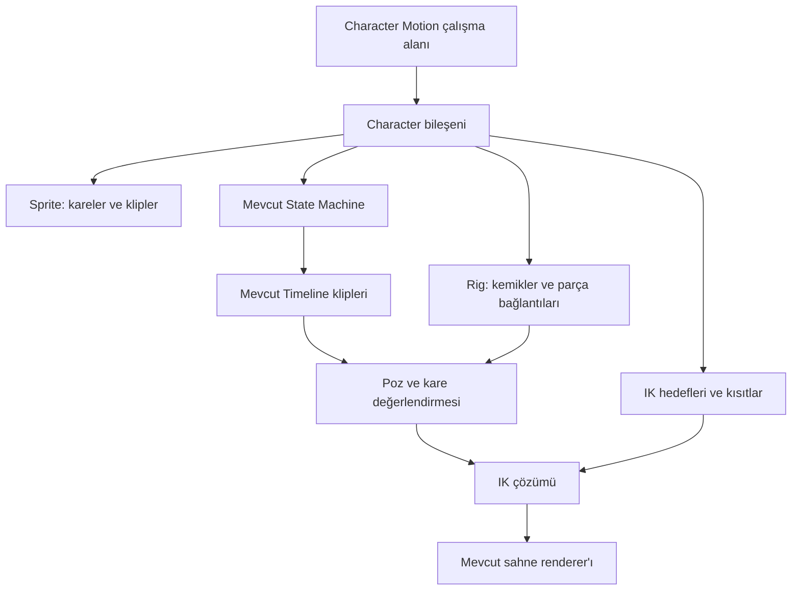

# Character Motion: mimari ve geliştirme planı

Tarih: 4 Kasım 2026. Durum: mimari öneri; bu belgede tarif edilen yeni özellikler henüz uygulanmadı. Kapsam: mevcut Chorono 2D editöründe karakter rigleme, sprite klipleri, IK ve state machine ile davranış kontrolü.

## 1. Ürün kararı

**Character Motion, mevcut sahne sisteminin üzerinde çalışan bir karakter bileşeni ve ona ait çalışma alanı olacak.** Kullanıcı sahneye tek bir Character ekleyecek; altında gövde parçaları, kemikler, kontrol noktaları ve animasyon klipleri düzenlenebilecek.

İlk sürüm mevcut `2danimation` modunu, grup hiyerarşisini, timeline'ları ve state machine motorunu kullanacak. Yeni bir renderer, ikinci timeline motoru veya bağımsız state machine sistemi kurulmayacak. Sahnedeki Character, bir kök `group` ve onu tanımlayan ek verilerle temsil edilecek; ilk sürümde `LayerType` içine yeni bir çizim türü eklemek gerekmeyecek.



Üç temsil aynı bileşende desteklenecek: parçalardan oluşan **rigged**, karelerden oluşan **sprite** ve bunları birlikte kullanan **hybrid**. Örneğin kemiklerle hareket eden gövdeye, sprite kareleriyle göz kırpan bir yüz bağlanabilecek. Hybrid'in veri modeli baştan korunacak; birleşik kullanımın arayüzü temel iki akıştan sonra tamamlanacak.

## 2. Repoda doğrulanan mevcut durum

| Alan | Mevcut durum | Kaynak |
| --- | --- | --- |
| Sahne hiyerarşisi | `group`, `parentId`, yerel transform ve pivot var | `src/lib/types/core.ts`, `src/lib/geometry/resolveLayerWorldMatrix.ts` |
| Sprite içe alma | Grid, FPS, frameCount ve GIF → frameSequence yolu var | `src/components/modals/SpriteSheetImportModal.tsx`, `src/lib/import/handlers/asset/SpriteSheetHandler.ts`, `src/lib/import/handlers/asset/GifHandler.ts` |
| Sprite oynatma | Kare seçimi genel `ctx.timeMs` ve katmanın `startMs` değeriyle yapılıyor; adlandırılmış karakter klipleri yok | `src/lib/frameSequence/frameMath.ts`, `src/lib/render/renderers/FrameSequenceRendererPlugin.ts` |
| State machine | State → timeline, guard, event ve transition blend var | `src/lib/types/statemachine-chorono.ts`, `src/lib/statemachine/StateMachineRuntime.ts` |
| State klibi saati | Editör ve player aktif state timeline'ını genel sahne saatiyle değerlendiriyor; state'e girişte başlayan bağımsız klip saati gerekiyor | `src/app/hooks/useSMRuntime.ts`, `src/lib/player/ChronoPlayer.ts` |
| Blend | Genel property interpolasyonu var; eksik track ve kemik açılarına özel politika gerekiyor | `src/lib/statemachine/blend.ts`, `src/lib/animation/typedValues.ts` |
| Kontrol parametreleri | Parameter, binding ve expression wire var | `src/app/hooks/useInteractiveRuntime.ts`, `src/lib/runtime/parameterWireEvaluator.ts` |
| Editör yerleşimi | Dock panelleri ve Canvas / State Machine sekmeleri var | `src/components/dock/registry.ts`, `src/components/dock/layoutOps.ts`, `src/app/page.tsx` |
| Runtime export | İki ayrı üretim yolu var; taşıdıkları alanlar aynı değil. MCP'nin kullandığı `RuntimeOptimizer` çıktısında state machine alanı bulunmuyor | `src/lib/export/runtimeExport.ts`, `src/lib/export/RuntimeOptimizer.ts`, `src/lib/mcp/editor.ts` |
| Kemik, rig, IK | İncelenen model ve runtime'da karaktere özel bir uygulama bulunmadı | `src/lib/types/core.ts`, `src/lib/statemachine/`, `src/lib/frameSequence/` |

Bu nedenle iş yalnızca yeni bir panel eklemekten oluşmuyor. Ortak klip saati, karakter sahipliği, constraint değerlendirmesi ve export sözleşmesi de gerekli.

## 3. Veri modeli ve sahiplik

Aşağıdaki kayıtlar **önerilen yeni modeldir**; mevcut MCP veya script API'sinde kullanılabilir komutlar değildir.

| Kayıt | Sorumluluk ve temel alanlar |
| --- | --- |
| `ChronoScene.characters?` | Sahnedeki karakter örnekleri. Yoksa eski sahne davranışı aynen sürer. |
| `CharacterDefinition` | `id`, `name`, `schemaVersion`, `rootLayerId`, `representation`, kemikler, attachment'lar, kontroller, klipler ve isteğe bağlı `stateMachineId`. İlk sürümde sahneye yerleştirilmiş tek örneği tanımlar. |
| `BoneDefinition` | `id`, `name`, `layerId`, pozitif `length`, bind/rest transform ve isteğe bağlı dönme sınırları. `layerId` sıradan bir grup katmanıdır. |
| `AttachmentDefinition` | Görsel `layerId` ile onu taşıyan `boneId` ilişkisi. Yerel bağlantı ofseti görsel katmanın transform'unda tutulur. |
| `IKConstraint` | `id`, iki kemik referansı, `targetLayerId`, `bendDirection`, `enabled`, varsayılan ağırlık ve isteğe bağlı ağırlık parametresi referansı. |
| `CharacterClip` | `id`, `name`, `timelineId`, temsil türü. Sprite klibi ayrıca sprite katmanı, kaynak kare listesi/aralığı, FPS, loop ve pivot bilgisini taşır. Süre ve loop davranışı ilgili timeline'a derlenir. |

Karakter bir sahne örneğidir; tekrar kullanılabilir karakter kütüphanesi ve paylaşılan asset tanımı ayrı bir sonraki aşamadır. İlk sürümde karakter çoğaltılırken tüm katman, kemik, kontrol, klip, timeline, state machine ve karaktere özel parametre kimlikleri yeniden eşlenir. Medya asset'leri paylaşılabilir. Bir kopyanın hareketi diğerini değiştirmemeli.

**Tek doğruluk kaynağı:** ebeveynlik `Layer.parentId` üzerinde kalır; ayrıca ikinci bir bone-parent ağacı tutulmaz. Kemik ilişkisi grup hiyerarşisinden türetilir. Attachment metadata'sı ile görselin gerçek ebeveynliği aynı transaction içinde değiştirilir ve doğrulanır. Timeline süreleri runtime'da klip metadata'sından ayrı hesaplanmaz; klip düzenleme komutu timeline'ı da atomik günceller.

Kök grup karakterin sahnedeki konumunu, ölçeğini ve yönünü taşır. Alt klipler yerel poz üretir. İlk sürüm animasyonları yerinde oynar; yürüyüş döngüsü kendiliğinden sahnede mesafe katettirmez. Root motion ayrı bir özellik olarak ele alınır.

Bir katman aynı anda iki karakterin kemik/görsel/kontrol öğesi olamaz. Karakter state machine'inin yazabileceği hedefler kendi alt ağacı ve açıkça sahip olduğu parametrelerle sınırlandırılır. Aynı klip timeline'ı iki bağımsız karakter runtime'ı tarafından paylaşılmaz.

## 4. Rigleme ve FK

İlk rigleme akışı: parçalı görselleri veya mevcut vektör katmanlarını seç → karakter oluştur → eklem noktalarını yerleştir → kemik zincirini kur → parçaları kemiklere bağla → rest pose kaydet → pozlandır.

- Kemikler görünür çizimler değil, normal grup transform'ları ve editör overlay'idir. Her kemik pivotu başlangıç eklemindedir; ilk sürümde `anchorX = anchorY = 0` sözleşmesi kullanılır.
- Kemik uzunluğu pozitif yerel X yönünde tanımlanır. Çocuk kemik başlangıcı ebeveynin ucuna yerleşir; renderer'ın mevcut parent transform bileşimi FK sonucunu verir.
- Görseli kemiğe bağlama işlemi, desteklenen transform'larda sahnedeki görünümünü koruyan yerel ofset üretir. Affine dönüşümün shear gerektirdiği durumlar sessizce yaklaşıklaştırılmaz; uygun dönüşüm akışı veya açıklayıcı doğrulama gerekir.
- Setup işlemleri rest pose'u değiştirir; Animate işlemleri seçili klibe keyframe yazar. Çalışma anında IK sonucunun rest pose'u değiştirmesi engellenir.
- İlk sürüm rigid attachment kullanır: her parça tek kemiği izler. Tek parça PNG'yi eklemli bir mesh'e dönüştürme, skin weight boyama ve otomatik anatomik rigleme sonraki kapsamdadır.
- Render sırası mevcut grup alt ağaçlarının çizim sırasını izler. Farklı kemik alt ağaçlarının görsellerini keyfi sırayla iç içe geçiren bağımsız slot/draw-order sistemi sonraki aşamadır; ön/arka kol gibi basit düzenler grup sırasıyla yapılır.

Track hedefleri mevcut biçimi korur: örneğin `layers.<boneLayerId>.transform.rotationDeg`. Böylece mevcut keyframe, dope sheet, curve editor ve undo mekanizması kullanılabilir.

## 5. IK: inverse kinematics

**IK, rig'in bir kontrol katmanıdır.** Kullanıcı eli veya ayağı hedefe taşır; omuz-dirsek ya da kalça-diz açıları çözülür. State machine hangi hareketin oynadığını seçer; IK o hareketin pozunu hedefe uydurur.

İlk solver iki kemikli 2D zincir içindir. Girdi: FK pozu, iki uzunluk, hedef konumu, bükülme yönü ve 0–1 ağırlık. Çıktı: kemiklerin yerel dönme override'ları ve çözüm tanısı. Sahne verisi veya keyframe'ler solver içinde değiştirilmez.

Hedef grupları kökün altında, çözdükleri kemik zincirinin dışında tutulur. Hedefi aynı kolun altına yerleştirerek geri besleme döngüsü oluşturulamaz. Hedefin `transform.x/y` değerleri mevcut timeline veya parametre bağlantılarıyla animasyonlanabilir.

Çözüm kuralları:

1. Hedefi zincirin ebeveyn koordinat uzayına çevir; sahne koordinatıyla kemik yerel koordinatını karıştırma.
2. İki kemikli analitik çözüm uygula; erişim dışındaki hedef için erişilebilir uca yaklaş ve tanı üret. İlk sürüm kemikleri uzatmaz.
3. `bendDirection` dirseğin/dizin hangi tarafa büküleceğini belirler. Aynalama altında ekran koordinatı ve determinant işareti hesaba katılır.
4. FK pozu ile IK pozu ağırlığa göre karıştırılır; ağırlık 0 FK'yi, 1 IK'yi verir. Bir ağırlık parametresi kullanıldığında nihai runtime parametre değerinden okunur.
5. Sonuç sonrası FK matrisi yeniden hesaplanır; görsel ve overlay aynı sonuçtan beslenir.

İlk sürüm zincir içinde birim ölçek, kök ve üst ebeveynlerde uniform ölçek ve yatay yön çevirme destekler. Sıfır ölçek, zincir içi nonuniform ölçek veya shear altında constraint kapatılır ve açık tanı gösterilir; `NaN` veya yanlış poz üretilmez. Bu sınır tüm karakterin normal çizimini durdurmaz.

Kemik limitleri varsa sonuç limitlere uymalı; bu durumda hedefe tam erişim garanti edilmez. Erişim hatası raporlanır. Aynı kemiğe yazan birden çok constraint ve constraint bağımlılık döngüsü ilk sürümde reddedilir. FABRIK/CCD, uzun zincir, otomatik foot planting, fizik ve gelişmiş IK/FK eşleme sonraki aşamalardır.

## 6. Sprite klipleri ve sprite hazırlama

Mevcut sprite-sheet ve GIF import'u korunur. Üzerine adlandırılmış klip düzenleme eklenir: kareleri seç → `idle`, `walk`, `run`, `jump` gibi isim ver → FPS, loop, kare sırası ve tutarlı pivot belirle → önizle.

İlk sürüm düzenli grid kullanır; adlandırılmış klip ardışık aralık veya sıralı kare listesi olabilir. Düzensiz atlas/trim/rotation metadata'sı ayrı import aşamasıdır. Kaynak kareler aynı hücre boyutuna ve ortak karakter pivotuna göre hizalanır; görünür şeklin değişmesi karakterin sahnede zıplamasına neden olmamalı.

**Oynatma kararı:** karakter sprite klibi, ilgili timeline üzerinde kare seçen basamaklı bir `frameSequence.frameIndex` track'ine derlenir. Bu alan `FrameSequenceData` ve property şemasına yeni bir optional özellik olarak eklenecek; renderer override varsa bu tam kareyi çizecek. İndeks clamp edilip tam sayıya çevrilir; interpolasyonla ara kare üretilmez. Override yoksa mevcut zamana bağlı `frameAtTime` yolu korunur. Tek kare, son kare, loop sınırı ve geçerli kaynak hücre sayısı doğrulanır.

Klipler ayrı bir görünmez oynatıcı tarafından yürütülmez. Timeline'ın yerel saati hem rig keyframe'lerini hem sprite karelerini sürer. State değiştiğinde yeni klip, tanımlanan giriş davranışına göre başlar.

Rig animasyonundan sprite hazırlama da hedef kapsamındadır: seçili klibi belirli FPS, aralık, sabit canvas/pivot ve transparan arka planla örnekle → PNG kareleri ve sheet/atlas metadata'sı üret → karakter sprite klibi olarak yeniden içe al. Bu çıktı aşaması editable rig'in yerine geçmez. İlk dilimde kaynak görsel veya karakter hareketini üretken AI ile kendiliğinden üretmek varsayılmaz.

## 7. State machine ve ortak klip saati

Mevcut `StateMachineDefinition` ve `ChronoSMState.timelineId` bağlantısı kullanılacak. Character Motion içindeki klip listesi state'lere timeline bağlamayı kolaylaştıracak; mevcut State Machine grafiği karakterin makinesine filtrelenebilecek.

Örnek davranış: `speed = 0` → Idle; `speed > 0` → Walk; `speed > runThreshold` → Run; `jump` olayı → Jump; iniş koşulu → Idle/Walk. Guard, event ve geçiş süreleri mevcut sistemde düzenlenir. Karaktere özel parametre kimlikleri birbirinden ayrılır.

Gerekli ortak değişiklikler:

- Yeni karakter state'leri açıkça **state'e girişte başlayan yerel saat** kullanır. Önerilen optional state alanı `timeMode: 'global' | 'state'`; alanı olmayan eski state'ler mevcut global saat davranışını korur.
- İlk sürümde state'e yeniden giriş klibi baştan başlatır; `speed`, pause, seek, loop ve one-shot sonu bu yerel saate göre işler. Resume/senkron yürüyüş fazı daha sonraki politikadır.
- Blend sırasında çıkan ve giren state'in ayrı yerel saatleri vardır; çıkan klip ilerlemeye devam eder, yeni klip sıfırdan başlar. Ortak timeline süresi iki state için tek bir faza zorlanmaz.
- One-shot klip bitişi karakter ve klip kimliğiyle tek bir completion olayı üretir. Ters seek aynı olayı kazara tekrar ateşlemez; seek ve event replay politikası açıkça belirlenir.
- Editör ve player aynı saf klip değerlendirme ve saat yardımcılarını çağırır. Yeni mantık `useSMRuntime` ile `ChronoPlayer._tickStateMachines` içine ayrı ayrı kopyalanmaz.
- Dışarıdan sağlanan simülasyon zamanı kullanılır. Salt `performance.now()` tabanlı yeni bir karakter saati eklenmez; duraklatma, deterministik önizleme ve kare export'u aynı zaman sözleşmesini izler.
- Bir klibe salt seek, o klibin pozunu belirler. State machine'in geçmişini seek ile tahmin etmek yerine başlangıç durumu ve olay/parametre akışıyla reset/replay gerekir. Canlı yakalama ile deterministik klip örneklemesi ayrı işlemlerdir.

**Blend politikası:** rig klipleri için eksik kanallar rest/default pozdan tamamlanır; önceki state'in keyframe'i sahipsiz biçimde kalmaz. Kemik açıları shortest-arc ile karışır; tam tur dönmesi istenen kanallar açıkça farklı politika seçer. Sprite kareleri geçişte atomik değiştirilir; ilk sürüm otomatik sprite crossfade yapmaz. Sayısal kare indekslerine genel property blend uygulanmaz. Bu davranışlar karaktere ait hedeflerle sınırlandırılır; eski sahnelerin genel interpolasyonu sessizce değiştirilmez.

## 8. Kare değerlendirme sırası

```text
Girdi / runtime parametreleri / state geçişleri
  → aktif kliplerin yerel saatleri
  → timeline'lar ve karakter poz blend'i
  → mevcut paramBindings, bindings ve parameterWires
  → karakter constraint / IK çözümü
  → nihai transform override'ları ve sprite frame seçimi
  → mevcut renderer, seçim geometrisi ve rig overlay
```

IK, binding/wire işlemlerinden sonra çalışır; böylece hedef noktalar parametrelerle sürülebilir. IK sonucunu aynı frame'de tekrar okuyup kendi girdisine yazan wire döngüsü desteklenmez. Çözülmüş kemikler üzerinde farklı bir son transform yazarı bulunamaz; çakışmalar tanı üretir.

State entry/exit parametre değişikliklerinin aynı karede mi sonraki karede mi okunacağı editör ve player için aynı sözleşmeyle netleştirilmelidir. Yeni karakter akışında parametre snapshot'ı bu aksiyonlardan sonra kesinleştirilir; eski davranış için regresyon kontrolü yapılır.

Canvas renderer'a özel IK eklenmez. Saf `evaluateCharacterFrame` katmanı mevcut override haritasını zenginleştirir. Editör, standalone player, MCP preview ve raster/sequence export aynı değerlendirme yolunu kullanır. Kontrol overlay'leri render çıktısına girmez.

## 9. Character Motion çalışma alanı

Mevcut dock sisteminde `Character Motion` paneli/çalışma alanı eklenir. Karakter seçimi Scene Explorer ve canvas seçimiyle senkron olur. Kalıcı modelde yeni `EditorMode` gerektirmez.

| Bölüm | İşlev |
| --- | --- |
| Sol | Karakter listesi; seçili karakterin kemikleri, parçaları, kontrolleri ve klipleri |
| Orta | Mevcut canvas üzerinde eklem/kemik/hedef overlay'i; gerekirse mevcut State Machine grafiğine geçiş |
| Sağ | Seçili kemik, attachment, IK veya sprite klibi özellikleri |
| Alt | Seçili klibin mevcut timeline / dope sheet / curve editor görünümü |

Üç çalışma bağlamı: **Setup** kemik/bağ/rest pose düzenler; **Animate** seçili klibe poz ve kare anahtarları yazar; **Test** parametre/olayla state machine çalıştırır. Aktif bağlam açıkça görünür. Bir state veya klip seçildiğinde ilgili timeline açılır; yanlış klibe keyframe yazılamaz.

Klip yokken timeline yazma işlemi disabled olur ve klip oluşturma eylemi sunulur. Kemik/IK hedef sürüklemesi tek undo transaction'ıdır; sayısal alanlarla eşdeğer düzenleme mümkündür. Hatalar ilgili zincir veya klip yanında görünür; renk tek ayırt edici olmaz. Dar dock alanlarında yardımcı özellikler katlanır, temel seçim ve pozlandırma erişilebilir kalır.

UI/UX becerisinin yerel araması bu editör akışı için ilgili sonuç vermedi. Bu bölüm, mevcut Chorono yerleşimi ve becerinin genel erişilebilirlik/etkileşim ilkelerine dayanan öneridir.

## 10. Kayıt, export ve MCP sözleşmesi

Portable proje rig, karakter, klip, constraint, state machine ve medya verilerini kayıpsız taşır. `characters` bulunmayan eski projeler yüklenir. Karakter verisinin kendi `schemaVersion` alanı olur; desteklenmeyen sürümler sessizce düşürülmez.

İki export yolu için ortak alan sözleşmesi ve round-trip fixture gerekir. Özellikle state machine, parameter wire, karakter metadata'sı ve sprite kontrolünün korunması doğrulanmalıdır. Karakter eklemeden önce mevcut `RuntimeOptimizer` / `exportToRuntime` farkı giderilir veya ortak serializer'a bağlanır.

- **Interactive runtime:** desteklenen karakter modelini, kontrolleri ve IK'yi taşımalıdır. Runtime capability/sürüm denetimi olmadan eski player'a başarılı export ilan edilmez.
- **Baked klip / sprite / video:** belirli parametre ve olay girdileriyle örneklenen sonuçtur. Dinamik IK hedeflerinin veya tüm state machine davranışının korunacağı anlamına gelmez.
- **SVG:** var olan exporter'ın taşıyamadığı dinamik karakter kontrolü için açık uyarı veya desteklenen baked/statik çıktı sunulur.

MCP ekleme sırası: önce karakteri ve rig'i okuma → native atomik komutlarla karakter/kemik/attachment/constraint/klip düzenleme → script handle'ları → deterministik klip önizleme ve bake. Komut isimleri uygulama aşamasında tool catalog ve gerçek şemalarla kesinleşir; bu belgedeki model isimleri çağrılabilir API sayılmaz.

Tüm mutasyonlar mevcut revision, requestId, undo ve script dry-run/plan kurallarına uyar. MCP/API değişiklikleriyle birlikte `skills/chorono/` altındaki canonical skill ve referanslar güncellenir; generated CLI skill dosyaları elle düzenlenmez.

## 11. Uygulama sırası ve kabul ölçütleri

| Aşama | Teslim | Kabul ölçütü |
| --- | --- | --- |
| 0 — Ortak sözleşmeler | Character şeması, doğrulama, klip saati tasarımı, ortak export alanları | Eski sahne aynen yüklenir; state machine ve wire export'ta kaybolmaz; kontrollü zamanla aynı klip aynı pozu verir. |
| 1 — Rig/FK | Character oluşturma, kemik grupları, rigid attachment, Setup/Animate temeli | İki kemikli kol pozlandırılır; çocuk parçalar doğru izler; bind/rest poz ve undo/redo korunur; kayıt tekrar açılır. |
| 2 — İki kemikli IK | Hedef kontrolü, yön, ağırlık, erişim ve ölçek tanıları | Eli sürükleyince kol çözülür; 0/1 ve ara ağırlıklar, aynalama, erişim dışı ve sıfır ölçek güvenli çalışır; target scrub edilebilir. |
| 3 — Klip ve sprite | Adlandırılmış rig/sprite klipleri, kare listesi, FPS/pivot, yerel klip saati | Idle ve Walk ayrı timeline'lardır; sprite kareleri doğru sınırda değişir; klip başlatma, duraklatma ve seek tutarlıdır. |
| 4 — Davranış | Mevcut SM ile karakter klipleri, blend, completion, parametre izolasyonu | Idle → Walk → Jump → Idle çalışır; sprite ve rig aynı saat sözleşmesine uyar; iki karakter bağımsız test edilir. |
| 5 — Teslim ve otomasyon | Runtime parity, MCP/script, rig → kare/sheet bake, UI tamamlaması | Editör, player, MCP ve raster export aynı girdide eşleşir; portable proje açılır; capability uyarıları doğrulanır. |

0–5 birlikte ilk tamamlanmış sürümü oluşturur. Aşama 1–2 sonunda küçük bir rig/IK prototipi görülebilir; bütün Character Motion özelliği tamamlanmış sayılmaz. İlk uygulanacak dikey dilim: **tek karakter kökü + iki kemikli kol + bir attachment + hareket eden IK hedefi + bir klip + kayıt/yükleme**. Ardından aynı karaktere ikinci klip ve state geçişi eklenir.

İlk sürümün dışında: mesh deformation ve skin weight, otomatik görsel parçalara ayırma, tam otomatik rig, retargeting, root motion, uzun IK zincirleri, fizik, blend tree, bağımsız slot sırası ve karakter asset kütüphanesi. Bunlar mevcut modele ileride eklenebilir; temel rig/sprite/IK/state machine tesliminin önkoşulu yapılmaz.

## 12. Uygulama haritası ve doğrulama

Önerilen yeni alanlar: `src/lib/types/character.ts`, `src/lib/character/` altında model doğrulama, klip derleme, pose/blend ve IK; `src/lib/editor/commands-character.ts`; `src/components/character/` altında panel, inspector ve overlay. Ortak klip saati/değerlendirme yardımcıları `src/lib/statemachine/` veya ortak runtime alanında tutulur. Kesin dosya sınırları ilk dilimde belirlenir.

Entegrasyon noktaları: `types/core.ts`, `types/media.ts`, katman property registry'si, `useInteractiveRuntime`, `useSMRuntime`, `ChronoPlayer`, frame-sequence renderer, dock layout, import/save ve her iki runtime exporter. Sahne değerlendirmesi kullanan preview, hit-test ve export yolları nihai karakter override'larını almalıdır.

Anlamlı testler: FK dünya koordinatı; bind sırasında görünümü koruma; IK erişim/ayna/limit/singularity; karakter kopyasında kimlik eşleme; eksik track ve açı blend'i; sprite sınırları; state'e girişte sıfırlanan saat; one-shot olayının tekliği; iki karakterin bağımsızlığı; eski/yeni proje round-trip'i; export alanlarının korunması; editör/player eşdeğerliği.

Görsel kabul sahnesi: iki karakter; bir rig kolu ve bacak, bir sprite karakter; Idle/Walk/Jump; hedef sürükleme, kök döndürme/ölçekleme ve aynalama. Klip başı, ara poz, geçiş ortası ve son kare gerçek render görüntüleriyle incelenir. Yalnızca sayısal frame değerlendirmesi görsel kabul yerine geçmez.

Uygulama değişikliklerinde repo sözleşmesi gereği `npm test`, `npm run mcp:build` ve `npm run build` çalıştırılır; build öncesinde Next sunucusu durdurulur. Bu belge yalnızca mimari plan eklediği için uygulama testleri çalıştırılmadı.
