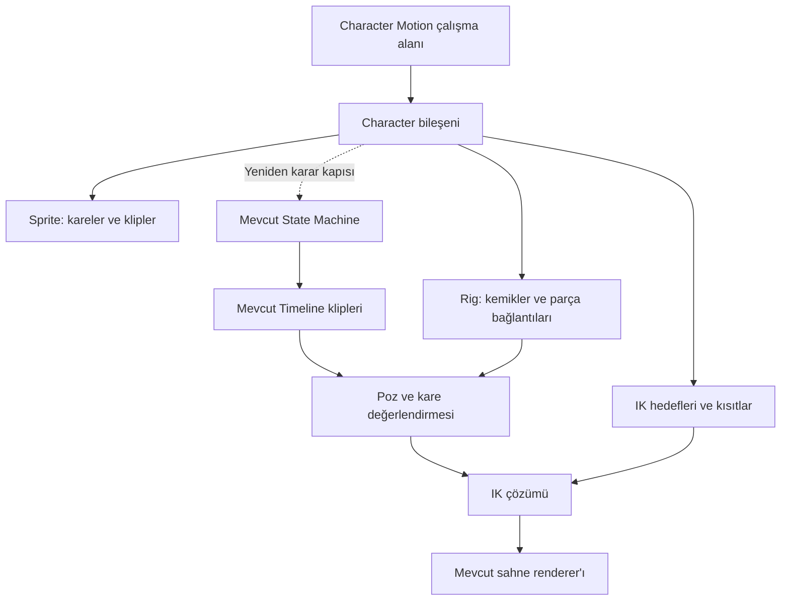

# 2D pivot bağlantıları ve iki parçalı IK

25 Kasım 2026 ürün kararı. Gövde, kol, bacak ve hedef için mevcut sahne katmanları kullanılır. Aynı araç menteşeler ve mekanik kollar için de kullanılabilir.

## Editörde kurulum

1. Üst kol, ön kol ve hedefi aynı grubun içine veya sahnenin köküne yerleştir. Üst kol pivotunu omza, ön kol pivotunu dirseğe, hedef pivotunu bileğe koy. Görünmez bir kontrol için hedef olarak boş grup kullanılabilir.
2. Ön kolu seç. **Properties → Link & IK** sekmesinde **Pick driver in viewport** düğmesine bas, ardından viewport’ta üst kola tıkla. Bağlama anındaki görünüm korunur. Üst kolun yer değiştirmesi ve dönüşü ön kola aktarılır.
3. Üst kolu seç, aynı sekmede **Set up IK in viewport** düğmesine bas. Önce viewport’ta ön kola, sonra bilekteki hedefe tıkla. Hedefin konumunu değiştir veya timeline’da anahtarla. **Flip bend** dirseğin büküldüğü tarafı değiştirir.
4. İki parça eşit uzunluktaysa hedefi omza getirdiğinde dirsek birden fazla konumda durabilir. Üst kolu seçip **Prefer this pose** düğmesine basarak o karedeki omuz yönünü tercih olarak kaydedebilirsin. **Clear preferred pose** kaynak omuz yönüne döndürür. İki işlem de Undo ile geri alınır.
5. **Shoulder limit** veya **Elbow limit** altında **Enabled** seç. Min ve Max açılarını dereceyle girip **Apply** düğmesine bas. Omuzun sıfır yönü sürücünün X eksenidir. Sürücü yoksa ortak grubun X ekseni kullanılır. Dirseğin sıfırı üst segmentin devamıdır. **Lock current angle** o eklemi o karedeki açıda sabitler. **Unlock angle** kayıtlı aralığa döner. **Reset** yalnız o eklemin sınırını temizler.
6. **Remove IK** pivot bağlantısını korur. **Unlink pivots** parçayı kendi kaynak transformuna döndürür. **Pozu koruyarak ayır** ise parçayı seçili karede gördüğün konum ve açıyla serbest bırakır. Düğmenin altında değişecek X, Y ve dönüş kanallarını görebilirsin. Anahtarlı bir kanala o karede anahtar yazılır, statik bir kanalın kaynak değeri güncellenir. Alt parçayı ayırmak ona bağlı iki parçalı IK’yi de kaldırır. Tek Undo bağlantıyı, IK’yi ve önceki değerleri birlikte geri getirir.

Seçili parçanın pivotundan sürücüye uzanan bakır renkli kesikli okun yönü, hangi katmanın izlendiğini gösterir. Omuz, dirsek veya hedef seçildiğinde turkuaz nişangâh hedefi, bakır halka bileğin ulaştığı noktayı gösterir. İkisi arasında boşluk kalırsa ince bir çizgi belirir. **Link & IK** sekmesi her ilgili zincir için mesafeyi kompozisyon pikseliyle ve uzanmayı sınırlayan koşulu gösterir. Eklem yayı turkuazdır. Etkin sınıra gelindiğinde ilgili uç bakır renkte görünür. Çizgiler yalnız editör görünümünde yer alır. Hedef seçerken Esc veya sağ tık işlemi iptal eder. Boş bir grubu seçmek için viewport’ta işaretlenen pivotuna tıklayabilirsin.

**Hedefi animasyonlamak için** timeline’da kareyi seç, **Auto** modunu aç ve hedefin nişangâhını merkezinden sürükle. Küçük bir şekil veya boş grup hedef olarak kullanılabilir. Fareyi bıraktığında hedefin değişen X/Y kanalları o kareye yazılır. Tek Undo konumu ve anahtarları birlikte geri alır. Sürüklerken Esc’ye basarsan hedef ve kol önceki poza döner. İlk timeline da gerekirse fareyi bıraktığında oluşur.

## Veri ve değerlendirme

- Katmanın isteğe bağlı `pivotLink2d` kaydı sürücü kimliğini, bağlama anındaki pivotu (ortak üst grubun yerel piksel koordinatları) ve dönüşü (derece) taşır. Bağlı parça, sürücüsünün hareketini izlerken kendi animasyonunu korur. Ölçek, sürücüden bağlı parçaya aktarılmaz.
- Üst parçadaki `twoBoneIK2d` alt parça kimliğini, hedef kimliğini, alt parça pivotuna göre yerel uç vektörünü ve bükülme yönünü tutar. Aynı eklem tek bir IK zincirinde sürülür. Döngü oluşturan bir hedef bağlanamaz.
- Timeline, parametreler ve ifadeler değerlendirildikten sonra bağlantılar bağımlılık sırasıyla çözülür. İki parçanın uzunlukları o karenin FK pozundan gelir. Analitik çözüm hedef uzaklığını iki parçanın toplamı ile uzunluk farkı arasında sınırlar. Hedef erişilemeyecek kadar uzaktaysa uzuv tam açılır. Çözülen poz yalnız o karenin transform değerlerinde yaşar.
- `evaluateSceneFrame(scene, timeMs).ikDiagnostics.get(upperId)` o karede çözülen omuz, dirsek, bilek ve özgün hedefi verir. `local` ortak grup uzayını, `composition` üst grupların dönüşümlerinden sonraki konumları ve mesafeyi içerir. `status` yerel erişimi belirtir. Geçersiz zincirde `inactive` ile `reason` döner. Bu ölçümler geçicidir.
- İsteğe bağlı `twoBoneIK2d.preferredShoulderOffsetDeg`, o karenin FK üst segmentine göre saat yönünde derece cinsinden omuz farkıdır. Çözücü bu farkı tam katlanmadaki belirsiz yön ve limitli çözümde eşit hatalı, aynı taraftaki pozlar arasında seçim için kullanır. Önceki kareye bağımlılık yoktur. Kayıtta alan yoksa kaynak FK yönü kullanılır.
- `shoulderLimit` ve `elbowLimit` bağımsız, isteğe bağlı `{ enabled, minDeg, maxDeg, lockedDeg? }` kayıtlarıdır. Örneğin 170°…190° yirmi derecelik bir yayı tanımlar. `jointLimits.ts` analitik çözümleri, aralık sınırlarını ve düz/katlı konumları ileri kinematikle karşılaştırır. Yerel uç uzaklığı en küçük olan poz seçilir. Hedef konumu korunur. Bir eklem hedefe yaklaşmayı engellediğinde kare tanısı `limited` olur. Kilit ve etkin Min/Max bilgisi hedefe ulaşılmış olsa da okunabilir.
- İşlemler `src/lib/rig2d/commands.ts`, kare planlama `frame.ts`, analitik çözüm `pose.ts` içindedir. Katman kimlikleri sahne dosyasında saklanır. Ortak grubu kopyalamak bağlantılı bir düzeneğin tamamını çoğaltır.
- İlk kapsam iki parçalı rijit 2D hareketle sınırlıdır. Sprite klip yönetimi, skin ağırlıkları, uzun IK zincirleri ve bake ileride bağımsız olarak değerlendirilebilir.

Editörde **Ungroup**, statik öteleme, dönme ve pozitif eşit ölçek altındaki pivot bağlantılarını yeni üst grubun koordinatlarına taşır. Zincirin bütün parçaları ve hedefi birlikte taşınmalıdır. Dönüşüm uygulanmış grupta hareketli eklem dönüşümlerini önce bake et. Grup dönüşümü özdeşse çocuk animasyonu korunur.

Sayısal kabul örnekleri, viewport geliştirmeleri ve ileri fazların sırası [2D IK etkileşim ve hesaplama planındadır](plans/ik2d-etkilesim-ve-cozum-plani.md).

## Arşiv — önceki Character Motion önerisi

Aşağıdaki bölümler Kasım 2026’da değerlendirilen özel Character bileşeni ve çalışma alanının tarihsel taslağıdır. Güncel uygulama kapsamı yukarıdaki katman bağlantılarıdır.

## 1. Ürün kararı

**Character Motion, mevcut sahne sisteminin üzerinde çalışan bir karakter bileşeni ve ona ait çalışma alanı olacak.** Kullanıcı sahneye tek bir Character ekleyecek; altında gövde parçaları, kemikler, kontrol noktaları ve animasyon klipleri düzenlenebilecek.

İlk sürüm mevcut `2danimation` modunu, grup hiyerarşisini ve timeline'ları
kullanacak. Yeni bir renderer, ikinci timeline motoru veya bağımsız state
machine sistemi kurulmayacak. Sahnedeki Character, bir kök `group` ve onu
tanımlayan ek verilerle temsil edilecek; ilk sürümde `LayerType` içine yeni bir
çizim türü eklemek gerekmeyecek.



MVP iki temsil sunar: karelerden oluşan **sprite** ve parçalardan oluşan
**rigged**. Veri şeması gelecekteki **hybrid** temsili okuyabilecek biçimde
sürümlenir; ancak hybrid UI, kemiğe bağlı sprite slotu ve birleşik kabul MVP'yi
bloke etmez.

### 1.1. Sadeleştirilmiş kapsam

| Katman | İçerik | Karar |
| --- | --- | --- |
| Character MVP adayı | Sprite Character, adlandırılmış klip, rigid rig/FK, iki kemikli analitik IK, Setup/Animate, Char Detail, undo ve basic save/load/player/raster parity | Ertelendi; aktif uygulama sırasının dışında |
| Yeniden karar kapısı | Manuel `Active Clip`, minimum State Machine `Set/Play Character Clip` action'ı, state-entry klip saati ve ileri transition/blend sınırı | Uygulama başlamadan önce sonuçlandırılacak |
| Sonraki Character genişlemesi | Gelişmiş State Machine koşulları/completion, hybrid sprite+rig ve ortak BakeService üzerinden character bake | MVP sınırı kararlaştırıldıktan sonra ayrı teslim |
| Backlog | FABRIK/CCD, uzun zincir ve full-body IK, foot planting, retargeting, mesh skin/weight, lip-sync, sprite crossfade ve draw-order animasyonu | Aktif programın dışında |

Mesh2D/spline-to-mesh Character MVP'nin önkoşulu değildir ve güncel ana planda
Character'dan önce başlar. Character da Mesh2D, simülasyon veya export'un
önkoşulu değildir. İlk rig yeniden açılırsa rigid layer attachment kullanır;
deformable mesh/skin daha sonraki ayrı iştir.

## 2. Repoda doğrulanan mevcut durum

| Alan | Mevcut durum | Kaynak |
| --- | --- | --- |
| Sahne hiyerarşisi | `group`, `parentId`, yerel transform ve pivot var | `src/lib/types/core.ts`, `src/lib/geometry/resolveLayerWorldMatrix.ts` |
| Sprite içe alma | Grid, FPS, frameCount ve GIF → frameSequence yolu var | `src/components/modals/SpriteSheetImportModal.tsx`, `src/lib/import/handlers/asset/SpriteSheetHandler.ts`, `src/lib/import/handlers/asset/GifHandler.ts` |
| Sprite oynatma | Kare seçimi genel `ctx.timeMs` ve katmanın `startMs` değeriyle yapılıyor; adlandırılmış karakter klipleri yok | `src/lib/frameSequence/frameMath.ts`, `src/lib/render/renderers/FrameSequenceRendererPlugin.ts` |
| State machine | State → timeline, guard, event ve transition blend var | `src/lib/types/statemachine-chorono.ts`, `src/lib/statemachine/StateMachineRuntime.ts` |
| State klibi saati | Editör ve player aktif state timeline'ını genel sahne saatiyle değerlendiriyor; state'e girişte başlayan bağımsız klip saati gerekiyor | `src/app/hooks/useSMRuntime.ts`, `src/lib/player/ChronoPlayer.ts` |
| Blend | Genel property interpolasyonu var; eksik track ve kemik açılarına özel politika gerekiyor | `src/lib/statemachine/blend.ts`, `src/lib/animation/typedValues.ts` |
| Kontrol parametreleri | Parameter, binding ve expression wire var | `src/app/hooks/useInteractiveRuntime.ts`, `src/lib/runtime/parameterWireEvaluator.ts` |
| Editör yerleşimi | Dock panelleri ve Canvas / State Machine sekmeleri var | `src/components/dock/registry.ts`, `src/components/dock/layoutOps.ts`, `src/app/page.tsx` |
| Runtime export | İki ayrı üretim yolu var; taşıdıkları alanlar aynı değil. MCP'nin kullandığı `RuntimeOptimizer` çıktısında state machine alanı bulunmuyor | `src/lib/export/runtimeExport.ts`, `src/lib/export/RuntimeOptimizer.ts`, `src/lib/mcp/editor.ts` |
| Kemik, rig, IK | İncelenen model ve runtime'da karaktere özel bir uygulama bulunmadı | `src/lib/types/core.ts`, `src/lib/statemachine/`, `src/lib/frameSequence/` |

Bu nedenle iş yalnızca yeni bir panel eklemekten oluşmuyor. Ortak klip saati, karakter sahipliği, constraint değerlendirmesi ve export sözleşmesi de gerekli.

## 3. Veri modeli ve sahiplik

Aşağıdaki kayıtlar **önerilen yeni modeldir**; mevcut MCP veya script API'sinde kullanılabilir komutlar değildir.

| Kayıt | Sorumluluk ve temel alanlar |
| --- | --- |
| `ChronoScene.characters?` | Sahnedeki karakter örnekleri. Yoksa eski sahne davranışı aynen sürer. |
| `CharacterDefinition` | `id`, `name`, `schemaVersion`, `rootLayerId`, `representation: 'sprite' | 'rigged' | 'hybrid'`, visual slot'lar, kemikler, attachment'lar, kontroller, klipler ve isteğe bağlı `stateMachineId`. İlk sürümde sahneye yerleştirilmiş tek örneği tanımlar. |
| `CharacterVisualSlot` | Character içindeki çizilebilir rolü tanımlar: stable `id`, ad, `layerId`, `kind: 'sprite' | 'layer'`, isteğe bağlı `boneId` ve yerel ofset. Saf sprite karakterde tek `Primary` slot; hybrid karakterde gövde, yüz veya ekipman gibi birden çok slot bulunabilir. |
| `BoneDefinition` | `id`, `name`, `layerId`, pozitif `length`, bind/rest transform ve isteğe bağlı dönme sınırları. `layerId` sıradan bir grup katmanıdır. |
| `AttachmentDefinition` | Görsel `layerId` ile onu taşıyan `boneId` ilişkisi. Yerel bağlantı ofseti görsel katmanın transform'unda tutulur. |
| `IKConstraint` | `id`, iki kemik referansı, `targetLayerId`, `bendDirection`, `enabled`, varsayılan ağırlık ve isteğe bağlı ağırlık parametresi referansı. |
| `CharacterClip` | `id`, `name`, `timelineId`, temsil türü. Sprite kanalı ayrıca hedef slotu, kaynak kare listesi/aralığı, ilk FPS/loop ve pivot bilgisini taşır. Nihai frame exposure'ları ilgili timeline'daki basamaklı `frameSequence.frameIndex` track'idir; ayrı görünmez oynatıcı yoktur. |

Karakter bir sahne örneğidir; tekrar kullanılabilir karakter kütüphanesi ve paylaşılan asset tanımı ayrı bir sonraki aşamadır. İlk sürümde karakter çoğaltılırken tüm katman, kemik, kontrol, klip, timeline, state machine ve karaktere özel parametre kimlikleri yeniden eşlenir. Medya asset'leri paylaşılabilir. Bir kopyanın hareketi diğerini değiştirmemeli.

**Tek doğruluk kaynağı:** ebeveynlik `Layer.parentId` üzerinde kalır; ayrıca ikinci bir bone-parent ağacı tutulmaz. Kemik ilişkisi grup hiyerarşisinden türetilir. Attachment metadata'sı ile görselin gerçek ebeveynliği aynı transaction içinde değiştirilir ve doğrulanır. Timeline süreleri runtime'da klip metadata'sından ayrı hesaplanmaz; klip düzenleme komutu timeline'ı da atomik günceller.

Kök grup karakterin sahnedeki konumunu, ölçeğini ve yönünü taşır. Alt klipler yerel poz üretir. İlk sürüm animasyonları yerinde oynar; yürüyüş döngüsü kendiliğinden sahnede mesafe katettirmez. Root motion ayrı bir özellik olarak ele alınır.

Bir katman aynı anda iki karakterin kemik/görsel/kontrol öğesi olamaz. Karakter state machine'inin yazabileceği hedefler kendi alt ağacı ve açıkça sahip olduğu parametrelerle sınırlandırılır. Aynı klip timeline'ı iki bağımsız karakter runtime'ı tarafından paylaşılmaz.

## 4. Rigleme ve FK

İlk rigleme akışı: parçalı görselleri veya mevcut vektör katmanlarını seç → karakter oluştur → eklem noktalarını yerleştir → kemik zincirini kur → parçaları kemiklere bağla → rest pose kaydet → pozlandır.

- Kemikler görünür çizimler değil, normal grup transform'ları ve editör overlay'idir. Her kemik pivotu başlangıç eklemindedir; ilk sürümde `anchorX = anchorY = 0` sözleşmesi kullanılır.
- Kemik uzunluğu pozitif yerel X yönünde tanımlanır. Çocuk kemik başlangıcı ebeveynin ucuna yerleşir; renderer'ın mevcut parent transform bileşimi FK sonucunu verir.
- Görseli kemiğe bağlama işlemi, desteklenen transform'larda sahnedeki görünümünü koruyan yerel ofset üretir. Affine dönüşümün shear gerektirdiği durumlar sessizce yaklaşıklaştırılmaz; uygun dönüşüm akışı veya açıklayıcı doğrulama gerekir.
- Setup işlemleri rest pose'u değiştirir; Animate işlemleri seçili klibe keyframe yazar. Çalışma anında IK sonucunun rest pose'u değiştirmesi engellenir.
- İlk sürüm rigid attachment kullanır: her parça tek kemiği izler. Tek parça PNG'yi eklemli bir mesh'e dönüştürme, skin weight boyama ve otomatik anatomik rigleme sonraki kapsamdadır.
- Render sırası mevcut grup alt ağaçlarının çizim sırasını izler. Farklı kemik alt ağaçlarının görsellerini keyfi sırayla iç içe geçiren bağımsız slot/draw-order sistemi sonraki aşamadır; ön/arka kol gibi basit düzenler grup sırasıyla yapılır.

Track hedefleri mevcut biçimi korur: örneğin `layers.<boneLayerId>.transform.rotationDeg`. Böylece mevcut keyframe, dope sheet, curve editor ve undo mekanizması kullanılabilir.

## 5. IK: inverse kinematics

**IK, rig'in bir kontrol katmanıdır.** Kullanıcı eli veya ayağı hedefe taşır; omuz-dirsek ya da kalça-diz açıları çözülür. State machine hangi hareketin oynadığını seçer; IK o hareketin pozunu hedefe uydurur.

İlk solver iki kemikli 2D zincir içindir. Girdi: FK pozu, iki uzunluk, hedef konumu, bükülme yönü ve 0–1 ağırlık. Çıktı: kemiklerin yerel dönme override'ları ve çözüm tanısı. Sahne verisi veya keyframe'ler solver içinde değiştirilmez.

Hedef grupları kökün altında, çözdükleri kemik zincirinin dışında tutulur. Hedefi aynı kolun altına yerleştirerek geri besleme döngüsü oluşturulamaz. Hedefin `transform.x/y` değerleri mevcut timeline veya parametre bağlantılarıyla animasyonlanabilir.

Çözüm kuralları:

1. Hedefi zincirin ebeveyn koordinat uzayına çevir; sahne koordinatıyla kemik yerel koordinatını karıştırma.
2. İki kemikli analitik çözüm uygula; erişim dışındaki hedef için erişilebilir uca yaklaş ve tanı üret. İlk sürüm kemikleri uzatmaz.
3. `bendDirection` dirseğin/dizin hangi tarafa büküleceğini belirler. Aynalama altında ekran koordinatı ve determinant işareti hesaba katılır.
4. FK pozu ile IK pozu ağırlığa göre karıştırılır; ağırlık 0 FK'yi, 1 IK'yi verir. Bir ağırlık parametresi kullanıldığında nihai runtime parametre değerinden okunur.
5. Sonuç sonrası FK matrisi yeniden hesaplanır; görsel ve overlay aynı sonuçtan beslenir.

İlk sürüm zincir içinde birim ölçek, kök ve üst ebeveynlerde uniform ölçek ve yatay yön çevirme destekler. Sıfır ölçek, zincir içi nonuniform ölçek veya shear altında constraint kapatılır ve açık tanı gösterilir; `NaN` veya yanlış poz üretilmez. Bu sınır tüm karakterin normal çizimini durdurmaz.

Kemik limitleri varsa sonuç limitlere uymalı; bu durumda hedefe tam erişim garanti edilmez. Erişim hatası raporlanır. Aynı kemiğe yazan birden çok constraint ve constraint bağımlılık döngüsü ilk sürümde reddedilir. FABRIK/CCD, uzun zincir, otomatik foot planting, fizik ve gelişmiş IK/FK eşleme aktif programın dışındaki backlog'dur.

## 6. Sprite klipleri ve sprite hazırlama

Mevcut sprite-sheet ve GIF import'u korunur. Üzerine adlandırılmış klip düzenleme eklenir: kareleri seç → `idle`, `walk`, `run`, `jump` gibi isim ver → FPS, loop, kare sırası ve tutarlı pivot belirle → önizle.

### 6.1. Hangi aşamada eklenir?

Sprite Character, Character şeması ve ortak klip saati kurulduktan sonraki
**ilk çalışan Character Motion dikey dilimidir**. Rig/FK ve IK'yi beklemez.
Bunun nedeni mevcut `frameSequence` import/render altyapısının yeniden
kullanılabilmesi ve Character root, clip/timeline, Scene Explorer, Char Detail,
save/load, player ve raster çıktı sözleşmelerinin solver riskinden önce gerçek
bir kullanıcı akışıyla doğrulanabilmesidir.

Ertelenmiş aday sıra: **ürün kapısı → Character/clip sözleşmesi → Sprite
Character → Rig/FK → iki kemikli IK → basic save/load/player/raster parity**.
Ürün kapısı; manuel `Active Clip` ile minimum State Machine clip action'ının
hangisinin MVP kabulüne gireceğini ve state-entry klip saatini kararlaştırır.
Saf sprite karakter kemik gerektirmez. Hybrid, gelişmiş State Machine geçişleri
ve kapsamlı bake ayrı genişleme olarak değerlendirilir.

### 6.2. Sahneye ekleme

Üç açık giriş yolu vardır:

1. **Add → Character → Sprite Character:** asset seç veya sprite sheet/GIF içe
   aktar. Grid, frame sayısı, pivot ve ilk frame aralığı doğrulanır. Tek atomik
   komut bir Character root grubu, altında `frameSequence` Primary slotu,
   `CharacterDefinition`, varsayılan `Default` klibi ve klibin timeline'ını
   oluşturur. Scene Explorer'da tek üst seviye Character görünür; teknik sprite
   layer'ı genişletildiğinde alt öğedir.
2. **Import Sprite Sheet → Create as Character:** mevcut plain frame-sequence
   import akışı korunur; kullanıcı açıkça Character seçerse aynı atomik kurulum
   yapılır. Normal sprite layer içe aktarması kendiliğinden Character'a çevrilmez.
3. **Wrap as Character:** seçili mevcut `frameSequence` layer'ını görünümünü ve
   dünya transformunu koruyarak Character root altına alır; asset kopyalanmaz.
   İşlem önizleme, Apply/Cancel, source revision guard ve tek undo kullanır.

İlk kurulum bütün sheet'i yanlışlıkla `Idle` saymaz. Kullanıcının seçtiği aralık
`Default` klibini üretir; sonra Clip Editor'da Idle/Walk/Run/Jump olarak
bölünebilir. En az bir geçerli frame seçilmeden Apply aktif olmaz.

### 6.3. Kontrol ve zaman sözleşmesi

İlk sürüm düzenli grid kullanır; adlandırılmış klip ardışık aralık veya sıralı kare listesi olabilir. Düzensiz atlas/trim/rotation metadata'sı ayrı import aşamasıdır. Kaynak kareler aynı hücre boyutuna ve ortak karakter pivotuna göre hizalanır; görünür şeklin değişmesi karakterin sahnede zıplamasına neden olmamalı.

**Oynatma kararı:** karakter sprite klibi, ilgili timeline üzerinde kare seçen basamaklı bir `frameSequence.frameIndex` track'ine derlenir. Bu alan `FrameSequenceData` ve property şemasına yeni bir optional özellik olarak eklenecek; renderer override varsa bu tam kareyi çizecek. İndeks clamp edilip tam sayıya çevrilir; interpolasyonla ara kare üretilmez. Override yoksa mevcut zamana bağlı `frameAtTime` yolu korunur. Tek kare, son kare, loop sınırı ve geçerli kaynak hücre sayısı doğrulanır.

Klipler ayrı bir görünmez oynatıcı tarafından yürütülmez. Timeline'ın yerel saati hem rig keyframe'lerini hem sprite karelerini sürer. State değiştiğinde yeni klip, tanımlanan giriş davranışına göre başlar.

- **Setup:** sheet/grid, karakter boyutu, Primary veya hybrid slot, ortak pivot,
  bone attachment ve object-fit düzenlenir; klip frame exposure'ı yazılmaz.
- **Animate:** aktif klip seçilir; thumbnail strip ve dope sheet'te kare ekle,
  sırala, çoğalt, sil, exposure süresini değiştir, loop/FPS başlangıç ayarını
  uygula ve frame-by-frame scrub yapılır. Sonraki exposure düzenlemelerinde
  basamaklı timeline track'i tek doğruluk kaynağıdır.
- **Test:** state, parametre ve olaylar klip seçer; kullanıcı aynı anda elle
  başka klibi zorlamıyorsa runtime sonucu gösterilir. Debug override açıkça
  etiketlenir ve kaynak state machine'e yazılmaz.
- **Canvas:** saf sprite karakterde yalnız Character root transformu düzenlenir.
  Hybrid slot seçildiğinde slot ofseti veya bağlı kemik düzenlenir; aktif klip
  karesi root sürüklemesiyle değişmez.

İlk sürüm sprite geçişinde atomik frame/clip değişimi kullanır; otomatik
crossfade üretmez. Playback speed, loop ve one-shot completion klip/state yerel
saatine aittir. İki Character aynı asset'i paylaşabilir fakat aktif klip,
timeline, state local time ve slot override'ları instance'a aittir.

### 6.4. Hybrid kullanım — MVP sonrası

Hybrid ilk kabulü küçük tutulur: rig'e bağlı bir Primary/body layer ile bir
sprite slotu birlikte çalışır; örneğin head kemiğine bağlı yüz slotunda blink
veya mouth kareleri oynar. Sprite slot normal `AttachmentDefinition` yaşam
döngüsünü ve aynı Character timeline'ını kullanır. İlk sürüm bağımsız slot draw
order animasyonu, çok katmanlı lip-sync sistemi veya otomatik yön/varyant
seçimi sunmaz.

Rig animasyonundan sprite hazırlama da hedef kapsamındadır: seçili klibi belirli FPS, aralık, sabit canvas/pivot ve transparan arka planla örnekle → PNG kareleri ve sheet/atlas metadata'sı üret → karakter sprite klibi olarak yeniden içe al. Bu çıktı aşaması editable rig'in yerine geçmez. İlk dilimde kaynak görsel veya karakter hareketini üretken AI ile kendiliğinden üretmek varsayılmaz.

## 7. State machine ve ortak klip saati — MVP sonrası

Bu bölüm temel klip düzenleme ve manuel klip seçiminin kabulünü bekletmez.
MVP'de kullanıcı aktif klibi Character Motion içinden açıkça seçer; otomatik
state/parametre/olay yönlendirmesi sonraki Character genişlemesidir.

Mevcut `StateMachineDefinition` ve `ChronoSMState.timelineId` bağlantısı kullanılacak. Character Motion içindeki klip listesi state'lere timeline bağlamayı kolaylaştıracak; mevcut State Machine grafiği karakterin makinesine filtrelenebilecek.

Örnek davranış: `speed = 0` → Idle; `speed > 0` → Walk; `speed > runThreshold` → Run; `jump` olayı → Jump; iniş koşulu → Idle/Walk. Guard, event ve geçiş süreleri mevcut sistemde düzenlenir. Karaktere özel parametre kimlikleri birbirinden ayrılır.

Gerekli ortak değişiklikler:

- Yeni karakter state'leri açıkça **state'e girişte başlayan yerel saat** kullanır. Önerilen optional state alanı `timeMode: 'global' | 'state'`; alanı olmayan eski state'ler mevcut global saat davranışını korur.
- İlk sürümde state'e yeniden giriş klibi baştan başlatır; `speed`, pause, seek, loop ve one-shot sonu bu yerel saate göre işler. Resume/senkron yürüyüş fazı daha sonraki politikadır.
- Blend sırasında çıkan ve giren state'in ayrı yerel saatleri vardır; çıkan klip ilerlemeye devam eder, yeni klip sıfırdan başlar. Ortak timeline süresi iki state için tek bir faza zorlanmaz.
- One-shot klip bitişi karakter ve klip kimliğiyle tek bir completion olayı üretir. Ters seek aynı olayı kazara tekrar ateşlemez; seek ve event replay politikası açıkça belirlenir.
- Editör ve player aynı saf klip değerlendirme ve saat yardımcılarını çağırır. Yeni mantık `useSMRuntime` ile `ChronoPlayer._tickStateMachines` içine ayrı ayrı kopyalanmaz.
- Dışarıdan sağlanan simülasyon zamanı kullanılır. Salt `performance.now()` tabanlı yeni bir karakter saati eklenmez; duraklatma, deterministik önizleme ve kare export'u aynı zaman sözleşmesini izler.
- Bir klibe salt seek, o klibin pozunu belirler. State machine'in geçmişini seek ile tahmin etmek yerine başlangıç durumu ve olay/parametre akışıyla reset/replay gerekir. Canlı yakalama ile deterministik klip örneklemesi ayrı işlemlerdir.

**Blend politikası:** rig klipleri için eksik kanallar rest/default pozdan tamamlanır; önceki state'in keyframe'i sahipsiz biçimde kalmaz. Kemik açıları shortest-arc ile karışır; tam tur dönmesi istenen kanallar açıkça farklı politika seçer. Sprite kareleri geçişte atomik değiştirilir; ilk sürüm otomatik sprite crossfade yapmaz. Sayısal kare indekslerine genel property blend uygulanmaz. Bu davranışlar karaktere ait hedeflerle sınırlandırılır; eski sahnelerin genel interpolasyonu sessizce değiştirilmez.

## 8. Kare değerlendirme sırası

```text
Girdi / runtime parametreleri / state geçişleri
  → aktif kliplerin yerel saatleri
  → timeline'lar ve karakter poz blend'i
  → mevcut paramBindings, bindings ve parameterWires
  → karakter constraint / IK çözümü
  → nihai transform override'ları ve sprite frame seçimi
  → mevcut renderer, seçim geometrisi ve rig overlay
```

IK, binding/wire işlemlerinden sonra çalışır; böylece hedef noktalar parametrelerle sürülebilir. IK sonucunu aynı frame'de tekrar okuyup kendi girdisine yazan wire döngüsü desteklenmez. Çözülmüş kemikler üzerinde farklı bir son transform yazarı bulunamaz; çakışmalar tanı üretir.

State entry/exit parametre değişikliklerinin aynı karede mi sonraki karede mi okunacağı editör ve player için aynı sözleşmeyle netleştirilmelidir. Yeni karakter akışında parametre snapshot'ı bu aksiyonlardan sonra kesinleştirilir; eski davranış için regresyon kontrolü yapılır.

Canvas renderer'a özel IK eklenmez. Saf `evaluateCharacterFrame` katmanı mevcut override haritasını zenginleştirir. Editör, standalone player, MCP preview ve raster/sequence export aynı değerlendirme yolunu kullanır. Kontrol overlay'leri render çıktısına girmez.

## 9. Character Motion çalışma alanı ve Char Detail

Mevcut dock sisteminde `Character Motion` paneli/çalışma alanı ve sağ inspector
olarak `Char Detail` eklenir. Karakter seçimi Scene Explorer ve canvas
seçimiyle senkron olur. Kalıcı modelde yeni `EditorMode` gerektirmez.
Panel anatomisi, durum görünümü, klavye/drag alternatifleri ve responsive dock
davranışı [ortak 2D UI sözleşmesini](production-2d-ui-contracts.md) izler.

| Bölüm | İşlev |
| --- | --- |
| Sol | Karakter listesi; seçili karakterin Visual Slots, kemikler, parçalar, kontroller ve klipleri |
| Orta | Mevcut canvas üzerinde eklem/kemik/hedef overlay'i; gerekirse mevcut State Machine grafiğine geçiş |
| Sağ — Char Detail | Seçili character/root, bone, attachment, IK constraint/target, sprite veya clip özellikleri; doğrulama ve bake eylemleri |
| Alt | Seçili klibin mevcut timeline / dope sheet / curve editor görünümü |

MVP'nin iki çalışma bağlamı vardır: **Setup** kemik/bağ/rest pose veya sprite
kaynak/pivot ayarını düzenler; **Animate** seçili klibe poz ve kare anahtarları
yazar. MVP sonrası **Test** bağlamı parametre/olayla State Machine'i çalıştırır.
Aktif bağlam açıkça görünür. Bir klip seçildiğinde ilgili timeline açılır;
yanlış klibe keyframe yazılamaz.

Klip yokken timeline yazma işlemi disabled olur ve klip oluşturma eylemi sunulur. Kemik/IK hedef sürüklemesi tek undo transaction'ıdır; sayısal alanlarla eşdeğer düzenleme mümkündür. Hatalar ilgili zincir veya klip yanında görünür; renk tek ayırt edici olmaz. Dar dock alanlarında yardımcı özellikler katlanır, temel seçim ve pozlandırma erişilebilir kalır.

Char Detail bağlama göre sekmeler gösterir: **Character**, **Rig**, **Bone**,
**Attachment**, **IK**, **Sprite**, **Clip/State** ve **Bake**. Setup bağlamında
rest transform, parent, bone length/limits, attachment offset ve IK zinciri;
Animate bağlamında aktif clip, target, IK weight ve key durumu; Test bağlamında
state, parametre, olay ve çözüm tanıları görünür. Aynı alanın canvas tutamacı
ve sayısal girişi aynı native komutu kullanır. Rig validation; döngü, eksik
layer/bone, sıfır uzunluk, singular ölçek, sahiplik çakışması ve ulaşılamayan
IK hedefini ilgili kayıt üzerinde gösterir.

Sprite Character seçiliyken `Sprite` sekmesi asset/grid/slot/pivot/fit'i;
`Clip/State` sekmesi aktif clip, frame aralığı, FPS başlangıç değeri, loop,
one-shot ve state bağlantısını gösterir. Animate bağlamında panelin üstünde
aktif clip adı ve `Editing Sprite Frames` kapsam etiketi bulunur. Alt timeline
yalnız seçili slotun basamaklı frame track'ini filtreleyebilir; `Show Rig +
Sprite Channels` ile hybrid kanallar birlikte açılır. Klip seçilmeden frame
ekleme disabled olur ve `Create Clip` eylemi sunulur.

MVP görsel kabulü Setup ve Animate bağlamlarının normal, boş, hatalı rig,
ulaşılamayan IK ve dar dock durumlarını gerçek ekran görüntüsüyle karşılaştırır.
Test ve stale bake görünümleri ilgili sonraki teslimde eklenir. Yalnız panel
kaydı veya property değer testi yeterli değildir.

## 10. Kayıt, export ve MCP sözleşmesi

Portable proje rig, karakter, klip, constraint, state machine ve medya verilerini kayıpsız taşır. `characters` bulunmayan eski projeler yüklenir. Karakter verisinin kendi `schemaVersion` alanı olur; desteklenmeyen sürümler sessizce düşürülmez.

İki export yolu için ortak alan sözleşmesi ve round-trip fixture gerekir.
MVP'de karakter metadata'sı, sprite frame track'i, rig/IK kontrolü ve kullanılan
parameter wire'ların korunması doğrulanır. State Machine alanları sonraki
genişleme eklendiğinde aynı serializer üzerinden taşınır. Karakter eklemeden
önce mevcut `RuntimeOptimizer` / `exportToRuntime` farkı giderilir veya ortak
serializer'a bağlanır.

- **Interactive runtime:** desteklenen karakter modelini, kontrolleri ve IK'yi taşımalıdır. Runtime capability/sürüm denetimi olmadan eski player'a başarılı export ilan edilmez.
- **Baked klip / sprite / video:** belirli parametre ve olay girdileriyle örneklenen sonuçtur. Dinamik IK hedeflerinin veya tüm state machine davranışının korunacağı anlamına gelmez.
- **SVG:** var olan exporter'ın taşıyamadığı dinamik karakter kontrolü için açık uyarı veya desteklenen baked/statik çıktı sunulur.

MVP sonrası karakter bake'i ana plandaki ortak typed `BakeService` yaşam döngüsünü kullanır:
immutable source/replay snapshot → progress/cancel destekli preview → seçili
FPS/zaman aralığında FK+IK değerlendirmesi → bone transform track'leri veya
PNG/sprite sheet çıktısı → atomik commit ve tek undo. Kaynak rig, constraint,
clip ve state machine korunur. Target, rest pose, clip, event/parameter girdisi
veya solver sürümü değişince sonuç stale olur. Re-bake, sonradan kullanıcı
tarafından değiştirilmiş track'i sessizce ezmez; yeni sürüm veya açık replace
uygular. Dinamik IK/state davranışını track'e bake etmek ile interactive runtime
olarak taşımak ayrı export seçenekleridir.

MCP ekleme sırası: önce Character/visual slot/clip okuma → native atomik
komutlarla Sprite Character ekleme ve klip düzenleme → rig/kemik/attachment/IK
komutları → temel script handle'ları ve deterministik klip önizleme. Hybrid slot
ve bake komutları ilgili sonraki teslimde eklenir. Komut isimleri uygulama
aşamasında tool catalog ve gerçek
şemalarla kesinleşir; bu belgedeki model isimleri çağrılabilir API sayılmaz.

Tüm mutasyonlar mevcut revision, requestId, undo ve script dry-run/plan kurallarına uyar. MCP/API değişiklikleriyle birlikte `skills/chorono/` altındaki canonical skill ve referanslar güncellenir; generated CLI skill dosyaları elle düzenlenmez.

## 11. Uygulama sırası ve kabul ölçütleri

Bu bölüm aktif uygulama emri değildir; Character Motion yeniden açıldığında
kullanılacak aday iç sıradır. Aşağıdaki karar kapısı kapanmadan Aşama 0 başlamaz.

| Aşama | Teslim | Kabul ölçütü |
| --- | --- | --- |
| Karar kapısı | Manuel `Active Clip`, minimum `Set/Play Character Clip` State Machine action'ı, state-entry saat sıfırlama/devam politikası ve ileri transition/blend sınırı | Idle/Walk kliplerinin editör, player ve runtime'da nasıl seçileceği tek ve test edilebilir sözleşmeyle kesinleşir; ölü klip metadata'sı bırakılmaz. |
| 0 — Ortak Character/clip sözleşmesi | Character, Visual Slot, klip saati, discrete frame track, doğrulama ve export alanları | Eski sahne aynen yüklenir; kontrollü zamanla aynı klip aynı kare/pozu verir; plain frame-sequence davranışı değişmez. |
| 1 — Sprite Character dikey dilimi | Add/import/wrap akışları, root + Primary slot, Default/adlandırılmış klip, thumbnail strip, timeline, Char Detail, save/load ve raster çıktı | Sprite Character tek atomik işlemle sahneye eklenir; Default, Idle ve Walk doğru frame sınırlarında seek/loop eder; pivot sabittir; undo ve reopen çalışır. |
| 2 — Rig/FK | Kemik grupları, rigid layer attachment, rig klipleri ve Setup/Animate temeli | İki kemikli kol pozlandırılır; çocuk parçalar doğru izler; bind/rest poz ve undo/redo korunur; Sprite Character gerilemez. |
| 3 — İki kemikli IK ve MVP parity | Hedef, yön, ağırlık, limit/erişim tanıları; bağlama duyarlı Char Detail; basic player/MCP/save-load/raster eşliği | Eli sürükleyince kol çözülür; Sprite ve rig klipleri editör/player'da aynı görünür; undo, reopen ve raster çıktı çalışır. |
| Sonraki A — Davranış | Mevcut State Machine ile sprite/rig klip seçimi, completion ve parametre izolasyonu | Idle → Walk → Jump → Idle çalışır; iki karakterin local time/state'i bağımsızdır. |
| Sonraki B — Hybrid | Visual Slot'un kemiğe attachment'ı; aynı klipte rig ve basamaklı sprite kanalları | Head kemiğine bağlı yüz slotu blink oynatırken rig pozu/IK ve pivot korunur; saf sprite ve saf rig davranışı değişmez. |
| Sonraki C — Character bake | Ortak BakeService ile rig/IK → track ve rig → kare/sheet bake; stale/re-bake/replace | Kaynak korunur; progress/cancel, tek undo ve editor/player/raster eşliği doğrulanır. |

Karar kapısı ve 0–3 birlikte ilk tamamlanmış Character MVP adayını oluşturur.
Sonraki A–C ayrı ürün genişlemeleridir ve Mesh2D veya diğer 2D işlerin
başlangıcını bekletmez. Character fazı yeniden açılırsa ilk aday dikey dilim:
**tek Sprite Character kökü, Primary slot, Default
ve Idle/Walk klipleri, thumbnail/frame track düzenleme, Char Detail,
kayıt/yükleme ve raster çıktı**. İkinci dikey dilim aynı Character sözleşmesine
iki kemikli rig/FK ve attachment ekler; üçüncü dilim IK'yi tamamlar. Hybrid ancak
MVP kapandıktan sonra ayrı genişleme olarak açılır.

MVP dışında: State Machine otomasyonu, hybrid, character bake,
düzensiz/rotated atlas metadata'sı, otomatik yön varyantı, sprite crossfade,
bağımsız slot draw-order animasyonu, tam lip-sync sistemi, mesh deformation ve
skin weight, otomatik görsel parçalara ayırma, tam otomatik rig, retargeting,
root motion, fizik, blend tree ve karakter asset kütüphanesi. FABRIK/CCD ve
uzun zincir IK aktif programdan çıkarılmıştır.

## 12. Uygulama haritası ve doğrulama

Önerilen yeni alanlar: `src/lib/types/character.ts`, `src/lib/character/`
altında model doğrulama, visual slot sahipliği, sprite clip/hold-track derleme,
pose/blend ve IK; `src/lib/editor/commands-character.ts` içinde add/import/wrap,
clip, rig ve constraint komutları; `src/components/character/` altında kurulum,
frame strip, panel, inspector ve overlay. Ortak klip saati/değerlendirme
yardımcıları `src/lib/statemachine/` veya ortak runtime alanında tutulur. Kesin
dosya sınırları ilk dilimde belirlenir.

Entegrasyon noktaları: `types/core.ts`, `types/media.ts`, katman property registry'si, `useInteractiveRuntime`, `useSMRuntime`, `ChronoPlayer`, frame-sequence renderer, dock layout, import/save ve her iki runtime exporter. Sahne değerlendirmesi kullanan preview, hit-test ve export yolları nihai karakter override'larını almalıdır.

MVP testleri: Add/import/wrap atomikliği ve exact undo; plain frame-sequence
gerilemesi; frame listesi, hold exposure, son frame, loop ve pivot sabitliği;
sprite instance local time bağımsızlığı; FK dünya koordinatı; bind sırasında
görünümü koruma; IK erişim/ayna/limit/singularity; karakter kopyasında kimlik
eşleme; eksik track ve açı blend'i; eski/yeni proje round-trip'i; export
alanlarının korunması ve editör/player eşdeğerliği. State local time, one-shot
ve hybrid attachment testleri ilgili sonraki teslimde eklenir.

MVP görsel kabul sahnesi: iki karakter; saf Sprite Character ve iki kemikli kol
ile rigid attachment kullanan Rigged Character. Default, Idle ve Walk;
thumbnail/frame exposure düzenleme, manuel klip seçimi, hedef sürükleme, kök
döndürme/ölçekleme ve aynalama doğrulanır. Hybrid ve otomatik Idle/Walk/Jump
geçişi sonraki teslimin ayrı kabul sahnesidir. Klip başı, ara poz ve son kare
gerçek render görüntüleriyle incelenir; sayısal değerlendirme tek başına yeterli
değildir.

Uygulama değişikliklerinde repo sözleşmesi gereği `npm test`, `npm run mcp:build` ve `npm run build` çalıştırılır; build öncesinde Next sunucusu durdurulur. Bu belge yalnızca mimari plan eklediği için uygulama testleri çalıştırılmadı.
