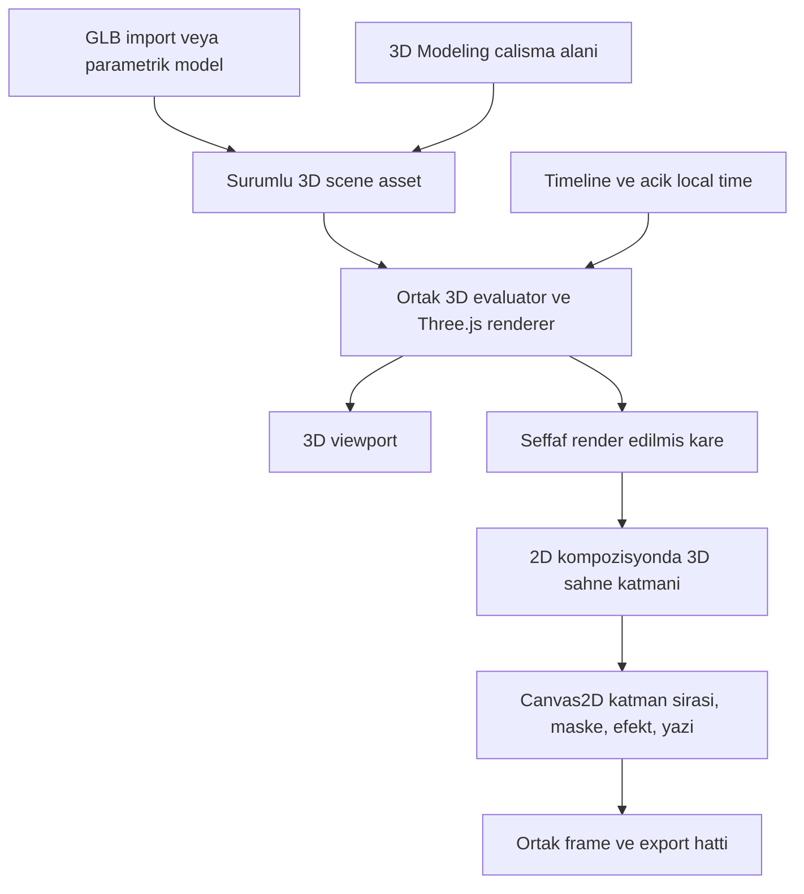

# Chorono — 3D modelleme ve 2D sahneye 3D katman entegrasyonu

Tarih: 5 Kasım 2026. Güncelleme: 6 Kasım 2026, 2D içindeki kutulu 3D nesne düzenleme akışı netleştirildi. Durum: kaynak kod incelemesine dayanan mimari ve geliştirme planı; uygulama başlatılmadı. Aşağıdaki yeni tip, servis ve capability adları öneridir; mevcut MCP veya scripting API'si değildir.

## 1. Karar ve kapsam

**Yerel Three.js tabanlı üretim sistemi eklenebilir. İlk teslim, 2D kompozisyonda kendi kutusunda düzenlenebilen bir 3D sahne katmanıdır. Ayrı `3d-modeling` çalışma alanı ihtiyaç olduğunda aynı çekirdek üzerine eklenebilir.** Model, kamera, ışık ve malzeme verileri iki kullanım arasında paylaşılır; tam modelleme modu 2D içindeki kullanımın önkoşulu değildir.

2D kompozisyona 3D model koymak için tam modelleme editörünün tamamlanması gerekmez. İçe aktarılan bir GLB veya parametrik model, kendi kamerasıyla render edilerek 2D katman yığınına katılır. Ayrı modelleme alanı bu varlığın hazırlanmasını ve düzenlenmesini sağlar. Bu değerlendirme, önceki yalnız 2D geliştirme kararına yeni bir ürün kapsamı önerisidir; bütün 3D işlerinin uygulamaya alındığı anlamına gelmez.

[2D üretim yol haritasındaki](production-2d-roadmap.md) export tutarlılığı → bileşen kütüphanesi → çoklu format önceliği korunur. Bu belge 3D model/render entegrasyonunu planlar. Arşivdeki 3D rigid body, kumaş, sıvı solver'larını yeniden aktif etmez; game engine ve video editor kapsamını genişletmez.

## 2. Kodda doğrulanan başlangıç

| Alan | Bugünkü durum | Entegrasyona etkisi |
| --- | --- | --- |
| `src/lib/core/EditorMode.ts` | `3d-modeling` adı var. | Ayrılmış mod kimliği var; çalışan 3D özellik kanıtı değildir. |
| `ModeDescriptor`, `ModeRegistry`, `modes/bootstrap.ts` | Descriptor renderer/exporter/panel/tool fabrikalarını tarif ediyor; yalnız `Animation2DDescriptor` kayıtlı. | İleride 3D descriptor eklenir; workspace ve uygulama yaşam döngüsü de bağlanmalıdır. |
| `src/app/page.tsx` | `currentMode` sabit `2danimation`; editor state ve birçok panel 2D tiplerine bağlı. | Tek bir mod kaydı eklemek kullanılabilir 3D arayüz oluşturmaz. |
| `types/core.ts` | `LayerType` içinde 3D yok. Transform x/y, scaleX/Y, rotationDeg ve anchorX/Y içeriyor. | Yeni katman türü gerekir; mevcut 2D transform'a z eklenmez. |
| `core/ITimeline.ts`, `types/core.ts` | Genel arayüz mevcut 2D `AnimatableValue` tipine bağlı; Vec3/quaternion track değeri yok. | İlk entegrasyon mevcut scalar/color kontrollerle yapılır; kapsamlı 3D track türleri ayrı genişlemedir. |
| `LayerRegistry`, `LayerRendererRegistry`, `CanvasRenderer` | Factory/property schema ve katman renderer eklentileri var; Canvas2D mask/effect hattı mevcut. | 3D çıktı normal katman koordinatlarında bu hatta katılabilir. |
| `render/gpu/GPUCompositor.ts` | Particle GPU çıktısını Canvas2D'ye aktarıyor; transform/opacity zaten GPU'ya işlendiği için bunları sıfırlıyor. | GPU → Canvas2D yaklaşımı referanstır; particle'a özgü sözleşme 3D katman için doğrudan kullanılamaz. |
| `types/media.ts`, import/asset sistemi | Model/3D scene asset türü yok; embedded/external/projectPackage storage tanımları var. | Model, texture, environment ve decoder bağımlılıkları eklenir; tanımlı storage seçeneklerinin uçtan uca desteği ayrıca doğrulanır. |
| `package.json` | Three.js bağımlılığı yok. | Sürümü sabitlenmiş, istemcide gerektiğinde yüklenen bir entegrasyon gerekir. |
| Runtime export | Mevcut iki serializer farklı alanlar taşıyor. | Yeni 3D veriler [canonical export planına](../../plan/EXPORT_CONSISTENCY_2D_PLAN.md) eklenir; üçüncü serializer açılmaz. |

Bu belge inceleme öncesinde boştu. Genel multi-mode iskeleti başlangıç sağlar; bütün modların bugün aynı uygulama koduyla çalıştığı iddia edilemez.

## 3. İki çalışma alanı, ortak 3D çekirdek

3D çekirdeği model graph'ı, geometri, malzeme, ışık, kamera, animasyon örneklemesi ve GPU kaynaklarının yaşam döngüsünü kapsar. 2D katmanı ve 3D viewport aynı verinin iki tüketicisidir. 3D modelin düzenlenebilir kaynağı raster bake yapıldığında da korunur.

| Paylaşılacak | Kullanıma özgü kalacak |
| --- | --- |
| Asset kimliği, bağımlılık manifest'i ve sürüm/hash | 2D affine transform ve 3D position/quaternion/scale |
| 3D scene verisi, evaluator ve renderer | Canvas2D kompozit adaptörü ve 3D viewport adaptörü |
| Command/undo yaklaşımı, zaman örnekleme yardımcıları | 2D seçim/drag ile 3D raycast/orbit/gizmo araçları |
| Dock kabuğu, property kontrol bileşenleri | Moda özgü schema, seçim ve panel içeriği |
| Job/progress/cancel, tanı ve render profilleri | 2D raster/runtime çıktısı ile GLB varlık ihracı |
| Parametre/state-machine sözleşmelerinin uygun parçaları | 3D clip ve transform blend adaptörleri |

Paylaşım mevcut ihtiyaçlarla sınırlıdır. `PropertySchema` bugün `Layer` tipini kullandığı için yeni 3D nesneyi cast ederek bütün panellere geçirmek uygun değildir. Ortak kontrol bileşenleri küçük adapter'larla kullanılır; kapsamlı mode soyutlaması bağımsız bir yeniden yazım projesine dönüştürülmez. Uygulamadaki yeni sınıflar repo OOP ve script/host event kurallarını izler.

## 4. Veri modeli ve animasyon sınırı

Önerilen yeni 2D katman türü `scene3d` olur. Normal `Layer` alanları; id, parentId, size, mevcut 2D transform, opacity, blend, zaman aralığı, mask ve efektlerdir. Katmana özel payload şu referansları taşır:

- Düzenlenebilir, sürümlü 3D scene asset kimliği ve seçili kamera kimliği.
- Parametre schema'sına bağlı kontrol değerleri; örneğin ürün dönüşü, kapak açılma miktarı, malzeme rengi veya dolum yüksekliği.
- Varsa seçili model clip'i, başlangıç ofseti, hız ve loop politikası.
- Açık viewport oranı/kamera kadrajı ve render profili referansı.

3D asset içinde node'lar sabit kimliklerle tutulur. Node transform'u position xyz, quaternion xyzw ve scale xyz içerir. Koordinat sistemi, uzunluk birimi, içe aktarma ölçeği ve up-axis dönüşümü import sırasında kaydedilir; 2D piksel ile 3D dünya birimi kendiliğinden eşitlenmez. Three.js runtime nesneleri JSON'a yazılmaz.

İlk sürümde 2D timeline, schema ile açılmış sayı/renk/bool kontrollerini animasyonlar. Örneğin `layers.<layerId>.scene3d.controls.<controlId>` biçimi mevcut layer namespace'ine uyar; bu yalnız önerilen hedef biçimidir. Kontrol node özelliğine adapter ile bağlanır. İç node'lar `layers[]` listesine sahte 2D katmanlar olarak eklenmez. Kontrol kimlikleri nokta içermeyen kararlı kimliklerdir; görünür ad değişince track hedefi değişmez.

Global `AnimatableValue` hemen Vec3/quaternion ile genişletilmez. Basit ürün dönüşü scalar açı kontrolüyle tanımlanabilir; genel 3D yönelim blend'i quaternion slerp gerektirir ve dört bağımsız sayı track'iyle eşdeğer sayılmaz. Ayrı 3D modda yeni track türü gerekiyorsa evaluator, curve editor, clone/remap, validator, state blend ve export desteği birlikte geliştirilir.

Bir asset'in birden çok instance'ı geometri ve texture paylaşabilir; kontrol değerleri, local saat ve değiştirilen materyal durumu instance'a aittir. Asset sürümü pin'lenir. Kaynağı düzenlemek bütün instance'ları sessizce değiştirmez; güncelleme ve bağımsızlaştırma politikası [bileşen planıyla](../../plan/COMPONENT_LIBRARY_2D_PLAN.md) uyumlu olur.

## 5. Render ve kompozit sözleşmesi

Three.js önce kendi ışık/kamera sistemiyle 3D içeriği çizer. 2D renderer bu görüntüyü **katman yerel koordinatlarında**, tanımlı width/height sınırına yerleştirir. 2D transform ve opacity mevcut Canvas2D hattında bir kez uygulanır. Three.js sahnesinin kamera/dünya dönüşümü ayrı kalır.

İlk köprü, hazır asset'lerle yapılan WebGL canvas render'ını aynı çizim sırasında Canvas2D `drawImage` ile tüketebilir. Ham `WebGLRenderTarget.texture`, Canvas2D'ye doğrudan çizilebilir bir görüntü değildir; hedef kullanılırsa canvas'a sunma veya uygun aktarım adımı gerekir. Her karede CPU piksel readback varsayılan yol yapılmaz. Çapraz canvas aktarımının maliyeti prototipte ölçülür; sıfır kopya veya ücretsiz aktarım vaadi verilmez.

Mevcut katman render çağrısı senkrondur. Model/texture yükleme ve shader hazırlığı render çağrısından önce async yürür. Editör loading/error gösterebilir; final export bütün bağımlılıklar hazır olmadan kareyi tamamlanmış saymaz. İleride async frame hazırlığı eklenirse revision/time/quality anahtarlı sonuçlar kullanılır; önceki seek'in geciken karesi yeni playhead'e yazılmaz. Aynı WebGL canvas tekrar kullanıldığında her katmanın görüntüsü üzerine yazılmadan tüketilir veya ayrı frame kaynağına alınır.

Doğruluk sınırları:

- 3D katman içinde depth test, gölge ve nesnelerin birbirini örtmesi çalışır. Farklı 2D katmanlar mevcut yığın sırasıyla birleşir; ayrı 3D katmanlar ortak depth buffer veya ışık paylaşmaz. Birbirini örtmesi gereken modeller aynı 3D scene asset'inde tutulur.
- 2D shape veya yazı ilk sürümde 3D modele fiziksel gölge düşürmez. 3D cam, ayrı 2D katmanları kendiliğinden yansıtmaz veya kırmaz. Böyle bir ihtiyaç için açık background texture/3D plane adaptörü ayrıca planlanır.
- Şeffaf arka plan, premultiplied alpha, kenar antialiasing, mask ve group opacity birlikte test edilir. Particle compositor'un identity/alpha=1 davranışı kopyalanmaz.
- Çalışma renk uzayı, texture renk etiketleri, tone mapping ve sRGB çıktı profili sabitlenir. Tone mapping yalnız 3D görüntüye uygulanır; üstteki 2D marka renkleri yeniden dönüştürülmez.
- 2D selection bounds katmanın viewport dikdörtgenidir. İç model seçimi yalnız 3D düzenleme odağında raycast ile yapılır. Görünür model sınırına otomatik crop ilk sürümün zorunluluğu değildir.
- Preview çözünürlük/gölge kalitesi düşürülebilir; bu tercih kaynağın final render ayarlarını değiştirmez. Final parity aynı render profiliyle karşılaştırılır.

Renderer editör oturumunda yönetilen sınırlı bir context/pool kullanır; her model için yeni WebGL context açılmaz. Mevcut particle context'iyle doğrudan GPU nesnesi paylaşımı varsayılmaz. Geometri/texture/material yaşam süresi reference ve devam eden job'larla yönetilir. Silme, undo/redo, workspace geçişi, export iptali ve context loss sonrası yeniden hazırlama ele alınır.

Güncel `WebGLRenderer` WebGL2 gerektirir. Desteksiz cihazda 2D düzenleme açık kalır; 3D katmanın var olan bake/poster'ı gösterilebilir. Güncel bake yoksa final export eksik modeli başarıyla üretilmiş saymaz. WebGPU ilk teslimin önkoşulu değildir. [WebGLRenderer](https://threejs.org/docs/pages/WebGLRenderer.html)

## 6. 2D arayüzünü koruma

**Arayüz korunabilir; bunun kanıtı sınırlandırılmış değişiklikler ve gerçek regresyon kontrolleridir.** Mevcut mode iskeleti tek başına bu güvenceyi vermez.

2D kullanıcı akışı:

1. Kullanıcı mevcut Add Layer/import akışından 3D sahne ekler veya GLB içe aktarır.
2. Katman 2D canvas'ta mevcut taşıma, ölçek, anchor, opacity ve timeline araçlarıyla kullanılır.
3. Inspector yalnız bu katman seçiliyken model, kamera, ışık ve malzeme kontrolleri sunar.
4. “3D sahneyi düzenle” ayrı dock/viewport odağı açar; orbit/gizmo etkileşimi burada çalışır.
5. Düzenleme bittiğinde 2D seçim, playhead ve panel yerleşimi korunur. İçerik değişiklikleri mevcut command/undo hattından geçer. Model yönü ve çıktı kamerası ayarları kaydedilir; varsa yalnız inceleme için kullanılan çalışma görünümü çıktı kamerasını değiştirmez.

3D kısayolları yalnız ilgili viewport odaktayken aktiftir. Text input, 2D drag, wheel zoom, pan, clipboard ve timeline kısayolları global yeni handler'larla ele geçirilmez. Kontrol adları kullanıcı işini anlatır: Kamera, Işık, Malzeme, Model. Teknik decoder/cache ayrıntıları normal ürün akışına taşınmaz; hata veya export kararında gerektiğinde gösterilir.

Three.js ve loader'lar 3D kullanıldığında lazy load edilir. Next.js server render aşamasında GPU/DOM nesnesi yaratılmaz. Yalnız 2D içeren projede 3D renderer/context kurulmaz. Eski 2D projeyi açmak, kaydetmek ve export etmek mevcut davranışını korumalıdır.

Ayrı `3d-modeling` moduna ihtiyaç doğduğunda gerçek descriptor, scene state, viewport, seçim modeli ve moda ait dock yerleşimi bağlanır. Mod değişimi 2D scene'i 3D tipine cast etmez. Her belgenin mode/schema kimliği, geçmişi ve asset sahipliği belirgindir; 2D projeden açılan 3D asset düzenlemesi çağıran projeye referans üzerinden döner.

### 6.1. Önerilen kullanım: 2D içinde kutulu 3D nesne

6 Kasım 2026 tarihli kullanıcı sorusuna göre önerilen ana akış, mevcut 2D editöründeki **3D Nesne** katmanıdır. Ayrı modelleme alanı modelin geometri ve yapısını hazırlamak içindir; hazır modeli yerleştirmek, açı vermek ve animasyonlamak 2D editöründeki küçük düzenleme alanından yapılır. Ortak olan model varlığı ve render çekirdeğidir. İki çalışma alanının bütün araçlarını tek canvas'a toplamak gerekmez. `scene3d` teknik tür adı olarak kalabilir; kullanıcıya basit tek-model kullanımında “3D Nesne” gösterilir.

Kutu katmanın şeffaf render alanıdır; çerçeve ve tutamaçlar editör araçlarıdır, çıktıda görünmez. Katman seçildiğinde mevcut 2D taşıma/ölçekleme tutamaçları görünür. Inspector'da açılan tek bir 3D önizleme alanı seçili katmanı gösterir; her model için kalıcı ayrı pencere açılmaz. Büyük inceleme için aynı alan genişletilebilir. Kullanıcı modelin kendi ekseninde dönüşü ile kameranın bakışını ayrı kontrollerden ayarlar.

| İşlem | Etkilediği alan | Kaydedilen sonuç |
| --- | --- | --- |
| 2D canvas'ta taşı, ölçekle veya düzlemde döndür | Katmanın kompozisyondaki kutusu | Mevcut 2D transform; modelin iç açısı korunur. |
| “Modeli çevir” ile sürükle veya X/Y/Z açılarını gir | Kutunun içindeki model | Instance'a ait model yönü; kamera ve kutunun sahnedeki yeri korunur. |
| “Kamera” ile bakışı veya kadrajı değiştir | Kutunun 3D kamerası | Aktif render kamerası/kadrajı; modelin kendi yönü korunur. |
| “Çalışma görünümü” ile yalnız incele | Düzenleme viewport'u | Export kamerası değişmez; aktif render kamerasına dönme eylemi belirgindir. |
| Keyframe ekle | Seçilen model/kamera kontrolü | 2D kompozisyonun açıkça seçili timeline'ındaki animasyon. |

İlk kullanıcı akışı: **3D Nesne ekle → model seç/içe aktar → kutu içinde açısını ve ışığını ayarla → 2D sahnede yerleştir → gerekiyorsa animasyonla → birleşik 2D çıktı al.** Ekleme tek bir katman oluşturur; sonraki açı değişiklikleri aynı instance'ı canlı günceller. Inspector'da her ayar için tekrar “Sahneye ekle” işlemi yapılmaz. Modelin sabit açısını seçmek, kendiliğinden devamlı dönme animasyonu başlatmaz. Animasyon keyframe veya açık bir dönüş preset'iyle oluşturulur.

Model dönüşü, kamera düzenleme ve çalışma görünümü birbirinden açıkça ayrılır. İlk sürümde ana sürükleme eylemi “Modeli çevir” olur; kamera ayarı ayrı seçilir. İnceleme kamerası daha sonra eklenirse render kamerasıyla karışmayacak görünür bir durum göstergesi bulunur. Numeric alanlar ve sıfırla/nesneyi kadraja sığdır eylemleri sürüklemeye alternatif sağlar. Düzenleme alanının klavye odağı görünürdür; odak dışına çıkınca 2D kısayolları normal çalışır. Gizmo sürüklemesi tek undo işlemi olarak gruplanır.

Kutu sabit bir yerel width/height alanıdır. Ekrandaki 2D ölçekleme model geometrisini yeniden üretmez; aynı görüntü alanını ölçekler. Kutunun oranını değiştirmek ayrı bir kadraj kararıdır ve fit/crop politikasıyla ele alınır. Kullanıcı “Nesneyi kadraja sığdır” ile ilk görünümü seçebilir; model her döndüğünde otomatik yeniden kadraj yapılmaz. Böylece animasyonda istemsiz yakınlaşma ve uzaklaşma oluşmaz. Render alanının dışına taşan içerik kırpılır; genişletme/padding ayarı açıkça sunulur.

Son çıktı genişlik/yükseklikten oluşan birleşik 2D kare veya videodur. Canlı 3D katman kullanılırken her örnek zamanda önce 3D görüntü, sonra 2D kompozit hesaplanır. İstenirse sabit poz alpha'lı görüntüye, hareket alpha'lı kare dizisine bake edilerek sonraki oynatmanın 3D motoruna ihtiyacı azaltılır. Bake zorunlu değildir; model kaynağı düzenlenebilir kalır. Yalnız önceden hazırlanmış sabit görüntü kullanımı için mevcut image katmanı yeterlidir; kutu içinde canlı açı/kamera değiştirme yeni 3D katmanının sağladığı değerdir.

Birbirini örtmesi, aynı ışığı kullanması veya birlikte gölge oluşturması gereken modeller tek kutunun içindeki aynı 3D alt sahneye eklenir. Örneğin sürahi, kavanoz ve wax tek 3D katmanda; başlık ve açıklamalar normal 2D katmanlarda tutulur. Kullanıcı gerektikçe basit “3D Nesne” katmanının içini çok nesneli sahne olarak düzenleyebilir.

Bu akış için ek kabul kontrolleri: kutuyu taşımak iç model yönünü değiştirmez; modeli çevirmek 2D konumu değiştirmez; sabit açı animasyon başlatmaz; çalışma görünümü final kamerayı değiştirmez; çerçeve ve gizmo export'a çıkmaz; dönüş sırasında istemsiz auto-fit oluşmaz; sabit poz ve animasyon bake'i kaynakla aynı kadrajı korur.

## 7. Modelleme, malzeme ve görüntü kalitesi

İlk model kapsamı: box, sphere, cylinder, plane; GLB import; profil döndürme (lathe) ve kapalı şekil uzatma (extrude). Three.js bu son iki geometri için hazır yapı taşları sağlar. Chorono tarafında profil editörü, parametrik kaynak kaydı, seçim, undo, UV ve geometri yeniden üretme yaşam döngüsü geliştirilmelidir. Three.js tek başına tam bir modelleme editörü değildir. [LatheGeometry](https://threejs.org/docs/pages/LatheGeometry.html), [ExtrudeGeometry](https://threejs.org/docs/pages/ExtrudeGeometry.html)

MVP malzemeler: renk/texture, roughness, metalness, opacity ve kontrollü normal map; mat, plastik ve metal preset'leri. Işık/kamera: perspective/orthographic, bir studio preset'i, environment ve sınırlandırılmış dinamik gölge. Otomatik lightmap bake motoru ayrı iştir; başlangıçta hazır environment veya dışarıda hazırlanmış lightmap kullanılabilir.

Cam/transmission, temas gölgesi, arka arkaya saydam yüzeyler ve cam içindeki wax ayrı kalite kabul sahneleridir. Fiziksel malzemenin piksel maliyeti ve saydam sıralama sınırlamaları nedeniyle kalite varsayılmaz. Odak bulanıklığı, gelişmiş ekran efektleri, otomatik LOD ve kapsamlı material library sonraki dilimlerdir. [MeshPhysicalMaterial](https://threejs.org/docs/pages/MeshPhysicalMaterial.html), [WebGLRenderer](https://threejs.org/docs/pages/WebGLRenderer.html)

İlk wax dökümü; kaynak ve hedef arasında parametrik akış geometrisi, sürahi eğimi ve yükselen dolum yüzeyidir. Bu hareket animasyon kontrolüdür; sıvı solver'ı olarak sunulmaz. Yerçekimine göre serbest sıvı, çarpışma, sıçrama, yüzey gerilimi ve çift yönlü etkileşim yeni 3D simülasyon kapsamı gerektirir. Önceden planlanan 2D sıvı solver'ı otomatik olarak buna dönüşmez.

Stilize ürün filmi ve açıklayıcı sahneler uygun başlangıç hedefidir. Model kenarları, malzeme, ışık, kadraj ve hareket birlikte doğrulanır. Scanline/EEVEE örnekleri görsel hedefi anlatabilir; aynı kaliteyi veya özellik setini Three.js'e kendiliğinden taşıdığı iddia edilmez.

## 8. Zaman, state machine ve bake

3D renderer bağımsız geçen süreye göre animasyon ilerletmez. Chorono'nun verdiği zaman, timeline kapsamı, parametre snapshot'ı ve varsa olay replay'i kullanılır. GLB clip'leri mutlak local zamanda örneklenir; seek, reverse ve kareleri sıra dışı render etme aynı pozu vermelidir. Instance offset/hız/loop ve state-local saat politikası açıkça kaydedilir.

State machine ilk sürümde katmana açılmış kontrolleri ve tanımlı clip seçimini yönetebilir. Genel 3D skeleton retargeting, IK, root motion veya iki skeleton clip'inin blend'i ayrı iştir. [Character Motion planı](character-motion-plan.md) uygulanmış 3D rigging sistemi sayılmaz.

İki bake türü ayrılır:

- **Kontrol/animasyon bake:** desteklenen prosedürel scalar kontrolleri veya model hareketini örneklenmiş track/clip'e dönüştürür. Kaynak, tolerans ve zaman bilgisi korunur.
- **Görüntü bake:** 3D katmanı alpha'lı raster/frame sequence varlığına dönüştürür. 2D kullanım Three.js gerektirmeden oynatılabilir; 3D kamera ve malzeme düzenlemesi için kaynak asset ayrıca tutulur.

Görüntü bake manifest'i kaynak revision/hash, asset sürümü, kamera, parametreler, timeline/olay kapsamı, zaman aralığı, FPS, çözünürlük ve render profili içerir. Kaynak veya kadraj değişince stale olur. Replace/re-bake tek undo işlemiyle, kullanıcı düzenlemelerini sessizce silmeden yürür. İşler immutable snapshot üzerinden progress/cancel/failed/completed ile çalışır; simülasyon hesapladığı iddia edilmez.

## 9. Asset, export, bileşen ve çoklu format

İlk model import biçimi glTF 2.0/GLB'dir. GLB dosyasının tamamen kendi kendine yeterli olduğu varsayılmaz; harici texture/buffer ve gerekli uzantılar manifest'e toplanır. Desteklenmeyen uzantılar açıklanır. Draco/KTX2/Meshopt ancak decoder paketlenip capability doğrulanınca açılır; decoder'lar çalışma sırasında beklenmedik CDN bağımlılığı yaratmaz. [GLTFLoader](https://threejs.org/docs/pages/GLTFLoader.html)

Modelin stable asset kimliği, binary kaynağı, texture/environment bağımlılıkları ve içerik hash'i kaydedilir. Blob URL ve Three.js decoded nesneleri kalıcı proje verisi değildir. Import transaction, dependency validation ve portable round-trip mevcut asset sistemini genişletir. Büyük modeller için byte/triangle/texture ve GPU boyut ön kontrolü gerekir; mevcut MCP JSON sınırları sınırsız binary taşıma kanalı sayılmaz.

| Hedef | Beklenen davranış |
| --- | --- |
| Portable authoring proje | Düzenlenebilir 3D kaynak, parametreler, bağımlılıklar ve varsa bake korunur. |
| PNG/WebP ve kare dizisi | 2D ile aynı frame hattı üzerinden 3D görüntü dahil render edilir. |
| MP4/GIF/WebM | İlgili encoder uygulanmışsa birleşik raster kareler kullanılır; model katmanı eklemek encoder geliştirmesini tamamlamaz. |
| Interactive HTML/SDK | 3D capability, sabit engine/decoder sürümü ve asset paketi gerekir; alternatif bake profili açık seçilir. |
| SVG/Lottie | Genel 3D sahnenin yerel vektör karşılığı varsayılmaz. Hedefin gerçekten desteklediği image/sequence fallback veya açık unsupported tanısı gerekir. |
| GLB model export | 3D alt sahnenin desteklenen geometrisi/malzemesi/clip'leri taşınır. Chorono 2D yazı, ses, state machine veya bütün filmi GLB'ye kayıpsız taşıma sözü verilmez. |

Model katmanı exporter tarafından sessizce atılmaz. Eski player'ın okuyamayacağı capability sürümle bildirilir. Frame output ve portable project farklı teslimlerdir; bake seçimi düzenlenebilir kaynağı kaybettirmez.

Bileşen; model asset'ini sürümüyle referanslar, renk/dönüş/clip gibi açık kontrolleri instance'a taşır. Çoklu formatta 3D katman layout kutusuna yerleştirilir. İlk politika kamerayı koruyup fit/letterbox uygular; yeni oranda otomatik yeniden kadraj ayrı açık seçenek olur. Crop veya yeni kamera bake'i geçersiz kılabilir. Aynı modelden üç oran üretimi kaynak scene'i değiştirmeyen varyant profilleriyle yapılır.

## 10. Uygulama sırası ve kabul kapıları

| Aşama | Teslim | Geçiş kanıtı |
| --- | --- | --- |
| D0 — sözleşme ve teknik deneme | Minimal primitive + transparent WebGL canvas → mevcut Canvas2D; capability/renk/alpha ve maliyet ölçümü | 2D text altında/üstünde doğru çizim; mask/group/opacity/zoom; desteklenmeyen GPU davranışı; gerçek kare karşılaştırması. |
| D1 — 2D'de kullanılabilir 3D katman | Katman definition/schema, statik GLB/primitive, kamera/ışık/malzeme, portable asset | Ekle/düzenle/sil/undo/save/reopen; hazır asset bekleyen raster export; eski 2D projelerde regresyon yok. |
| D2 — zaman ve bake | Scalar controls, bir GLB clip'i, instance local saat, alpha sequence bake | Seek/reverse/sıra dışı kare aynı poz; aynı profil editor/export parity; stale/cancel/re-bake ve kaynak korunumu. |
| D3 — ürün sahnesi | Lathe/extrude, studio preset, kontrollü wax dökümü ve cam kalite denemesi | 10 saniyelik mum sahnesi gerçek kareleri ve 1080p render ölçümleriyle değerlendirilir. |
| D4 — ihtiyaç halinde ayrı 3D Modeling modu | Aynı asset/render çekirdeğiyle gerçek descriptor/workspace, 3D seçim/gizmo, bağımsız scene ve dar kapsamlı GLB export | Mod değişimi 2D geçmiş/yerleşim/sahneyi korur; round-trip ve hedef capability kayıpları açık. |

D0 iç denemesi mevcut export E0–E2 işlerinden bağımsız küçük bir teknik inceleme olabilir. D1'in teslimi canonical export'un asset/capability ve frame sözleşmesine dayanır; 2D üretim önceliklerinin yerini kendiliğinden almaz. D2 genel 3D state blending veya fizik teslimi sayılmaz. D4 başlamadan ilk model katmanı kullanılabilir hale gelebilir.

İlk referans sahne: 10 saniye, 1920×1080, 30 FPS, tek 3D katmanda kavanoz/sürahi/wax ve kamera; ayrıca iki 2D yazı katmanı ile ses. İlk kontrol opak malzemeyle, sonraki kontrol camla yapılır. Örnek kareler: 0, 2.5, 5, 7.5 ve son geçerli kare. 300 karelik uç aralığı `[0, 10000 ms)` olur; 10 saniye son karesi ikinci kez yazılmaz. Bugünkü MCP sequence sınırı 300 kare/4 MP'dir; bu örnek sınıra uyar, daha yüksek FPS/süreyi desteklediği iddia edilmez.

Ölçüm raporu cihaz/GPU/tarayıcı ve render profilini kaydeder: soğuk asset/shader hazırlık süresi, sıcak frame p50/p95, 2D kompozit aktarım süresi, draw call/triangle sayısı, texture/render target bütçesi, 300 kare toplam export süresi ve dosya boyutu. Genel GPU bellek sayacının her cihazda kesin byte verdiği varsayılmaz. Geçiş hedefi görsel kabul ve cihaz bazlı ölçümle belirlenir; ölçüm öncesi sabit FPS veya EEVEE düzeyinde kalite vaat edilmez.

Gerçek regresyon kapsamı: 3D içermeyen projelerde selection/drag/pan/zoom/anchor; parent/mask/effects; text/spline/particle; timeline/curve/state/wire; save/reopen ve mevcut desteklenen export. 3D fixture'larında alpha kenarı/renk, asset eksikliği, context loss, undo sırasında kaynak yaşamı ve iki bağımsız instance eklenir. Salt property evaluation görsel doğrulama yerine geçmez.

Uygulama aşamasında `npm test`, `npm run mcp:build`, `npm run build` çalıştırılır; Next build öncesi dev/production sunucusu durdurulur. UI ve görsel sonuç tarayıcıdan doğrulanır. Bu belge turunda uygulama kodu değişmediği için build/test veya çalışan 3D sahne teslimi yapılmadı.

## 11. MCP ve scripting entegrasyonu

Uygulama geldiğinde layer/model/asset/controls, kamera/ışık/malzeme ve bake işlemleri native command'lar üzerinden UI, AI ve izole QuickJS scripting'e açılır. Mevcut tool adları veya `scene.add` destekleri varmış gibi örnek çalıştırılmaz; capabilities/catalog/schema gerçek API ile güncellenir.

Model import ve raster bake gibi ağır işler async host job'larıdır. Sync script süresine model decode veya frame render döngüsü sığdırılmaz. Mutasyonlarda revision/requestId, script dry-run planId commit, portable save ve gerçek render preview kuralları korunur. `skills/chorono/` ve MCP dokümanları API ile birlikte güncellenir.

## 12. Kaynaklar ve sınırlar

Three.js MIT lisanslıdır; bağımlılığın lisans bildirimi dağıtımda korunur. Renderer, loader ve kullanılan decoder sürümleri sabitlenir. Yerel render kare başına bir video üretim API'si gerektirmez; hesaplama süresi ve GPU kapasitesi cihaz tarafından karşılanır. [Three.js lisansı](https://github.com/mrdoob/three.js/blob/dev/LICENSE)

Renk ve kaynak yaşam döngüsü için: [Color Management](https://threejs.org/manual/pages/color-management.html), [How to dispose of objects](https://threejs.org/manual/pages/how-to-dispose-of-objects.html). Aynı geometri ve materyalle çok sayıda tekrar gerçekten gerektiğinde instancing değerlendirilir; her nesneyi otomatik hızlandırdığı varsayılmaz. [InstancedMesh](https://threejs.org/docs/pages/InstancedMesh.html)

Bu plan renderer ve ürün sınırlarını tanımlar. Hazır Three.js sınıflarının bulunması; modelleme UI'si, asset taşınabilirliği, timeline/export tutarlılığı veya 2D regresyonlarının tamamlandığı anlamına gelmez. Somut ilk teknik iş D0; ilk kullanıcı teslimi D1'dir.
