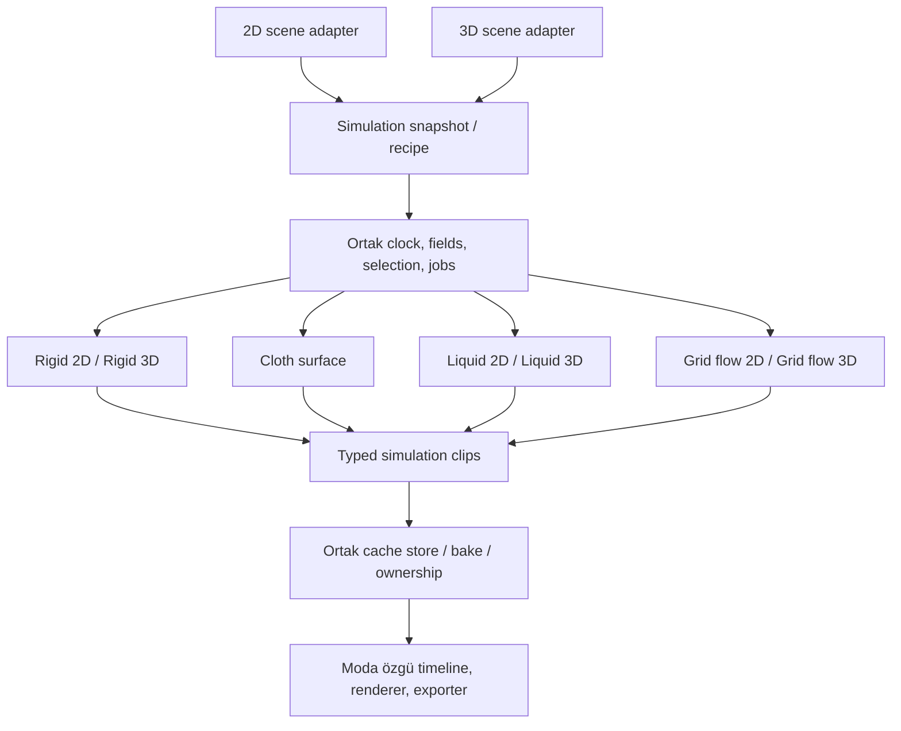

> Archived design reference. This document does not describe shipped 3D capabilities; the active scope is the versioned 2D/2.5D roadmap.

# Arşiv — aktif geliştirme planı değildir

4 Kasım 2026 tarihli son kullanıcı kararı: geliştirmeler yalnızca 2D modunda yapılacak. Aşağıdaki eski 2D/3D değerlendirmesi sadece referanstır; 3D görevleri, kabul ölçütleri ve sınıf önerileri uygulanmayacak. Aktif plan: [Simulation Core 2D](../simulation-core-2d-architecture.md).

# Simulation Core — 2D / 3D ortak mimari

Tarih: 4 Kasım 2026. Durum: uygulama öncesi mimari karar. Rigid Body, Fracture, Cloth ve Fluids planlarının ortak sözleşmesidir. Mevcut özelliklerin uygulanmış olduğu anlamına gelmez.

## 1. Ana karar

**2D ve 3D simülasyonlar ortak servis ve sınıfları kullanacak; sahne adaptasyonu, boyuta özgü geometri/nümerik işlemler ve çizim ayrılacak.** Amaç her şeyi tek solver sınıfına toplamak değil, iş yürütme ve bake sistemini bir kez kurmaktır.

Kardeş planlar: [Rigid Body & Fracture](../physics-fracture-bake-plan.md), [Cloth / Fabric](../cloth-fabric-simulation-bake-plan.md), [Liquid & Fluids](../fluid-liquid-simulation-bake-plan.md). Character Motion planı ayrı kalır.

## 2. Repoda doğrulanan sınırlar

`EditorMode` içinde `2danimation`, `video-editor`, `game-engine`, `3d-modeling` adları var. `ModeDescriptor`, `ModeRegistry`, `IScene`, `ISceneObject`, `IRenderer`, `ITimeline` gelecekteki modlar için temel sunuyor. Ancak `modes/bootstrap.ts` bugün yalnız `Animation2DDescriptor` kaydediyor; çalışan bir 3D scene/animation descriptor'ı yok.

Core scene ve transform verileri 2D; genel timeline arayüzü de mevcut 2D `AnimatableValue` tipine referans veriyor. Bu nedenle var olan arayüzleri tam 3D runtime olarak değerlendiremeyiz. `docs/tr/multi-mode-architecture.md` mevcut checkout'ta boş; ayrıntılı 3D uygulama kanıtı sayılmaz.

3D animasyon hedefi uygulamada bir mode/workspace descriptor, scene graph, kamera, renderer, property/track ve exporter gerektirir. Modelleme ile animasyon çalışma alanının ayrı mı aynı descriptor altında mı olacağı kendi ürün kararıdır; simülasyon çekirdeği bu karara bağlanmaz.

## 3. Ortak kullanılacak sınıflar

Aşağıdaki isimler önerilen yeni sınıf/sözleşmelerdir; mevcut MCP çağrıları değildir.

| Ortak yapı | Sorumluluk |
| --- | --- |
| `SimulationRecipe` / compiler | Kaynak nesneler, boyut, malzeme, alanlar, collider'lar, zaman aralığı ve sürümlerden immutable iş girdisi üretir. |
| `SimulationClock` | Integer tick, sabit adım, alt-adım ve kayıt zamanlarını yönetir; ekran FPS'ine bağlı değildir. |
| `SimulationJob` / job manager | Queue, worker, progress, cancel, failed, stale ve completed durumlarını yönetir. |
| `AffectedObjectResolver` | Alan hedefleri, collider listeleri, ignore çiftleri ve koleksiyonları somut id'lere çözer. |
| `FieldSystem` | Gravity, rüzgâr, vortex ve diğer desteklenen alanları simülasyon zamanında örnekler. |
| Collider source/query sözleşmesi | Kaynak geometri, transform, yüzey hızı ve malzemeyi sunar; 2D/3D query uygulaması farklıdır. |
| `SimulationCacheStore` | Türlü clip manifest'i, binary chunk, hash, sürüm, byte bütçesi ve yükleme yaşam döngüsünü yönetir. |
| `BakeService` / bake record | Sonucu uygun moda derler; generated ownership, tek undo, yeniden bake ve kullanıcı değişikliği denetimini yürütür. |
| Capability ve diagnostics | Solver, renderer, cache decoder ve exporter desteğini doğrular; desteklenmeyen sonucu sessizce düşürmez. |

Job/saat/cache sınıfları React, Canvas, Three.js, Matter.js veya `ChronoScene` import etmez. Scene adapter'ı mevcut sahneyi boyutu ve birimleri açık bir snapshot'a çevirir. Veri kayıtları plain serializable yapılar olabilir; her kayda class yazılmaz. Genişletilen servislerde dar abstract base/interface ve composition kullanılır; katı cisim, kumaş ve gaz tek body modeline zorlanmaz.

## 4. Boyut, uzay ve birimler

Recipe hem **simulation dimension** hem gerekli olduğunda **manifold/embedding dimension** taşır. Düzlemsel sıvı 2D; hacimsel sıvı 3D; kumaş 2 boyutlu topolojinin 3D uzayda hareketidir. Cloth planındaki 2,5D görünümde bile yüzey solver'ı x/y/z hesaplar.

Ortak fizik verisi metre, saniye ve kilogram gibi açık birimlerle normalize edilir. 2D kullanıcı arayüzü px/s ve px/s² gösterebilir; `pixelsPerMeter` snapshot içinde saklanır. Matter adapter'ının kendi zaman/hız birimleri ayrıca çevrilir. 3D scene unit ölçeği de recipe'ye girer; aynı sayısal uzunluk iki modda kendiliğinden aynı fizik anlamına gelmez.

2D ekranın aşağı yönlü Y ekseniyle 3D sahnenin koordinat/handedness tercihi adapter sınırında eşlenir. Poz, normal, açısal hız, mesh winding ve gravity aynı dönüşüm sözleşmesini izler. Z=0 eklemek bütün bu dönüşümlerin yerine geçmez.

2D sıvıda referans yoğunluğu alan başına kütle veya açık slab thickness sözleşmesiyle tanımlanır. 3D hacim yoğunluğu ve kernel normalizasyonu farklıdır. Kumaş yüzey yoğunluğu ayrı kalır. Boyut değişince ölçeksiz sanatçı preset'leri taşınabilir; fizik parametreleri birim ve boyut kontrolünden geçer.

## 5. Solver paylaşımı ve ayrı uygulamalar

| Sistem | Paylaşılabilecek hesap/kod | 3D için gereken ayrı iş |
| --- | --- | --- |
| Rigid Body | Recipe, malzeme UI'si, job, clock, fields, bake yönetimi | Matter.js 2D yerine 3D backend; hacim collider'ları, kütle/atalet tensörü ve quaternion pozları |
| Cloth | x/y/z particle buffer'ları, constraint çözümü, mesh topolojisi, pin ve deformasyon cache'i | 3D scene adapter, hacim collider'ları, perspektif çizim ve hedef nesne bağlantıları |
| Liquid / PBF | Particle yaşam döngüsü, komşuluk arama iskeleti, density-solve akışı, alanlar ve clip yönetimi | 3D kernel/gradient, komşuluk/geometri, hacim sınırları ve yüzey çıkarımı |
| Smoke / grid flow | Grid alan tanımı, advection/projection iş akışı, emitter ve job yönetimi | 3 eksenli grid/stencil, 3D basınç sınırları, volume cache ve volume renderer |
| Voronoi Fracture | Seed, ayarlar, kaynak/bake ownership, job ve malzeme protokolü | Polygon yerine polyhedron hücreleri, kapalı iç yüzler ve hacim/atalet hesabı |

Particle spatial hash veya numeric buffer gibi yardımcılar, gerçek ihtiyaç doğrulandığında ortaklaştırılır. Sıcak döngülerde her eleman için `dimension` kontrolü yapan ağır bir genel katman zorunlu değildir; aynı sözleşmenin 2D/3D kernel uygulamaları olabilir.

## 6. Kuvvet alanı ve collision semantiği

Alan tanımı ortak: kind, transform/uzay, kapsam hacmi, yön, şiddet/zaman eğrisi, falloff, seed ve affected-object listesi. Fakat alanın solver'a uygulanması semantik olarak ayrılır: gravity ivmedir; hedef rüzgâr hızı drag modeliyle etkiler; kumaş yüzey basıncı ile gaz grid kuvveti aynı formül değildir.

Collider sözleşmesi geometri yanında boyut, kapalı/açık yüzey, signed distance/normal veya desteklenen temas query'si, boundary velocity ve malzeme sunar. Bir 2D circle, 3D sphere, cylinder veya düz kart olarak açıkça yorumlanmalıdır. Render layer sırası fiziksel derinlik sayılmaz.

Field targets, collision targets, pin targets ve emitter sources ayrı ilişkilerdir. Collection üyeliği snapshot'ta çözülür. Boyut veya solver capability'si uyuşmayan nesne hedef listesinde hata/tanı verir; referansın varlığı etkileşimin desteklendiği anlamına gelmez.

İlk karma sahneler one-way çalışır: örneklenmiş rigid/collider trajectory'si cloth/fluid'e girdi olur. İki yönlü etkileşim ortak alt-adım, temas/kuvvet alışverişi ve kararlılık gerektirir. Aynı job manager'da iki solver bulunması iki yönlü coupling'i otomatik sağlamaz.

## 7. Cache ve bake türleri

Ortak clip header'ı: schema/solver sürümü, source/recipe hash'i, boyut, birimler/koordinat uzayı, sample times, interpolation politikası, channel manifest'i ve chunk hash/byte bilgileri. Payload türü açıkça ayrılır:

- `rigidPose`: 2D poz/açı veya 3D poz/quaternion; interpolasyon bu türe göre yapılır.
- `meshDeformation`: sabit topoloji ve UV, vertex poz örnekleri; kumaş için uygundur.
- `particleFluid`: stable particle id, yaşam aralığı, poz ve gerekli ek kanallar.
- `gridField`: çözünürlük, hücre/face yerleşimi, domain transform'u ve scalar/vector alanlar.
- `surfaceSequence`: örnek başına değişebilen contour/mesh topolojisi.
- `rasterSequence`: belli kamera/görünümle çizilmiş kareler; fizik state'i değildir.

Cache storage, hash, sıkıştırma ve yükleme protokolü paylaşılır; payload decoder ve interpolator ayrı tutulur. Gaz yoğunluk grid'ini kumaş vertex buffer'ı gibi, değişen sıvı yüzeyini sabit topolojili mesh gibi oynatmak desteklenmez.

2D rigid bake normal keyframe'lere derlenebilir. Kumaş/fluid/gaz çoğunlukla binary clip ve timeline playback kontrolü gerektirir. 3D rigid bake kendi transform/quaternion track'lerine veya pose clip'ine derlenir. BakeService output-kind ve mode adapter'ını seçer; kendi keyframe motorunu yazmaz.

3D sıvı yüzeyinde vertex sayısı değişebilir. Kumaşın sabit-topoloji decoder'ı buna otomatik uygun değildir. 2D baked fluid'i 3D plane üzerinde göstermek mümkündür; bu hacimsel 3D sıvı simülasyonu sayılmaz. Gerçek 3D sonuç, 3D recipe ve solver ile yeniden hesaplanır.

## 8. Bütçeler ve runtime

Aynı eksen çözünürlüğünde 128×128 grid 16.384 hücre, 128³ grid 2.097.152 hücre içerir: 128 kat fark. Float32 tek scalar alan 2D'de 64 KiB, 3D'de 8 MiB'dir; tek kare için. 91 örnekte yalnız 3D scalar alan 728 MiB olur. Hız/basınç/temperature ve çalışma buffer'ları buna eklenir.

Bu nedenle 3D işi 2D varsayılan bütçeleriyle açılmaz. Domain, aktif hücre/particle, komşu sayısı, substep, sample sayısı, transfer ve saklama boyutu preflight'ta hesaplanır. Cache chunk/sparse formatı sonraki gereksinimlere göre eklenir; sınırsız RAM veya GPU varsayılmaz.

CPU worker ilk doğruluk referansıdır. GPU/WebGPU compute daha sonra ayrı backend/capability olarak değerlendirilebilir. Preview için düşük çözünürlük ve final bake için yüksek çözünürlük farklı recipe/hash oluşturur; final çıktı preview'ın aynısı diye sunulmaz.

Solver çalıştırmadan playback, ilgili cache decoder ve renderer desteği gerektirir. Unsupported runtime için raster fallback veya açık tanı verilir. Tüm asset'ler portable projede/pakette referans ve hash'leriyle korunur; decoder değişiminde sürüm denetimi yapılır.

## 9. Uygulama sırası ve kabul

1. Ortak recipe, snapshot adapter, clock, job ve cache header'ını ilk 2D rigid bake içinde uygula; varsayımsal bütün solver'ları önce yazma.
2. Cloth ve Liquid 2D ile ikinci/üçüncü payload türlerini ekle; ortak helper sınırlarını somut kullanımda doğrula.
3. Grid Flow 2D ve alan/collider kaynaklarını ekle; cache bütçesini ölç.
4. 3D scene/animation adapter, renderer, timeline ve capability katmanını kur. İlk 3D dilim cloth cache'ini bir perspektif sahnede oynatsın.
5. Cloth 3D collider ve Liquid 3D solver dilimini ekle; primitive bir kapta küçük ölçekli hacimsel sıvıyı hesapla/bake et.
6. 3D rigid/fracture ve smoke/volume, measured budget ve kendi kabul sahneleriyle ilerlesin. İki yönlü coupling ayrı doğrulansın.

Ortak servis testleri iki mode fixture'ıyla çalışır; fizik doğruluk testleri boyuta özeldir. Çekirdek import sınırı, birim/eksen dönüşümü, fixed-step, cancel/stale, event yaşam döngüsü, cache round-trip, atomik bake/re-bake ve renderer parity doğrulanır. Her yeni servis anlamlı olaylarını mevcut script/host yapısına açar.

Bu belge plan dosyasıdır. Uygulama başladığında canonical skill ve MCP şemaları birlikte güncellenir; gerekli `npm test`, `npm run mcp:build`, `npm run build` kontrolleri yapılır. Build öncesinde Next sunucusu durdurulur. Dosya yerel `plan/` konvansiyonunu izler.
