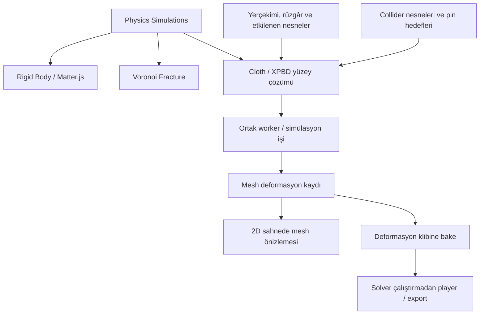

# Cloth / Fabric — kumaş simülasyonu ve deformasyon bake

Tarih: 4 Kasım 2026. Durum: mimari ve geliştirme planı; uygulama yapılmadı. Kullanıcının seçtiği görünüm: **2D sahnede derinlikli dalgalanma; bayrak ve perde gibi**.

Ortak servis, sınıf ve birim sözleşmesi: [Simulation Core 2D](simulation-core-2d-architecture.md). Diğer alan: [Liquid & Fluids](fluid-liquid-simulation-bake-plan.md). **Geliştirme yalnızca 2D modundadır.** Seçilen bayrak/perde görünümü için yerel x/y/z yüzey deformasyonu korunur; 3D mod, scene adapter, kamera veya hacimsel runtime işi yapılmaz. Olası 3D uyarlama aktif aşama veya kabul ölçütü değildir.

Genel uygulama kuyruğu [2D üretim yol haritasını](../production-2d-roadmap.md) izler: export → bileşen → çoklu format önceliklidir. Kumaş planı korunur; bu teslimlerin önkoşulu değildir.

## 1. Ürün ve kapsam kararı

Kumaş, **Physics Simulations** alanında Rigid Body ve Fracture ile birlikte yer alacak. Ortak iş sistemi fiziği hesaplar, önizleme ve scrub için kaydeder, sonucu bake eder. Kumaşın hesabı bir yüzey ağı üzerinde yapılır; çıktı mevcut 2D sahnede bir deformable mesh olarak çizilir.

İlk hedefler: köşesinden bağlı dalgalanan bayrak, üst kenarı asılı perde, iki noktadan sarkan kumaş ve bir nesnenin üzerine düşen örtü. Yerçekimi, rüzgâr, rüzgâr patlamaları, sabitleme, kumaş sertliği ve çarpışma kullanıcı tarafından kontrol edilebilir.

**Kumaş yüzeyi yerel x/y/z konumları taşır; sahne ve kompozisyon 2D kalır.** Kullanıcı genel bir 3D editöre geçmez. Z hareketi kumaşın öne/arkaya katlanmasını sağlar; 2D sahneye ortografik çizilir. Yalnızca düzlemde hareket eden bir yay ağı, seçilen bayrak/perde görünümünün tamamlanmış hali sayılmaz.

## 2. Mevcut altyapı ve gereken ekler

Repoda kumaş/soft-body çözümü, üçgen mesh katmanı veya mesh deformasyon cache'i bulunmadı. Spline noktaları x/y koordinatlıdır; texture UV'si ve yüzey topolojisi taşımaz. Mevcut katman türleri içinde deformable mesh yoktur. Parçacık GPU yolu quad çizimi içindir; genel kumaş renderer'ı olarak hazır kabul edilmez.

Kullanılabilecek parçalar: LayerRegistry/LayerRendererRegistry, mevcut canvas kompozisyonu, Matrix2D, property schema, timeline/curve editor, native undo komutları ve planlanan fizik job/cache sistemi.

6 Kasım 2026 eklemesi: [Editable Poly 2D ve native ağ araçları](../production-2d-roadmap.md#9-editable-poly-2d-native-ağ-üretimi-ve-blob-surface) ortak geometri altyapısıdır. Vertex/edge/triangle/quad seçimi, structured grid, UV/komşuluk, doğrulama ve buffer yardımcıları paylaşılır. Kumaşın yerel z'si, rest metric, pin/constraint ve solver state'i ayrı adapter'da kalır. Birleştirilip ayrılan Blob yüzeyi sabit topolojili cloth mesh'i değildir.

Önemli fark: rigid-body bake'i x/y/dönme track'leri üretirken kumaş bake'i **yüzeydeki vertex konumlarını** saklamalıdır. Mevcut `bakeTrack` bu deformasyonu üretmez. Bu özellik için hem geometry cache formatı hem mesh renderer ve cache playback desteği gerekir.

## 3. Ortak fizik çatısı ve solver seçimi

[Physics & Fracture planı](physics-fracture-bake-plan.md) rigid-body uygulaması için Matter.js kararını korur. Kumaş için ayrı bir **XPBD tabanlı yüzey solver'ı** önerilir. XPBD, kısıtların esnekliğini compliance ile ifade eder; klasik PBD'de malzeme sertliğinin zaman adımı ve iterasyon sayısına bağımlılığına çözüm getirir. Uygulamada çözüm doğruluğu ve yakınsama yine test edilmelidir. [XPBD makalesi](https://mmacklin.com/xpbd.pdf)

Ortak sistemler: recipe/snapshot, sabit saat, worker job, kuvvet alanı tanımları, collider kaynakları, progress/cancel/stale, bake ownership, kayıt ve export capability denetimi.

Snapshot birimleri ortak core sözleşmesine uyar: kullanıcı px tabanlı düzenleme yapabilir, fakat solver'a geçerken `pixelsPerMeter`, eksen ve world/local dönüşümleri kayıtlıdır. Ortaklaştırma mevcut 2D rigid/cloth/fluid işlerinin ihtiyaçlarıyla sınırlıdır; başka mod için adapter veya renderer önceden yapılmaz.

Solver'a özel sistemler: rigid-body temas çözümü Matter adapter'ında; kumaş vertex/constraint çözümü Cloth solver'ında. İki sistemi tek bir `RigidBody` arayüzüne zorlamak yerine ortak job sonuçları `rigidPose` ve `meshDeformation` gibi açık türlerle ayrılır. İlk kumaş aşaması mevcut rigid-body çözümünü değiştirmez.

Kumaş solver'ı React/DOM/canvas bağımsızdır; typed-array durumuyla worker içinde çalışır. GPU compute ilk sürümde gerekli değildir. GPU'nun ilk görevi hesaplanmış yüzeyi çizmek olabilir.

## 4. Kumaş modeli

| Bileşen | Temel veri ve sorumluluk |
| --- | --- |
| Rest mesh | Sabit vertex kimlikleri, başlangıç x/y/z konumları, triangle indeksleri, UV koordinatları |
| Kumaş malzemesi | Yüzey yoğunluğu, gerilme/esneme, kayma ve bükülme direnci, damping, temas kalınlığı, sürtünme |
| Constraints | Kenar/gerilme, kayma, komşu üçgenler arası bükülme ve pin kısıtları |
| Solver state | Konum, önceki konum, hız, ters kütle ve constraint çarpanları; authoring verisinden ayrı |
| Pin/attachment | Vertex veya seçili vertex grubu, sabit ya da animasyonla sürülen hedef, tutunma davranışı |
| Mesh appearance | Kaynak image asset veya düz renk, çift taraflı çizim, isteğe bağlı arka yüz materyali ve basit ışık |

Başlangıçta dikdörtgen düzenli üçgen grid kullanılır. Vertex kütlesi ait olduğu üçgen alanı ve yüzey yoğunluğundan türetilir; çözünürlüğü artırmak toplam kumaş kütlesini rastgele değiştirmez. Gerilme ve bükülme ayrı ayarlardır. İplik yönlerine göre farklı sertlik ileri malzeme aşamasında eklenebilir.

Rest grid native **Structured Quad Grid** aracından üretilebilir; kaynak quad yüzler kararlı diyagonalle solver triangle'larına derlenir. Authoring yüz/vertex kimlikleri ve fizik bağlantısı korunur. Genel kapalı sınırdan kalite ağı için CDT daha sonraki seçenektir; ilk kumaşın başlaması tüm quad remeshing'in tamamlanmasını gerektirmez. Her kare yeniden triangulate yapılmaz. Diyagonal/topology değişimi pin/constraint ve deformasyon bake hash'ini geçersiz kılar; eski düzenleme otomatik yeni indislerle eşlenmez.

Bükülme komşu üçgenler üzerinden modellenir. Basit karşı-vertex mesafe kısıtı prototipte kullanılabilir; açı tabanlı bükülme daha tutarlı bir sonraki seçenek olarak ölçülür. Referans yaklaşım, güçlü kenar kısıtlarıyla esnemeyi sınırlayıp bükülmeyi ayrı ele alır. [Kumaş modeli referansı](https://matthias-research.github.io/pages/tenMinutePhysics/14-cloth.pdf)

İlk tam dilimde topoloji sabittir. Kumaş yırtılması, dikiş açılması ve yeni vertex üretimi cache formatının ilk sürümüne eklenmez. Bunlar Voronoi katı cisim kırılmasıyla aynı özellik sayılmaz.

## 5. Gravity, rüzgâr ve kuvvet alanları

**Gravity:** dünya uzayında yön ve ivme; kumaşın toplam kütlesi ve pin'leriyle birlikte çalışır. Görseli döndürmek yerçekimini yerel aşağı yönüne çevirmemeli.

**Wind:** yön, hız/şiddet, hava direnci, başlangıç/bitiş, gust ve turbulence. Global veya sınırlı hacimde olabilir. Bölgesel alanda transform, kapsama hacmi ve mesafeye göre falloff bulunur. Alan gizmosu export'a girmez.

Rüzgâr yalnızca rastgele vertex ötelemesi değildir. Önerilen ilk model, üçgen alanı, yüzey normali ve hava-kumaş göreli hızından iki taraflı basınç/drag hesaplar; kuvveti vertex'lere dağıtır. Birim ve işaret sözleşmesi uygulama testleriyle kesinleşir. Ayrıntılı akışkanlar hesabı veya türbülans çözümü ilk kapsam değildir.

Gust ve turbulence simülasyon zamanından ve seed'den hesaplanır; render sıklığına göre yeni rastgelelik üretilmez. Kuvvetler her alt adımda değerlendirilir. Damping, hava drag'i ve yüzey sürtünmesi ayrı ayarlardır. Rüzgâr kapatıldığında kumaş malzeme ve sönümüne göre durulur.

Şiddet ve yön zaman içinde animasyonlanabilir olmalı. İlk dilimde sabit alan ve deterministik gust yeterlidir; alan animasyonu mevcut Track/curve evaluator ve açık property şemaları üzerinden genişletilir. Yeni hedef yolları gerekiyorsa parser, clone, validation ve MCP birlikte güncellenir; ikinci bir keyframe değerlendirme motoru kurulmaz.

## 6. Etkilenen nesneler ve çarpışma listeleri

İki ayrı ilişki düzenlenir:

| İlişki | Kullanıcının seçimi | Sonuç |
| --- | --- | --- |
| Field → affected objects | Kuvvetten etkilenecek cloth/rigid nesneler veya koleksiyonlar; hariç tutulanlar | Her rüzgâr alanı tüm sahneyi kendiliğinden etkilemez. Solver desteklemediği nesne türünü açıkça belirtir. |
| Cloth → collision objects | Kumaşın çarpışacağı collider nesneleri, gruplar ve ignore çiftleri | Aynı sahnede olmak tek başına çarpışma oluşturmaz. |
| Cloth → attachment targets | Asılacağı/sabitleneceği noktalar veya katmanlar | Collider listesi ile pin hedefleri birbirine karıştırılmaz. |

Liste ve koleksiyon üyelikleri job başlangıcında somut id'lere çözülür ve snapshot hash'ine katılır. Üyelik, ilgili nesne veya kaynak asset değişince job/cache stale olur. Eksik/silinmiş referanslar kırık bağlantı olarak gösterilir.

Alan maskesi, collision group ve pair exclusion ayrı anlamlar taşır. Bir nesnenin rüzgârdan hariç tutulması ona çarpışmayı kapatmaz. Alanın rigid-body nesnelere etkisi, o solver'ın ayrıca desteklediği kuvvet kuralıyla uygulanır; kumaşa özgü yüzey basıncı ham biçimde rigid-body'ye kopyalanmaz.

## 7. Pin, tutunma ve hareket eden hedefler

Kullanıcı tek vertex, köşeler, kenar veya boyayarak seçtiği vertex grubunu sabitleyebilir. İlk UI preset'leri: sol kenarı bağla, üst kenarı as, iki köşeyi tut.

Sert pin'de ters kütle sıfırdır; hedef solver tarafından sürüklenmez. Soft pin için ayrı compliance/ağırlık kullanılır. Hedefler ilk dilimde sabit; sonraki aşamada seçili timeline'ın her alt adımındaki örneklenmiş konumundan okunur.

Tutma ve bırakma birer zamanlı olaydır. Bırakılan vertex'in hızı hedefin o andaki hareketinden türetilir; rastgele sıçrama oluşturulmaz. Kendi kumaş vertex'ini tekrar hedefleyen veya dolaylı geri besleme üreten bağlar reddedilir. Karakter/bone'a asılma daha sonra aynı hedef sözleşmesini kullanabilir; Character Motion'ın tamamlanması ilk kumaş sürümünün önkoşulu değildir.

## 8. Collision ve nesneler arası etki

Seçilen görünüm için temaslar **yüzeyin x/y/z konumlarıyla** değerlendirilir. 2D katmanın çizim sırası fiziksel Z koordinatı sayılmaz. Kullanıcı collider derinliğini, ön/arka konumunu ve temas kalınlığını görür.

İlk primitive'ler: plane, sphere, capsule ve box; sonraki adım convex prism. 2D kaynakla eşleme açık olmalı: rect → derinliği tanımlı box; circle → extruded cylinder veya açıkça seçilen sphere. Silüet benzerliğinden otomatik aynı hacim varsayılmaz. Şeffaf image ve spline için collider ayrı düzenlenir.

İlk sürüm **tek yönlü etkileşim** kullanır: static veya önceden bake edilmiş nesne kumaşı iter; kumaş nesnenin trajectory'sini değiştirmez. Hareketli collider/pin girdileri önce kendi açık zaman kapsamlarında örneklenir, sonra kumaş çözülür. Böylece aynı karede belirsiz solver sırası veya bir adım gecikme yaratılmaz.

Kumaşın nesneyi itmesi/düşürmesi **iki yönlü coupling** gerektirir. Bu ayrı bir 2D genişletmedir: ortak alt adım ve temas impulslu protokol, kütle/atalet, kararlı sıralama ve enerji testleri gerekir. Matter.js 2D gövdelerinin Z serbestliği yoktur; yerel derinlik hareketinden düzlemsel cisme etki aktarımı açık ve sınırlı bir model ister. Bunun için 3D rigid backend geliştirmek mevcut kapsama eklenmez.

Temasta kumaş kalınlığı, penetration düzeltme, göreli hız ve sürtünme hesaba katılır. Yalnız vertex testleri uzun kenarların collider'dan geçmesini bütünüyle önlemez; alt adım/mesh çözünürlüğü ve gerekirse edge/triangle temaslarıyla kabul sahnesi doğrulanır. Hızlı/ince collider için sınır veya ek swept test gerekir.

**Self-collision**, kumaşın kendi katlarının birbirinden geçmesini azaltır. Komşu vertex/üçgenlerin yanlışlıkla birbirini itmesini engelleyen topology exclusion ve yakınlık araması gerekir. İlk prototipte kapalı olabilir; katlanmalı/drape preset'inin tamamlanması için sınırlı self-collision ayrı kabul kapısıdır. Kusursuz dolaşmama veya tüm hızlarda kesişmeme garantisi verilmez. [Self-collision referansı](https://matthias-research.github.io/pages/tenMinutePhysics/15-selfCollision.pdf)

## 9. Saat, uzay ve solver döngüsü

Ortak physics recipe'sinin sabit saati kullanılır. İlk hedef 120 Hz; kumaş alt-adım ve iterasyon sayıları recipe içinde açıkça kaydedilir. Rigid-body/cloth girdilerinin farklı frekansları varsa ortak örnekleme zamanları belirlenir. Render FPS'i solver adımını değiştirmez.

Her alt adım: pin/collider/alan girdilerini örnekle → kuvvetlerle konum tahmini → esneme/kayma/bükülme/pin ve temas kısıtlarını kararlı sırada çöz → hız ve sönümü güncelle → cache örneği/olay kaydı. Kullanılan constraint türlerine uygun multiplier reset ve compliance/zaman adımı ölçeklemesi tanımlanır.

İlk dilimde kumaş kökü ve ebeveynleri simülasyon boyunca sabittir; uniform ölçek ve doğrulanmış aynalama desteklenir. Dünya yerçekimi ve alanlar solver uzayına çevrilir. Sonuç yerel mesh cache'ine geri dönüştürülür; parent transform iki kez uygulanmaz. Animasyonlu kök, nonuniform ölçek ve shear için ayrı destek/tanı gerekir.

Hazırlık/settle süresi ayarlanabilir. Kaydedilen klip başlangıcı ile simülasyon başlangıcı ayrılır; settle sonucu ve başlangıç hızları snapshot'ta tutulur. Loop varsayılan olarak kapalıdır. Son ve ilk poz/hız uyumu doğrulanmadan bayrak/perde klibi kendiliğinden kusursuz döngü sayılmaz.

Scrub cache okur, fizik ilerletmez. Job iptali, stale/revision denetimi ve yeniden hesaplama rigid planıyla aynı protokolü kullanır. Sabit seed bit düzeyinde tüm platformlarda aynı yeniden simülasyon garantisi değildir; kaydedilmiş deformasyon playback'in kaynağıdır.

## 10. Deformable mesh çizimi

Önerilen yeni katman ailesi `deformableMesh`; bu henüz mevcut LayerType veya MCP nesnesi değildir. Rest mesh ve appearance tutar; normal root transform/opacity ile mevcut grup sisteminde yer alır. Kumaşa özel veriyi spline control point'lerine veya particle katmanına gizlemek yerine registry, schema, renderer ve seçim geometrisi birlikte eklenir.

Mesh renderer sabit UV'lerle image asset'i üçgenlere map eder. Z-buffer ile kendi yüzeyleri arasındaki örtüşme, çift taraflı çizim ve normalden basit ışık gölgelemesi hedeflenir. Ön/arka yüz görselleri isteğe bağlıdır. Normal ve türetilmiş çizim verileri cache'teki konumlardan hesaplanabilir.

Önerilen ilk çizim backend'i offscreen WebGL mesh pass'idir; sonuç mevcut Canvas 2D kompozisyonuna aktarılır. Mevcut compositor deseni incelenir fakat particle'a özgü alpha/blend sözleşmesi doğrudan kopyalanmaz. Zoom, parent, opacity, clipping, mask/effect zinciri ve export resolution aynı görseli üretmelidir.

Kumaşın kendi üçgenleri derinliğe göre çizilse de normal 2D katmanlar bütün sahneyi kapsayan ortak bir 3D depth buffer paylaşmaz. Diğer katmanlarla ön/arka sıralama normal scene stack'ini izler; collider olmak görselde otomatik doğru örtüşme sağlamaz. Bu sınır kabul sahnelerinde açıkça tasarlanır.

WebGL capability yokken doğrulanmış bir Canvas textured-triangle yolu veya önceden üretilmiş raster sequence fallback sunulur. Desteklenmeyen renderer'da kumaşın sessizce düz image olarak çizilmesi başarılı playback sayılmaz. Dinamik bounds, hit-test ve overlay cache'in o anki deforme yüzeyini kullanır; gizmo noktaları export'a girmez.

## 11. Mesh bake formatı ve timeline

Ana çıktı bir **MeshDeformationClip** olur: schema/solver sürümü, topology hash, vertex/triangle sayısı, örnek zamanları, yerel x/y/z poz buffer'ları, kaynak recipe hash'i ve isteğe bağlı pin/contact olayları. Topoloji ve UV bir kez saklanır. Cache verisi normal AnimatableValue içine büyük JSON dizileri olarak doldurulmaz.

Timeline bu klibi oynatan küçük sayısal zaman/progress track'i ve normal katman transform/opacity track'leri taşır. Önerilen cache playback property şeması uygulamada tanımlanır; mevcut genel sayı blend'i iki farklı deformasyon klibini veya cache zamanlarını fiziksel poz blend'iymiş gibi karıştırmaz. İlk dilim tek timeline/tek klip oynatır. Aynı topolojiyle pose blending sonraki özelliktir.

Her vertex'e x/y/z için ayrı normal track yazmak varsayılan değildir. Örneğin **16×12 hücre = 221 vertex**, 5 saniye, 30 FPS ve 151 örnek için 100.113 scalar keyframe gerekir; mevcut 50.000 keyframe sınırını aşar. Aynı pozlar raw Float32 buffer'da 400.452 byte'tır; metadata ve kodlama ek yükü ayrıca hesaplanır.

Yeni geometry-cache asset'i ve loader/serializer gerekir. Portable projede veri embed edilebilir veya proje paketinde hash'li binary olarak tutulur. Typed-array çalışma hali serialize edilirken açık binary/encoding sözleşmesine çevrilir. Mevcut 32 MiB scene ve 48 MiB request bütçeleri, base64 ek yükü ve büyük işlerde transfer maliyeti preflight'a dahil edilir; limitleri sessizce yükseltmek çözüm sayılmaz.

Önce ham float cache ile doğruluk sağlanır; sonra compression/key-pose azaltma ölçülür. Zaman interpolasyonu gerçek renderer pozuyla kontrol edilir. Pin/release/temas anları korunur; ara pozun collider içine girmesi yalnız örnek karelere bakılarak kaçırılmaz. İlk tolerans profili screen-space vertex sapması ve collider penetration'ıyla belirlenir.

Bake cache'i solver'dan bağımsız oynatır; runtime yine **mesh renderer ve cache decoder** gerektirir. Bu capability'si olmayan eski player'a native kumaş çıktısı destekleniyormuş gibi export yapılmaz. Alternatif PNG sequence/sprite bake, sabit görünüm için taşınabilir teslimdir; 3D deformasyonun düzenlenebilirliği bu raster çıktıda korunmaz.

## 12. Düzenleme, kayıt ve yeniden bake

Kaynak image/shape ve rest mesh korunur. Bake sonucu, cache asset'i, oynatma track'i, görünürlük ve BakeRecord tek undo transaction'ıyla eklenir. Kaynak gizleme, runtime'da korunan opacity/hold sözleşmesiyle yapılır; editör `hidden` bayrağına bırakılmaz.

Kullanıcı rest mesh/pin/material/field/collider/clip aralığını değiştirince hangi bake'in stale olduğu görülür. Resimülasyon mevcut sonucu otomatik silmez. Re-bake yalnız kendi ürettiği cache/katman/track'lere dokunur; kullanıcı tarafından değiştirilmiş sonuç için yeni sürüm üretme veya açık replace davranışı kullanılır.

Kaydedilmiş cache oynatmak için ilk simülasyonu tekrar hesaplamak gerekmez. Orijinal medya, recipe, topoloji, cache ve bağlantılar portable round-trip'te korunur. Asset temizliği yalnız referansı kalmayan generated asset'leri toplar; undo'nun ihtiyaç duyduğu veriyi erkenden silmez.

Runtime JSON yolları, HTML/player, MCP render preview ve raster/sequence export yeni mesh/cache alanlarını birlikte desteklemelidir. SVG gibi deforme texture mesh taşımayan formatlar için raster fallback veya açık destek tanısı gerekir. Salt sayısal frame kontrolü görsel export kabulü yerine geçmez.

## 13. Editör ve MCP akışı

Physics Simulations panelinin alt bölümleri: **Rigid Body**, **Fracture**, **Cloth**, **Liquids/Flow**, **Fields**, **Bake Jobs**. Cloth seçildiğinde mesh çözünürlüğü, pin seçimi, malzeme, alanlar ve collision objects açılır. Ortak World alanı gravity'yi; Fields alanı rüzgârın yön/hacim/şiddetini düzenler.

Kuvvetten etkilenen nesneler ve collider listeleri ayrı başlık/ikonlarla gösterilir. Canvas overlay'i pin'leri, mesh'i, rüzgâr yönünü ve collider hacmini gösterebilir. Üçgen sayısı, süre, sample FPS ve tahmini cache boyutu simülasyon öncesi görünür. Numeric düzenleme pin/alan sürüklemesine eşdeğer alternatif sunar.

Native MCP akışı: setup/validate → simulate job → status/cancel → deterministic preview → bake commit. Uzun çözüm synchronous QuickJS callback'i içinde beklemez. Script handle'ları config ve veri okumayı açar; async job orchestration host araçlarında kalır. Tüm yeni API isimleri capabilities/catalog ve gerçek şemalarla kesinleşir.

Started/progress/completed/cancelled/failed, pin released ve bake completed olayları mevcut host/event sistemi üzerinden erişilebilir olur. Collision olayları örnekleme/limit politikasıyla sunulur; her solver temasını sınırsız UI/event akışına dönüştürmez. Revision, requestId, plan commit ve canonical `skills/chorono/` güncellemesi mevcut kuralları izler.

## 14. Geliştirme sırası ve kabul

| Aşama | Teslim | Kabul ölçütü |
| --- | --- | --- |
| 0 — Mesh/cache temeli | Sabit topoloji, textured mesh, z katlanma ve cache playback fixture | Solver olmadan örnek mesh klibi scene/player/preview/export'ta eşleşir; UV kaymaz; ön/arka yüz ve hit-test çalışır. |
| 1 — Kumaş solver | XPBD, rest grid, gravity, sert pin, esneme/bükülme, damping | İki köşeden bağlı kumaş sarkar; rest kütlesi korunur; çözünürlük ve timestep profilleri kontrol edilir. |
| 2 — Alanlar ve collision | Wind/gust, affected objects, static primitive collision, one-way girişler | Bayrak rüzgârla dalgalanır; yalnız seçili kumaş etkilenir; örtü primitive üzerinde geçerli biçimde durur. |
| 3 — Kontrol ve katlanma | Animasyonlu pin/collider, bırakma, soft pin ve sınırlı self-collision | Perde hareketli hedefi izler; bırakma sıçramaz; katlanmalı/drape sahnesinde penetrasyon bütçesi sağlanır. |
| 4 — Teslim | Atomik bake/re-bake, cache bütçesi/sıkıştırma, portable, MCP ve runtime capability | Scrub fiziği yeniden hesaplamaz; kayıt açılır; solver olmayan playback aynı cache'i gösterir; kullanıcı düzenlemeleri korunur. |

**İlk dikey dilim:** 16×12 hücreli kumaş, iki sabit pin, yerçekimi ve tek sabit rüzgâr → 3–5 saniye hesap → textured mesh önizleme → deformasyon bake → solver kapalı playback → undo/kayıt-yükleme. Sonraki adım static sphere/box üzerine örtü ve collision maskeleridir.

İki yönlü rigid coupling, birden çok kumaş arasında temas, yırtılma/dikiş, kıyafet kalıbı/karakter dressing, gelişmiş hava akışı, GPU compute ve mesh değişen cache bu ilk teslimin dışında ayrı aşamalardır.

## 15. Uygulama haritası ve doğrulama

Önerilen modüller: `src/lib/physics/cloth/` (mesh/constraints/solver), ortak `physics/fields` ve `physics/jobs`, geometry cache decoder/asset hattı, registry altında mesh definition ve mesh renderer, `components/physics/cloth/`. Mevcut geometry, compositor, command ve evaluator yardımcıları incelenerek kullanılır. Yeni veri şemaları mevcut core/media/runtime/MCP doğrulama noktalarıyla birlikte eklenir.

Testler: alan ağırlıklı kütle; pin sabitliği; stretch/shear/bend; damping ve gust seed'i; field include/exclude; collider derinliği ve transform'u; primitive/kenar temasları; self-collision komşu filtreleri; hızlı hareket sınırı; release hızı; fixed-step tekrar; UV ve çift taraflı çizim; cache decode/interpolasyon/topoloji hash'i; local/world dönüşümü; bütçe/stale/cancel; tek undo; güvenli re-bake ve portable/runtime round-trip.

Görsel kabul sahneleri: soldan bağlı bayrak, üstten bağlı perde, iki köşeden sarkan kumaş ve primitive üzerine örtü. Başlangıç, rüzgârın zirvesi, kıvrım/temas, bırakma ve durulma anları gerçek render ile incelenir. Önizleme-cache-bake farkı ve kare arası penetrasyon ölçülür; yalnızca overlay veya wireframe yeterli sayılmaz.

Bu tur yalnızca plan oluşturur. Uygulama değişikliklerinde repo gereği `npm test`, `npm run mcp:build`, `npm run build` çalıştırılır; build öncesinde Next sunucusu durdurulur. Character Motion planı değiştirilmez. Bu dosya yerel plan konvansiyonu gereği `plan/` altında, mevcut Markdown ignore kuralının kapsamındadır.
