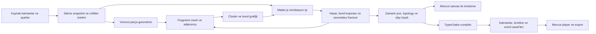

# Physics & Fracture — 2D motion, destruction ve bake

Tarih: 4 Kasım 2026. Güncelleme: 21 Kasım 2026. Durum: aşama 0–2'nin ilk
dikey rigid + tek nesil Voronoi dilimi, dedicated Worker, Physics ürün UI'ı ve
bağlantı-sahipli kalıcı MCP job status/Preview/Apply/Cancel/Discard akışı
ve dünya-uzayı/olay-korumalı rigid keyframe sadeleştirme uygulandı. Sahiplik
hash'li güvenli Re-bake / Clear Bake, image→Mesh2D fragment görünümü, kaynak UV
korunumu, event hizası/raster seam/mask bellek ölçümü, darbe tetikli fracture
ve deterministik artistic explosion da tamamlandı. Aşama 3'te kalan
panel/overlay bitişi ve 32 parçalı görsel matris; aşama 5–9 bütünüyle açıktır.
Aşama
4'ün kalan kapısı scrub/player/MCP/render/export parity kabulüdür.
Character Motion planı ayrı tutulur ve bu özellik için önkoşul değildir. Ortak
ürün alanı **Physics Simulations**; bu belge Rigid Body, Voronoi Fracture,
bonded destruction cluster, secondary/recursive fracture ve olay tabanlı
dinamik fragment mesh dilimlerini tanımlar. Kumaş için kardeş plan:
[Cloth / Fabric Simulation & Bake](cloth-fabric-simulation-bake-plan.md).

Ortak 2D sınıf, birim ve cache sözleşmesi: [Simulation Core](simulation-core-2d-architecture.md). Sıvı ve akışkan kapsamı: [Liquid & Fluids](fluid-liquid-simulation-bake-plan.md). Shape, spline, text ve `Mesh2D` kaynak/collider/yüzey adapter'ları: [Emitter / Collider / Surface Target](emitter-collider-surface-interaction-plan.md). **Güncel geliştirme kapsamı yalnızca 2D modudur.** 3D mod, solver, renderer, scene adapter veya exporter geliştirmesi aktif yol haritasında yoktur. Kumaşın 2D sahne içindeki yerel derinlikli bayrak/perde efekti korunur.

Genel uygulama kuyruğu [2D üretim yol haritasını](../production-2d-roadmap.md)
izler. Fizik/kırılma; ortak BakeService sözleşmesinden sonra gelir. Bu belge
fizik alt sisteminin iç teslim sırasını tanımlar; ana planın önceliklerini
değiştirmez.

17 Kasım 2026 geometri kararı: İlk kırılma kaynağı doğrulanmış kapalı shape/spline sınırıdır; iç mesh veya Editable Poly 2D önkoşul değildir. [Mesh2D](../production-2d-roadmap.md#9-mesh2d-spline-to-mesh-ve-blob-surface) yalnız dokulu/deforme görünüm veya sonraki kompleks kaynak adapter'ında kullanılabilir. Bu belge ayrı bir polygon editor kurmaz.

## 1. Önceki karar ve mevcut durum

Eski Chorono proje belleğinde `proj_plan_docs.md`, ayrı `game-engine` modu için **Matter.js** fizik kararı ve `plan/GAME_ENGINE_ROADMAP.md` / `plan/GAME_ENGINE_WORKPLAN.md` belgelerine referans veriyor. Bu eski plan dosyaları mevcut checkout'ta veya referans verilen eski dizinlerde bulunamadı. Bellek notunda Voronoi kırılma ve 2D animasyona bake akışı tarif edilmiyor.

Mevcut repoda ve erişilebilir Git geçmişi taramasında bu işe özel ayrıntılı plan veya katı cisim uygulaması bulunmadı. README'de fizik ve gelecekteki oyun motoru anılıyor; kaynak kodun sunduğu altyapı daha dar:

| Mevcut parça | Sağladığı temel | Eksik olan |
| --- | --- | --- |
| `animation/physics/spring.ts`, `easings.ts` | Tek kanallı spring ve bounce/elastic/decay eğrileri | Çarpışan cisimler, collider, sürtünme ve rigid-body dünya çözümü |
| `particles/runtime/` | Prosedürel parçacık üretme ve hareket değerlendirme | Parçalar arası katı cisim çarpışması ve kaynak geometrisini kırma |
| `animation/baking/bake.ts`, `simplify.ts` | Mevcut track'i örnekleyip sadeleştirerek keyframe üretme | Çok cisimli simülasyon kaydı, kırılma olayı ve çarpışmayı koruyan sadeleştirme |
| `editor/commands-track.ts` | Undo destekli track bake | Parça katmanları ve bütün transform track'lerinin atomik bake edilmesi |
| `geometry/Matrix2D.ts`, `resolveLayerWorldMatrix.ts` | Dünya/yerel dönüşümler | Fizik kütle merkezi ile görsel pivotun eşlenmesi |
| `types/mask.ts`, `mask/MaskRenderer.ts` | Başka katmanın silüetiyle görsel kesme | Voronoi parça üretimi ve çok parçalı görsel için performans doğrulaması |

Bellekteki planlama konvansiyonuna göre bu belge proje kökündeki `plan/` altında tutulur. Bu checkout'ın genel Markdown ignore kuralı nedeniyle yerel dosyadır. Önceki karakter belgesi taşınmaz veya değiştirilmez.

## 2. Ürün kararı

**2D editörüne Physics Simulations altında Rigid Body & Destruction authoring sistemi eklenecek: temel rigid fizik ve Voronoi kırılması önce teslim edilecek; sonraki dilimlerde bağlı fragment cluster'ları, hasar/bond kopması, secondary fracture ve olay tabanlı yeni fragment mesh nesilleri hesaplanacak; sonuç önizlenip typed cache ve düzenlenebilir timeline çıktısına bake edilecek.**

Kullanıcı akışı: nesneleri seç → hareketli/sabit cisimleri tanımla → yerçekimi, malzeme ve başlangıç hareketi ver → Voronoi/destruction pattern üret → gerekiyorsa parçaları cluster'la ve bond dayanımlarını ayarla → kırılma/darbe/hasar tetiklerini seç → secondary fracture sınırlarını belirle → simüle et → sonucu ve topology nesillerini incele → Bake.

Bake edilmiş animasyon mevcut player'da fizik motoru çalıştırmadan oynar. Fizik tarifi yeniden simülasyon için projede korunur. Kaynak nesne ve bake sonucu ayrı tutulur; başka animasyonlardaki veriler korunur.

Bu iş `2danimation` içinde çalışır. Oyun modu için ileride aynı fizik adapter'ı kullanılabilir; oyun döngüsü, runtime etkileşimi ve game-object modeli bu teslimin kapsamını büyütmez.

## 3. Motor ve modül sınırları

Önceki kararı koruyan ilk backend **Matter.js** olacak. Çarpışma çözücüsü ve temas çözümü yerine Chorono'nun sahne adaptasyonu, parçalama, iş yürütme, kayıt ve bake sistemi geliştirilecek. Matter'ın `Engine.update` çağrısı simülasyonu verilen zaman adımıyla ilerletiyor ve çarpışma olaylarını sunuyor. [Resmi Engine API](https://brm.io/matter-js/docs/classes/Engine.html)

Önerilen sınırlar:

- **Scene snapshot / compiler:** açık timeline ve zamanda görselin nihai transform'unu, collider geometrisini ve fizik ayarlarını alır.
- **Fracture geometry:** kaynak alanı tohum noktalarına göre parçalara ayırır; motor veya renderer bağımlılığı taşımaz.
- **Fragment mesh compiler:** doğrulanmış parça polygon'larını render triangle'ları, UV/appearance koordinatları, sınır halkaları, adjacency ve collider payload'larına derler. Topology yalnız kırılma olayında değişir; per-frame remeshing yapmaz.
- **Cluster graph:** fragment düğümleri ile paylaşılan sınırdan türetilen bond kenarlarını, cluster üyeliğini ve kararlı kimlikleri taşır. Geometry üretimi, bond hasarı ve backend body yaşam döngüsü ayrı kalır.
- **Damage / fracture policy:** temas impulse'u, göreli normal hız, kullanıcı tetikleri ve biriken sanatsal hasarı bond kırma veya secondary fracture kararına çevirir. Gerçek malzeme gerilimi/çatlak mekaniği iddia etmez.
- **Fragment generation service:** recursive fracture isteğini aynı boundary/Voronoi/compiler sözleşmesinden geçirir; parent–child lineage, generation limiti, minimum alan ve toplam fragment bütçesini uygular.
- **PhysicsBackend → MatterPhysicsBackend:** dünya, cisim, malzeme, kuvvet, adımlama ve poz okumayı kapsayan dar rigid-body adapter. Bu dilimde tek rigid-body backend uygulanır; kumaşın yüzey solver'ı aynı body arayüzüne zorlanmaz.
- **Simulation job:** worker içinde sabit adımlarla ilerler; iptal, ilerleme ve hata durumunu yönetir.
- **Pose/topology/event cache:** zaman damgalı pozları; cluster ayrılması, bond kopması, fracture generation ve temas kayıtlarını; olay anında etkin fragment topology manifest'ini taşır.
- **Bake compiler:** cache'i mevcut Layer/Track/Keyframe modeline çevirir; tek editor command ile uygular.

`matter-js` ve Voronoi için `d3-delaunay` paketleri uygulama başlangıcında tam sürüme sabitlenir; bugün bağımlılık yüklenmez. Matter'ın kendi renderer'ı ve `Runner` döngüsü kullanılmaz. Chorono canvas'ı ve açık zaman adımları kullanılır. Next/SSR tarafında fizik modülü yalnızca gerekli istemci/worker yolunda yüklenir.

İlk teknik dilimde seçilen sürümün worker, build, polygon ve hızlı çarpışma davranışı doğrulanır. Rigid-body motorunu değiştirme gerekirse bu somut sonuçla ayrı karar olur; iki rigid-body backend eşzamanlı geliştirilmez. Kumaş, ortak zaman/job/alan/cache altyapısını kullanan ayrı bir yüzey çözümüdür.

## 4. Temel fizik kapsamı

İlk sürüm: dynamic ve static cisimler; dikdörtgen, daire ve convex polygon collider; yerçekimi; başlangıç doğrusal/açısal hız; yoğunluk/kütle; restitution; sürtünme; hava direnci; zemin ve duvar; cisimler arası çarpışma; sınırlandırılmış kuvvet ve tek seferlik itki.

Görsel ile collider ayrı tanımlanır. İlk collider seçimi auto-rectangle/auto-circle veya kullanıcı çizdiği convex polygon olabilir. Şeffaf PNG'de ilk collider görüntü dikdörtgenidir; silüeti otomatik izlediği iddia edilmez.

Matter'ın `Bodies.fromVertices` işlemi geometriyi kütle merkezine göre yeniden konumlandırır. Concave veri için ayrıca decomposition sağlanmazsa convex hull kullanabilir. Bu yüzden ilk sürüm geometriyi önceden convex doğrular ve beklenmedik hull dönüşümüne izin vermez. [Resmi Bodies API](https://brm.io/matter-js/docs/classes/Bodies.html)

Bu rigid-body ilk diliminde animasyonla sürülen kinematic collider, eklem/ragdoll, sıvı, genel soft body ve hacimsel 3D fizik yoktur. Kumaşın gravity/wind/pin/collision ve mesh bake kapsamı kardeş planda ayrıca tanımlanır. Statik çevrenin transform ve geometrisi simülasyon aralığında değişmez. Dynamic cismin transform yazarı fizik olur; aynı kanala yazan followPath/binding/modifier veya başka aktif timeline tespit edilirse bake öncesi çözülmesi gereken çakışma gösterilir.

Fırlatma/itki ile sürekli kuvvet ayrı kontrol edilir. İtki yalnızca bir kez uygulanır; sürekli kuvvet süresi boyunca her simülasyon adımında uygulanır. Adapter kütle ve zaman birimi dönüşümlerini yapar. [Matter Body kuvvet sözleşmesi](https://brm.io/matter-js/docs/classes/Body.html#method_applyForce)

## 5. Koordinat, ölçek ve zaman sözleşmesi

- Kullanıcı değerleri piksel, saniye ve derece cinsinden gösterilir; dünya başlangıcı composition başlangıcı, +Y aşağıdır. Motorun ms/radyan ve hız sözleşmesine dönüşüm yalnızca adapter'da yapılır ve referans hareket testleriyle doğrulanır.
- Ortak core snapshot'ı birimleri açıkça normalize eder; `pixelsPerMeter`, eksen eşlemesi ve motor birimleri recipe'de kayıtlıdır. Bu sözleşme mevcut 2D/surface solver'ları içindir; ayrıntı ortak Simulation Core 2D belgesindedir.
- Simülasyonun ilk hedefi **120 Hz sabit adım**dır; değer recipe içinde kaydedilir. Önizleme FPS'i veya ekran yenileme hızı fizik adımını değiştirmez. Performans profili daha düşük adım seçebilir; aynı iş sürerken adım kendiliğinden değişmez.
- Zaman integer tick ile yürütülür. Başlangıç, süre ve olayların etkin tick'i kaydedilir; UI istenen ve kuantize edilen kırılma zamanını açık gösterir.
- Başlangıç pozu seçili timeline'ın belirtilen anındaki değerlendirilmiş sahneden alınır. Dynamic gövde daha sonra kendi fiziğini izler. Diğer sistemler aynı cismin x/y/dönmesini tekrar yazmaz.
- Sahne matrisi, katman pivotu ve collider centroid'i arasında sabit görsel ofset tutulur. Motorun COM konumu doğrudan `transform.x/y` kabul edilmez. Rotation dönüşümleri derecelere çevrilirken tam turlar korunur.
- İlk sürüm sabit ebeveyn zinciri, uniform ölçek ve doğrulanmış aynalama destekler. Animasyonlu ebeveyn, shear ve desteklenmeyen nonuniform ölçek için açık tanı gerekir; yanlış bir yerel transform bake edilmez.

Canlı render veya `evaluate_at_time` her çağrıldığında fizik ilerlemez. İleri/geri scrub cache'ten poz okur. Henüz hesaplanmamış bir ana gitmek ayrı simülasyon işi gerektirir. `performance.now()` yalnızca işin ilerleme/yürütme bütçesini ölçer; fizik zamanını belirlemez.

## 6. Voronoi kırılma geometrisi

Voronoi geometrisi parçaların şeklini belirler; fizik motoru bu parçaların sonradan nasıl hareket edeceğini hesaplar. İlk kaynak **düz renkli dikdörtgen veya convex kapalı polygon**dur. D3 Voronoi hücrelerinden kapalı convex polygon verisi alınabilir; hücreler kaynak alanla ayrıca kesiştirilir. Dikdörtgen viewport sınırı keyfi kaynak silüetinin yerine geçmez. [D3 Voronoi API](https://d3js.org/d3-delaunay/voronoi)

Voronoi için kapalı shape/spline sınırı yeterlidir; iç triangle mesh matematiksel zorunluluk değildir. Mesh vertex'leri, Voronoi seed noktaları ve üretilen parça kimlikleri ayrı tutulur. Delaunay triangulation üçgen ağ; Voronoi ise değişken kenar sayılı kırılma hücreleri üretir. Bir render üçgeni otomatik olarak bir fizik parçası sayılmaz.

Geometri adımları:

1. Sabit seed ile kaynak yerel uzayında tohumlar üret. Uniform dağılım, darbe noktasına yoğunlaşma ve kullanıcının koyduğu noktalar desteklenebilir.
2. Yinelenen/yakın tohumları kararlı kuralla birleştir; Voronoi hücrelerini çıkar ve kaynak polygon ile kes.
3. Tekrarlanan kapanış vertex'ini kaldır; winding ve collinear noktaları normalize et. Boş, sıfır alanlı ve geçersiz polygon'ları ayıkla.
4. Çok küçük parçaları sessizce yok ederek delik bırakma. Yeniden tohumlama veya komşuyla alanı koruyan birleştirme yap; concave birleşim oluşursa desteklenen convex alt parçalara ayır veya açık tanıyla yeniden üret.
5. Her parça için alan, centroid, collider ve kaynak görsele göre ofset üret. Yoğunluktan kütle türetilir; geometri ve seçilen kütle sözleşmesi birlikte doğrulanır.
6. Gerçekleşen tohumları, polygon'ları ve geometri sürümünü projede tut. Yalnızca seed saklamak gelecekte farklı kütüphane sürümünde aynı parçaları garanti etmez.

**Sonraki kompleks kaynak dilimi:** concave/delikli shape/spline sınırı veya doğrulanmış Mesh2D üçgenleri hücrelerle kesiştirilir; aynı hücredeki bağlı bölgeler birleştirilir. Kopuk bileşenler ayrı parçadır. Concave parça, uygun convex alt parçalardan compound collider'a derlenebilir; convex hull ile delikler/boşluklar doldurulmaz. Triangle spatial index gereksiz tüm hücre × tüm yüz taramasını azaltır. Kaynak UV/koordinat, alan, centroid ve kütle denetlenir. Bu dilim ilk convex kırılma teslimini bekletmez.

Temel teslim bir cismin tek seferde önceden hazırlanmış parçalara ayrılmasıdır. Zamanlı kırılma temel tetiktir. Darbeye göre kırılma, tanımlı göreli normal hız/eşik ve temas noktasıyla sonraki aşamada eklenir. Aşağıdaki ileri destruction dilimleri cluster, biriken hasar ve recursive fracture ekler; bunlar sanatsal/parametrik bir bond modeli kullanır, malzeme gerilimi, çatlak yayılması veya gerçek mukavemet analizi iddia etmez.

### 6.1. Olay tabanlı dinamik fragment mesh ağı

Buradaki **dinamik mesh**, bir kırılma veya secondary-fracture olayında yeni
parça topolojisinin üretilmesidir. Kumaş gibi her kare aynı vertex ağını
deforme etmek veya sıvı gibi her örnekte serbestçe değişen bir yüzey üretmek
değildir. Kırılma olayları arasındaki her fragment sabit polygon/triangle
topolojisi ve rigid transform ile hareket eder. Bu ayrım cache, renderer ve
export decoder'larında korunur.

Önerilen kayıtlar:

- `FractureGeneration`: recipe kimliği, generation index'i, tetik tick'i,
  parent fragment kimliği, gerçekleşmiş seed'ler, geometri/compiler sürümü,
  topology manifest hash'i ve child fragment kimlikleri.
- `FragmentGeometry`: kaynak yerel uzayında dış/delik halkaları, alan,
  centroid, parent–child lineage ve doğrulama tanıları.
- `FragmentMesh`: render vertex/triangle indeksleri, kaynak görünümüne bağlı
  UV/yerel koordinatlar, topology hash'i ve paint bounds. Genel kullanıcı Poly
  modelleme verisi değildir.
- `FragmentCollider`: solver'a uygun convex parça veya compound collider
  bileşenleri. Render triangulation ile collider decomposition aynı indeks
  listesiymiş gibi davranılmaz.
- `FragmentAdjacency`: iki fragment arasındaki doğrulanmış ortak sınır,
  uzunluk/normal ve bu sınırdan türeyen bond adayı.

Fragment mesh compiler mevcut kapalı sınır doğrulama, clipping, triangulation,
UV ve topology hash yardımcılarını uygun dar sözleşmeler üzerinden yeniden
kullanır. Kaynak `Mesh2D` varsa üçgenleri doğrudan fiziksel parça sayılmaz;
Voronoi hücresi kaynak silüetle kesilir, sonuç polygon'u yeniden doğrulanır ve
gerektiğinde render için triangulate edilir. Kaynak UV/appearance koordinatı
fragment yerel uzayına taşınır; her parçada tüm texture yeniden ölçeklenmez.

Topology yalnız olay tick'inde atomik olarak değişir. Parent fragment o tick'te
çıkarılır ve child fragment'lar aynı tick'te eklenir; parent ve child aynı anda
çizilmez veya çarpışmaz. Aynı girdiler için child sırası polygon alanı,
centroid ve canonical geometri hash'iyle kararlı belirlenir; worker tamamlanma
sırası kimlik üretimini değiştirmez. Gerçekleşmiş polygon/mesh manifest'i
portable recipe/cache'e yazılır; yalnız seed'e güvenilmez.

Her generation için `maxDepth`, `maxChildrenPerEvent`, `maxTotalFragments`,
`minFragmentArea`, `maxTriangleCount` ve worker süre/byte bütçesi preflight'ta
hesaplanır. Limite ulaşan parça kırılmaz ve açık `budgetLimited` tanısı üretir;
yarım generation sahneye uygulanmaz. Runtime buffer, collider ve offscreen
görünüm kaynakları generation ownership'iyle acquire/release edilir. Undo veya
stale job eski generation kaynaklarını sızdırmaz.

### 6.2. Bonded destruction cluster

**Cluster**, bir veya daha fazla Voronoi fragment'ının kırılmamış bond'larla
bağlı bileşenidir. Otomatik mod komşu fragment'ların ortak sınırından bond
üretir; kullanıcı modu fragment grubu veya seçili bond üzerinde dayanım,
kopma ve “unbreakable” override'ı verir. Yalnız yakın centroid'e bakılarak bond
kurulmaz; doğrulanmış ortak sınır veya açık kullanıcı bağı gerekir.

Her bond kararlı `bondId`, iki fragment kimliği, ortak sınır uzunluğu/normal,
dayanım, toughness/hasar birikimi, kopma politikası ve durum taşır. İlk model
şunları destekler:

- tek seferlik temas impulse eşiği;
- göreli normal hız ve temas noktasına bağlı ölçek;
- biriken scalar damage ve isteğe bağlı iyileşmesiz decay;
- zamanlı veya kullanıcı event'iyle zorunlu kopma;
- seed'li sanatsal varyasyon.

Bu değerler gerçek sonlu eleman gerilimi değildir. Damage hesabı sabit step'te
ve kararlı temas/bond sırasıyla yürür. Aynı temas her substep'te sınırsız kez
sayılmaz; backend temas kimliği ve impulse toplama penceresi sözleşmesi test
edilir.

Tam bağlı cluster başlangıçta tek compound rigid body veya backend'in açıkça
desteklediği constraint/body grubu olarak derlenebilir. Hangi stratejinin
kullanıldığı recipe capability'sinde kayıtlıdır. Bond koptuğunda sağlam bond
grafiğinin connected-component'ları yeniden çıkarılır; yalnız ayrılan
bileşenler yeni body'lere dönüştürülür. Eski body aynı tick'te kaldırılır.
Yeni body'ler eski cluster'ın doğrusal/açısal hızından centroid ofsetine göre
hız devralır; toplam kütle, kütle merkezi, doğrusal momentum ve tolerans
içindeki açısal momentum kabul testidir. Kopma anında ayrıca artistic impulse
seçilmedikçe gizli enerji eklenmez.

Canvas overlay; fragment rengi, cluster rengi, bond çizgisi, dayanım, hasar ve
kopmuş bağ durumlarını ayrı modlarda gösterir. Inspector'da **Auto Cluster**,
**Group Selected**, **Split Cluster**, **Bond Strength**, **Damage Threshold**,
**Unbreakable** ve **Reset Damage** bulunur. Overlay ve seçim bilgisi export'a
girmez; bütün işlemler tek undo command'ıdır.

### 6.3. Secondary ve recursive fracture

Secondary destruction, serbest kalmış bir fragment'ın yeni bir
`FractureGeneration` üreterek child fragment'lara ayrılmasıdır. Tetikler ayrı
ayrı seçilebilir: temas impulse'u, biriken hasar, göreli hız, belirli timeline
tick'i, script/event veya kullanıcı “Fracture Now” komutu. Bir fragment için
aynı generation olayı yalnız bir kez commit edilir.

Yeni seed, root recipe seed'i + parent fragment kimliği + generation index'i +
olay sıra numarasından deterministik türetilir. Seed noktaları parent'ın kendi
yerel polygon sınırı içinde üretilir; composition bounds veya ilk kaynak
dikdörtgeni tekrar kullanılmaz. Child geometrisi parent alanını tolerans içinde
tam bölmeli, boşluk/örtüşme üretmemeli ve parent appearance/UV eşlemesini
devralmalıdır. Parent transform'u geometriye iki kez uygulanmaz.

Önceden üretim ve olay anında üretim iki açık kalite profilidir:

- **Precomputed hierarchy:** belirlenen derinliğe kadar child pattern'ları iş
  öncesi oluşturur; playback daha ucuz ve tamamen öngörülebilirdir.
- **On-demand deterministic:** yalnız tetiklenen fragment'ı worker'da üretir;
  preview duraklatılabilir ve sonuç hazır olmadan topology commit edilmez.

İki profil aynı `FractureGeneration`/manifest sözleşmesini kullanır. On-demand
sonuç tamamlanmadan düşük kaliteli rastgele polygon fallback'i gösterilmez.
Bir tick'te birden çok fragment kırılırsa olaylar tick, generation depth,
parent id ve event id sırasıyla işlenir. `maxDepth` ve toplam fragment bütçesi
her iki profil için zorunludur; sınırsız recursive fracture yoktur.

### 6.4. Kırılma öncesi hasar deformasyonu

Destruction deformasyonu rigid fracture ve kumaş solver'ıyla karıştırılmaz.
İleri dilimde kaynak görünüm sabit topolojili `Mesh2D` ise darbe çevresinde
dent/bend/shear gibi sanatsal vertex offset'leri `meshDeformation` klibi olarak
üretilebilir. Shape/spline/image kaynak önce açık bir Mesh2D/appearance
snapshot'ına derlenir; kaynak katman korunur. Bu dilim MESH2 görünüm ve
deformasyon playback sözleşmesine bağlıdır, temel Voronoi teslimini bekletmez.

İki açık çarpışma politikası vardır:

- **Visual only:** rigid collider değişmez; UI ve export capability görünür
  biçimde bunu belirtir.
- **Event-sampled collider:** yalnız tanımlı damage/fracture tick'lerinde
  deforme dış sınır yeniden çıkarılır, doğrulanır ve collider/fragment girdisi
  atomik rebuild edilir. Her frame collider remesh yapılmaz.

Kırılma anında recipe, fracture sınırının `restBoundary` mi yoksa doğrulanmış
`deformedSnapshot` mı olduğunu saklar. Deformed snapshot seçildiyse foldover,
self-intersection, minimum alan, delik ve UV tanıları geçmeden fracture işi
başlamaz. Başarısız deformasyon convex hull ile düzeltilmez. Deformasyon
örnekleri sabit topology hash'ine; fracture generation ise yeni topology
manifest'ine bağlıdır. Re-bake bu iki kimliği ayrı stale nedeni olarak gösterir.

## 7. Kırılma olayı ve momentum

Kırılma öncesinde tek kaynak cisim çözülür. Etkin kırılma tick'inde kaynak collider kaldırılır; parça gövdeleri o andaki dünya pozundan oluşturulur. Kaynak ile parçaları aynı anda çarpışma dünyasında bırakmak veya release sonrasında kaynağı ikinci kez çizmek engellenir.

Parçalar kaynak cismin doğrusal hızını ve dönmeden gelen teğetsel hızını devralır: `v_parça = v_kaynak + ω × (c_parça − c_kaynak)`. Dönme yönü ve birimler adapter testleriyle doğrulanır. Kaynakla tutarlı yoğunluk ve atalet kullanılmalı; backend geometri temizliğinin alan/kütle değiştirmesi kontrol edilmelidir.

Aynı devir sözleşmesi cluster split ve secondary fracture için de kullanılır.
Cluster body veya parent fragment kaldırılmadan önce dünya pozu, unwrap edilmiş
açısı, doğrusal/açısal hızı ve kütle özellikleri snapshot edilir. Child veya
yeni cluster body'leri kendi centroid'lerine yerelleştirilir. Aynı topology
olayında body yaratma/kaldırma yalnız bir kez olur; backend callback sırası
çifte impulse veya kayıp momentum üretmez.

İsteğe bağlı **artistic explosion**, kırılma anında eklenen dışsal itki ve spin'dir. Merkez, yön, kuvvet ve seed ile ayarlanır; doğal parçalanma ile aynı parametre sayılmaz. Ek enerji eklediği kullanıcıya ifade edilir. Darbe kuvveti ve rastgelelik her playback karesinde yeniden uygulanmaz.

Temas sınırlarındaki sayısal tolerans ve çok ince parçalar başlangıç patlaması/jitter yaratmamalı. Collider overlap, minimum parça alanı, solver slop ve malzeme kombinasyonu kabul sahnesinde ölçülür. Yüksek hızlı cisimlerin ince zeminden geçmesi için hız/boyut/adım sınırı ve test gerekir; Matter backend için otomatik CCD varmış gibi davranılmaz.

## 8. Parçaların görünümü

**İlk dilim:** düz renk kaynak polygon'u, centroid'e göre yerelleştirilmiş normal path/spline parçalarına dönüşür. Her parça bağımsız katman ve normal transform track'leriyle düzenlenebilir. Başlangıçta parçaların birleşimi kaynağı alan ve konum toleransı içinde yeniden oluşturur.

**İkinci dilim:** image ve dokulu yüzeyler, ortak asset referansı ve parça polygon maskesiyle kesilir; kaynak UV/yerel koordinatı korunur. Tam kaynağı her parçada tekrar ölçekleyerek doku kaydırılmaz. Maskeyle görsel kesmek collider silüetini otomatik değiştirmez.

Mevcut mask/effect yolu composition boyutunda offscreen canvas kullanıyor. Bu nedenle image parçaları için yüksek parça sayısı kapasitesi varsayılmaz. Maskelerin parça bounding-box'ına göre çizilmesi veya kontrollü türetilmiş görüntü asset'leri seçeneği profil sonucuyla değerlendirilir. Full-resolution görüntüyü yüzlerce kez kopyalayan varsayılan çözüm kurulmaz.

Metin, gradient, stroke, grup, mevcut maskeler ve efekt zincirleri için ayrı görünüm testi gerekir. İlk sürüm desteklemediği kaynakta bunu açıkça söyler. Sonraki aşamada kullanıcının açıkça seçtiği flatten/bake-appearance akışıyla statik görünüm snapshot'ı alınabilir; editable kaynak saklanır. Concave/delikli silüet, cluster ve recursive fracture §6'daki ileri dilimlerde aynı appearance/UV lineage sözleşmesiyle eklenir.

## 9. Simülasyon işi ve cache

Recipe; kaynak revision'ı, geometri/asset hash'leri, timeline, başlangıç pozu, seed, motor ve geometri sürümleri, tüm fizik ayarları, stepHz, süre ve olay listesiyle bir job'a derlenir. Cisim/temas/olay sıralaması sabittir; worker'ın global sayaçları iş kimliği yerine kullanılmaz.

Job durumları: `queued → running → completed`, ayrıca `cancelled`, `failed`, `stale`. Worker ana editörü bloke etmeden sınırlı bloklar halinde hesaplar; progress ve cancel sunar. Sahne değişince hesap sessizce güncel sayılmaz. Commit anında revision ve kaynak hash'leri yeniden doğrulanır; stale sonuç sahneye uygulanmaz.

Cache kayıtları zaman, gövde/cluster/fragment kimliği, x/y, unwrap edilmiş açı ve gerekli olayları taşır. `fractureEventSequence` payload'ı olay tick'i, parent/child kimlikleri, generation manifest hash'i, cluster component değişimi, bond kopması ve gerekiyorsa yeni fragment geometry asset referansını saklar. Geometri her frame tekrarlanmaz; immutable generation manifest'i bir kez saklanır, pose örnekleri kararlı fragment id'lerine adreslenir. Typed-array/aktarılabilir buffer ile taşınabilir; renderer doğrudan ham motor nesnesine bağlanmaz. Uzun işler ve rastgele seek için checkpoint; etkin body/cluster seti, bond damage durumu ve son topology generation'ını birlikte geri yükler. Temel sürüm başlangıçtan kontrollü hesaplar ve kayıt aralığını önceden sınırlar.

Sabit seed ve adım, tek başına tüm tarayıcılarda bit düzeyinde aynı fizik garantisi sayılmaz. Aynı sabitlenmiş ortamda tekrar üretilebilirlik test edilir; taşınabilir animasyonun esas kaynağı kaydedilmiş geometri ve bake edilmiş trajectory'dir. Motor sürümü değişimi eski keyframe'leri değiştirmez; resimülasyon yeni bir job/bake sürümü oluşturur.

## 10. Bake sözleşmesi

Fizik cache'i mevcut `bakeTrack` fonksiyonunu tekrar tekrar çağırarak üretilmez. Bu fonksiyon var olan track'i örnekler; çok cisimli dünya çözmez. Yeni compiler cache'ten normal track'ler üretir; mevcut keyframe/command ve uygun sadeleştirme yardımcılarını kullanır.

Temel çıktılar:

- Her gövde/parça için `layers.<id>.transform.x`, `.y`, `.rotationDeg`.
- Kaynak ve parça görünürlük değişimi için normal `opacity` track'leri; keskin geçişlerde mevcut `hold` easing. `hidden` gibi export'ta atılan editör bayrakları animasyon görünürlüğü olarak kullanılmaz.
- Fracture ve istenirse collision marker/event kayıtları. Preview scrub'ı bu olayları dış sistemlere tekrar göndermez; baked timeline olaylarının oynatma/seek politikası ayrı tanımlanır.
- Cluster split, bond break ve secondary fracture olayları; bunların immutable
  generation/fragment geometry manifest referansları. Olay tick'inde görünür
  layer/body seti hold semantiğiyle atomik değişir.
- Sabit topolojili kırılma öncesi hasar için `meshDeformation`; topology
  değişiminden sonra fragment rigid pozları ve `fractureEventSequence`. Bu iki
  payload birbirinin decoder'ıyla oynatılmaz.
- Generated katman/track kimlikleri, kaynak recipe ve snapshot hash'iyle ilişkili `BakeRecord`.

Önce ham örneklerle doğruluk sağlanır. Sonra x/y/açı kanalları birlikte sadeleştirilir; başlangıç/son, kırılma, temas ve uykuya geçiş anları korunur. Mevcut normalize RDP toleransı tek başına fizik için yeterli kabul edilmez: gerçek interpolator ile dünya uzayındaki vertex sapması ve açısal hata ölçülür. Ara hedef başlangıç profili 0,5 px / 0,25° olarak önerilir; kesin değer referans sahnede belirlenir. İhlalde daha çok keyframe saklanır.

Simülasyon adımı ile bake FPS'i ayrı değerlerdir. Sonuç istenen 24/25/30/60 FPS zamanlarına örneklenir; olay anları ek korumalı anahtarlardır. Açı 359° → 0° olarak sarılıp yanlış yönde tam tur atmaz. Motion blur ve subframe export'ta da bake interpolasyonu değerlendirilir; simülasyon tekrar çalıştırılmaz.

Runtime exporter'daki varsayılan frame snapping, korumalı olay anahtarını kaydırmamalı. Bake/export sözleşmesi olay zamanını koruyacak seçeneği kullanır veya aynı kurala göre önceden kuantize eder; bu seçim kabul testinde doğrulanır.

## 11. Sahneye uygulama ve yeniden bake

Preview sahneyi kalıcı değiştirmez. **Bake tek undo transaction'ıdır:** sonuç grubu, parça/görsel/mask katmanları, tüm track'ler, timeline üyeliği, görünürlük anahtarları ve BakeRecord birlikte eklenir. İptal veya başarısız iş yarım katman bırakmaz.

Hedef timeline açık `timelineId` ile seçilir. `timeline.layerIds` bir track görünümü listesidir; tek başına playback izolasyonu garantisi sayılmaz. İlk sürüm tek açık simülasyon/playback kapsamıyla çalışır; diğer aktif timeline'ların ve state machine'lerin aynı hedeflere yazması doğrulanır. Belirsiz çoklu yazarlı sahneye sessiz bake yapılmaz.

Varsayılan çıktı ayrı sonuç grubudur; kaynak katman ve kaynak keyframe'leri saklanır. Kaynağın kırılma sonrasındaki görünürlüğü, tanımlı bake kapsamındaki hold anahtarlarıyla yönetilir. Çıktı grubunun başlangıç/son davranışı ve bake aralığı dışında kaynak görünümü round-trip test edilir. Ebeveyn transform'u iki kez uygulanmaz.

Resimülasyon mevcut bake'i kendiliğinden değiştirmez. `Re-bake`, yalnızca bu
recipe'nin sahip olduğu track, katman, generation/topology manifest ve timeline
üyeliklerini yeniler. Her owned hedefin commit anındaki içerik hash'i kaydedilir;
source/recipe stale durumu generated output sahipliğinden ayrı incelenir.
Kullanıcının sonradan değiştirdiği, sildiği veya eski şemadan gelen output'ta
varsayılan replacement/Clear açık hatayla durur ve hiçbir sahne verisini
değiştirmez.

İlk MVP'de sessiz otomatik `New Version` yoktur. Aynı kaynak ve timeline için
çoklu aktif sürüm izolasyonu tasarlanana kadar kullanıcı ürün UI'ında
**Replace edited bake** veya **Delete edited output** seçimini açıkça yapar;
yalnız bu seçim `discard-edits` politikasına yetki verir. Başka katmanlar ve
anahtarlar silinmez. Apply/Clear tek undo transaction'ıdır; Undo kullanıcının
değiştirdiği eski bake'i, track anahtarlarını ve üyelikleri tam geri getirir.

## 12. Kalıcı veri, UI ve MCP

Önerilen authoring verisi `ChronoScene.physics?` altında sürümlü setup/recipe,
body ve collider tanımları, fracture pattern'ları, gerçekleşmiş generation ve
fragment manifest'leri, cluster/bond grafikleri, damage/recursive-fracture
politikaları ve bake kayıtlarıdır. Dense pose buffer'ları, worker state'i,
Matter body nesneleri ve GPU kaynakları scene JSON'a girmez. Recipe içinde
hedef timeline, zaman aralığı, topology bütçeleri ve her kaynağın sahipliği
açıktır. Eski projeler alan yokken normal açılır.

Portable proje ayarları, kaynak medya ve bake katmanlarını korur. Ham cache proje boyutu nedeniyle optional olabilir; cache olmasa da kaydedilmiş keyframe'ler oynar. Baked-only runtime export simülasyon tarifini taşımaz ve fizik bağımlılığını bundle'a eklemez. Mevcut runtime export yollarının standart path/mask/track çıktısını koruduğu ayrıca doğrulanır.

Mevcut dock içinde **Physics Simulations** paneli: Rigid Body, World,
Fracture, Clusters & Bonds, Damage/Secondary, Cloth, Liquids/Flow, Fields ve
Bake Jobs bölümleri. Bu belge rigid-body/destruction kontrollerini; kardeş
belgeler cloth ve fluid kontrollerini tanımlar. Collider, centroid, Voronoi
hücresi, fragment/cluster rengi, bond ve damage canvas overlay'idir; export'a
girmez. Üstte Validate / Generate Pattern / Simulate / Cancel / Reset Preview /
Bake ve net `stale` durumu bulunur. Generation depth, parça/triangle/bond
sayısı, süre, tahmini katman/keyframe/cache/bellek bütçesi iş başlamadan
gösterilir.

Rigid body emitter, doğacak gövde tipini ve **Emit From** geometri kaynağını ayrı seçer. **Collide With** listesi source'tan ayrıdır. Text satırında glyph outline/compound modu, shape/spline/`Mesh2D` satırında desteklenen collider modu ve capability görünür. `A/O/8` gibi glyph delikleri korunur; tek text bounds veya convex hull ile doldurulmaz. Eksik font, silinmiş layer veya desteklenmeyen concave geometri inline hata verir; fizik işi sessiz fallback ile başlamaz.

Alanların affected-object listeleri, collision-object listeleri, job/recipe sürümü ve bake sahipliği ortak modeldir. Rigid-body sonucu `rigidPose`, kumaş sonucu `meshDeformation` olarak ayrılır. Kumaş için gerekli geometry cache, bu belgedeki normal transform keyframe bake'inin yerine geçirilmez. İki yönlü kumaş/rigid etkileşimi ilk dilime örtük biçimde eklenmez.

Fluid sonucunda ayrıca `particleFluid`, `gridField` veya değişen topolojili `surfaceSequence` kullanılır. Ortak cache store ve BakeService bu farklı 2D/surface payload'larını taşır; decoder/interpolasyon ve çıktı derleyicileri ayrıdır. Ortak sınıflar yalnızca aktif 2D kullanımına göre geliştirilir.

Önerilen başlangıç profili 32 parça, 5 saniye ve 30 FPS bake'tir; üç transform kanalı yaklaşık 14.496 ham keyframe üretir. İlk teknik üst bütçe adayı temel fracture için 100 parça / 10 saniyedir; ölçülmüş kapasite değildir. Cluster/secondary profili ayrıca toplam fragment, generation depth, bond, render triangle, collider component ve topology-event byte bütçesi taşır; 100 parça sınırı recursive fracture'a her generation için yeniden verilmez. Bu üst bütçede 60 FPS seçimi yalnız üç kanalda bile 180.000'den fazla ham keyframe üretir. Mevcut MCP katman/keyframe sınırlarına göre ön hesap ve sadeleştirme sonrası kontrol gerekir. Çok büyük iş atomik uygulamadan önce açık tanıyla durur; kısmi generation veya bake yapılmaz.

MCP akışı native job araçlarıyla config/validate → simulate → job status/cancel → preview → bake commit olur. Uzun iş synchronous QuickJS script'i içinde bekletilmez. Script handle'ları recipe okumayı ve atomik config düzenlemeyi açar; job orchestration host/MCP katmanında çalışır. Yeni komut isimleri uygulamada catalog/capabilities şemalarıyla kesinleştirilir.

Simulation started/progress/completed/cancelled/failed, fracture occurred,
cluster split, bond broken, secondary fracture generated, budget limited ve
bake completed olayları mevcut event/host yapısından erişilebilir olmalı.
Preview scrub aynı olayları host'a tekrar göndermez. Revision, requestId ve
dry-run plan kimliği kuralları korunur; simulation/cache/fragment generation
hazırlığı ile sahne mutasyonu ayrılır. MCP/API eklenirken `skills/chorono/`
altındaki canonical skill güncellenir; generated CLI skill dosyaları elle
değiştirilmez.

## 13. Geliştirme sırası

21 Kasım uygulama notu: Aşağıdaki tablo her aşamanın tam hedefini korur. Aşama
0–2 için ilk dikey dilim; rectangle dynamic/static body, sabit adım Matter,
portable bake provenance, 16 parçalı zamanlı Voronoi ve gerçek Worker yürütmesi
olarak tamamlandı. Physics Simulations ile aynı workspace job'unu gösteren
Jobs & Bake Preview/Cancel/Apply/Discard ilk ürün akışı da bağlandı. Kalıcı MCP
job/status/cancel, aşama 4'teki olay-korumalı sadeleştirme, owned output'u
hash'leyerek koruyan güvenli Re-bake / Clear Bake ve editor-only Canvas
fragment/collider/centroid/triangle tanıları tamamlandı. Image rectangle
kaynaklar artık full-source normalize UV'li bake-owned Mesh2D fragment üretir;
solid source Path davranışı korunur. Diagnostic triangle fan gerçek appearance
mesh'i değildir. 32 parçalı/geniş görsel matris ve bütün ürün UI kriterleri
henüz bu aşamaların tamamı geçti anlamına gelmez. Seam/boşluk ile mask bellek
ölçümü de tamamlandı. Darbe/temas fracture ve açık dış enerji olarak raporlanan
artistic explosion impulse/spin de uygulanıp canlı MCP kabulünden geçti.
Topology olay rozeti, exact-event Inspector kartı ve gerçek render–collider
fark tanısı UI/MCP eşliğiyle tamamlandı. Aktif sıra aşama 3'ün 32 fragment,
eğimli zemin ve yüksek hızlı küçük parça geniş görsel matrisiyle aşama 4 parity
kapısıdır.

| Aşama | Teslim | Kabul ölçütü |
| --- | --- | --- |
| 0 — Teknik doğrulama | Matter backend, koordinat/zaman sözleşmesi, worker ve cache prototipi | Düşen kutu zemine çarpar; 30/60 Hz önizleme aynı cache'i gösterir; iptal çalışır; build tamamlanır. |
| 1 — Temel Physics Bake | Dynamic/static şekiller, malzeme, başlangıç hızları, çoklu cisim, atomik bake | Düşme/sekme/çarpışma x/y/dönme keyframe'lerine dönüşür; fizik kapalıyken aynı hareket oynar; undo ve kayıt/yükleme geçer. |
| 2 — Voronoi | Seed'li parçalar, polygon doğrulama, zamanlı kırılma, momentum devri | 32 parçalı panel seçilen anda ayrılır, parçalar zemine ve birbirine çarpar; kaynak tekrar çizilmez; birleşik alan korunur. |
| 3 — Görünüm ve kontrol | Image parçaları, darbe tetiklemesi, explosion, panel/overlay tamamlaması | Görsel kırılma öncesi/sonrası hizalıdır; collider görünüm farkları açıktır; mask bellek maliyeti ölçülür. |
| 4 — Temel teslim | Sadeleştirme, güvenli re-bake, MCP/script, portable ve export parity | Scrub/player/MCP/render aynı temel bake'i kullanır; olaylar ve tam tur dönme korunur; kullanıcı düzenlemeleri kaybolmaz. Bu kapı ileri destruction dilimlerini beklemez. |
| 5 — Kompleks kaynak ve fragment mesh | Concave/delikli shape/spline veya `Mesh2D` clipping; render triangle/UV, adjacency, compound collider ve generation manifest | Kaynak alanı/delik/UV korunur; triangle sayısı fiziksel parça sayısı olmaz; topology yalnız olay tick'inde atomik değişir; save/load aynı manifest'i getirir. |
| 6 — Bonded clusters | Auto/manual cluster, adjacency bond graph, dayanım/damage, connected-component split ve momentum devri | Bağlı panel tek cluster gibi hareket eder; seçili bond kopunca yalnız ayrılan bileşenler body olur; kütle/momentum toleransı ve tek body değişimi geçer. |
| 7 — Secondary destruction | Precomputed/on-demand child generation, recursive tetikler, parent–child lineage ve generation/fragment bütçesi | Ayrılmış bir parça darbeyle ikinci kez kırılır; aynı seed aynı child manifest'i üretir; depth/bütçe sınırı yarım topology bırakmadan durur. |
| 8 — Hasar deformasyonu | Mesh2D dent/bend/shear, visual-only ve event-sampled collider politikası, rest/deformed fracture snapshot seçimi | Deformasyon topology hash'i ve fracture manifest'i ayrı stale olur; foldover/self-intersection reddedilir; fracture öncesi/sonrası görünüm atlamaz. |
| 9 — İleri destruction teslimi | `fractureEventSequence`, checkpoint/seek, cluster/secondary MCP araçları, portable asset ve canonical render/export parity | Rastgele seek etkin cluster/bond/topology durumunu geri getirir; native playback ile bake/render aynı generation olaylarını gösterir; kullanıcı düzenlemeleri ve kaynak korunur. |
| Sahne geometrisi entegrasyonu | Shape/spline/text/`Mesh2D` emitter ve compound collider; rigid circle/body üretimi | `A8` text üstünde toplar kararlı yığılır; glyph/shape boşlukları hull ile doldurulmaz. Kaynak silüet/alan korunur. |

**İlk dikey dilim:** bir kutu ve statik zemin → 3 saniye simülasyon → x/y/dönme bake → fizik motoru çalıştırmadan playback → undo. Sonraki dilim aynı kutuyu 16–32 Voronoi parçasına ayırır. Böylece önce genel fizik+bake temeli doğrulanır; kırılma bunun üzerinde ilerler.

## 14. Uygulama haritası ve testler

Önerilen yeni modül sınırları: `src/lib/physics/` (backend, recipe compiler,
job/cache), `src/lib/fracture/` (Voronoi/clip/centroid, fragment mesh compiler,
adjacency, cluster graph, damage policy ve generation orchestration),
`src/lib/types/physics.ts`, `src/lib/editor/commands-physics.ts`,
`src/components/physics/`. Fracture geometry ve fragment mesh compiler solver
body yaşam döngüsünü; cluster graph damage policy'yi; damage policy React/UI'ı
import etmez. Mevcut baking/geometry/mesh2d/mask ve command altyapısı önce
değerlendirilir; aynı işlev yeniden yazılmaz. Kesin dosya sayısı ilk dilimde
belirlenir.

Testler: yerçekimi ve birim dönüşümü; kütle/itki; friction/restitution;
pivot-COM eşlemesi; uniform ölçek/ayna; sıfır ölçek tanısı; polygon
alan/topoloji; duplicate tohum ve sliver; kırılmada hız devri; body değişiminin
tekliği; fragment triangle/UV/bounds/topology hash; ortak sınırdan adjacency;
bond grafiği connected-component; cluster split'te kütle, doğrusal/açısal
momentum ve gizli enerji; tek temasın hasarı iki kez yazmaması; aynı seed ile
recursive child manifest determinismi; parent alanının child alan/boşluk/
örtüşme korunumu; eşzamanlı olay sırası; generation depth/fragment/triangle/
byte bütçesi; iptal sırasında yarım topology olmaması; deformasyon foldover ve
rest/deformed snapshot; sabit adım tekrarı; topology event öncesi/sonrası
ileri/geri scrub ve checkpoint; stale/revision; keyframe bütçesi; tam tur
dönme; olayları koruyan sadeleştirme; re-bake ownership; undo/redo; proje
round-trip ve fizik çalıştırmadan runtime playback.

Görsel kabul: düşen kutu, üst üste duran cisimler, eğimli zemin, yüksek hızlı
küçük parça, `A8` text compound collider üzerinde top yığını, 32 parçalı panel,
dokulu image örneği, birbirine bağlı duvar/taş cluster'ı, yalnız orta bond'ları
kopan panel, darbeyle ikinci kez parçalanan fragment ve kırılmadan önce dent
olan Mesh2D örneği. Kırılmadan hemen önce, kırılma anı, cluster split,
secondary-fracture tick'i, ilk temas, orta kare ve durulma karesi gerçek render
ile incelenir. Üçgen overlay delik/UV seam/topology değişimini; cache ile bake
çıktısı vertex/poz ve olay zamanını doğrular.

Temel aşama 0–4; delikli/concave kaynak, fragment mesh, bonded cluster,
recursive fracture ve hasar deformasyonunu içermez. Bunlar bu belgede aşama
5–9 olarak tanımlanmıştır ve temel rigid/Voronoi kabulünü veya sonraki kumaş/
fluid işinin başlamasını bloke etmez. Fiziksel crack-tip propagation, gerçek
FEM/plasticity, serbest soft-body parçalanması, sürekli adaptive remeshing,
kinematic çevre ve GPU compute hâlâ kapsam dışıdır. Worker'da CPU çözümü
doğruluk temelidir; GPU çizim desteği fizik hesabını otomatik hızlandırmış
sayılmaz.

Güncel uygulanan dilim için `npm test` (431 dosya / 3.232 test), TypeScript,
`npm run mcp:build`, `npm run cli:build`, 16/16 CLI testi ve `npm run build`
21 Kasım'da geçti; build öncesinde Next sunucusu durduruldu. Yeni sistem
class'ları mevcut event/script sözleşmesine uyar. Yayınlama veya paket kurulumu
bu planın parçası değildir.
