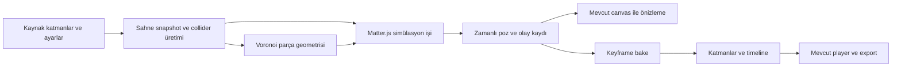

# Physics & Fracture — 2D motion için simülasyon ve bake

Tarih: 4 Kasım 2026. Durum: mimari ve geliştirme planı; uygulama yapılmadı. Character Motion planı ayrı tutulur ve bu özellik için önkoşul değildir. Ortak ürün alanı **Physics Simulations**; bu belge Rigid Body ve Fracture dilimini tanımlar. Kumaş için kardeş plan: [Cloth / Fabric Simulation & Bake](cloth-fabric-simulation-bake-plan.md).

Ortak 2D sınıf, birim ve cache sözleşmesi: [Simulation Core](simulation-core-2d-architecture.md). Sıvı ve akışkan kapsamı: [Liquid & Fluids](fluid-liquid-simulation-bake-plan.md). **Güncel geliştirme kapsamı yalnızca 2D modudur.** 3D mod, solver, renderer, scene adapter veya exporter geliştirmesi aktif yol haritasında yoktur. Kumaşın 2D sahne içindeki yerel derinlikli bayrak/perde efekti korunur.

Genel uygulama kuyruğu [2D üretim yol haritasını](../production-2d-roadmap.md) izler: export → bileşen → çoklu format önceliklidir. Bu belge korunmuş fizik planıdır; bu üç teslimin önkoşulu veya bugünkü uygulama başlangıcı değildir.

6 Kasım 2026 geometri eklemesi: [Editable Poly 2D ve native ağ üretimi](../production-2d-roadmap.md#9-editable-poly-2d-native-ağ-üretimi-ve-blob-surface), kırılma için kaynak düzenleme altyapısıdır. İç vertex/edge/triangle/quad editleri ve mesh üretimi ana planda tanımlanır; bu belge ayrı bir polygon editor kurmaz.

## 1. Önceki karar ve mevcut durum

Eski Chorono proje belleğinde `proj_plan_docs.md`, ayrı `game-engine` modu için **Matter.js** fizik kararı ve `plan/GAME_ENGINE_ROADMAP.md` / `plan/GAME_ENGINE_WORKPLAN.md` belgelerine referans veriyor. Bu eski plan dosyaları mevcut checkout'ta veya referans verilen eski dizinlerde bulunamadı. Bellek notunda Voronoi kırılma ve 2D animasyona bake akışı tarif edilmiyor.

Mevcut repoda ve erişilebilir Git geçmişi taramasında bu işe özel ayrıntılı plan veya katı cisim uygulaması bulunmadı. README'de fizik ve gelecekteki oyun motoru anılıyor; kaynak kodun sunduğu altyapı daha dar:

| Mevcut parça | Sağladığı temel | Eksik olan |
| --- | --- | --- |
| `animation/physics/spring.ts`, `easings.ts` | Tek kanallı spring ve bounce/elastic/decay eğrileri | Çarpışan cisimler, collider, sürtünme ve rigid-body dünya çözümü |
| `particles/runtime/` | Prosedürel parçacık üretme ve hareket değerlendirme | Parçalar arası katı cisim çarpışması ve kaynak geometrisini kırma |
| `animation/baking/bake.ts`, `simplify.ts` | Mevcut track'i örnekleyip sadeleştirerek keyframe üretme | Çok cisimli simülasyon kaydı, kırılma olayı ve çarpışmayı koruyan sadeleştirme |
| `editor/commands-track.ts` | Undo destekli track bake | Parça katmanları ve bütün transform track'lerinin atomik bake edilmesi |
| `geometry/Matrix2D.ts`, `resolveLayerWorldMatrix.ts` | Dünya/yerel dönüşümler | Fizik kütle merkezi ile görsel pivotun eşlenmesi |
| `types/mask.ts`, `mask/MaskRenderer.ts` | Başka katmanın silüetiyle görsel kesme | Voronoi parça üretimi ve çok parçalı görsel için performans doğrulaması |

Bellekteki planlama konvansiyonuna göre bu belge proje kökündeki `plan/` altında tutulur. Bu checkout'ın genel Markdown ignore kuralı nedeniyle yerel dosyadır. Önceki karakter belgesi taşınmaz veya değiştirilmez.

## 2. Ürün kararı

**2D editörüne Physics Simulations altında Rigid Body & Fracture authoring sistemi eklenecek: fizik hesaplanacak, sonuç önizlenecek, ardından normal katmanlara ve düzenlenebilir timeline keyframe'lerine bake edilecek.**

Kullanıcı akışı: nesneleri seç → hareketli/sabit cisimleri tanımla → yerçekimi, malzeme ve başlangıç hareketi ver → gerekiyorsa Voronoi parçalarını hazırla → kırılma anını seç → simüle et → sonucu incele → Bake.

Bake edilmiş animasyon mevcut player'da fizik motoru çalıştırmadan oynar. Fizik tarifi yeniden simülasyon için projede korunur. Kaynak nesne ve bake sonucu ayrı tutulur; başka animasyonlardaki veriler korunur.

Bu iş `2danimation` içinde çalışır. Oyun modu için ileride aynı fizik adapter'ı kullanılabilir; oyun döngüsü, runtime etkileşimi ve game-object modeli bu teslimin kapsamını büyütmez.

## 3. Motor ve modül sınırları

Önceki kararı koruyan ilk backend **Matter.js** olacak. Çarpışma çözücüsü ve temas çözümü yerine Chorono'nun sahne adaptasyonu, parçalama, iş yürütme, kayıt ve bake sistemi geliştirilecek. Matter'ın `Engine.update` çağrısı simülasyonu verilen zaman adımıyla ilerletiyor ve çarpışma olaylarını sunuyor. [Resmi Engine API](https://brm.io/matter-js/docs/classes/Engine.html)

Önerilen sınırlar:

- **Scene snapshot / compiler:** açık timeline ve zamanda görselin nihai transform'unu, collider geometrisini ve fizik ayarlarını alır.
- **Fracture geometry:** kaynak alanı tohum noktalarına göre parçalara ayırır; motor veya renderer bağımlılığı taşımaz.
- **PhysicsBackend → MatterPhysicsBackend:** dünya, cisim, malzeme, kuvvet, adımlama ve poz okumayı kapsayan dar rigid-body adapter. Bu dilimde tek rigid-body backend uygulanır; kumaşın yüzey solver'ı aynı body arayüzüne zorlanmaz.
- **Simulation job:** worker içinde sabit adımlarla ilerler; iptal, ilerleme ve hata durumunu yönetir.
- **Pose/event cache:** zaman damgalı pozları, release/kırılma ve temas kayıtlarını taşır.
- **Bake compiler:** cache'i mevcut Layer/Track/Keyframe modeline çevirir; tek editor command ile uygular.

`matter-js` ve Voronoi için `d3-delaunay` paketleri uygulama başlangıcında tam sürüme sabitlenir; bugün bağımlılık yüklenmez. Matter'ın kendi renderer'ı ve `Runner` döngüsü kullanılmaz. Chorono canvas'ı ve açık zaman adımları kullanılır. Next/SSR tarafında fizik modülü yalnızca gerekli istemci/worker yolunda yüklenir.

İlk teknik dilimde seçilen sürümün worker, build, polygon ve hızlı çarpışma davranışı doğrulanır. Rigid-body motorunu değiştirme gerekirse bu somut sonuçla ayrı karar olur; iki rigid-body backend eşzamanlı geliştirilmez. Kumaş, ortak zaman/job/alan/cache altyapısını kullanan ayrı bir yüzey çözümüdür.

## 4. Temel fizik kapsamı

İlk sürüm: dynamic ve static cisimler; dikdörtgen, daire ve convex polygon collider; yerçekimi; başlangıç doğrusal/açısal hız; yoğunluk/kütle; restitution; sürtünme; hava direnci; zemin ve duvar; cisimler arası çarpışma; sınırlandırılmış kuvvet ve tek seferlik itki.

Görsel ile collider ayrı tanımlanır. İlk collider seçimi auto-rectangle/auto-circle veya kullanıcı çizdiği convex polygon olabilir. Şeffaf PNG'de ilk collider görüntü dikdörtgenidir; silüeti otomatik izlediği iddia edilmez.

Matter'ın `Bodies.fromVertices` işlemi geometriyi kütle merkezine göre yeniden konumlandırır. Concave veri için ayrıca decomposition sağlanmazsa convex hull kullanabilir. Bu yüzden ilk sürüm geometriyi önceden convex doğrular ve beklenmedik hull dönüşümüne izin vermez. [Resmi Bodies API](https://brm.io/matter-js/docs/classes/Bodies.html)

Bu rigid-body ilk diliminde animasyonla sürülen kinematic collider, eklem/ragdoll, sıvı, genel soft body ve hacimsel 3D fizik yoktur. Kumaşın gravity/wind/pin/collision ve mesh bake kapsamı kardeş planda ayrıca tanımlanır. Statik çevrenin transform ve geometrisi simülasyon aralığında değişmez. Dynamic cismin transform yazarı fizik olur; aynı kanala yazan followPath/binding/modifier veya başka aktif timeline tespit edilirse bake öncesi çözülmesi gereken çakışma gösterilir.

Fırlatma/itki ile sürekli kuvvet ayrı kontrol edilir. İtki yalnızca bir kez uygulanır; sürekli kuvvet süresi boyunca her simülasyon adımında uygulanır. Adapter kütle ve zaman birimi dönüşümlerini yapar. [Matter Body kuvvet sözleşmesi](https://brm.io/matter-js/docs/classes/Body.html#method_applyForce)

## 5. Koordinat, ölçek ve zaman sözleşmesi

- Kullanıcı değerleri piksel, saniye ve derece cinsinden gösterilir; dünya başlangıcı composition başlangıcı, +Y aşağıdır. Motorun ms/radyan ve hız sözleşmesine dönüşüm yalnızca adapter'da yapılır ve referans hareket testleriyle doğrulanır.
- Ortak core snapshot'ı birimleri açıkça normalize eder; `pixelsPerMeter`, eksen eşlemesi ve motor birimleri recipe'de kayıtlıdır. Bu sözleşme mevcut 2D/surface solver'ları içindir; ayrıntı ortak Simulation Core 2D belgesindedir.
- Simülasyonun ilk hedefi **120 Hz sabit adım**dır; değer recipe içinde kaydedilir. Önizleme FPS'i veya ekran yenileme hızı fizik adımını değiştirmez. Performans profili daha düşük adım seçebilir; aynı iş sürerken adım kendiliğinden değişmez.
- Zaman integer tick ile yürütülür. Başlangıç, süre ve olayların etkin tick'i kaydedilir; UI istenen ve kuantize edilen kırılma zamanını açık gösterir.
- Başlangıç pozu seçili timeline'ın belirtilen anındaki değerlendirilmiş sahneden alınır. Dynamic gövde daha sonra kendi fiziğini izler. Diğer sistemler aynı cismin x/y/dönmesini tekrar yazmaz.
- Sahne matrisi, katman pivotu ve collider centroid'i arasında sabit görsel ofset tutulur. Motorun COM konumu doğrudan `transform.x/y` kabul edilmez. Rotation dönüşümleri derecelere çevrilirken tam turlar korunur.
- İlk sürüm sabit ebeveyn zinciri, uniform ölçek ve doğrulanmış aynalama destekler. Animasyonlu ebeveyn, shear ve desteklenmeyen nonuniform ölçek için açık tanı gerekir; yanlış bir yerel transform bake edilmez.

Canlı render veya `evaluate_at_time` her çağrıldığında fizik ilerlemez. İleri/geri scrub cache'ten poz okur. Henüz hesaplanmamış bir ana gitmek ayrı simülasyon işi gerektirir. `performance.now()` yalnızca işin ilerleme/yürütme bütçesini ölçer; fizik zamanını belirlemez.

## 6. Voronoi kırılma geometrisi

Voronoi geometrisi parçaların şeklini belirler; fizik motoru bu parçaların sonradan nasıl hareket edeceğini hesaplar. İlk kaynak **düz renkli dikdörtgen veya convex kapalı polygon**dur. D3 Voronoi hücrelerinden kapalı convex polygon verisi alınabilir; hücreler kaynak alanla ayrıca kesiştirilir. Dikdörtgen viewport sınırı keyfi kaynak silüetinin yerine geçmez. [D3 Voronoi API](https://d3js.org/d3-delaunay/voronoi)

Voronoi için kapalı kaynak sınırı yeterlidir; iç triangle/quad mesh matematiksel zorunluluk değildir. Poly adapter'ı bu sınırı yüz bağlantılarından türetir. Mesh vertex'leri, Voronoi seed noktaları ve üretilen parça kimlikleri ayrı tutulur. Delaunay triangulation üçgen ağ; quadrangulation dörtgen ağ; Voronoi ise değişken kenar sayılı kırılma hücreleri üretir. Bir render üçgeni otomatik olarak bir fizik parçası sayılmaz.

Geometri adımları:

1. Sabit seed ile kaynak yerel uzayında tohumlar üret. Uniform dağılım, darbe noktasına yoğunlaşma ve kullanıcının koyduğu noktalar desteklenebilir.
2. Yinelenen/yakın tohumları kararlı kuralla birleştir; Voronoi hücrelerini çıkar ve kaynak polygon ile kes.
3. Tekrarlanan kapanış vertex'ini kaldır; winding ve collinear noktaları normalize et. Boş, sıfır alanlı ve geçersiz polygon'ları ayıkla.
4. Çok küçük parçaları sessizce yok ederek delik bırakma. Yeniden tohumlama veya komşuyla alanı koruyan birleştirme yap; concave birleşim oluşursa desteklenen convex alt parçalara ayır veya açık tanıyla yeniden üret.
5. Her parça için alan, centroid, collider ve kaynak görsele göre ofset üret. Yoğunluktan kütle türetilir; geometri ve seçilen kütle sözleşmesi birlikte doğrulanır.
6. Gerçekleşen tohumları, polygon'ları ve geometri sürümünü projede tut. Yalnızca seed saklamak gelecekte farklı kütüphane sürümünde aynı parçaları garanti etmez.

**Sonraki kompleks Poly dilimi:** concave/delikli kaynakta doğrulanmış render üçgenleri hücrelerle kesiştirilir; aynı hücredeki bağlı bölgeler birleştirilir. Kopuk bileşenler ayrı parçadır. Concave parça, uygun convex alt parçalardan compound collider'a derlenebilir; convex hull ile delikler/boşluklar doldurulmaz. Triangle spatial index gereksiz tüm hücre × tüm yüz taramasını azaltır. Kaynak UV/koordinat, alan, centroid ve kütle denetlenir. Bu dilim ilk convex kırılma teslimini bekletmez; native CDT/quad remeshing'in tamamı ilk Voronoi'nin önkoşulu değildir.

İlk sürüm bir cismin tek seferde önceden hazırlanmış parçalara ayrılmasıdır. Zamanlı kırılma temel tetiktir. Darbeye göre kırılma, tanımlı göreli normal hız/eşik ve temas noktasıyla sonraki aşamada eklenir; malzeme gerilimi, çatlak yayılması veya gerçek mukavemet analizi iddia edilmez.

## 7. Kırılma olayı ve momentum

Kırılma öncesinde tek kaynak cisim çözülür. Etkin kırılma tick'inde kaynak collider kaldırılır; parça gövdeleri o andaki dünya pozundan oluşturulur. Kaynak ile parçaları aynı anda çarpışma dünyasında bırakmak veya release sonrasında kaynağı ikinci kez çizmek engellenir.

Parçalar kaynak cismin doğrusal hızını ve dönmeden gelen teğetsel hızını devralır: `v_parça = v_kaynak + ω × (c_parça − c_kaynak)`. Dönme yönü ve birimler adapter testleriyle doğrulanır. Kaynakla tutarlı yoğunluk ve atalet kullanılmalı; backend geometri temizliğinin alan/kütle değiştirmesi kontrol edilmelidir.

İsteğe bağlı **artistic explosion**, kırılma anında eklenen dışsal itki ve spin'dir. Merkez, yön, kuvvet ve seed ile ayarlanır; doğal parçalanma ile aynı parametre sayılmaz. Ek enerji eklediği kullanıcıya ifade edilir. Darbe kuvveti ve rastgelelik her playback karesinde yeniden uygulanmaz.

Temas sınırlarındaki sayısal tolerans ve çok ince parçalar başlangıç patlaması/jitter yaratmamalı. Collider overlap, minimum parça alanı, solver slop ve malzeme kombinasyonu kabul sahnesinde ölçülür. Yüksek hızlı cisimlerin ince zeminden geçmesi için hız/boyut/adım sınırı ve test gerekir; Matter backend için otomatik CCD varmış gibi davranılmaz.

## 8. Parçaların görünümü

**İlk dilim:** düz renk kaynak polygon'u, centroid'e göre yerelleştirilmiş normal path/spline parçalarına dönüşür. Her parça bağımsız katman ve normal transform track'leriyle düzenlenebilir. Başlangıçta parçaların birleşimi kaynağı alan ve konum toleransı içinde yeniden oluşturur.

**İkinci dilim:** image ve dokulu yüzeyler, ortak asset referansı ve parça polygon maskesiyle kesilir; kaynak UV/yerel koordinatı korunur. Tam kaynağı her parçada tekrar ölçekleyerek doku kaydırılmaz. Maskeyle görsel kesmek collider silüetini otomatik değiştirmez.

Mevcut mask/effect yolu composition boyutunda offscreen canvas kullanıyor. Bu nedenle image parçaları için yüksek parça sayısı kapasitesi varsayılmaz. Maskelerin parça bounding-box'ına göre çizilmesi veya kontrollü türetilmiş görüntü asset'leri seçeneği profil sonucuyla değerlendirilir. Full-resolution görüntüyü yüzlerce kez kopyalayan varsayılan çözüm kurulmaz.

Metin, gradient, stroke, grup, mevcut maskeler ve efekt zincirleri için ayrı görünüm testi gerekir. İlk sürüm desteklemediği kaynakta bunu açıkça söyler. Sonraki aşamada kullanıcının açıkça seçtiği flatten/bake-appearance akışıyla statik görünüm snapshot'ı alınabilir; editable kaynak saklanır. Concave/delikli silüet ve yeniden kırılma sonraki kapsamdadır.

## 9. Simülasyon işi ve cache

Recipe; kaynak revision'ı, geometri/asset hash'leri, timeline, başlangıç pozu, seed, motor ve geometri sürümleri, tüm fizik ayarları, stepHz, süre ve olay listesiyle bir job'a derlenir. Cisim/temas/olay sıralaması sabittir; worker'ın global sayaçları iş kimliği yerine kullanılmaz.

Job durumları: `queued → running → completed`, ayrıca `cancelled`, `failed`, `stale`. Worker ana editörü bloke etmeden sınırlı bloklar halinde hesaplar; progress ve cancel sunar. Sahne değişince hesap sessizce güncel sayılmaz. Commit anında revision ve kaynak hash'leri yeniden doğrulanır; stale sonuç sahneye uygulanmaz.

Cache kayıtları zaman, gövde kimliği, x/y, unwrap edilmiş açı ve gerekli olayları taşır. Typed-array/aktarılabilir buffer ile taşınabilir; renderer doğrudan ham motor nesnesine bağlanmaz. Uzun işler ve rastgele seek için checkpoint desteği daha sonra eklenebilir; ilk sürüm başlangıçtan kontrollü hesaplar ve kayıt aralığını önceden sınırlar.

Sabit seed ve adım, tek başına tüm tarayıcılarda bit düzeyinde aynı fizik garantisi sayılmaz. Aynı sabitlenmiş ortamda tekrar üretilebilirlik test edilir; taşınabilir animasyonun esas kaynağı kaydedilmiş geometri ve bake edilmiş trajectory'dir. Motor sürümü değişimi eski keyframe'leri değiştirmez; resimülasyon yeni bir job/bake sürümü oluşturur.

## 10. Bake sözleşmesi

Fizik cache'i mevcut `bakeTrack` fonksiyonunu tekrar tekrar çağırarak üretilmez. Bu fonksiyon var olan track'i örnekler; çok cisimli dünya çözmez. Yeni compiler cache'ten normal track'ler üretir; mevcut keyframe/command ve uygun sadeleştirme yardımcılarını kullanır.

Temel çıktılar:

- Her gövde/parça için `layers.<id>.transform.x`, `.y`, `.rotationDeg`.
- Kaynak ve parça görünürlük değişimi için normal `opacity` track'leri; keskin geçişlerde mevcut `hold` easing. `hidden` gibi export'ta atılan editör bayrakları animasyon görünürlüğü olarak kullanılmaz.
- Fracture ve istenirse collision marker/event kayıtları. Preview scrub'ı bu olayları dış sistemlere tekrar göndermez; baked timeline olaylarının oynatma/seek politikası ayrı tanımlanır.
- Generated katman/track kimlikleri, kaynak recipe ve snapshot hash'iyle ilişkili `BakeRecord`.

Önce ham örneklerle doğruluk sağlanır. Sonra x/y/açı kanalları birlikte sadeleştirilir; başlangıç/son, kırılma, temas ve uykuya geçiş anları korunur. Mevcut normalize RDP toleransı tek başına fizik için yeterli kabul edilmez: gerçek interpolator ile dünya uzayındaki vertex sapması ve açısal hata ölçülür. Ara hedef başlangıç profili 0,5 px / 0,25° olarak önerilir; kesin değer referans sahnede belirlenir. İhlalde daha çok keyframe saklanır.

Simülasyon adımı ile bake FPS'i ayrı değerlerdir. Sonuç istenen 24/25/30/60 FPS zamanlarına örneklenir; olay anları ek korumalı anahtarlardır. Açı 359° → 0° olarak sarılıp yanlış yönde tam tur atmaz. Motion blur ve subframe export'ta da bake interpolasyonu değerlendirilir; simülasyon tekrar çalıştırılmaz.

Runtime exporter'daki varsayılan frame snapping, korumalı olay anahtarını kaydırmamalı. Bake/export sözleşmesi olay zamanını koruyacak seçeneği kullanır veya aynı kurala göre önceden kuantize eder; bu seçim kabul testinde doğrulanır.

## 11. Sahneye uygulama ve yeniden bake

Preview sahneyi kalıcı değiştirmez. **Bake tek undo transaction'ıdır:** sonuç grubu, parça/görsel/mask katmanları, tüm track'ler, timeline üyeliği, görünürlük anahtarları ve BakeRecord birlikte eklenir. İptal veya başarısız iş yarım katman bırakmaz.

Hedef timeline açık `timelineId` ile seçilir. `timeline.layerIds` bir track görünümü listesidir; tek başına playback izolasyonu garantisi sayılmaz. İlk sürüm tek açık simülasyon/playback kapsamıyla çalışır; diğer aktif timeline'ların ve state machine'lerin aynı hedeflere yazması doğrulanır. Belirsiz çoklu yazarlı sahneye sessiz bake yapılmaz.

Varsayılan çıktı ayrı sonuç grubudur; kaynak katman ve kaynak keyframe'leri saklanır. Kaynağın kırılma sonrasındaki görünürlüğü, tanımlı bake kapsamındaki hold anahtarlarıyla yönetilir. Çıktı grubunun başlangıç/son davranışı ve bake aralığı dışında kaynak görünümü round-trip test edilir. Ebeveyn transform'u iki kez uygulanmaz.

Resimülasyon mevcut bake'i kendiliğinden değiştirmez. `Re-bake`, yalnızca bu recipe'nin sahip olduğu katman/track'leri yeniler. Kullanıcının sonradan değiştirdiği generated track'lerde içerik hash'i uyuşmazsa sonuç yeni bir sürüm olarak eklenir veya kullanıcı açıkça replace seçer. Başka katmanlar ve anahtarlar silinmez. Undo eski bake'i tam geri getirir.

## 12. Kalıcı veri, UI ve MCP

Önerilen authoring verisi `ChronoScene.physics?` altında sürümlü setup/recipe, body ve collider tanımları, fracture tanımları, üretilmiş polygon'lar ve bake kayıtlarıdır. Bu alan henüz mevcut API değildir. Recipe içinde hedef timeline, zaman aralığı ve her kaynağın sahipliği açıktır. Eski projeler alan yokken normal açılır.

Portable proje ayarları, kaynak medya ve bake katmanlarını korur. Ham cache proje boyutu nedeniyle optional olabilir; cache olmasa da kaydedilmiş keyframe'ler oynar. Baked-only runtime export simülasyon tarifini taşımaz ve fizik bağımlılığını bundle'a eklemez. Mevcut runtime export yollarının standart path/mask/track çıktısını koruduğu ayrıca doğrulanır.

Mevcut dock içinde **Physics Simulations** paneli: Rigid Body, World, Fracture, Cloth, Liquids/Flow, Fields ve Bake Jobs bölümleri. Bu belge rigid-body/fracture kontrollerini; kardeş belgeler cloth ve fluid kontrollerini tanımlar. Collider, centroid, kuvvet yönü ve Voronoi hücreleri canvas overlay'idir; export'a girmez. Üstte Simulate / Cancel / Reset Preview / Bake ve net `stale` durumu bulunur. FPS, süre ve parça sayısı için tahmini katman/keyframe/bellek bütçesi iş başlamadan gösterilir.

Alanların affected-object listeleri, collision-object listeleri, job/recipe sürümü ve bake sahipliği ortak modeldir. Rigid-body sonucu `rigidPose`, kumaş sonucu `meshDeformation` olarak ayrılır. Kumaş için gerekli geometry cache, bu belgedeki normal transform keyframe bake'inin yerine geçirilmez. İki yönlü kumaş/rigid etkileşimi ilk dilime örtük biçimde eklenmez.

Fluid sonucunda ayrıca `particleFluid`, `gridField` veya değişen topolojili `surfaceSequence` kullanılır. Ortak cache store ve BakeService bu farklı 2D/surface payload'larını taşır; decoder/interpolasyon ve çıktı derleyicileri ayrıdır. Ortak sınıflar yalnızca aktif 2D kullanımına göre geliştirilir.

Önerilen başlangıç profili 32 parça, 5 saniye ve 30 FPS bake'tir; üç transform kanalı yaklaşık 14.496 ham keyframe üretir. İlk teknik üst bütçe adayı 100 parça / 10 saniyedir; ölçülmüş kapasite değildir. Bu üst bütçede 60 FPS seçimi yalnız üç kanalda bile 180.000'den fazla ham keyframe üretir. Mevcut MCP katman/keyframe sınırlarına göre ön hesap ve sadeleştirme sonrası kontrol gerekir. Çok büyük iş atomik uygulamadan önce açık tanıyla durur; kısmi bake yapılmaz.

MCP akışı native job araçlarıyla config/validate → simulate → job status/cancel → preview → bake commit olur. Uzun iş synchronous QuickJS script'i içinde bekletilmez. Script handle'ları recipe okumayı ve atomik config düzenlemeyi açar; job orchestration host/MCP katmanında çalışır. Yeni komut isimleri uygulamada catalog/capabilities şemalarıyla kesinleştirilir.

Simulation started/progress/completed/cancelled/failed, fracture occurred ve bake completed olayları mevcut event/host yapısından erişilebilir olmalı. Revision, requestId ve dry-run plan kimliği kuralları korunur; simulation cache hazırlığı ile sahne mutasyonu ayrılır. MCP/API eklenirken `skills/chorono/` altındaki canonical skill güncellenir; generated CLI skill dosyaları elle değiştirilmez.

## 13. Geliştirme sırası

| Aşama | Teslim | Kabul ölçütü |
| --- | --- | --- |
| 0 — Teknik doğrulama | Matter backend, koordinat/zaman sözleşmesi, worker ve cache prototipi | Düşen kutu zemine çarpar; 30/60 Hz önizleme aynı cache'i gösterir; iptal çalışır; build tamamlanır. |
| 1 — Temel Physics Bake | Dynamic/static şekiller, malzeme, başlangıç hızları, çoklu cisim, atomik bake | Düşme/sekme/çarpışma x/y/dönme keyframe'lerine dönüşür; fizik kapalıyken aynı hareket oynar; undo ve kayıt/yükleme geçer. |
| 2 — Voronoi | Seed'li parçalar, polygon doğrulama, zamanlı kırılma, momentum devri | 32 parçalı panel seçilen anda ayrılır, parçalar zemine ve birbirine çarpar; kaynak tekrar çizilmez; birleşik alan korunur. |
| 3 — Görünüm ve kontrol | Image parçaları, darbe tetiklemesi, explosion, panel/overlay tamamlaması | Görsel kırılma öncesi/sonrası hizalıdır; collider görünüm farkları açıktır; mask bellek maliyeti ölçülür. |
| 4 — Teslim | Sadeleştirme, güvenli re-bake, MCP/script, portable ve export parity | Scrub/player/MCP/render aynı bake'i kullanır; olaylar ve tam tur dönme korunur; kullanıcı düzenlemeleri kaybolmaz. |
| Sonraki Poly entegrasyonu | Concave/delikli mesh kırılması, component/compound collider ve UV | Kaynak silüet/alan korunur; iç üçgen sayısı fiziksel parça sayısını belirlemez; boşluklar hull ile doldurulmaz. |

**İlk dikey dilim:** bir kutu ve statik zemin → 3 saniye simülasyon → x/y/dönme bake → fizik motoru çalıştırmadan playback → undo. Sonraki dilim aynı kutuyu 16–32 Voronoi parçasına ayırır. Böylece önce genel fizik+bake temeli doğrulanır; kırılma bunun üzerinde ilerler.

## 14. Uygulama haritası ve testler

Önerilen yeni modül sınırları: `src/lib/physics/` (backend, recipe compiler, job/cache), `src/lib/fracture/` (Voronoi/clip/centroid), `src/lib/types/physics.ts`, `src/lib/editor/commands-physics.ts`, `src/components/physics/`. Mevcut baking/geometry/mask ve command altyapısı önce değerlendirilir; aynı işlev yeniden yazılmaz. Kesin dosya sayısı ilk dilimde belirlenir.

Testler: yerçekimi ve birim dönüşümü; kütle/itki; friction/restitution; pivot-COM eşlemesi; uniform ölçek/ayna; sıfır ölçek tanısı; polygon alan/topoloji; duplicate tohum ve sliver; kırılmada hız devri; body değişiminin tekliği; sabit adım tekrarı; ileri/geri scrub; iptal/stale/revision; keyframe bütçesi; tam tur dönme; olayları koruyan sadeleştirme; re-bake ownership; undo/redo; proje round-trip ve fizik içermeyen runtime playback.

Görsel kabul: düşen kutu, üst üste duran cisimler, eğimli zemin, yüksek hızlı küçük parça, 32 parçalı panel ve dokulu image örneği. Kırılmadan hemen önce, kırılma anı, ilk temas, orta kare ve durulma karesi gerçek render ile incelenir. Simülasyon cache'i ile bake çıktısının vertex/poz sapması da ölçülür.

İlk sürümde karmaşık fracture alanları, delikli/concave otomatik kaynak, progressive cracking, recursive fracture, kırılabilir joint ağı, kinematic çevre ve GPU compute sonraki aşamadır. Worker'da CPU çözümü temel alınır; GPU çizim desteği fizik hesabını otomatik hızlandırmış sayılmaz.

Bu tur yalnızca plan dosyası ekler. Uygulama başladığında repo gereği `npm test`, `npm run mcp:build`, `npm run build` çalıştırılır; build öncesinde Next sunucusu durdurulur. Yeni sistem class'ları mevcut event/script sözleşmesine uyar. Yayınlama veya paket kurulumu bu planın parçası değildir.
