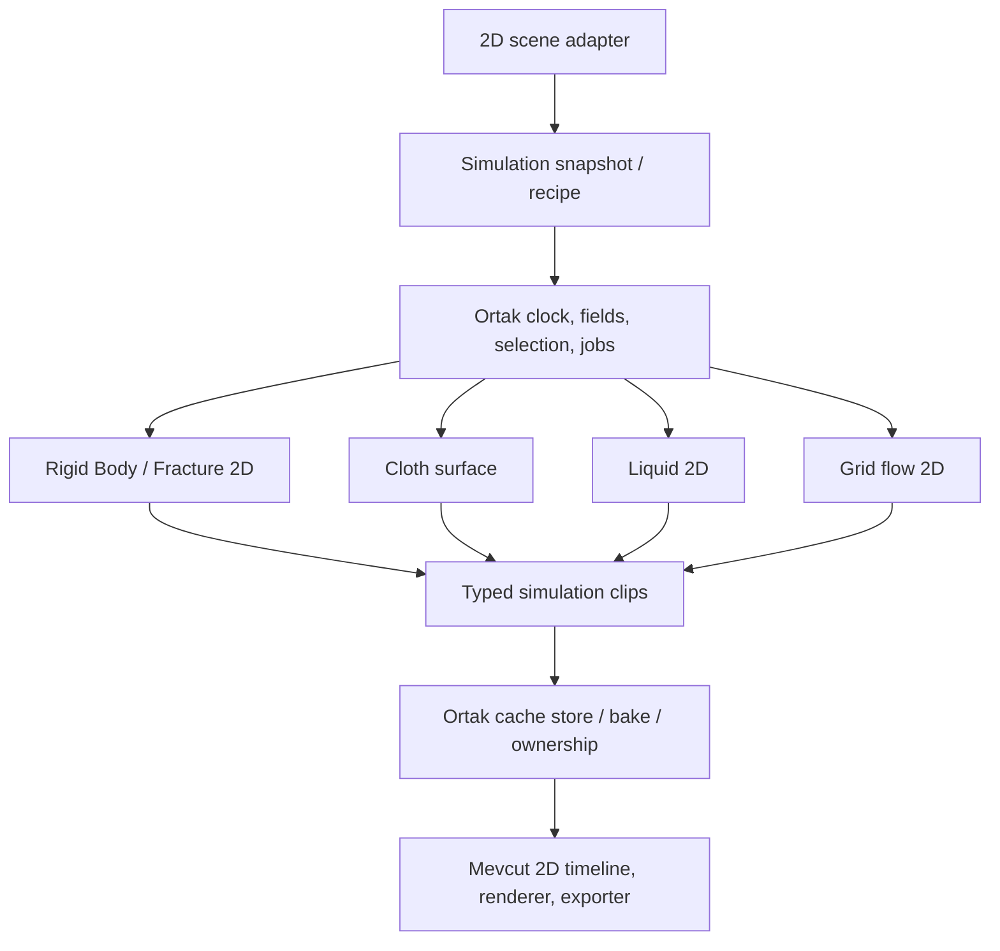

# Simulation Core — 2D ortak mimari

Tarih: 4 Kasım 2026. Durum: uygulama öncesi mimari karar. Rigid Body, Fracture, Cloth ve Fluids planlarının ortak sözleşmesidir. Mevcut özelliklerin uygulanmış olduğu anlamına gelmez.

**Güncel kapsam kararı: bütün geliştirmeler yalnızca `2danimation` modunda yapılacak. 3D mod, scene adapter, solver, kamera, renderer, timeline ve exporter geliştirmesi bu planın ve aşamaların dışındadır.** Önceki boyutlar arası değerlendirme yalnızca [arşiv referansıdır](archive/simulation-core-2d-3d-reference.md); uygulama talimatı değildir. Gelecekte 3D ancak yeni ve açık bir kullanıcı talebiyle ele alınır.

## 1. Ana karar

**2D katı cisim, kırılma, kumaş ve akışkan sistemleri ortak servis ve sınıfları kullanacak; solver'a özgü hesap ve çizim ayrılacak.** İş yürütme ve bake sistemi bir kez kurulur. Ortaklaştırma somut 2D ihtiyaçlarına göre yapılır; varsayımsal 3D desteği için genel boyut/adapter katmanları önceden geliştirilmez.

Kardeş planlar: [Rigid Body & Fracture](physics-fracture-bake-plan.md), [Cloth / Fabric](cloth-fabric-simulation-bake-plan.md), [Liquid & Fluids](fluid-liquid-simulation-bake-plan.md). Character Motion planı ayrı kalır.

6 Kasım 2026 geometri eki: [Editable Poly 2D / native ağ üretimi / Blob Surface](../production-2d-roadmap.md#9-editable-poly-2d-native-ağ-üretimi-ve-blob-surface). Poly vertex/triangle/quad kaynak topolojisi, grid/triangulation, sınır çıkarımı, doğrulama ve UV/buffer yardımcıları paylaşılır. Solver adapter'ları kendi rest state, constraint ve collider derlemesini yapar. Blob scalar field→contour üretimi sıvının görünüm adapter'ıdır; ortak fizik solver'ı değildir.

## 2. Repoda doğrulanan sınırlar

`modes/bootstrap.ts` bugün yalnız `Animation2DDescriptor` kaydediyor. `EditorMode` ve genel mode arayüzlerindeki diğer mod adları mevcut altyapı referansıdır; bu iş kapsamında etkinleştirilmez veya genişletilmez.

Core scene, transform ve timeline verileri mevcut 2D modelini kullanır. Yeni simülasyon clip'leri bu modelin cache/asset ve registry sınırlarına eklenir; ayrı bir sahne modu kurulmaz.

## 3. Ortak kullanılacak sınıflar

Aşağıdaki isimler önerilen yeni sınıf/sözleşmelerdir; mevcut MCP çağrıları değildir.

| Ortak yapı | Sorumluluk |
| --- | --- |
| `SimulationRecipe` / compiler | 2D sahnenin kaynak nesneleri, malzeme, alanlar, collider'lar, zaman aralığı ve sürümlerinden immutable iş girdisi üretir. |
| `SimulationClock` | Integer tick, sabit adım, alt-adım ve kayıt zamanlarını yönetir; ekran FPS'ine bağlı değildir. |
| `SimulationJob` / job manager | Queue, worker, progress, cancel, failed, stale ve completed durumlarını yönetir. |
| `AffectedObjectResolver` | Alan hedefleri, collider listeleri, ignore çiftleri ve koleksiyonları somut id'lere çözer. |
| `FieldSystem` | Gravity, rüzgâr, vortex ve diğer desteklenen alanları simülasyon zamanında örnekler. |
| Collider source/query sözleşmesi | Kaynak geometri, transform, yüzey hızı ve malzemeyi sunar; rigid/fluid düzlemsel temasları ve kumaşın yerel derinlik temasları ilgili solver'da çözülür. |
| `SimulationCacheStore` | Türlü clip manifest'i, binary chunk, hash, sürüm, byte bütçesi ve yükleme yaşam döngüsünü yönetir. |
| `BakeService` / bake record | Sonucu mevcut 2D timeline/asset modeline derler; generated ownership, tek undo, yeniden bake ve kullanıcı değişikliği denetimini yürütür. |
| Capability ve diagnostics | Solver, renderer, cache decoder ve exporter desteğini doğrular; desteklenmeyen sonucu sessizce düşürmez. |

Job/saat/cache sınıfları React, Canvas, Matter.js veya `ChronoScene` import etmez. Mevcut 2D sahne derleyicisi birimleri açık bir snapshot üretir. Veri kayıtları plain serializable yapılar olabilir; her kayda class yazılmaz. Genişletilen servislerde dar abstract base/interface ve composition kullanılır; katı cisim, kumaş ve gaz tek body modeline zorlanmaz.

## 4. 2D sahne, yerel derinlik ve birimler

Rigid Body, Fracture ve Fluids düzlemsel 2D çözümlerdir. Kullanıcının seçtiği bayrak/perde görünümü korunur: kumaş yüzeyi yerel x/y/z noktalarıyla dalgalanabilir, fakat çıktı 2D canvas/timeline içinde çizilir. Bu yerel derinlik hesabı 3D mod geliştirmesi, serbest 3D kamera veya hacimsel 3D sıvı kapsamı açmaz.

Ortak fizik verisi metre, saniye ve kilogram gibi açık birimlerle normalize edilir. 2D kullanıcı arayüzü px/s ve px/s² gösterebilir; `pixelsPerMeter` snapshot içinde saklanır. Matter adapter'ının kendi zaman/hız birimleri ayrıca çevrilir.

2D ekranın aşağı yönlü Y ekseni, solver koordinatı, dünya/yerel dönüşümler ve kumaşın derinlik işareti açıkça tanımlanır. Poz, normal, açısal hız, mesh winding ve gravity aynı dönüşüm sözleşmesini izler.

2D sıvıda referans yoğunluğu alan başına kütle veya açık eşdeğer kalınlık sözleşmesiyle tanımlanır. Kumaş yüzey yoğunluğu ayrı kalır. Fizik parametreleri ilgili 2D/surface modelin birimleriyle doğrulanır; genel 2D/3D numeric katman bu aşamada gerekli değildir.

## 5. 2D sistemler arasında paylaşım

| Sistem | Paylaşılabilecek hesap/kod | Sisteme özgü hesap/çıktı |
| --- | --- | --- |
| Rigid Body | Recipe, job, clock, fields, cache ve bake yönetimi | Matter.js 2D, collider ve x/y/dönme track'leri |
| Cloth | Job, fields, kaynak seçimi, binary cache ve bake ownership | Yüzey constraints, pin, yerel derinlik ve deformable mesh çizimi |
| Liquid / PBF | Particle/numeric buffer ve komşuluk yardımcıları gerektiğinde, job ve alanlar | 2D density/boundary çözümü ve particle/contour cache |
| Smoke / grid flow | Recipe, job, fields, emitter ve cache storage | 2 eksenli grid/advection/projection ve density/dye texture |
| Voronoi Fracture | Rigid-body çözümü, seed, job ve bake ownership | Düzlemsel polygon parçaları, centroid ve görsel kesimi |

Particle spatial hash veya numeric buffer gibi yardımcılar, en az iki mevcut 2D/surface ihtiyacında yararı doğrulandığında ortaklaştırılır. Kullanılmayacak dimension-generic kernel veya gelecekteki moda yönelik adapter eklenmez.

## 6. Kuvvet alanı ve collision semantiği

Alan tanımı ortak: kind, transform/uzay, kapsam hacmi, yön, şiddet/zaman eğrisi, falloff, seed ve affected-object listesi. Fakat alanın solver'a uygulanması semantik olarak ayrılır: gravity ivmedir; hedef rüzgâr hızı drag modeliyle etkiler; kumaş yüzey basıncı ile gaz grid kuvveti aynı formül değildir.

Collider sözleşmesi geometri yanında kapalı/açık sınır, signed distance/normal veya desteklenen temas query'si, boundary velocity ve malzeme sunar. Rigid/fluid düzlemsel primitive'ler kullanır. Kumaşın yerel derinlik temasları kendi primitive proxy'lerini açıkça tanımlar; render layer sırası fiziksel derinlik sayılmaz.

Field targets, collision targets, pin targets ve emitter sources ayrı ilişkilerdir. Collection üyeliği snapshot'ta çözülür. Boyut veya solver capability'si uyuşmayan nesne hedef listesinde hata/tanı verir; referansın varlığı etkileşimin desteklendiği anlamına gelmez.

İlk karma sahneler one-way çalışır: örneklenmiş rigid/collider trajectory'si cloth/fluid'e girdi olur. İki yönlü etkileşim ortak alt-adım, temas/kuvvet alışverişi ve kararlılık gerektirir. Aynı job manager'da iki solver bulunması iki yönlü coupling'i otomatik sağlamaz.

## 7. Cache ve bake türleri

Ortak clip header'ı: schema/solver sürümü, source/recipe hash'i, boyut, birimler/koordinat uzayı, sample times, interpolation politikası, channel manifest'i ve chunk hash/byte bilgileri. Payload türü açıkça ayrılır:

- `rigidPose`: 2D poz/açı; interpolasyon tam tur dönmelerini korur.
- `meshDeformation`: sabit topoloji ve UV, vertex poz örnekleri; kumaş için uygundur.
- `particleFluid`: stable particle id, yaşam aralığı, poz ve gerekli ek kanallar.
- `gridField`: çözünürlük, hücre/face yerleşimi, domain transform'u ve scalar/vector alanlar.
- `surfaceSequence`: örnek başına değişebilen contour/mesh topolojisi.
- `rasterSequence`: belli kamera/görünümle çizilmiş kareler; fizik state'i değildir.

Cache storage, hash, sıkıştırma ve yükleme protokolü paylaşılır; payload decoder ve interpolator ayrı tutulur. Gaz yoğunluk grid'ini kumaş vertex buffer'ı gibi, değişen sıvı yüzeyini sabit topolojili mesh gibi oynatmak desteklenmez.

2D rigid bake normal keyframe'lere derlenebilir. Kumaş/fluid/gaz çoğunlukla binary clip ve timeline playback kontrolü gerektirir. BakeService ilgili output-kind derleyicisini seçer ve mevcut 2D timeline'ı kullanır; kendi keyframe motorunu yazmaz.

2D sıvı contour'larının topolojisi değişebilir. Kumaşın sabit-topoloji decoder'ı buna otomatik uygun değildir. Clip decoder'ları farklı 2D sonuç türlerinin ihtiyacına göre ayrılır.

Poly kaynak quad yüzleri runtime/solver için kararlı triangle ağına derlenebilir; bu eşleme topology hash'ine girer. Marching Squares çıktısında aynı contour/vertex kimliği kareler arasında garanti edilmez. Sıvı hareket cache'i ve yüzey appearance recipe/hash'i ayrı tutulur; görsel threshold/örnekleme değişimi mümkünse kayıtlı particle verisini yeniden kullanır. Tek kareyi Poly'ye dönüştürme yeni bir kaynak nesne üretir; değişken topology klibini sabit mesh payload'ı yapmaz.

## 8. Bütçeler ve runtime

128×128 grid 16.384 hücre içerir. Float32 tek scalar alan kare başına 64 KiB, 91 örnekte 5.963.776 byte olur. Hız/basınç/temperature ve çalışma buffer'ları ayrıca hesaplanır.

Domain, aktif hücre/particle, komşu sayısı, substep, sample sayısı, transfer ve saklama boyutu preflight'ta hesaplanır. Cache chunk/sparse formatı gerçek 2D iş bütçesine göre eklenir; sınırsız RAM veya GPU varsayılmaz.

CPU worker ilk doğruluk referansıdır. GPU/WebGPU compute daha sonra ayrı backend/capability olarak değerlendirilebilir. Preview için düşük çözünürlük ve final bake için yüksek çözünürlük farklı recipe/hash oluşturur; final çıktı preview'ın aynısı diye sunulmaz.

Solver çalıştırmadan playback, ilgili cache decoder ve renderer desteği gerektirir. Unsupported runtime için raster fallback veya açık tanı verilir. Tüm asset'ler portable projede/pakette referans ve hash'leriyle korunur; decoder değişiminde sürüm denetimi yapılır.

## 9. Uygulama sırası ve kabul

Genel geliştirme önceliği [2D üretim yol haritasında](../production-2d-roadmap.md) tanımlıdır: önce export tutarlılığı, bileşen kütüphanesi ve çoklu format üretimi. Aşağıdaki sıra yalnız simülasyon işine gelindiğinde onun iç bağımlılıklarını belirtir; ana öncelik kuyruğunu değiştirmez.

1. Ortak recipe, snapshot adapter, clock, job ve cache header'ını ilk 2D rigid bake içinde uygula; varsayımsal bütün solver'ları önce yazma.
2. Cloth ve Liquid 2D ile ikinci/üçüncü payload türlerini ekle; ortak helper sınırlarını somut kullanımda doğrula.
3. Grid Flow 2D ve alan/collider kaynaklarını ekle; cache bütçesini ölç.
4. Ortak 2D asset/decoder, renderer parity, portable proje, MCP ve güvenli re-bake teslimini tamamla.

3D işi, 3D kabul fixture'ı veya 3D dependency kurulumu bu sıraya eklenmez. Olası iki yönlü etkileşim de kendi 2D kabul ölçütleriyle ayrı genişletmedir.

Ortak servisler aynı 2D modundaki rigid/cloth/fluid fixture'larıyla test edilir. Çekirdek import sınırı, birim/eksen dönüşümü, fixed-step, cancel/stale, event yaşam döngüsü, cache round-trip, atomik bake/re-bake ve renderer parity doğrulanır. Her yeni servis anlamlı olaylarını mevcut script/host yapısına açar.

Bu belge plan dosyasıdır. Uygulama başladığında canonical skill ve MCP şemaları birlikte güncellenir; gerekli `npm test`, `npm run mcp:build`, `npm run build` kontrolleri yapılır. Build öncesinde Next sunucusu durdurulur. Dosya yerel `plan/` konvansiyonunu izler.
