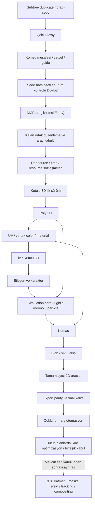

# Chorono 2D / 2.5D — birleşik üretim ve geliştirme yol haritası

Tarih: 4 Kasım 2026. Güncelleme: 11 Kasım 2026. **Güncel ve onaylanan sıra:**
tamamlanan kullanıcı onaylı tanı servisi/sürüm kontrolü D0–D2 ara işinden sonra
tamamlanan E−1.Q/E−1.1/E−1.2/E−1.3 MCP açıklığı/güvenli düzenleme/köken/ortak hiyerarşi, E−1.4 Set Key/transport ve
E−1.5 prosedürel eğri/bake sonrasında E−1.5A input expression ve kalan
viewport/ortak araç kabulü → dar entegrasyon sözleşmeleri →
kutulu 3D → Poly/UV/material → ileri kutulu 3D → bileşen/karakter → fizik,
kumaş, Blob/sıvı/akış → export/final kalite → çoklu format/otomasyon → bütün
ürünü kapsayan ikinci optimizasyon ve birleşik kabul.
[Ayrıntılı sıra ve bağımlılık sınırları](plans/geometry-material-boxed3d-sequence.md)
bu sıranın uygulama rehberidir. Önceki sıra kayıtları §12'de tarihsel kanıttır;
güncel iş kuyruğu bu bölüm ve bağlantılı sıra belgesidir.

**11 Kasım sonraki faz kaydı:** [CFX — ileri katman/kompozisyon/efekt, video
kurgu, yerel tracking ve 3D compositing](plans/advanced-compositing-tracking-plan.md)
mevcut serinin son optimizasyon ve birleşik kabulünden **sonraki ayrı faza**
eklenmiştir. Mevcut sıra ve sıradaki E−1.5A değişmez; CFX yeni bir ara iş değildir.

Genel optimizasyonun ilk kabulü §12.37'de, viewport V1/V2 §12.40'ta ve V3
position key authoring §12.41'de tamamlandı. Yeni alanlar henüz uygulanmadı.
2.5D; 2D çalışma alanında kutulu 3D ve derinlikli kumaş anlamındadır;
bağımsız tam 3D Modeling veya Game Engine modunu etkinleştirmez.

**8 Kasım ek kullanıcı önceliği tamamlandı:** V5 sonrası [komşu mesafesi düzenleme,
seçim ve ruler/guide araçları](viewport-layout-editing.md) uygulandı.
İlk sürüklemenin geri sıçraması ve modifier basılı mouse-up hataları V5
kapanışında ele alındı (§12.43); ölçü/guide kabulü §12.44'tedir.

**9 Kasım viewport düzeltmeleri:** [pointer-up/guide bırakma, sabit durum çubuğu,
fare noktası, hafif gölge ve kompozisyon dışı düzenleme](viewport-interaction-polish.md)
uygulandı (§12.45). Kalan E−1 ve tam V6 kabulü D0–D2 ara işi sonrasında korunur.

**10 Kasım sadeleştirilen ara iş:** [kullanıcı onaylı hata özetleri ve sürüm
kontrolü](plans/diagnostics-consent-version-plan.md), kalan E−1 işinden önce
**D0–D2** olarak planlandı (§12.46). Yalnız beklenmeyen hatalar tekilleştirilip
tekrar sayısıyla gösterilir; ayrıntılı Interaction kaydı elle açılan yerel araçtır.
Son kullanıcı isteğiyle hata paylaşımı ve sürüm kontrolü aynı, varsayılan kapalı onaya bağlıdır.
Hata paylaşımı için ilk çalıştırmada bir kez onay sorulur; tercih saklanır,
kabul edilirse düzenli anonim özet gönderimi başlar, ayarlardan kapatılabilir.
D0–D2 tamamlandı (§12.48–50): kalıcı ilk açılış onayı, kuyruk, gerçek alıcı
API/depo, aynı izinle sürüm kontrolü ve ayrı admin hata yönetimi. D2'nin güncel
kabul sınırları [uygulama belgesindedir](diagnostic-management.md); public
hosting/yayın ayrıdır. **E−1.Q MCP araç kalitesi de tamamlandı (§12.52);
E−1.1 zorunlu okuma/revision da tamamlandı (§12.53); E−1.2 kaynak kökeni de tamamlandı (§12.54); E−1.3 ortak hiyerarşi de tamamlandı (§12.55); E−1.4 Set Key/transport (§12.56) ve E−1.5 zorunlu eğri/bake (§12.58) tamamlandı. Sırada E−1.5A input expression (§12.59), ardından kalan ortak araç kabulü var.**
Paylaşım tercihi localStorage'da saklanır; her açılışta veya olağan güncellemede
tekrar sorulmaz. Yönetim token'ı ayrı, yalnız sayfa belleğindedir.
Son [capture kaybı, kalıcı tanı kaydı ve ardışık
shape kimliği düzeltmeleri](pointer-gesture-lifecycle.md) ise uygulanıp doğrulandı.

## 1. Kapsam ve öncelikler

| Sıra | İş | Durum / ilk teslim |
| --- | --- | --- |
| Tamamlandı | İlk genel optimizasyon; viewport V1/V2/V3 | Mevcut kazanımlar ve regresyon fixture'ları korunur. |
| Tamamlandı — V4 | Subtree duplicate / drag-copy | [Gerçek sözleşme](viewport-clone-editing.md): ortak clone yolu, kök normalizasyonu, internal referanslar, bütün ilgili timeline'lar ve tek undo; destek sınırları belgede. |
| Tamamlandı — V5 | Çoklu Array | [Gerçek sözleşme](viewport-array-editing.md): dört pattern, forest, animasyon, bounded preview, Apply/Cancel ve tek undo. |
| Tamamlandı | Komşu mesafesi ve ruler/guide araçları | [Gerçek sözleşme](viewport-layout-editing.md): seçimi koruyan sayısal boşluk, yakın yatay/dikey komşular, kalıcı guide, cursor ve snap. |
| Tamamlandı — D0–D2 | Kullanıcı onaylı hata özetleri ve sürüm kontrolü | Kalıcı tek onay + kuyruk + gerçek alıcı ve izinli sürüm kontrolü; admin erişimli sade hata listesi/durum takibi. Public yayın ayrı. [D1](diagnostic-sharing.md), [D2 ve kabul sınırları](diagnostic-management.md). |
| Tamamlandı — E−1.Q | MCP araç kalitesi | [Uygulama ve kabul](plans/mcp-tool-quality-plan.md): standard 40 / legacy 77, dokuz uyumlu alias, typed şema ve açıklamalar. |
| Tamamlandı — E−1.1 | Zorunlu güncel sahne okuması/revision | MCP 2.0.0; istemci/belge/revision token, son browser CAS, plan/batch/retry ve değişiklik özeti. |
| Tamamlandı — E−1.2 | İnsan/ajan kaynak kökeni | Optional bounded authoring v1; creation/field/last writer, copy/import, history, portable ve runtime temizliği. |
| Tamamlandı — E−1.3 | Ortak editör hiyerarşisi | Explorer/Timeline tek source tree, Find, subtree flags/undo, çoklu dal filtreleri ve güvenli UI reparent. |
| Devam ediyor — sırada A2 | E−1.5A, ardından kalan E−1 ve araç kabulü | [A1 sabit numeric input formülleri](input-expressions.md) uygulandı; sırada canlı zaman/kaynak bağlamı A2, sonra A3–A5 ve V6/E−1.7. Set Key/transport ve zorunlu prosedürel eğri/bake tamamlandı. |
| Sonra 1 | Ortak dar entegrasyon | Source/asset kimliği, kesin frame saati, çıktı capability ve kaynak sahipliği. |
| Sonra 2 | Kutulu 3D ilk sürüm | GLB/glTF, model hiyerarşisi, kamera/ışık/material, şeffaf yüzey, 2D Timeline ve portable save/load. |
| Sonra 3 | Editable Poly 2D | Vertex/edge/tri/quad, grid/triangulation, selection/bounds/renderer/undo. |
| Sonra 4 | Texture, vertex color, UV ve basit material | Texture gizmo ve UV paneli; dokulu/deforme mesh adapter'ı. |
| Sonra 5 | Kutulu 3D ileri düzenleme | Çoklu model, camera animasyonu, imported rig/clip/morph; rig oluşturma/IK ayrı artımlı dilimler. |
| Sonra 6 | Bileşen kütüphanesi ve Character Motion | Source component/local clock; 2D rig/FK/IK/sprite/state-machine. |
| Sonra 7 | Simulation Core, rigid, Voronoi ve particle fiziği | Poly kaynaklı kırılma; sabit adım, gravity/field/collision, cache/bake. |
| Sonra 8 | Fabric/kumaş | Poly rest mesh/UV; gravity/wind/pin/collision ve bake. |
| Sonra 9 | Blob Surface, sıvı, akış/duman | Değişken topoloji, contour/mesh görünümü; alanlar/collision ve bake. |
| Sonra 10 | Tamamlayıcı 2D üretim araçları | Particle V2+, runtime konsolu, gelişmiş metin, çizim/fırça. |
| Sona taşındı 1 | Export tutarlılığı ve yüksek kaliteli final render | Yeni türlerin parity/capability'si; hedef çözünürlükte redraw, sampling/preview; ardından ileri renk/backend/FP16. |
| Sona taşındı 2 | Çoklu format ve üretim otomasyonu | Ekran oranları/codec desteği, queue, data-driven üretim, audio-driven hareket ve kelime zamanlı altyazı. |
| En son | İkinci genel optimizasyon, ileri profiler ve birleşik kabul | Four Seasons + yeni Poly/3D/rig/cloth/Blob/fluid/export alanlarında CPU/bellek/GPU/job ve görüntü eşliği. |
| Mevcut seriden sonraki ayrı faz — CFX | İleri katman/kompozisyon/efekt, maske, video kurgu, yerel tracking ve 3D compositing | [CFX1–CFX11](plans/advanced-compositing-tracking-plan.md); mevcut kapıları veya sıradaki işi bloke etmez, kendi regresyon/çıktı kabulü gerekir. |

Tam export/refactor ve kapsamlı son optimizasyon ertelenir; her yeni feature'ın
kaynak bütçesi, acquire/release/dispose, cache invalidation, kaydet/aç/undo/clone,
doğru zamanda değerlendirme ve asgari raster çıktı/bake kontrolleri ertelenmez.
Desteksiz exporter yeni layer'ı sessizce atlayamaz; capability/fallback açık olur.
Son optimizasyon turu kritik bellek sızıntısı veya doğruluk hatasını bekletme izni değildir.

Elle düzeltme her feature'ın teslim koşuludur (§7). Soft selection/connected-loop
kullanıcının isteğine göre en son tartışılacak ayrı konudur. Önceden yazılmış
özellik planları ve kabul koşulları korunur; yalnız teslim sırası değişir.

## 2. Bağımlılıklar ve geçiş kapıları

Bu diyagram teslim sırasını ve önemli geometri bağımlılıklarını gösterir;
her ok zorunlu kod bağımlılığı değildir. Tam export compiler bileşen source
modelinin önkoşulu değildir; kesin zaman/asset/capability sözleşmesi önkoşuldur.

- **G0 — İnsan–ajan devam edebilir:** E−1 birleşik kabulü geçer; taze okuma ve manuel alan/kimlik koruması, tek undo, keyset/transport/eğri ve viewport pivot/seçim/key çizimi/subtree çoğaltma doğrulanır. Ayrıntı E−1 ve viewport planındadır; soft selection tartışması bu kapıya eklenmez.
- **G1 — Export güvenilir:** E1/E2 temel 2D fixture'ları geçer. Aynı snapshot/profil File/JSON/MCP ve standalone'da aynı anlamı taşır. Yeni codec veya gelecekteki solver bütünlüğü beklenmez.
- **G2 — Bileşen yeniden kullanılabilir:** C1 kart örneği iki instance'ta farklı text/color/başlangıçla çalışır; source ve asset'ler korunur; portable ve runtime parity geçer. İleri nested/interactive C2 işleri ilk çoklu formatı bekletmez.
- **G3 — Çoklu format teslim edilebilir:** M0 text layout ve font/bounds, M1 variant compiler, M2 queue ve M3 portable/MCP doğrulaması tamamdır. Üç oran gerçek desteklenen formatta alınır; source değişmez, overflow ve stale bake görünürdür.

Bu kapılar uygulama sırasında kanıtla tamamlanır. Optimizasyonun güncel kapanışı §12.37'dedir; önceki §12 kayıtları teslim günündeki açıkları anlatır. G0–G3 henüz tamamlanmış sayılmaz. Takvim/ETA ilgili gerçek iş yükü ölçümlerinden sonra çıkarılır.

## 3. Ortak mimari kararlar

Mevcut scene, registry/property schema, evaluator, timeline, asset ve command/undo çekirdeği genişletilir. Her feature için yeni scene/timeline/render motoru açılmaz. Export için tek canonical compiler; component için derived scene/local time; format için immutable variant compiler kullanılır.

Native komutlar UI ve MCP/script için aynı mutasyon yoludur. Ağır render/analysis işleri async job id/progress/cancel ile yürür; sync QuickJS callback'i bunları beklemez. Gerçek API isimleri capabilities/catalog ve şemalarla uygulama sırasında kesinleşir.

6 Kasım kaynak uyumluluk incelemesinde [§10 entegrasyon koşulları](#10-kaynak-kodla-uyumluluk-incelemesi--6-kasım-2026) eklendi. Registry genişletilebilirliği tek başına yeni nesnenin bütün editör/player/export yollarında desteklendiği anlamına gelmez. Yeni veri modeli, instance/clone, nihai frame/bounds, asset/cache ve capability yolları ilgili feature ile birlikte tamamlanır. Kullanıcı öncelikleri değişmez.

Her job source revision/hash, component version, variant, timeline/zaman kapsamı ve asset/font/cache bağımlılıklarını pin'ler. Source edit, devam eden işi kendiliğinden başka sürüme çevirmez. Stale durum ve re-run/replace politikası görünürdür. Yeni event'ler mevcut script/host yapısına açılır.

Cache türleri birbirine karıştırılmaz: component çözümü, layout, PCM feature, simulation ve raster preview farklı payload'lardır; manifest/hash/ownership/job yaşam döngüsü ihtiyaç doğrulandığında paylaşılır. Fazladan genel altyapı kurmak başlı başına teslim sayılmaz.

Particle fiziği, mevcut seed'li spawn ve görsel life kontrollerini kullanır; prosedürel konum ile fizik konumu aynı anda iki kez uygulanmaz. İlk temas particle–collider içindir; particle–particle katı temas veya sıvı yoğunluk çözümü olduğu iddia edilmez. Sabit collider'larla başlayan akışa sonradan bake edilmiş hareketli collider girdileri eklenir. İlk çözüm düzlemseldir; kumaşın yerel yüzey derinliği ve model katmanının 3D render'ı genel 3D fizik dünyası oluşturmaz.

## 4. Mevcut karakter ve fizik planları

[Character Motion](character-motion-plan.md), [Rigid Body & Fracture](plans/physics-fracture-bake-plan.md), [Cloth](plans/cloth-fabric-simulation-bake-plan.md), [Fluids](plans/fluid-liquid-simulation-bake-plan.md) ve [Simulation Core 2D](plans/simulation-core-2d-architecture.md) korunur. Bu üretim yol haritası onları silmez veya uygulanmış saymaz.

Güncel uygulama kuyruğu §1 ve onaylanan sıra belgesindedir. V4/V5, komşu mesafesi/cetvel/guide ve D0–D2 sade hata özeti/sürüm ara işi tamamlandı; sırada kalan E−1 ortak düzenleme var. Ardından kutulu 3D/Poly ve üretim özellikleri gelir. Tam export ve ikinci genel optimizasyon sona taşınmıştır; dar frame/asset/resource sözleşmeleri feature teslimleriyle birlikte uygulanır.

Simülasyon source geometri/alan/pin/collider değişince stale olur. Çoklu format yalnız kaydedilmiş görseli root transform'uyla yerleştiriyorsa resimülasyon yaptığı iddia edilmez. Component içine baked cache alınması solver çalıştırma bağımlılığı yaratmaz; ilgili decoder/renderer capability'si gerekir.

Genel per-character text animator eski backlog'da ayrı iştir. Caption planı zamanlı konuşma/kelime akışını kapsar; aynı text layout/renderer altyapısı paylaşılır. Autosave/version snapshot zaten var; bu yol haritası bunları yeni özellik gibi tekrar planlamaz.

## 5. Doğrulama ve başarı ölçütleri

İlk ortak referans proje: kısa/uzun Türkçe başlık, renkli kart, image/logo, tek giriş/çıkış klibi ve 5 saniyelik ses; ayrı minimal state/wire/particle/mask fixture'larıyla desteklenir. Amaç tek dev sahnede rastgele test değil, her sözleşmenin açık kanıtıdır.

Ölçülecek sonuçlar: canonical export alan/parite hataları; bir bileşenin tekrar kullanımında gerekli manuel işlem; üç formatın source değişmeden üretilebilmesi; overflow/font sorunu sayısı; queue başarısızlık/iptal izolasyonu; cache boyutu ve final render süresi. Sabit iyileşme yüzdeleri, FPS veya süre kazancı ölçülmeden vaat edilmez.

Görsel QA'da representative kareler gerçek render ile karşılaştırılır; değer değerlendirmesi tek başına yeterli değildir. Audio için gerçek PCM/zaman aralığı, state machine için replay edilmiş olay sırası, input/output için portable round-trip kontrol edilir.

Uygulama değişikliklerinde repo kontrolleri `npm test`, `npm run mcp:build`, `npm run build` ve gerekli görsel/işlev testleri yapılır. Next build öncesinde dev/production sunucusu durdurulur. Testler geçtikten sonra değişmeyen konular gereksiz yere tekrar test edilmez. MCP/API değişimlerinde canonical `skills/chorono/` güncellenir.

## 6. Bu planlama teslimi

İlk planlama tesliminde uygulama kodu, bağımlılık, çalışan editör sahnesi veya yayın durumu değiştirilmemişti. Sonraki ilk kaynak yönetimi uygulaması §12'de kaydedilir. Diğer ayrıntılı planlar; veri modeli önerileri, ilgili mevcut modüller, çalışma akışı, kabul kapıları ve sonraki işlerin sınırlarını içerir. Henüz uygulanmamış sınıf/araç isimleri öneridir; mevcut API diye çağrılmamalıdır.

Belgeler repository'nin yerel `plan/` konvansiyonunu izler. Sonraki teknik başlangıç **OPT0 genel benchmark matrisi ve ölçüm sözleşmesi; ardından OPT1 ortak sayaçlar ve temel kaynak panelidir.** Export hattında ilk iş E0 fixture/canonical alan manifest'i, ardından E1 ortak compiler olarak korunur. Optimizasyon tüm yeni feature'ların ortak teknik koşuludur.

## 7. Elle düzeltme ve kullanıcı müdahalesi

### 7.1. Amaç ve mevcut temel

Kullanıcı AI, preset, controller veya simülasyonla üretilmiş sonucu anlaşılır araçlarla düzeltebilmeli; düzeltmenin hangi nesneye, özelliğe, klibe ve zaman aralığına ait olduğu görünür olmalıdır. Yeniden üretim bu emeği sessizce silmemelidir. Bu bölüm geliştirme gereksinimidir; aşağıdaki davranışlar bugün uygulanmış sayılmaz.

Mevcut inspector/spreadsheet, keyframe time/value/easing komutları, curve editor, ghost/onion skin, spline/motion-path overlay ve transaction/undo temeli tekrar kullanılır. `KeyframeInspector` ve `KeyframeSpreadsheet` bugün value düzenlemesini sayısal değerlerle sınırlıyor; çoklu seçim inspector'ı toplu easing/silme sunuyor. Bunlar yeni özellik olarak baştan yazılmaz; typed ve toplu düzeltme açıkları tamamlanır. Auto/manual/record modları zaten vardır; yeni bağlamlara doğru aktarılır.

### 7.2. Geliştirilecek düzenleme noktaları

| Alan | Elle düzeltme gereksinimi | İlk teslim sınırı |
| --- | --- | --- |
| Timeline ve keyframe | Seçili aralığa zaman kaydırma/ölçekleme, değer offset'i; sayısal/frame girişi, typed value kontrolleri ve sınır karelerini koruma | Var olan bulk/scale/stagger araçları önce doğrulanır. Renk, Vec2 ve discrete değerler kendi editor'leriyle düzenlenir; sayı gibi işlenmez. |
| Eğri ve hareket yolu | Tutamaç/teğet ve yol noktalarını görsel/sayısal düzeltme; önce/sonra ve onion skin karşılaştırması | Mevcut araçları bağlam ve typed kanal desteğiyle tamamla. UI'si bulunan ama handler'ı olmayan eylemler çalışan özellik sayılmaz. |
| Düzeltme kapsamı | Seçili nesne/özellik/klip/zaman aralığı, local/world veya instance/definition hedefini açık gösterme | Sürüklemeden önce hedef görünür; sayısal ve düğmeli alternatifler vardır. Bir hareket tek undo, Escape iptalidir. |
| Bileşen ve format | Instance'a özel metin, renk, görsel, boyut, crop, yerleşim; orana özel offset, satır kırımı ve safe area | Kaynak tanım ve diğer oranlar etkilenmez. Değeri varsayılana döndür ve instance override'ını kaldır ayrı eylemlerdir. |
| Veriden üretim | Hücre/mapping hatasını, seçili satırın kontrolünü ve çıktısını düzeltme | Dataset/mapping değişimi ile yalnız o çıktı için satır override'ı ayrıdır; başka satırın sonucuna yazmaz. |
| Ses ve altyazı | Analiz range/smoothing, hatalı beat marker'ı, cue/kelime zamanları, metin ve satır kırımı | Otomatik analiz yenilenince elle düzeltilen zaman/marker'lar korunur veya açık sürüm çakışması olarak gösterilir. |
| Kutulu 3D nesne | Model yönü, pivot, kamera kadrajı, ışık/malzeme ve seçili kontrol anahtarı | 2D kutu transform'u ile iç model transform'u ayrı. Modeli kadraja sığdır açık eylem; çalışma görünümü çıktı kamerasını değiştirmez. |
| Karakter ve sprite | Rest pose/attachment, IK hedefi ve ağırlığı, dirsek yönü, sprite pivot/kare sırası/klip zamanları | Setup ve Animate ayrıdır. Aktif IK'nin sürdüğü kemiğe gizli FK düzeltmesi yazılmaz; hedef veya IK ağırlığı üzerinden düzenlenir. |
| Poly 2D ve ağ üretimi | Vertex/edge/face seçimi; nokta ekle/taşı, yüz oluştur/sil, ızgara yoğunluğu, triangulate ve quad birleştirme önizlemesi | Üçgen/dörtgen yüzler tek nesnede kalır. Geçersiz yüz, çakışma ve T-junction denetlenir; topology değişimi bağımlı bake'i stale yapar. |
| Blob Surface | “+” etki noktası ekle, taşı, radius/weight/threshold ayarla; merge grubu ve ayrılan bölgeleri incele | Aynı grupta birleşme/ayrılma görsel alan hesabıdır. Sıvı cache'inin yüzey görünümünü düzenlemek particle fiziğini yeniden çözmez. |
| Rigid/fracture | Collider noktası, kütle/sekme, başlangıç hızları; Voronoi seed noktaları, parça sayısı ve kırılma anı | Collider ve parça geçerliliği yeniden doğrulanır. Geometri/kırılma değişirse bağımlı bake eski olur. |
| Particle fiziği | Emission şekli/yolu, burst zamanı, hız/ömür, alan ve collider hedefleri | Hesabı etkileyen düzenleme yeni simülasyon ister; sırf renk/life görünümü değişimi uygun durumda aynı hareket cache'ini kullanır. |
| Kumaş/fabric | Mesh/pin seçimi, sabitle/bırak, hedef yolu, gravity/wind ve collider tutamaçları | İlk teslim solver girdilerini düzenler ve yeniden hesaplar. Hesap sonrasında sabit topolojiye bölgesel mesh düzeltmesi ileri aşamadır. |
| Sıvı ve akış | Domain/engel sınırları, emitter/drain, akış miktarı, kuvvet alanı konumu/yönü ve etkilenen nesneler | Fizik girdisi değişince yeniden hesapla. Appearance, opacity veya görsel maske düzeltmesi sıvı basıncını değiştirdiği iddiası taşımaz. |
| Bake sonrası | Desteklenen transform'larda zamanlı düzeltme; görünüm/timing düzenleme; bağımsız editable kopya | Kaynak bake/cache korunur; yoğun mesh/particle verisi varsayılan olarak binlerce keyframe'e açılmaz. |

### 7.3. Kaynak düzeltmesi ve sonuç düzeltmesi

Üç açık eylem bulunur:

1. **Kaynağı düzenle:** rig, geometri, controller, collider, pin veya fizik tarifini değiştirir. Bağımlılık hash'i değişir; ilgili bake/analiz eski olarak işaretlenir. İlk simülasyon sürümü bütün gerekli aralığı başlangıçtan hesaplar; güvenilir checkpoint altyapısı olmadan yalnız bir kesiti yeniden simüle ettiği iddia edilmez.
2. **Sonuca düzeltme ekle:** üretilmiş temel korunur. İlk destek rigid/normal katman x/y ve unwrap edilmiş dönme için zaman aralıklı delta track'idir. Alan dışındaki delta sıfırdır; giriş/çıkış ağırlığı anahtarlarla kontrol edilir. Kaynak veya yeni bake üzerinde aynı rigid kimlik ve koordinat sözleşmesi korunuyorsa düzeltme tekrar uygulanabilir; fiziksel temasları yeniden çözmez. Renk/discrete değerler bu sayısal toplama yoluna girmez.
3. **Bağımsız düzenlenebilir kopya oluştur:** normal track çıktısını kopyalar ve üretim sahipliğini o kopyadan ayırır. Orijinal kaynak/bake kalır. Mesh/fluid için renderer destekli clip veya açık raster bake seçilir; her cache normal keyframe'e dönüştürülebilir diye gösterilmez.

İlk düzeltme delta'sı desteklenen base/controller/baked poz çözüldükten sonra aynı yerel koordinatlarda uygulanır; parent/layout transform'u daha sonra bir kez bileşir. Karakterde IK sonrası kemik delta'sı ilk sürümde sunulmaz: elle değişen IK hedefi/ağırlığı constraint çözümünden önce değerlendirilir. Böylece yeni düzeltme sistemi mevcut karakter değerlendirme sırasını gizlice değiştirmez. Görsel düzeltme collider/solver sonucunu değiştirmez; yeni fizik için kaynak düzenleme yolu kullanılır.

Simülasyon klibini kırpma/oynatma hızını değiştirme kayıtlı görselin zamanını değiştirir. Bağlı marker/ses olaylarının aynı local time eşlemesini izlemesi gerekir; ham fizik kaydı değiştirilmez. Fiziksel hız/ivme sonucu yeniden hesaplanmış gibi sunulmaz.

### 7.4. Yeniden üretimde emeği koruma

Manuel override ve delta'lar kaynak generated track/cache'ten ayrı saklanır. Projede source owner/id, yerel hedef kimliği, instance/variant/klip kapsamı ve referans bake sürümü korunur. Export'ta görsel etkileri canonical evaluator/compiler üzerinden taşınır; editor-only bayrak diye atılmaz.

Re-bake yeni bir temel sürüm üretir. Hedef kimliği, zaman/koordinat kapsamı veya mesh topology değişmişse manuel düzeltme yeni sonuca sessizce yeniden bağlanmaz; önceki düzeltilmiş sürüm korunur ve eşlenemeyen alanlar görünür olur. Yapı değişmeden korunabilen override'lar devam eder. Önce/sonra karşılaştırması ve düzeltmeyi geçici kapatma kaynağı silmez.

Kullanıcı seçili özellik/track/aralık için **Yeniden üretimde koru** işareti verebilir. Bu, mevcut `Layer.locked` seçim kilidinden ayrıdır; kullanıcının elle düzenlemesini engellemez. AI/MCP, dataset refresh, preset update ve bake commit aynı native yazma denetimini kullanır. Korumayla çakışan otomatik transaction atomik olarak uygulanmaz; hedefleriyle tanı döndürür. Kullanıcı korumayı açıkça kaldırarak veya hedefi belirterek değiştirir; her rutin düzenleme için yeni onay sorusu çıkarılmaz.

Koruma editor/authoring metadata'sıdır; oynatılan düzeltme verisi ise runtime verisidir. Bu ikisi exporter'da karıştırılmaz. Eski projede bu kayıtlar yoksa mevcut evaluation değişmez. MVP tek ilgili düzeltme kümesi kullanır; tam NLA/çok katmanlı animasyon stack'i bu işin önkoşulu yapılmaz.

### 7.5. Teslim sırası ve kabul kapıları

| Dilim | Ana plana bağlandığı yer | Kabul |
| --- | --- | --- |
| MAN0 — güvenilir düzenleme | Export A1 ve mevcut timeline | Mevcut sayısal/typed/bulk araç envanteri, kapsam göstergesi, tek undo/cancel ve editor/player/export parity. |
| MAN1 — bağımsız override | Bileşen, format ve üretim otomasyonu | Instance/variant/row/kelime düzeltmesi kaydet–aç ve yeniden üretimde korunur; kaynak/diğer instance değişmez. |
| MAN2 — feature kontrolleri | 3D, karakter ve her simülasyonun kendi teslimi | Model/pivot/IK/pin/collider/field hem tutamaç hem sayısal/düğmeli alternatifle düzenlenir; doğru kaynak invalidation oluşur. |
| MAN3 — bake sonrası düzeltme | İlk rigid bake ve sonraki typed cache teslimleri | Base korunur; delta/kopya/retime açık ayrılır; re-bake eşleme ve topology çakışması kullanıcı emeğini silmez. |
| MAN4 — ileri mesh düzeltmesi | Temel kumaş/cache tesliminden sonra | Sabit topolojide vertex bölgesi/falloff ve zamanlı görsel düzeltme; kaynak, normals/bounds, export parity ve topology hash doğrulanır. |

Her feature elle düzeltme desteği tamamlanmadan bitmiş sayılmaz; bütün elle düzeltme araçlarının diğer feature'lardan önce tek seferde geliştirilmesi de beklenmez.

Kabul senaryoları: AI ürettiği kartın tek hareketini düzeltip koruma; iki instance'tan yalnız birini değiştirme; yalnız 9:16 varyantında başlığı kaydırma; altyazı kelime zamanını analizden sonra tutma; 3D model açısını kutuyu taşımadan değiştirme; IK hedefini rest pose'u bozmadan düzeltme; kırılma anını değiştirdikten sonra stale bake tanısı; particle collider'ını, kumaş pin'ini ve sıvı emitter'ını düzeltip yeniden hesaplama; rigid bake'e delta ekleyip yeniden bake etme. Her biri undo/redo, portable round-trip ve gerçek render ile sınanır. Export'ta tutamaç, ghost ve karşılaştırma overlay'i görünmez.

## 8. Genel optimizasyon ve kaynak yönetimi

### 8.1. Ürün hedefi ve genel kapsam

**Bu plan sahne adına, nesne kimliğine, katman sayısına veya belirli bir projeye özel kestirme içermez.** Küçük/büyük vektör, metin, medya, parçacık, etkileşimli animasyon, export ve gelecekteki 2.5D/simülasyon projelerinde aynı ölçüm, zamanlama, kaynak talebi ve bütçe sözleşmesi kullanılır. Hedefler: sınırlı kaynak tüketimi, akıcı düzenleme, doğru zaman/çıktı, idle durumda gereksiz iş yapılmaması ve kullanıcıya anlaşılır kaynak görünürlüğü.

İki tamamlayıcı teslim vardır: **Genel optimizasyon altyapısı** tüketimi yönetir; **Kaynak ve Performans paneli** aynı altyapının ölçümlerini gösterir ve güvenli eylemleri sunar. Kaynak paneli yalnız bir RAM sayacı değildir. Kapsam CPU/main-thread işleri, GPU/render, bellek/cache, medya decode/IO, React/DOM, worker ve export/bake kuyruğu, idle/arka plan davranışıdır. Ayrıntılı genel uygulama sırası §8.11'dir; MEM0–MEM4 aşağıdaki bellek alt iş paketidir.

Mevcut dock/panel registry'si ve GPU event/capability temeli yeniden kullanılır. Renderer ve cache'ler kaynak sayaçlarını sağlar; panel kendi başına bütün scene'i gezip her refresh'te dosya boyutu, geometry veya heap hesaplamaz. Ölçüm verisi source scene'den ve undo geçmişinden ayrıdır; doğru çıktı için gereken düzeltme/verilerle karıştırılmaz.

### 8.1.1. İncelenen referans örnek ve kanıt sınırı

Kullanıcının verdiği kaynak: `projects/chorono-four-seasons-48s-v1.chorono.json`. 6 Kasım incelemesinde dosya 14.287.707 byte, kompozisyon 1920×1080, 48 saniye ve 30 FPS'tir. Toplam **4.079 katman** vardır: 1.496 shape, 1.654 path, 905 group, 16 text, 8 particle emitter. İki timeline toplam 7.863 track ve 42.512 keyframe içerir. Tek asset fonttur; image/video/audio yoktur. Bir enabled shadow effect chain, 16 legacy effect taşıyan katman vardır; mask ve motion blur yoktur. Emitter konfigürasyonlarındaki maxParticles toplamı 19.500'dür; bu, aynı anda canlı parçacık sayısı değildir.

Kullanıcı 8 GB cihazda 37 GB bellek gözlemi bildirdi. Dosya ve kaynak kod incelendi; bu tur 37 GB tüketim aynı editör/tarayıcı oturumunda yeniden ölçülmedi. Ölçümün hangi süreç/sütuna ait olduğu henüz belirlenmedi. Dolayısıyla bu sayı doğrulanmış JS heap veya tek bir sızıntının ölçümü olarak sunulmaz. Aşırı kaynak ayırma, tutulmuş referans ve sık allocation/GC ayrı hipotezlerdir.

Hidden, aktif zaman ve modifier/controller içermeyen opacity track'lerinin kesin sıfır bölümleriyle yapılan konservatif statik incelemede t=0 için 3.543 katman görünmez bir alt ağaçta kalır; en fazla 536 katman bu elemeden geçer. t=36s için bu sayılar 2.286 / 1.793'tür. Bu inceleme tam JS evaluator, viewport clipping veya gerçek draw-call/bellek ölçümü değildir; görünürlükten sağlanabilecek iş azaltımını gösterir. Kaynak projeye dokunulmadı.

1920×1080 tek RGBA8 yüzey 8.294.400 byte, yaklaşık 7,91 MiB'dır. 3.000 ayrı yüzey yaklaşık 23,17 GiB eder. Bu yalnız kaynak bütçesi için kapasite hesabıdır; incelenen dosyanın katman başına canvas tuttuğunun kanıtı değildir. JSON dosya boyutu da runtime heap/bellek tüketimine eşit sayılmaz.

### 8.2. Kodda doğrulanan açıklar ve öncelikleri

| Bulgu | Kaynak | Bu sahne açısından anlamı |
| --- | --- | --- |
| Hidden/time/solo filtresi var; viewport kesişimi yok, opacity=0 alt ağaç için erken çıkış yok | `CanvasRenderer.ts` | Saydam veya ekran dışı içerik plugin/child çizim yoluna giriyor. |
| Her grup çocuklar için `scene.layers.filter`, her child çağrısı `find` yapıyor | `renderers/index.ts`, `CanvasRenderer.ts` | 905 grup ve 4.079 katmanda tekrar eden tam liste taramaları ve geçici diziler. |
| Her kare tüm sahne materialize ediliyor; bounds helper yeniden materialize/index oluşturabiliyor | `materializeOverrides.ts`, `resolveLayerWorldBounds.ts` | Aynı frame context'inin tekrar hesaplanması ve heap churn incelenmeli. Tek başına kalıcı sızıntı kanıtı değil. |
| Timeline `visibleLayers.map`, expanded track `keyframes.map`; dope sheet tüm row'ları oluşturuyor | `TimelinePanel.tsx`, `LayerTimelineSection.tsx`, `DopeSheetGrid.tsx` | Ekran dışında kalan satır/key DOM'u için gerçek row/time sanallaştırması eksik. İsimde “visible” olması viewport sanallaştırması anlamına gelmiyor. |
| Mask/effect hattı composition boyutunda yeni canvas'lar üretiyor | `CanvasRenderer.ts`, `MaskRenderer.ts`, effect plugin'leri | Genel mimari açık; örnekte mask yok, tek effect chain var. 37 GB'nin ana nedeni diye atanamaz. |
| `OffscreenCanvasCache` 64 MiB limiti tanımlı; etkin temporary allocation yolları bunu kullanmıyor | `OffscreenCanvasCache.ts`, `MaskRenderer.ts` | Cache limiti bütün geçici canvas/GPU belleğini sınırlandırmıyor. |
| `useAssetCache` bütün image/video asset'lerini dolaşıyor; video `preload=auto`, görünürlük talebi yok | `useAssetCache.ts` | Medyalı sahneler için gerekli düzeltme; bu yalnız fontlu örneğin açıklaması değil. |
| Audio servisinde 256 MiB LRU var, fakat AudioEngine buffer map'i ayrıca güçlü referans tutuyor | `AudioAssetService.ts`, `audioEngine.ts` | Bir cache'ten silmek tüketicinin tuttuğu belleği otomatik boşaltmıyor; PCM sahipliği birlikte düzenlenmeli. |
| AssetIndex image/video/audio'yu biliyor; frameSequence/font/instance bağımlılık kapanışı değil | `AssetIndex.ts` | Mevcut reverse index tek başına görünür kaynak listesi olarak kullanılamaz. |
| History 50 snapshot tutuyor; normal komutlar structural sharing kullanabiliyor | `editor/history.ts`, komutlar | “Sahne 50 kez tam kopyalanıyor” denemez. Heap retained-path ölçümü olmadan undo ana suçlu sayılmaz. |
| MCP preview tüm image asset'lerini hazırlıyor; portable snapshot clone/encode ediyor | `mcp/editor.ts` | Editor dışındaki girişler yeni kaynak yöneticisini atlatmamalı; paketleme belleği ayrıca sınırlandırılmalı. |

### 8.3. Temel karar: belge belleği ile çalışma kümesini ayır

**Görünmeyen nesnenin düzenlenebilir tanımı projede kalır; pahalı çizim ve decoded/GPU kaynakları yalnız gerektiğinde resident olur.** 4.079 küçük katman kaydını her kare diskten yükleyip silmek hedef değildir. Hiyerarşi, referanslar, track'ler ve undo için hafif belge/index belleği gerekir. Görünürlük değişimi scene'e mutation/history yazmaz.

Kaynak katmanları:

1. **Belge ve kalıcı kaynak:** Katman/track metadata'sı, varlık kimliği, sıkıştırılmış medya kaynağı, recipe ve kaydedilmiş bake. Kaydetme ve undo bağımlılıkları korunur. Büyük binary kaynaklar blob/store/disk üzerinden kimlikle erişilebilir olmalı; decoded kopyalar history'ye konmaz.
2. **Türetilmiş CPU kaynak:** Decoded image/bitmap/PCM, path/text geometry, bake chunk'ları ve thumbnail. Byte bütçesi ve LRU ile yönetilir; kullanılmayanlar yeniden üretilebilir kaynaktan yüklenmek üzere çıkarılır.
3. **GPU ve çizim kaynakları:** Texture, buffer, render target, efekt/mask yüzeyleri ve preview görüntüsü. Lease/pin ve byte muhasebesiyle ayrılır, son tüketiciden sonra serbest bırakılır veya sınırlı havuza döner.

Blob URL'yi revoke etmek decoded kaynağı boşaltma politikası yerine kullanılmaz. URL/sıkıştırılmış kaynak bir undo, başka instance veya job tarafından gerekiyorsa korunur. GPU/decoded kaynağın çıkarılması buna engel değildir. Yeniden yükleme için tek kaynak geçici blob URL ise URL yanlışlıkla yok edilmez; kaynak sahipliği tamamlanmadan diskten streaming varmış gibi davranılmaz.

### 8.4. Her karede dinamik görünürlük ve bağımlılıklar

Önerilen `FrameVisibilityPlan`, mevcut renderer/runtime değerlendirmesine bağlanan geçici frame verisidir; yeni public MCP aracı değildir. Şu ayrımlar açık olur: current draw set, draw'un gereken kaynak/dependency set'i, yakın zamanda gerekecek warm set ve çıkarılabilir cold kaynaklar.

Frame akışı:

1. Scene revision değişince id→layer, parent→children, layer→track ve gerekli dependency index'lerini güncelle. Sadece playhead değişti diye tüm statik index'leri yeniden kurma.
2. Aktif timeline/state/local saat ve görünürlüğü belirleyen parent transform/opacity değerlerini mevcut semantik ile değerlendir. Render seçimi `timeline.layerIds` ile yanlış playback izolasyonu yapmaz.
3. Grup hidden/time ve güvenli tam saydamlık kapılarında alt ağacın çizimini atla; kalanlarda boyalı dünya sınırı ile render alanını kesiştir. Sonuçları önce pahalı particle spawn, mesh decode ve offscreen allocation'dan geçirip sonra eleme.
4. Maske, instance/repeater kaynağı, parent, motion path, text/font, particle sourceLayer ve gerekli state/binding girdilerini dependency kapanışına ekle. Offscreen kaynak görünür bir sonucu besliyorsa sırf kendi kutusu dışarıda diye çıkarma.
5. Önceki demand set'iyle farkı al; değişen kaynaklar için load/acquire/release kuyruğunu güncelle. Aynı asset her frame tekrar istenmez, decode edilmez veya React scene state'ine kopyalanmaz.
6. Hazır kaynaklarla çiz; kullanılan lease'leri frame/pass tamamlanınca bırak. Zaman/viewport/revision değişirse sonraki render'da tekrar değerlendir. Duran sahnede sırf eviction için sonsuz RAF başlatma; süreli grace cleanup ayrı timer ile çalışır.

`CanvasRenderOptions` ve editör hook'una composition koordinatlarında açık render viewport'u eklenir. Bugün pan/zoom CSS transform'udur ve `useCanvasRenderer` bu bilgiyi almıyor. Görünür rect container/canvas rect, zoom ve pan dönüşümünden türetilir; resize/zoom/pan render invalidation'a girer. Kaydetme, DOM hit-test ve drag koordinat sözleşmesi korunur. Export/MCP preview varsayılanı tam composition veya istenen crop'tur; editörün dar viewport'u export'a taşınmaz.

`resolveLayerWorldBounds` selection geometrisini ölçer; stroke/effect padding'i bilinçli dışarıda bırakır ve particle/repeater için genel sonuç sağlamaz. Culling için doğrudan yeterli değildir. Ayrı konservatif paint-bounds sağlayıcısı stroke, glow/shadow, feather, trim ve motion blur zaman zarfını içerir. Particle kaynağının origin'i dışarıda olsa da içeri gelen parçacıklar çizilir. Güvenilir sınır bilinmiyorsa katman konservatif olarak tutulur; yanlış görünmez sayılmaz.

İlk güvenli sıfır-alpha elemesi standart source-over/pass-through alt ağaçlar içindir. Destination-in/out, maske/inversion veya çıktıyı etkileyen compositing semantiği önce sınıflandırılır. Şeffaf input'un destination'ı değiştirebildiği blend'lerde basit `opacity===0` kestirmesi yapılmaz. Tam opak bir başka nesnenin arkasında kalma temelli occlusion elemesi MVP dışıdır.

State, trigger, audio ve fizik işleri görsel culling ile durdurulmaz. Audio kaynakları görünür kutuya göre değil işitilebilir zaman penceresine göre yönetilir. Animasyon görünmezken donmaz; geri geldiğinde mutlak/local zamanda doğru pozu verir. İlk aşama timeline değerlendirmesini koruyup çizimi azaltır; gereksiz property evaluation ancak dependency kanıtı ve parity testiyle sonraki aşamada daraltılır.

### 8.5. Kaynakları yükleme ve çıkarma politikası

İlk profil: her render frame'inde görünürlük/demand kontrolü; görünür alanın çevresinde **128 CSS px** prefetch payı; oynatma yönünde **500 ms** zaman ön yüklemesi; talebi biten kaynakta en fazla **2 saniye** warm grace. Pay composition uzayına zoom ile çevrilir. Bütçe baskısında warm kaynaklar grace beklemeden atılır; görünür/pinned kaynak rastgele çıkarılmaz. Keyfi seek yeni generation başlatır ve eski preload taleplerini geçersiz kılar.

Image/model/bake yükleme kuyruğunda başlangıçta en fazla **2 eşzamanlı ağır hazırlık** vardır; admission byte rezervasyonu daha azına izin verebilir. Aynı kaynak identity/revision/kalite için in-flight dedupe yapılır. İptal edilemeyen decode geç biterse generation/demand yeniden doğrulanır; artık gerekli değilse sonucu cache'e geri yerleştirilmez, uygun şekilde dispose edilir.

Bir kaynağı birden çok görünür nesne kullanıyorsa bir resident kopya paylaşılır. Video source verisi paylaşılabilir, ancak farklı local zamandaki iki aktif clip'in decoder/playback instance'ı aynı elemente zorlanmaz. İlk streaming düzenlemesi mevcut asset başına video-element sınırını görünmezlikle daha da bozmaz; clip başına aktif consumer kimliği belirlenir.

Çıkarma türün kendi yaşam döngüsünü izler: ImageBitmap için `close`; HTMLImageElement için event/pending referanslarını kaldırma ve src/reset; video için pause, src/source bağlantılarını kaldırma ve `load()` ile reset; WebGL için sahip olunan texture/buffer/framebuffer handle'larını delete; kullanılmayan canvas backing store'u küçültme/bağlarını bırakma. Referans bırakılması tarayıcının RSS'yi aynı karede düşüreceği garantisi değildir. Paylaşılan WebGL context katman görünmedi diye kaybedilmez. Fontlar gerekli text ve ölçüm consumer'ları varken tutulur. [ImageBitmap yaşam döngüsü](https://developer.mozilla.org/en-US/docs/Web/API/ImageBitmap/close), [Media reset](https://developer.mozilla.org/en-US/docs/Web/API/HTMLMediaElement/load), [WebGL kaynak yönetimi](https://developer.mozilla.org/en-US/docs/Web/API/WebGL_API/WebGL_best_practices)

Undo/export/preview job'ları yalnız gereken kalıcı kaynak ve devam eden işe ait resident lease'leri pin'ler. Undo kaydının varlığı bütün decoded image/PCM/GPU kopyalarını süresiz pin'lemek için gerekçe değildir. Kaynak silme ile history dalının bırakılması birlikte source referans sayısını günceller; bir consumer silindi diye başka nesnenin kaynağı revoke edilmez.

### 8.6. Canvas havuzu, alan hesabı ve byte bütçesi

İlk 8 GB hedef cihaz profili için **yönetilen runtime kaynak bütçesi 512 MiB** olarak denenir: decoded image/model/cache verisi 192 MiB; scratch canvas 96 MiB; kalıcı preview/path/text türevleri 32 MiB; GPU kaynak tahmini 128 MiB; decoded audio 64 MiB. Bunlar ürün tasarımında seçilen başlangıç sınırlarıdır; ölçülmüş optimum veya toplam uygulama RAM garantisi değildir. Belge/history, tarayıcı/DOM, decoder'ın iç belleği ve in-flight geçici kopyalar ayrıca raporlanır. Aktif ve ayrılmış byte rezervasyonları bütçeden düşer; birden çok bağımsız 512 MiB cache açılmaz.

Sistem gerçek boş RAM'i tarayıcıdan kesin bildiğini varsaymaz. `deviceMemory` varsa yalnız kaba profil ipucudur, yoksa aynı konservatif varsayılan kullanılır. Browser/GPU/iç decode belleği için erişilemeyen rakamlar tahmin olarak işaretlenir; JS heap bütçesi GPU bütçesi yerine geçmez. [Device memory sınırları](https://developer.mozilla.org/en-US/docs/Web/API/Navigator/deviceMemory), [WebGL bellek bütçesi](https://developer.mozilla.org/en-US/docs/Web/API/WebGL_API/WebGL_best_practices)

`OffscreenCanvasCache` kalıcı reuse cache'i olarak değerlendirilebilir; geçici pass yüzeyleri için acquire/release kullanan ayrı ama aynı bütçeye bağlı scratch pool gerekir. Yeni canvas yaratmadan önce boyut/pixel format/çarpan ve lease bütçesi kontrol edilir. Pool'un kendisi de sınırlıdır; referansı bırakılmış bütün eski canvas'lar büyüyen free-list'te tutulmaz. Bir effect chain/mask pass bitince ara lease'ler `finally` yolundan döner. Aynı anda kullanılan veya export tarafından pin'lenmiş yüzey reuse edilmez.

Efekt/mask yüzeyi mümkün olduğunda katmanın gerekli paint rect'i ve halo'suyla sınırlanır; tüm kompozisyonu her küçük nesneye ayırma kaldırılır. Surface sözleşmesi canvas ile birlikte origin/bounds ve sahipliği taşır; CPU/GPU effect zinciri crop origin'ini korur. Input ROI, istenen output rect'inden efektin komşu piksel ihtiyacıyla türetilir; blur/glow/shadow kenarı viewport'ta kesilmez. Lokal sınırı bilinmeyen efekt kontrollü composition fallback'i kullanır. Hareket blur'unda shutter boyunca sınırlar ve maske inversion domain'i ayrıca hesaba katılır.

Bir aktif çalışma kümesi bütçeye sığmıyorsa görünür sonuçları sessizce atmak çözüm değildir. Preview için açık düşük çözünürlük/proxy profili kullanılır; mümkün olmayan hazırlık allocation'dan önce anlaşılır kaynak tanısıyla durur. Tam kalite export farklı profille seri/uygun mevcut tiled yol üzerinden yürür; uygulanmamış bir tiled decoder/encoder varmış gibi vaat edilmez. Çok büyük tek asset decode'unda geçici peak bütçesi de kontrol edilir. Final kalite kullanıcı haberi olmadan düşürülmez.

### 8.7. UI, geçmiş ve export kaynakları

Timeline, dope sheet, layer explorer ve asset thumbnail listesi görünür satırları artı başlangıçta 8 overscan satırını oluşturur. Açık gruplar/pinned satırlar ve değişken satır yüksekliği index'te çözülür. Zaman penceresindeki key'ler binary search ile bulunur; çizgi/easing bağlantısı için sınırdaki komşu key saklanır. Sadece DOM'u gizlemek sanallaştırma sayılmaz. Seçim, marquee ve klavye hareketi DOM'daki mounted key'leri tek doğruluk kaynağı kabul etmez; veri index'inden çalışır. Drag'ın aktif satırı kontrollü tutulur, binlerce seçili key sırf seçili diye DOM'a geri alınmaz.

History'nin mevcut 50 adımı ilk düzeltmede korunur. Önce retained heap ile gerçekten tuttuğu veri ölçülür; source blob/cache runtime handle'ları snapshot'lardan ayrılır ve değişmeyen alt ağaç kimliği korunur. Byte bazlı history eviction/checkpoint ancak bu ölçüm bunun gerekli olduğunu gösterirse ayrı teslim olarak planlanır. Görünmeyen nesneleri her kare scene'den silerek undo'yu büyüten bir mimari kurulmaz.

MCP preview ve raster/sequence/export aynı frame demand/residency sözleşmesini kullanır. Her kare öncesi gereken font/asset hazır beklenir; eksik medyayla başarılı boş çıktı üretilmez. Export seçili aralığa ait gerekli kaynakları pin'ler ve frame/encode sırayla ilerler. Çizilmiş frame canvas'larının tamamı RAM'de biriktirilmez; encoded çıktıların paketleme/streaming belleği ayrıca bütçelenir. Editor pan/zoom'undan bağımsız doğru output rect kullanılır. Ağır portable paketleme ve preview işleri eşzamanlı sınırsız çalıştırılmaz.

İleride kutulu 3D, cloth/fluid cache ve particle physics resident kaynakları aynı lease/bütçeye bağlanır; yalnız ilgili renderer/decoder eklendiğinde adapter yazılır. Bu optimizasyon için gelecekteki bütün solver'lar önceden geliştirilmez.

### 8.8. Bellek alt iş paketi: ölçüm, uygulama sırası ve kabul

| Aşama | Teslim | Kabul |
| --- | --- | --- |
| MEM0 | Gerçek projede dev/prod ayrımıyla memory baseline; frame/layer/DOM/surface/decode/history sayaçları | Aynı cihaz/tarayıcıda 37 GB sütunu/süreç ve başlama koşulu kaydedilir; heap, process footprint, DOM, tahmini GPU/surface ayrı ölçülür. |
| MEM1 | Frame hiyerarşi/track index'i, güvenli parent-alpha elemesi ve viewport paint-bounds | t=0/6/12/24/36/47.999s görseli değişmez; görünmez alt ağaçlarda pahalı plugin çalışmaz; grup çocukları için kare başına binlerce tam liste taraması yoktur. |
| MEM2 | Timeline/dope-sheet/layer listesi sanallaştırma, bounded scratch havuzu ve effect ROI | Mounted satır/key sayısı viewport ile sınırlanır; aynı sahnede tekrarlı render yeni canvas sayısını sınırsız artırmaz; mask/glow/blur parity geçer. |
| MEM3 | Ortak kaynak demand/load/evict ve byte admission; hook/MCP/audio tüketicileri bağlanır | Görünmeyen/aktif olmayan medyanın decoded/GPU kaynakları grace/basınçla çıkar; shared kaynak ve undo reload'u çalışır; geç decode stale cache'i diriltmez. |
| MEM4 | Ölçümde gerekli evaluation/materialization, paketleme ve GPU cleanup düzeltmeleri; büyük sahne release kapısı | Aynı script/seek/pan/export döngüsünde resident kaynak/DOM sayısı warm-up sonrası plato yapar; runtime sınırı aşımı kontrollü; sonuç görsel olarak aynıdır. |

MEM0, source sayımından ayrı runtime işidir ve bu tur tamamlandı diye işaretlenmez. MEM1–2 vektör ve yoğun UI projelerini, MEM3 medyalı projeler ve gelecekteki 2.5D cache'leri kapsar. Four Seasons bu yolların regresyon örneklerinden biridir; implementasyonda onun adı/süresi/kimlikleriyle optimizasyon dalı açılmaz. Bu tur kod uygulanmadı. Önceki incelemede mevcut OffscreenCanvasCache, world-bounds ve blob lifecycle testleri çalıştırıldı: **3 dosya, 26 test geçti**; bu sonuç yeni culling veya bellek hedefinin başarı kanıtı değildir.

Benchmark protokolü: orijinal proje immutable fixture; normal/proxy profil ayrı; font/viewport/zoom ve hangi timeline/panellerin açık olduğu kayıtlı. Önce 60 saniye ısınma, sonra en az 10 adet 48 saniyelik oynatma döngüsü; ayrıca ileri/geri seek, zoom/pan, dope-sheet scroll/expand, 50 undo/redo, projeyi kapat/aç ve preview/export iptali. Heap allocation kaydı ve snapshot test kopyasında alınır; profiling'in overhead'i raporda belirtilir. İlk raporda p50/p95 frame süresi, allocation hızı, major GC, mounted DOM, çizilen/elenen katman, etkin/pinned resource byte'ları, acquire/release/decode sayıları ve process memory eğrisi bulunur.

Bağımsız fixture'lar: 3.000 hafif shape; çoğu ekran dışı shape; aynı medyayı paylaşan 3.000 instance; farklı ve büyük medyalı sınırlı sahne; görünür alana giren animasyon; sıfır-alpha parent; ters/add/subtract mask; ekran dışı gölge/glow; sahneye giren particle; clip local time; sesin offscreen devamı; eksik asset; hızlı seek ve geç yükleme; context loss. Culling kapalı referansla gerçek kareler tolerans içinde eşleşir. Birden fazla loop'ta sıcak kaynaklar çıkarılıp geri alınarak decode thrashing yapılmamalı.

37 GB'den belirli bir sayıya inildiği runtime ölçümü olmadan iddia edilmez. Hedef 8 GB cihazda kullanımın toplam katman sayısına göre ağır kaynak kopyalarıyla büyümemesi, mevcut görünür çalışma kümesiyle sınırlanması ve tekrarlı kullanımda sürekli artmamasıdır. Tam OS/GPU belleğini byte byte ölçen taşınabilir tarayıcı API'si varsayılmaz. JS heap ile process footprint farkı ve retained DOM kökleri ayrı incelenir. [Chrome bellek inceleme yöntemi](https://developer.chrome.com/docs/devtools/memory-problems)

### 8.9. Kaynak ve Performans paneli

Panel kimliği `resourceMonitor`, görünen adı **Kaynak ve Performans**. 7 Kasım 2026'da dock, **Kaynaklar** araç çubuğu düğmesi ve **Menu → View** girişine bağlandı. Maske havuzunun ardından Genel / Medya / CPU-GPU / Maskeler kategorileri; canvas/medya/PCM/buffer tahminleri, heap ve isteğe bağlı sayfa bellek örneği, CPU stage süreleri ve WebGL2 query eklendi. Açık kapsam etiketleri, 500 ms görünürlük kontrollü örnekleme, duraklatma ve güvenli idle temizliği uygulanmıştır. Aşağıdaki tüm kaynaklar/işler/grafik/trace sözleşmesi hedef mimaridir; bu teslim bütününü tamamlamaz. Ayrı modal ikinci toplayıcı oluşturmaz.

**Yerleşim ve kullanıcı akışı:** üstte Genel Durum, altta Kaynaklar / Kare ve Çizim / İşler / Ayrıntılı Kayıt sekmeleri. Özet kartları frame süresi, yönetilen kaynak bütçesi, aktif işler ve en pahalı aşamayı gösterir. Kullanıcı zaman aralığı seçer, ağır katkıya tıklayıp nesne/asset'i seçer, gerekirse 10 saniyelik kayıt alır ve önceki kayıtla karşılaştırır. Detay görünümü normal düzenleme araçlarını veya canvas girişini ele geçirmez.

| Gösterge | İlk ölçüm kaynağı ve anlamı | Sınır/etiket |
| --- | --- | --- |
| Kare performansı | Tamamlanan render sayısı, frame interval ve CPU frame p50/p95; authored FPS ve geciken güncelleme sayısı ayrı | Render edilen FPS, ekranın gerçekten sunduğu kare veya export FPS'iyle eşitlenmez. Duran sahne 0 FPS diye hatalı sayılmaz. |
| CPU/main thread | Evaluator, binding/state, layout/text, hazırlık, çizim komutu gönderimi ve UI işi için instrumented süreler | Sistem genelinde işlemci yüzdesi gösterilmez. Worker geçen süresi main-thread CPU süresine eklenmez. |
| GPU/render | Aktif backend, WebGL draw call/pass, instance/particle/triangle/buffer/pixel sayıları; desteklenirse async timer query | GPU kullanım yüzdesi ve toplam ekran kartı belleği uydurulmaz. CPU submit süresi GPU süresi diye etiketlenmez. |
| Yönetilen bellek | Decode, geometry/path/text, canvas pool, texture/buffer, PCM ve bake chunk için sahipliği bilinen byte/reserve/pinned miktarı | Kaynak yöneticisinin muhasebesi/tahmini; bütün process RAM'i değildir. Aynı paylaşılan kaynak tek kez sayılır. |
| Tarayıcı belleği | Uygun API/capability varsa zaman damgalı bellek örneği; browser-specific JS heap ayrı kart | Scope ve API görünür; yoksa “Ölçülemiyor”. Heap + managed kaynaklar toplanıp sahte bir toplam RAM oluşturulmaz. |
| Sahne ve UI yükü | Toplam/aktif/çizilen/elenen katman, değerlendirilen track, görünür/mounted satır/key, aktif instance/particle | Yapılandırılmış maxParticles ile gerçekten canlı sayılar ayrıdır. DOM bütün tarayıcıyı her kare sorgulayarak sayılmaz. |
| Medya ve cache | Resident/loading/evicted kaynak, decode süresi, hit/miss, reuse, pending load ve beklenen byte | Thumbnail ile final kaynak ve source dosya boyutu ile decoded boyut ayrı gösterilir. |
| İşler | Worker/render/bake/export için queue wait, elapsed, progress, çıktı frame/byte ve cancel/stale/failed durumu | Wall-clock süre CPU kullanım yüzdesi değildir; paralel işler toplamı geçen süre diye sunulmaz. |
| IO/ağ | Uygulamanın yönettiği aktif fetch/import/save/export, taşınan/işlenen byte ve süre; desteklenirse Resource Timing | Disk kapasitesi/SSD hızı ölçülmüş gibi gösterilmez. Kısıtlı cross-origin timing/byte verisi “0 tüketim” sayılmaz. |
| Sağlık ve basınç | Cache bütçe eşiği, uzun main-thread görevleri, bekleyen queue, context loss ve veri yokluğu | Sorun göstergesi; tek örnekten memory leak veya kesin darboğaz teşhisi konmaz. |

Her gösterge birim, örnek zamanı/aralığı, kaynak ve **Ölçülen / Tahmini / Ölçülemiyor** durumunu taşır. Editör, preview ve export kapsamları ayrıdır. Grup/alt katman süreleri için inclusive/exclusive farkı saklanır; iç içe süreler iki kez toplanmaz. Süresi veya kaynağı bilinmeyen katkı “diğer/bilinmiyor” kalır. Canvas katman çizimi sayısı WebGL draw-call sayısıyla aynı sayaç değildir.

**Toplama sınırları:** bütçe için gereken ucuz sayaçlar kaynak acquire/release/draw olaylarından güncellenir. Panel açıkken UI **500 ms'de bir**, son **60 saniyelik** özetleri bounded buffer'dan gösterir. Panel kapalıyken UI timer/grafikleri çalışmaz. Ayrıntılı stage/layer ölçümü kullanıcı kaydıyla **10 saniye / en fazla 1.200 frame / toplam 8 MiB** ile sınırlıdır; ilk ulaşılan sınırda tamamlanır ve kesilme nedeni rapora girer. Katman detayları seçili alt ağaç veya en fazla 20 katkıyla sınırlanır. Collector kapasitesi mevcut CPU türev cache bütçesinden sayılır; sahne başına limitsiz bir trace dizisi açılmaz.

Pahalı browser memory ölçümü sürekli frame döngüsünde çalışmaz. İlk sürümde “Bellek örneği al” eylemi ve tek pending örnek vardır; API ve secure/cross-origin isolation koşulları uygunsa alınır. Sırf sayaç çalışsın diye global COOP/COEP başlıkları eklenmez; medya, embed ve MCP çalışma koşulları değiştirilmez. `performance.memory` varsa browser-specific, kapsamı sınırlı legacy heap tahmini olarak işaretlenir. [Memory ölçüm koşulları](https://developer.mozilla.org/en-US/docs/Web/API/Performance/measureUserAgentSpecificMemory), [Legacy heap sınırları](https://developer.mozilla.org/en-US/docs/Web/API/Performance/memory)

GPU timer query yalnız desteklenen WebGL backend'de, sınırlı sayıda pending query ile ve sonucu hazır olduktan sonra okunur; UI için `gl.finish` veya bloklayan bekleme yapılmaz. Disjoint/context loss'ta örnek geçersizdir. Long-task ve resource observer'ları capability kontrolüyle açılır, kendi retained kayıtları sınırlandırılır; destek yokluğu yeni optimizasyon işlevlerini kapatmaz. [GPU timer query](https://registry.khronos.org/webgl/extensions/EXT_disjoint_timer_query_webgl2/), [Long task](https://developer.mozilla.org/en-US/docs/Web/API/PerformanceLongTaskTiming), [Resource Timing](https://developer.mozilla.org/en-US/docs/Web/API/PerformanceResourceTiming)

**Eylemler:** kaydı başlat/durdur, grafikleri dondur/devam et, iki kaydı karşılaştır, kaynak katmanı/asset'i seç, kullanılmayan cache'i temizle, preview profilini seç ve yerel JSON raporu dışa aktar. Cache temizliği aktif/pinned kaynak, kaynak medya, undo veya manuel düzeltmeleri silmez. Rapor kayıtlı ortam/sürüm/scene revision/profil ve metric quality bilgisi taşır; proje verisi, metin, ham asset URL'si veya token eklemez. Adlar isteğe bağlıdır; otomatik dış telemetri yoktur. Karşılaştırma aynı cihaz/tarayıcı/profil koşullarını gösterir; farklı koşullardaki sonuç farkı otomatik başarı yüzdesine çevrilmez.

Şüpheli/normal durumlar yalnız renkle ayrılmaz; birim ve durum metni, klavye odağı, grafikle eşdeğer tablo ve durdurma eylemi vardır. Azaltılmış hareket tercihinde grafik geçişleri kaldırılır. Yeni grafik kütüphanesi ilk teslimin önkoşulu değildir; sınırlı veriyi mevcut UI yaklaşımıyla çizmek yeterlidir.

### 8.10. Belleğin ötesindeki genel optimizasyon iş paketleri

| Alan | Yapılacak genel iyileştirme | Korunacak davranış |
| --- | --- | --- |
| Frame/evaluation | Ortak frame context, revision/dirty flag, hiyerarşi/track index'i; tekrarlanan materialization ve sıcak döngüde geçici dizi/map üretimini azaltma | Keyframe, typed value, binding, state, IK ve local saat aynı sonucu verir. Kaynak scene render sırasında değiştirilmez. |
| Zamanlama/idle | Mevcut latest-frame scheduler yaklaşımıyla render taleplerini birleştirme; pointer/seek kuyruğunda son geçerli örnek; dirty değilse yeniden çizmemek | Playback zamanı gerçek transport saatinden gelir; geç kareler animasyonu yavaşlatmaz. Son drag/seek örneği kaybolmaz. |
| GPU/çizim | Paint-bounds culling, ROI/scratch reuse, texture/buffer reuse, aynı veri için tekrarlı upload'u azaltma; gerçekten uygun tekrarları instancing ile çizme | Parent/pivot/alpha/blend/mask/effect ve output pixel oranı korunur; tüm sahneyi değiştiren ikinci renderer yazılmaz. |
| UI/React | Satır/key/thumbnail sanallaştırma, küçük store abonelikleri, stabil handler/props ve playback tick'inde gereksiz panel render'ını azaltma | Inspector, seçim, keyboard, marquee ve undo güncel kalır; yalnız DOM üzerinde var olan satırlar seçilebilir hale gelmez. |
| Asset/IO | Demand loading, decode concurrency/byte reserve, in-flight dedupe, preview proxy/thumbnail, iptal ve geç sonuç denetimi | Orijinal kaynak/asset kimliği korunur; preview proxy final export'a sessizce taşınmaz. |
| Audio/video | Kaynak paylaşımı, aktif clip'e göre decode/playback talebi, PCM sahipliği ve kullanılmayan decoder cleanup | Offscreen ses, klip ofseti, lip/kelime zamanlaması ve seek senkronizasyonu bozulmaz. |
| Worker/job | Ortak CPU-ağır iş kuyruğu, backpressure, bounded buffer transfer, cancel/progress; etkileşime öncelik | Kullanıcının başlattığı uzun iş görünmez diye iptal edilmez. Sonuç source revision/hash ile commit edilir. |
| Export/paketleme | Seri frame hazırlama/encode, çalışma kümesi pin'leme, desteklenen streaming/chunk yolları ve import/export peak bellek preflight | Final çözünürlük, ses kapsamı ve deterministik örnekleme korunur; limitte eksik başarılı dosya üretilmez. |
| Yaşam döngüsü | Sahne geçişi, component unmount, job bitişi ve context loss'ta timer/listener/worker/cache lease cleanup | Shared kaynak son consumer'dan önce silinmez; undo veya başka instance'ın verisi bozulmaz. |

İlk 8 GB hedef profilde default yönetilen kaynak bütçesi §8.6'daki 512 MiB'dır. Preview profili kullanıcı tarafından seçilir; cache/resolution/preload sınırlarını değiştirir. Donanımın boş RAM'ini veya CPU/GPU yüzdesini kesin bilen otomatik bir yönetici varsayılmaz. CPU-ağır background işler için ilk eşzamanlılık toplam **1**, medya hazırlığı için en fazla **2** olur; byte rezervasyonu daha azına düşürebilir. GPU export işleri sınırlı/seri yürür, her iş kendi sınırsız context/pool'unu açmaz. Bunlar ölçümle ayarlanacak açık varsayılanlardır.

Sekme/dock görünmezken gereksiz canvas/monitor çizimi durabilir; aktif ses ve açıkça başlatılmış export/bake işi kendi sözleşmesiyle sürer. Yeniden görünürken transport zamanından doğru kare hazırlanır. Kullanıcı onayı olmadan kaliteyi veya simülasyon recipe'sini değiştiren, nesne/keyframe silen “otomatik optimize et” düğmesi ilk sürümde bulunmaz. Güvenli eylemler yalnız yeniden üretilebilir cache, çalışma zamanlaması ve açık preview profilini etkiler.

### 8.11. Genel teslim sırası ve uygulama genelinde kabul

| Aşama | Teslim | Geçiş ölçütü |
| --- | --- | --- |
| OPT0 | Genel benchmark matrisi; metrik/bütçe/kalite sözleşmesi ve capability envanteri | Vektör, medya, text, particle/efekt, interaktif ve export için tekrarlanabilir başlangıç ölçümleri vardır. Tek sahneye göre eşik/kimlik kodlanmaz. |
| OPT1 | Ortak collector/resource ledger ve temel Kaynak ve Performans dock paneli | Frame/stage, kaynak byte/counter, aktif iş ve capability durumu görünür; panel kaynak tüketimi kendi sınırlarında; unavailable veri sıfır diye gösterilmez. |
| OPT2 | Görünürlük/index, scratch/ROI ve UI sanallaştırma | Çok sayıda görünmez katman/satır eklemek ağır resident yüzey veya DOM sayısını aynı oranda artırmaz; render/etkileşim parity geçer. |
| OPT3 | CPU/evaluation/dirty scheduling ve asset/audio/video residency | Idle durumda gereksiz render yok; aynı girdiye aynı sonuç; pan/seek'te yükleme thrashing yok; bounded kaynak ve stale decode testleri geçer. |
| OPT4 | Worker/export/IO backpressure ve yaşam döngüsü temizliği | Yoğun job sırasında düzenleme yanıt verebilir; iptal/sahne geçişi temizlenir; final kalite/timing korunur. |
| OPT5 | Ayrıntılı trace, karşılaştırma/top contributors, güvenli cache eylemleri, MCP raporu ve regresyon kapısı | Raporlar ortam/profil ve ölçüm kalitesini taşır; farklı iş yüklerinde sürekli bellek artışı yok; kazançlar ölçümle ve görsel eşitlikle kanıtlanır. |

Öncelik 0 OPT0–OPT4'ün kritik teknik dilimlerini ve OPT1 temel panelini kapsar. Öncelik 7 OPT5 ayrıntılı kullanıcı analizini tamamlar; export/bileşen/çoklu format teslimi bütün ileri grafikler bitene kadar beklemez. MEM0–MEM4 bu genel sıranın bellek alt görevleridir; ayrı ikinci kaynak yöneticisi oluşturulmaz.

Ortak arayüzler: önerilen `ResourceSnapshot` ölçüm kapsamı/kaynak/kalite ve sayısal özet taşır; `PerformanceTrace` bounded stage/layer/job örneklerini tutar; resource manager acquire/release ve pin/admission bilgisi sunar. Mevcut GPU event/capability ve command/job altyapısı uygun adapter'larla kullanılır. Read-only kaynak snapshot/trace raporu MCP ve scripting'e açılır; cache boşaltma ve job iptali açık host eylemleridir. İsimler çağrılabilir mevcut API değildir. Yeni lifecycle olayları script/host yapısına açılır; scene timeline'ına her frame telemetri event'i yazılmaz. Tam modeller ve araç şemaları uygulamada canonical skills/catalog ile birlikte eklenir.

Test matrisi küçük/orta/büyük sahne ile 1080p/4K output, farklı zoom, düşük bellek profili ve GPU/API'siz fallback'i kapsar. İş yükleri: vektör/hiyerarşi; uzun metin ve çok font; shared/unique image; bağımsız local saatli video ve ses; particle/efekt/mask; çok keyframe/UI; state/wire; render/export/import ve ileride adapter'ı olan cloth/fluid/3D cache. Four Seasons yalnız gerçek yaşam fixture'larından biridir. Henüz uygulanmamış solver için benchmark başarı iddiası yapılmaz.

Kabulde panel açık/kapalı ve trace açık/kapalı overhead'i; aynı revision/profilde piksel/timing/ses parity; CPU frame p50/p95; idle render sayısı; mounted DOM; resource live/pinned/evicted byte'ları; en az 10 tekrarın plateau davranışı; reload/cancel/undo/late result/context loss kontrol edilir. Toplam proje ağırlığı ile canlı çalışma kümesi ayrı raporlanır. Panel için başlangıç hedefi steady-state managed retained collector verisinin 8 MiB sınırında kalması ve özet modunda p95 frame ek maliyetinin %5'i aşmamasıdır; bu ölçülecek bir kabul hedefidir, bugün kanıtlanmış sonuç değildir.

Otomatik CI'da deterministik sayaç, bütçe/lifecycle ve görsel davranış testleri koşar. Cihaz/tarayıcıya hassas süre/RSS ölçümleri aynı kontrollü ortamda raporlanır; değişken CI donanımından sabit FPS garantisi çıkarılmaz. Uygulama değişikliklerinde repo test/MCP build/Next build ve gerçek tarayıcı doğrulaması yapılır. Bu güncelleme yalnız plan belgelerini değiştirir.

## 9. Editable Poly 2D, native ağ üretimi ve Blob Surface

### 9.1. Ürün kararı ve mevcut sınır

İki ayrı nesne ailesi planlanır: **Editable Poly 2D**, iç vertex/edge/face topolojisi düzenlenen yüzey; **Blob Surface 2D**, etki noktalarından dinamik dış sınır üreten implicit yüzey. Ayrı çalışma alanı veya genel 3D modelleme modu açılmaz. Buradaki isimler önerilen ürün/veri modelidir; bugün çağrılabilir MCP veya scripting API değildir.

Mevcut spline sistemi kontur noktası, segment ve Bézier tutamacı düzenler; iç yüz komşuluğu, UV ve triangle/quad yüz listesi taşımaz. Mevcut `polygon` düzenli çokgen primitive'idir. Mevcut `blob`, seed ile üretilen organik kapalı şekildir; birbirine yaklaşan noktaların birleşen alanı değildir. Eski nesnelerin davranışı ve proje uyumluluğu korunur.

Voronoi kırılmasının matematiksel girdisi kapalı polygon sınırıdır; iç üçgen ağı zorunlu değildir. Poly araçları kompleks kaynak tasarımı, deformasyon, doku ve ortak geometri düzenlemesi için kırılmadan önce geliştirilir. Mesh üçgeni/dörtgeni, Voronoi kırılma parçası ve sıvı particle'ı farklı varlıklardır.

### 9.2. Editable Poly 2D veri modeli ve elle düzenleme

Önerilen katman türü `polyMesh`: sabit kimlikli yerel x/y vertex'ler, sıralı 3 veya 4 vertex kimliği içeren sabit kimlikli yüzler, topology sürümü/hash'i ve appearance. İlk dörtgenler basit, dışbükey ve sıfırdan büyük alanlıdır; genel n-gon yüz düzenlemesi sonraki kapsamdır. UV/doku diliminde vertex veya gerektiğinde yüz köşesi UV'si açık şemayla eklenir. Yeni mesh verisi spline kontur şemasına gizlenmez.

Dikdörtgenden dönüşüm dört vertex ve bir quad yüz üretir; çizim/fizik adapter'ı bu yüzü iki üçgen olarak derler. Kullanıcı isterse diyagonali görünür/kalıcı hale getirip iki triangle yüzüne dönüştürür. Quad kaynak yüz kimliği korunur; türetilmiş üçgenler ikinci bir bağımsız düzenleme kaynağı değildir. Komşuluk, kenar listesi ve dış/delik sınırları yüz bağlantılarından hesaplanır. Diyagonal seçimi kararlıdır; her karede yeniden ağ üretip bağlantıları değiştirmez.

İlk araçlar **Vertex / Edge / Face** alt seçimleri, görsel/sayısal taşıma, üç/dört noktadan geçerli yüz oluşturma, yüz silme ve noktaya bağlı yüzleri göstererek silmedir. Üçgenin içine nokta eklemek üç alt yüz üretir. Ortak kenara nokta eklemek iki taraftaki komşuları da günceller; asılı vertex/T-junction bırakmaz. Quad üzerindeki bölme yüz tipinin değişebileceği önizlemeyle uygulanır. Bir sürükleme/komut bir undo transaction'ıdır; Escape iptal eder. Weld, edge extrude, diagonal flip ve kontrollü remesh ikinci dilimdedir.

Shape veya kapalı spline, mevcut path/koordinat yardımcıları üzerinden dönüştürülür. Eğriyi düzleştirme toleransı kaynak biriminde açıkça kaydedilir; zoom değişince geometri değişmez. Kaynak korunur. Concave sınır ve delikler doğrulanmış dönüşümde desteklenebilir; ilk rigid/Voronoi solver kapsamının convex olması ayrıca geçerlidir.

Geometri commit'inde ters dönmüş/sıfır alanlı yüz, kesişen kenar, üst üste yüz, iki yüzden fazla komşusu olan kenar, kopuk vertex fanı ve T-junction kontrol edilir. Hatalı giriş tanıyla reddedilir; hull alarak delik doldurma yapılmaz. Yerel yüz yönü ile katmanın negatif ölçekle aynalanması ayrı değerlendirilir. Hareketli sabit topolojide foldover tanısı/interpolasyon politikası ayrıca gerekir; yalnız başlangıç mesh'inin geçerli olması her ara karenin geçerli olduğunu kanıtlamaz.

İlk fill/stroke sınır path'inden çizilebilir; iç wireframe yalnız editör overlay'idir. Dokulu/deforme mesh, üçgen/UV buffer adapter'ıyla mevcut kompozitöre bağlanır. Her yüz ayrı katman veya bitmap oluşturmaz. Sabit topolojide yoğun deformasyon typed mesh clip kullanır; topology değişimi ilgili pin, constraint, vertex animasyonu ve bake eşlemelerini stale yapar; indisler sessizce yeni noktalara bağlanmaz.

### 9.3. Native algoritmalar ve kullanım ayrımı

“Native”, araçların Chorono içinde yerel çalışması ve aynı command/undo, job/cancel, kayıt, renderer ve MCP sözleşmesine bağlanmasıdır. Kullanıcı dış modelleme uygulamasına gönderilmez. Bu karar bütün algoritmaların sıfırdan yazılmasını veya native binary zorunluluğunu içermez. Uygun küçük kütüphaneler adapter arkasında kullanılabilir; algoritma/sürüm/ayar ve gerçekleşmiş topoloji saklanır.

| İşlem / bilinen ad | Kullanım | Planlanan kapsam |
| --- | --- | --- |
| **Structured Grid / Quad Grid Generation** | Dikdörtgeni satır/sütun veya hücre boyutuyla bölmek | İlk dilim: düzenli quad ağ ve istenirse kararlı diyagonalle triangle ağ. Tam kare hücreler yalnız uyumlu ölçü/spacing ile oluşur. |
| **Ear Clipping / Earcut Triangulation** | Kapalı bir sınırı ve deliklerini üçgen yüzlerle doldurmak | İlk polygon dönüşümü adayı; giriş ve çıktı topolojisi denetlenir. İç nokta/constraint içeren genel kalite mesh'i yerine kullanılmaz. |
| **Delaunay Triangulation** | Nokta kümesinden üçgen ağı ve Voronoi dual ilişkisini üretmek | Native nokta ağı aracı; kaynak silüetinin dışını ve deliklerini kendiliğinden koruduğu varsayılmaz. |
| **Constrained Delaunay Triangulation — CDT** | Sınır/delik/korunan kenarlar ve iç noktalarla ağ üretmek | İleri native triangulate/remesh: constraint'ler korunur, yalnız domain içi yüzler seçilir; hedef kenar boyu/kalite iyileştirmesi ayrı refinement seçeneğidir. |
| **Quad Meshing / Quadrangulation** | Dört kenarlı yüzlerden oluşan ağ üretmek | İlk grid/manual quad'dan sonra triangle-to-quad recombination. Ortak kenarlı uygun üçgenler kalite ölçütüyle eşlenir; eşlenmeyenler triangle kalır ve açık raporlanır. |
| **Blossom-Quad / matching tabanlı recombination** | Triangulation üzerinden daha kapsamlı quad eşleme | İleri değerlendirme adayı; keyfi şekil için tam kare veya her koşulda tümü quad çıktı sözü verilmez. Tam quad remeshing ayrı kabul dilimidir. |
| **Voronoi Tessellation** | Tohum noktaları çevresinde kırılma hücreleri üretmek | Kaynak sınırla kesilen değişken kenar sayılı parçalar; quad üretme algoritması değildir. |
| **Marching Squares** | Scalar alandaki eşik seviyesinden 2D contour çıkarmak | Blob/sıvı dış sınırı; grid hücrelerinin kare olması, çıktının quad mesh olduğu anlamına gelmez. |

Quad, dört kenarlı yüz demektir; bütün kenar/açılarının eşit olması gerekmez. Keyfi concave/delikli şekli sınırını koruyarak yalnız kusursuz karelerle doldurma genel gereksinim değildir. Gerektiğinde triangle/quad karma ağ geçerli üründür. Subdivision/smoothing, yeni ağ üretiminden ayrı düzenleme işlemidir; Catmull–Clark/Loop benzeri yumuşatma ilk dilimin önkoşulu değildir.

Earcut hızlı boundary triangulation adayıdır; resmi belgesi keyfi girişte doğruluk ve conforming mesh garantisi vermez. Alan korunumu tek başına yeterli kabul değildir. T-junction onarımı/doğrulama olmadan sonuç cloth/physics mesh'i olarak kabul edilmez. `d3-delaunay` constrained polygon mesher yerine geçirilmez; CDT backend'i ayrıca değerlendirilir. CGAL/Gmsh belgeleri algoritma referansıdır; bu paketlerin projeye eklenmesi kararı değildir. Uygulamada lisans, boyut, worker/WASM uyumu ve bakım kontrol edilerek sürüm sabitlenir; bugün bağımlılık yüklenmez.

### 9.4. Blob Surface 2D / Metaballs

Önerilen `blobSurface` tek owner katmanda sabit kimlikli etki noktalarını taşır: yerel x/y, pozitif influence radius, negatif olmayan weight; grup threshold'u ve ortak appearance. Kullanıcının “+” noktaları bunlardır. Aynı katmanda birden fazla ayrık bölge ve delik oluşabilir; her nokta/damla ayrı sahne katmanı değildir.

Başlangıç referansı kompakt destekli scalar alandır: `phi(x) = toplam(weight_i * K(distance(x, point_i) / radius_i))`; örnek kernel `K(q) = (1 - q*q)^3`, `0 <= q < 1` için, diğer yerde sıfır. Dolu yüzey `phi >= threshold`, threshold pozitiftir. Radius etki alanıdır; fiziksel particle yarıçapıyla eşit sayılmaz. Yakın noktaların alanı ortak eşik üstü bölge oluşturduğunda yüzey birleşir; uzaklaşınca ayrılır. Tek evrensel “birleşme mesafesi” yerine radius/weight/threshold birlikte sonucu belirler.

Birleşme yalnız aynı **Blob Group / surface owner** içindeki noktalarda olur. İki ayrı blob nesnesini seçip gruplama açık bir undo işlemiyle ortak owner/appearance oluşturur; sırf sahnede yaklaşan farklı materyal/domain katmanları kendiliğinden birleşmez. Kaynak noktalar düzenlenebilir kalır; katman sırası ve görünüm owner'a aittir. İlk sürüm grup başına tek appearance kullanır; materyaller arası karışım ayrı genişletmedir.

Gruplamada noktalar ortak owner yerel uzayına dönüştürülür; kaynak parent transform ve animasyon/local-time eşlemesi korunur veya açıkça bake edilen yeni sürüm üretilir. Konum, zaman veya appearance farkları sessizce atılmaz. Mevcut scene/world/local koordinat yardımcıları kullanılır; field mesafesi aynı owner uzayında ölçülür.

Native kontroller: nokta ekle/sil/taşı, çoklu seçim, sayısal konum/radius/weight, threshold ve merge grubu, alan/contour önizlemesi. Nokta/grup hareketi animasyonla sürülebilir. Marching Squares, örneklenmiş alandan component/delik halkalarını çıkarır; `d3-contour` MultiPolygon çıktısı başlangıç adayıdır. Compound path ile çizim için quad/triangle remesh gerekmez; GPU yüzey istendiğinde doğrulanmış contour ayrıca triangulate edilir.

Örnekleme grid'inin origin/spacing'i owner/domain yerel uzayında tanımlanır; her kare bounds merkezine taşınıp titreşmez. Bounds radius ve efekt padding'ini içerir. Önizlemede başlangıç hedefi 4 kompozisyon pikseli spacing; finalde yaklaşık 1 çıktı pikselidir; örnekleme yerel ölçeğe çevrilir ve kalite profilinde saklanır. Bunlar ölçülecek varsayılanlardır; bütçe ve ince detay uyarıları gerekir. Eşik üstü alan hiç yoksa boş geometri geçerlidir. Çakışan noktalar, birleşme anındaki saddle durumları, küçük delikler ve domain sınırı deterministik fixture'larla sınanır. Smoothing ince ayrıntıyı/boşluğu sessizce kapatmaz.

### 9.5. Sıvı, kumaş ve kırılmayla paylaşım

**Sıvı:** PBF solver gravity, kuvvet alanı ve collider etkisiyle particle konumlarını hesaplar. Blob surface builder bu noktaların görünür yüzeyini çıkarır; metaball yakınlığı tek başına fiziksel çekim, basınç, yüzey gerilimi veya kütle korunumu sağlamaz. Manual blob kernel'i doğrudan fiziksel yoğunluk diye kullanılmaz. Fluid adapter, 2D kernel normalizasyonu, particle mass/reference density ve support radius'la yüzey alanını kalibre eder; particle çözünürlüğü değişince kontrolsüz hacim/alan değişimi ölçülür. Farklı fluid domain'lerinin fiziksel birleşmesi ayrıca solver kararıdır.

Particle hareket cache'i ile surface appearance recipe ayrı hash taşır. Threshold, çizim radius'u, renk veya örnekleme kalitesi değişince mümkün olduğunda kayıtlı particle verisinden yüzey yeniden çıkarılır; fizik parametreleri değişince resimülasyon gerekir. Merge/split yüzünden contour/vertex sayısı değişebilir; sonuç sabit vertex kimlikli spline morph veya cloth clip'i değildir. `particleFluid` + appearance, değişken topolojili `surfaceSequence` veya raster sequence seçilir. **Seçili kareyi Poly'ye dönüştür**, o karenin sınırını doğrular/triangulate eder ve yeni sabit kimlikli nesne üretir; kaynak blob/cache korunur.

**Kumaş:** Poly'nin vertex/UV, komşuluk, grid üretimi, seçim ve doğrulama yardımcıları paylaşılır. Kumaşın yerel z koordinatı, solver state'i, rest metric ve constraint'leri ayrı adapter'dadır. Authoring quad yüzleri gerekirse kararlı triangle solver mesh'ine derlenir; fizik bağlantıları kaydedilir ve diyagonal değişimi topology değişimi sayılır. Her kare yeniden triangulate edilmez. İlk cloth fixture düzenli grid'dir; gelişmiş tüm quad remesher bitmeden bu fixture bekletilmez.

**Kırılma:** Poly adapter'ı dış/delik sınırlarını türetir. İlk Voronoi dilimi convex kaynakla başlar. Sonraki kompleks mesh diliminde her Voronoi hücresi orijinal geçerli triangle yüzlerle kesiştirilir; aynı hücrede bağlı bölgeler gruplanır. Kopuk bileşenler ayrı parçadır; concave parça fizik için uygun convex alt parçaları olan compound body olabilir. Her render üçgeni ayrı rigid body yapılmaz; convex hull ile boşluk/delik doldurulmaz. Kaynak koordinat/UV eşlemesi korunur. Hızlandırma için triangle spatial index kullanılır; bütün yüz × bütün hücre döngüsü varsayılan değildir.

### 9.6. Kaynak bütçesi, kayıt ve kabul

Mesh buffer'ları ve scalar grid/scratch alanları ortak §8 ledger/budget/admission sistemine girer. Nokta alanı hesaplama spatial hash veya yerel destek splat'i kullanır; her nokta için bütün sahne grid'i dolaşılmaz. Tek grup için sınırlı buffer seti vardır; her noktaya texture/katman açılmaz. Worker görevleri snapshot, cancel/stale ve bounded transfer kullanır. Dynamic bounds surface'in tamamını kapsar; yalnız kaynak nokta merkezinden culling yapılmaz.

Kaynak ve Performans paneline vertex/triangle/quad, contour component, grid hücre sayısı, topology/field/contour üretim süresi ve managed byte metrikleri eklenir. Field/frame cache'leri bounded'dır; her kare sonuçları belge/undo geçmişine eklenmez. Hedef çözünürlük, parent transform, mask/efekt, AA ve final render politikası ilgili adapter'a taşınır; düşük çözünürlüklü blob bitmap'ini büyütmek final native geometri çizimi sayılmaz.

| Dilim | Teslim ve kabul |
| --- | --- |
| POL0 — topoloji ve temel üretim | Triangle/quad veri modeli, rectangle→quad→iki triangle, structured grid ve doğrulanmış boundary triangulation; alan/delik/komşuluk, kaydet–aç ve bounds doğrulanır. |
| POL1 — native alt nesne düzenleme | Vertex/edge/face, yüz oluştur/sil ve tutarlı bölme; geçersiz edit tanısı, tek undo/cancel; UI ve MCP aynı command yolunu kullanır. İlk convex Voronoi bu temel sonrasında başlayabilir. |
| POL2 — gelişmiş ağ ve görünüm | Delaunay/CDT, constraint/refinement, triangle-to-quad recombination, UV/doku ve ileri editler; sınır/delik/kalite korunur, eşlenmeyen yüzler görünürdür. Genel full-quad remeshing ayrı ölçümlü genişletmedir. |
| POL3 — kompleks fracture adapter'ı | Concave/delikli kaynak, bağlı bileşen ve compound collider; birleşik alan, görünüm/UV ve kütle merkezi korunur. İlk convex kırılmayı bekletmez. |
| BLOB0 — nokta alanı ve çizim | “+” noktalar, radius/weight/threshold, alan→contour→fill; iki küme yaklaşınca birleşir ve uzaklaşınca ayrılır, boş yüzey/delik desteklenir. |
| BLOB1 — native grup ve düzeltme | Açık merge owner, nokta/grup animasyonu, sayısal kontrol, tek undo, seçili kareyi Poly'ye dönüştürme; kaynak ve layer sırası korunur. |
| BLOB2 — fluid adapter ve bake | PBF particle clip'inden normalize yüzey; fizik yeniden çalışmadan görünüm değişimi; değişken topology surface/raster/native playback ve final render parity. |
| Ortak teslim kapısı | Portable round-trip, canonical export/runtime capability, MCP şema/skill güncellemesi, cancel/stale, kaynak bütçesi ve gerçek render QA. Desteklenmeyen export açık tanı/raster fallback verir. |

Ana sırada export/bileşen/çoklu format önceliği korunur. Poly temel dilimi Voronoi ve kumaş geometri entegrasyonundan önce; Blob temel dilimi sıvının bitmiş görünümünden önce gelir. PBF'nin ham particle doğruluk prototipi Blob araçlarından bağımsız çalışabilir. Bu güncelleme yalnız planlama yapar; algoritma, nesne veya API uygulanmış sayılmaz.

Teknik referanslar: [Earcut ve conforming çıktı sınırı](https://github.com/mapbox/earcut), [Delaunay / constrained triangulation](https://doc.cgal.org/latest/Triangulation_2/index.html), [quad recombination / Blossom](https://gmsh.info/doc/texinfo/), [Voronoi hücreleri](https://d3js.org/d3-delaunay/voronoi), [Marching Squares](https://d3js.org/d3-contour), [MultiPolygon contour çıktısı](https://d3js.org/d3-contour/contour).

## 10. Kaynak kodla uyumluluk incelemesi — 6 Kasım 2026

**Sonuç:** yol haritası mevcut 2D mimarisiyle uyumludur; yeni özellikler hazır altyapı kabul edilerek doğrudan açılabilecek durumda değildir. Aşağıdaki eksikler gelecekteki işler için entegrasyon koşullarıdır. Uygulanmamış bir özelliğin kaynakta bulunmaması tek başına plan çelişkisi değildir. Bu inceleme çalışan checkout'a dayanır; uygulama kodu değiştirilmedi.

Bu bölüm uygulama öncesi inceleme kaydıdır. Daha sonraki §12 dilimi MaskRenderer'ın kullanılmayan cache bağımlılığını surface-provider/lease ile değiştirmiştir; tablodaki başlangıç tespiti bunun gerekçesidir.

### 10.1. Yeniden kullanılabilen temel

| Alan | Kaynakta doğrulanan temel | Sınır / karar |
| --- | --- | --- |
| Tek 2D çalışma alanı | [Mode bootstrap](../../src/lib/modes/bootstrap.ts) yalnız `Animation2DDescriptor` kaydediyor. | Poly/Blob/cloth/model katmanları mevcut `2danimation` içinde eklenebilir; tam 3D modu önkoşul değildir. |
| Yeni nesne/factory/inspector | [LayerDefinition](../../src/lib/registry/LayerDefinition.ts), [LayerRendererRegistry](../../src/lib/registry/LayerRendererRegistry.ts) ve schema temeli var. | Yeni katman için uygun genişletme noktaları; sınırlı type union, seçim, asset ve export ayrıca genişler. |
| Ortak çizim | Editör, raster ve [web player adapter'ı](../../src/lib/player/RenderAdapter.ts) `CanvasRenderer` kullanıyor. | Yerel mesh/contour veya GPU canvas çıktısı bu kompozisyona bağlanabilir. Sadece yeni moda ait renderer eklemek mevcut 2D'yi genişletmez. |
| Nokta düzenleme ve koordinatlar | Spline normalized stable ID'ler, immutable editler, `Matrix2D` ve local/world dönüşümleri var. | UX/command yaklaşımı ve geometri yardımcıları paylaşılır; spline konturları iç yüz/UV topolojisi yerine kullanılmaz. |
| Animasyon ve undo | Typed leaf değerler, evaluator, controller, keyframe bake ve native command/history var. | Sabit topology scalar vertex kanalları kullanılabilir. Büyük mesh/particle buffer'ları `AnimatableValue` içine konmaz. |
| Instance ve state machine | Mevcut live instance ve SM runtime var. | Sürümlü component/local clock veya karakter rig/IK/sprite klibi henüz hazır kabul edilmez. |

### 10.2. Uygulamadan önce kapatılacak açıklar

| Öncelik / alan | Kod kanıtı ve pratik etkisi | Planın zorunlu uygulama koşulu |
| --- | --- | --- |
| P0 — export sözleşmesi | [RuntimeOptimizer](../../src/lib/export/RuntimeOptimizer.ts) çıktı listesinde assets/stateMachines/parameterWires/initialState yok. [exportToRuntime](../../src/lib/export/runtimeExport.ts) farklı alan/politika kullanıyor; parameterWires taşımıyor. | Öncelik 1'de canonical compiler ve eski çıktı loader'ları tamamlanır. Component/rig/clip metadata'sı kayıplı yola eklenip desteklenmiş sayılmaz. |
| P0 — çalışma kümesi ve tamponlar | [useAssetCache](../../src/app/hooks/useAssetCache.ts) sahne asset'lerini dolaşıp medya yükler. [CanvasRenderer](../../src/lib/render/CanvasRenderer.ts) visibility filtresi zaman/hidden/solo içindir; viewport paint culling yoktur. Mask/efekt yolu kompozisyon boyutunda yüzeyler üretir. | Öncelik 0'daki demand loading, bağımlılık güvenli paint culling, pool/ROI ve ortak resource ledger korunur. Kaynak belge/undo verisini görünmedi diye silme yapılmaz. |
| P0 — cache varlığı yeterli değil | [OffscreenCanvasCache](../../src/lib/render/OffscreenCanvasCache.ts) 64 MiB LRU sunar; [MaskRenderer](../../src/lib/mask/MaskRenderer.ts) constructor'da bunu almasına rağmen render'da doğrudan `createOffscreen` kullanır. | Bütçe nesnesinin bulunması bütün yüzeylerin bütçeye girdiği kanıtı değildir. Acquire/release/admission gerçek tahsis yollarına bağlanır; maliyet çift sayılmaz. |
| P1 — kapalı tipler ve şema | [LayerType/Layer](../../src/lib/types/core.ts) içinde polyMesh/blobSurface/deformableMesh/scene3d yok; [AssetType](../../src/lib/types/media.ts) model veya binary simulation clip içermiyor. | Her feature type/schema/default/registry/validator/import/save/runtime sürümünü birlikte genişletir. API adları gerçekleşmeden capabilities içinde ilan edilmez. |
| P1 — clone/instance görsel verisi | [InstanceResolver](../../src/lib/clone/InstanceResolver.ts) kaynak görsel alanlarını açık whitelist'ten alır; [CloneSingleLayer](../../src/lib/clone/CloneSingleLayer.ts) instance verisini ayrı strip listesiyle temizler. | Yeni mesh/blob/model/clip alanları iki yola ve bağımlılık/ID eşlemelerine eklenir; payload copy/share politikası açıktır. Metadata eklemek instance desteğini otomatik sağlamaz. |
| P1 — nihai geometri, seçim ve culling | [resolveLayerWorldBounds](../../src/lib/geometry/resolveLayerWorldBounds.ts) mevcut türlere özel dallar içerir; bilinmeyende null döner, stroke/efekt padding'ini dışarıda bırakır. Varsayılan değerlendirme saf timeline override'ıdır. | Poly/deforme mesh/Blob için geometry bounds ve hit-test, render için ayrıca konservatif paint bounds eklenir. Component/layout/IK/cache sonrası nihai frame aynı biçimde renderer, seçim ve export'a verilmelidir. |
| P1 — final render hedefi | [RasterExportEngine](../../src/lib/export/raster/RasterExportEngine.ts) normal composition çözünürlüğünde render edip `drawImage` ile büyütür. Plugin `RenderContext` Canvas2D ve displayScale taşır; ayrı output scale/kalite/renk sözleşmesi yoktur. | FQ0–FQ2 açık logical/backing/output ölçek modeli ekler; clear/background, mask/effect/particle/mesh hedefleri aynı frame request'i izler. Ana canvas'ı büyütmek tek başına yeterli değildir. |
| P1 — FP16 ve yerel derinlik | Mevcut plugin arayüzü `CanvasRenderingContext2D`; [GPU offscreen helper](../../src/lib/render/OffscreenCanvasCache.ts) `depth:false` ile açılıyor. | Uçtan uca FP16 mevcut Canvas2D işlemlerine bayrak eklenerek sağlanmaz; sonraki backend diliminde doğrulanır. Kumaş/model için gereken yerel depth ayrı adapter/context ayarıdır; particle helper'ının tüm tüketicileri global değiştirilmez. |
| P1 — saat ve sprite | [ChronoPlayer](../../src/lib/player/ChronoPlayer.ts) SM timeline'larını global zamanla değerlendirir. [FrameSequenceRendererPlugin](../../src/lib/render/renderers/FrameSequenceRendererPlugin.ts) kareyi `ctx.timeMs` üzerinden seçer. | Bağımsız component saati öncelik 2'de somutlaşır; karakter aşamasına ertelenmez. Karakter aynı zaman sözleşmesini SM giriş/blend/completion için genişletir. Planlanan optional frameIndex ve eski zamana bağlı fallback birlikte test edilir. |
| P1 — hesap işi ve binary cache | GIF worker client'ı ve MCP request queue'su var; genel simulation job/bake/cache deposu yok. [MCP limitleri](../../src/lib/mcp/protocol.ts) 32 MiB scene / 50.000 keyframe, QuickJS 2 s / 32 MiB sınırı koyuyor. Script okumaları JSON kopyası döndürüyor. | İlk rigid bake içinde gerçek job/cancel/stale kurulur; ağır triangulation/surface/solver işleri host worker job'ıdır. Dense sonuç binary asset/chunk + küçük manifest olarak taşınır; her frame scene JSON/undo/QuickJS içinde kopyalanmaz. Limit artırmak ana çözüm değildir. |
| P1 — encoder/capability | [Exporter2D](../../src/lib/export/Exporter2D.ts) GIF/WebM metotları hata atan placeholder, HTML yolu da placeholder; gerçek HTML yolu ayrı modülde. [SVGExporter](../../src/lib/export/vector/SVGExporter.ts) yalnız shape/path/text/group destekliyor. | Menüler ve queue yalnız gerçek destek gösterir. Yeni nesne için runtime/render capability veya açık bake/fallback gerekir. Poly/Blob'u registry'ye eklemek SVG/Lottie desteği sağlamaz. |
| P1 — resource panel entegrasyonu | `resourceMonitor`, [2D descriptor](../../src/lib/modes/animation2d/descriptor.ts) ve [page/dock registry](../../src/app/page.tsx) içinde kayıtlı; proje geneli canvas/medya/PCM/CPU/WebGL temel adapter'ları uygulandı. | Eksiksiz residency/budget ledger, diğer GPU pipeline'ları, jobs ve ayrıntılı trace işleri bekliyor. Telemetri scene/history metadata'sı yapılmaz; eski yerleşimler eksik yeni/kapalı panel nedeniyle sıfırlanmaz. |

### 10.3. Sıraya etkisi ve tamamlanma koşulu

Bu incelemenin eski sıra kaydı, 8 Kasım kullanıcı kararıyla §1 ve [onaylanan sıra belgesi](plans/geometry-material-boxed3d-sequence.md) tarafından güncellenmiştir. Teknik geometri ve source koruma gereksinimleri geçerliliğini korur.

Export aşamasında capability/schema/asset extension noktaları tasarlanır; gelecekteki tüm solver'ların binary formatları o aşamada uygulanmaz. Component C0/C1'de bağımsız local time ve türetilmiş frame görünümü ilk gerçek kullanımda doğrulanır. Bu altyapı Character/Poly/cloth/fluid tarafından genişletilir. Böylece aynı saat veya frame pipeline'ı tekrar yazılmaz.

POL0/POL1; veri, editor, clone, bounds ve render entegrasyonuyla birlikte tamamlanır. POL2 gelişmiş Delaunay/CDT/quad/doku ve POL3 kompleks fracture ayrı dilimlerdir. BLOB0/BLOB1; implicit field, açık merge grubu, değişken component/delik, düzenleme ve bounds/render desteğini tamamlar. BLOB2 fluid cache adapter'ıdır; ham PBF doğruluk prototipini bekletmez. Mevcut seed'li blob primitive veya spline editor'ü bu teslimlerin yerine geçmiş sayılmaz.

Yeni nesne tesliminde asgari kanıt: oluştur → düzenle/animasyonla → parent/instance/clone → seç/bounds ölç → mask/efektle render → undo/redo → portable kaydet/aç → desteklenen player/export'ta aynı frame. Desteksiz hedef açık tanı verir. Ayrıca job iptali/stale sonuç ve sınırlı kaynak yaşam döngüsü kontrol edilir. Yeni solver'ın doğruluğu kendi fizik fixture'larıyla ayrıca ölçülür.

### 10.4. Bu incelemede yapılan doğrulama

Çalıştırılan mevcut testler: `LayerRegistry`, `animationRendering`, `CanvasRenderer.selection`, `resolveLayerWorldBounds`, `spline/edit/mutations`, `SplineInstance`, `runtimeExport`, `ChronoPlayer`. Sonuç: **8 test dosyası / 70 test geçti** (`npm test -- --maxWorkers=2` ve bu dosyalar).

Bu sonuç mevcut altyapının ilgili davranışları içindir; henüz yazılmamış Poly/Blob/cloth/fluid veya gelecekteki compiler performansının kanıtı değildir. Yeni test yazılmadı, kaynak kod/bağımlılık veya çalışan sahne değiştirilmedi. Doküman yerel bağlantı/anchor ve biçim kontrolleri ayrıca yapılır. Bu plan incelemesi için Next/MCP build çalıştırılmadı; uygulama değiştiğinde repo kontrolleri zorunludur.

## 11. Geliştirme ve devir standardı — 6 Kasım 2026

Bu yol haritasındaki bütün işler [AGENTS.md içindeki canonical mühendislik kurallarını](../../AGENTS.md#software-engineering-standards) izler. `CLAUDE.md` aynı standarda yönlendirilmiştir; ayrıntılı sınıf/fonksiyon açıklamalarını yasaklayan eski kural kaldırılmıştır. Kaynak koda veya çalışan sahneye bu güncellemede müdahale edilmez.

- SOLID, tek sorumluluk, küçük sözleşmeler ve uygun strategy/adapter sınırları uygulanır. Her package/feature kendi sorumluluğuna ait dizinde tutulur; sırf klasör ayrımı için yeni npm package açılmaz.
- Yeni ortak işlevden önce mevcut uygulama ve testleri aranır. Uygun yardımcı kullanılır; eksik yetenek uyumlu genişletme veya açıkça farklı implementation/version ile karşılanır. Sıralama gibi farklı algoritmalar ortak contract ve ilgili implementasyonlarında çözülür; çağıran feature'larda tekrar yazılmaz.
- Sınıf başına hedef en fazla 300 satır uygulama kodudur; açıklama/boş satır ve generated kod hariçtir. İstisna gerekçelendirilir. Eski büyük sınıflar ilgili iş kapsamında kademeli ayrılır; yalnız satır sayısı için anlamsız parçalama yapılmaz.
- Core temel sözleşmeleri, domain utility'leri ortak yardımcıları, converter'lar temsil dönüşümlerini, adapter'lar platform/render/solver bağlantısını üstlenir. Mevcut geometry/math ve diğer domain sahipleri yeni paralel utility paketlerinden önce değerlendirilir.
- Poly bağlantı/topoloji, matematik, UV/buffer hazırlığı ve doğrulama ortak kullanılabilir. 2D/3D vertex konumları, affine/matrix/projection, normals/depth ve renderer ayrıntıları açık adapter/payload sınırlarında kalır. Bu paylaşım ilkeleri tam game-engine/3D modu geliştirmesini başlatmaz.
- Sınıf/fonksiyonların üzerinde sorumluluk, girdi/çıktı, koordinat/birim/zaman, ownership/mutation, yaşam döngüsü, hata/limit ve gerektiğinde algoritma açıklaması bulunur. Açıklamanın koddan uzun olması geçerlidir. Yeni geliştirici repo dışı konuşmalara ihtiyaç duymadan entry point, bağımlılık, veri akışı ve kabul ölçütlerini anlayabilmelidir.

Her feature tesliminde yeniden kullanılan modüller, yeni/genişleyen public sözleşmeler, gerekçeli istisnalar, kayıt/uyumluluk etkisi ve doğrulama sonucu belgelenir. Sayısal doğruluk, görsel QA, kaynak bütçesi ve taşınabilirlik kabul koşulları korunur. Ana geliştirme sırası değişmez.

## 12. İlk optimizasyon uygulaması — 7 Kasım 2026

OPT0/OPT1/OPT2'nin dar bir ilk dilimi uygulandı: [CanvasSurfacePool](../../src/lib/render/resources/CanvasSurfacePool.ts), maske render'ına ortak ve bounded scratch sahipliği getirir. Mevcut `createOffscreen` kullanılır; kalıcı key/version cache'i geçici lease yerine geçirilmez. Ayrıntılı devir/kullanım/test sözleşmesi: [render kaynak yönetimi](render-resource-management.md).

- `CanvasSurfaceProvider` üzerinden acquire/release; `finally` temizliği; aktif yüzeyleri tekrar kullanmama; allocation öncesi bütçe/admission.
- Varsayılan 96 MiB **yalnız bu havuzdaki** RGBA8 rezervasyonu; 2 saniye idle grace ve tek cleanup timer. Aktif/boş/tahmini peak byte ve allocation/reuse/eviction/denial sayaçları; anlamlı native lifecycle olayları.
- MaskRenderer content + sırayla silhouette için lease kullanır. Sınırsız maske sayısında her maske için yeni canvas tutmaz; nested render ayrı aktif yüzey alır. Kaynak sahne, keyframe veya render semantiği değiştirilmez.
- Gerçek Chrome fixture'ında 14 senaryoda eski algoritmayla sıfır RGBA kanal farkı; sonraki 60 karede 2 allocation / 155 reuse; grace sonrası 0 resident byte gözlendi.

Bu havuz dilimi tüm kaynaklara ortak ledger'ı, viewport culling, decoded image/audio/video residency veya dış effect/mask tamponlarının havuza alınmasını tamamlamaz. Toplam uygulama RAM'i bu sayaç değildir; 37 GB gözlemi için tam gerçek proje profili hâlâ gereklidir. OPT0 benchmark matrisi ve OPT1'in tüm kaynakları kapsayan kabul kapıları açık kalır. 7 Kasım kullanıcı yönlendirmesiyle **OPT1 temel Kaynak ve Performans paneli** eklendi: mevcut mask surface sayaçları, açık ölçüm kapsamı, duraklatma ve güvenli boş yüzey temizliği. Sonraki aşama frame/demand ve diğer kaynak adapter'larıdır. Tam ileri profiler öncelik 7 olarak kalır.

Son doğrulama: `npm test -- --maxWorkers=2` → **151 dosya / 1.482 test geçti**; `npm run mcp:build` ve Next sunucusu kapalıyken `npm run build` başarılı. Yerel doküman bağlantı/anchor ve biçim kontrolleri geçti; geçici tarayıcı test sunucusu kapatıldı. Public MCP/script şeması veya bağımlılık değişmedi.

### 12.1. Temel panel teslimi — 7 Kasım 2026

[ResourceMonitorPanel](../../src/components/resources/ResourceMonitorPanel.tsx), `renderSurfacePool.getSnapshot()` verisini mevcut dock içinde gösterir. Açılış: **Kaynaklar** veya **Menu → View → Kaynak ve Performans**. Tahmini resident/active/idle/peak byte, havuz bütçesi, aktif/boş yüzey ve allocation/reuse/eviction/denial sayaçları; görünür/etkin panelde 500 ms örnekleme, duraklatma ve aktif lease'i koruyan idle temizliği eklendi. Panel kapalı, inaktif veya document gizliyken polling timer'ı çalışmaz. İleri profiler, trace/rapor, kare süreleri ve diğer kaynaklar tamamlanmış sayılmaz.

Dock, kayıtlı yerleşimde kapalı/yeni panel bulunmamasını geçerli kabul eder; tekrar açmak duplicate üretmeden sekmeyi seçip genişletir. Kaynak paneli odaktayken nesne/keyframe silme çalışmaz. Ortak byte formatter panel ve Assets tarafından kullanılır. MCP/script API'si ve bağımlılıklar değişmedi.

Doğrulama: **156 dosya / 1.507 test geçti**; `npm run mcp:build` ve Next sunucusu kapalıyken `npm run build` başarılı. Chrome'da açma, duraklat/sürdür, temizleme, kapsam detayı, kapat/geri aç, tek panel ve Backspace sonrası sahnenin korunması doğrulandı. Üretim sunucusu yeni derlemeyle yeniden başlatıldı. Ayrıntılar: [render kaynak yönetimi](render-resource-management.md#kaynak-ve-performans-paneli).

### 12.2. Proje geneli kaynak paneli ve MCP doğrulaması — 7 Kasım 2026

[ProjectResourceMonitor](../../src/lib/resources/monitor/ProjectResourceMonitor.ts), mevcut sahiplerden canvas, media readiness/decoded RGBA, tekil PCM, GPU buffer/staging ve CPU evaluate/viewport sürelerini toplar. Maske byte'ları canvas toplamına ikinci kez eklenmez. `performance.memory` heap tahmini ayrı; capability varsa `measureUserAgentSpecificMemory` kullanıcı eylemiyle tek pending sayfa örneği alır. WebGL2 timer query yalnız görünür/gözlenen panelde, en fazla 3 pending sorguyla çalışır; disjoint/context-loss sonuçları atılır. Kaynak listesi 25 satırlık aranabilir sayfalara ayrılır; 3.000 asset testi eklendi.

Bu muhasebe kısmi bilinen kaynak toplamıdır; bütün proje/process RAM'i veya sistem CPU/GPU yüzdesi diye etiketlenmez. Canvas takibi weak olduğundan dispose/GC davranışını değiştirmez; bütün kaynakların admission/residency yönetimi teslim edilmiş sayılmaz. Diğer GPU pass'leri, worker/IO/job ölçümleri, trace/rapor ve gerçek büyük proje benchmark'ı açıktır.

**163 dosya / 1.523 test**, TypeScript, MCP ve üretim derlemeleri geçti. Gerçek MCP import/particle/mask/playback ile panel 3/3 hazır medya, 64 KiB görüntü, 36 KiB video karesi ve 172,3 KiB PCM gösterdi; CPU ve WebGL draw/instance/buffer ile GPU yaklaşık 0,06 ms örneği doğrulandı. Duraklatılan panel MCP seek sırasında sabit kaldı. `validate_scene` uyarısız; 800/2.500 ms önizlemeleri incelendi ve MCP QA projesi (`projects/resource-monitor-mcp-qa-20261107-v1.chorono.json`; yerel QA projesi, kaynak dağıtımına dahil değildir) kaydedildi. Tam ayrıntı: [proje kaynak sözleşmesi](render-resource-management.md#proje-genelinde-toplama-ve-kapsam).

### 12.3. OPT0 ilk renderer referansı — 7 Kasım 2026

Üretim evaluator, CanvasRenderer, asset/audio hook'ları ve ProjectResourceMonitor yeniden kullanılarak [tekrarlanabilir browser benchmark](performance-baseline.md) eklendi. Sorumluluklar protokol/recorder, orchestration, görünür zaman saati ve browser adapter'larına ayrıldı. İstatistik helper'ı mevcut render work monitor ile ortaklaştırıldı; render semantiği, production rota veya MCP API değiştirilmedi.

Gerçek 8 GiB Apple M2 / Chrome 156 üzerinde **7 sahne, 420 süre örneği, 42 kare hash'i**, hepsi `complete`. Her sahne en az 60 aktif saniye ısındı; altı authored zaman noktası on kez örneklendi. Bu bir tam editör veya on kesintisiz oynatma döngüsü testi değildir. [Ham raporlar, hash'ler, koşullar ve sonuç tablosu](../../artifacts/performance/opt0-20261107/README.md) korunur. **165 dosya / 1.538 test**, MCP ve Next build başarılı; build öncesinde Next durduruldu.

Çizim p50/p95: 3.000 görünür vektör **111,8/185,2 ms**, 2.700'ü ekran dışında **102,5/146,6 ms**, saydam parent'lı 3.100 katman **411,7/534,4 ms**, metin **5,8/8,7 ms**, shared image **64,5/101,2 ms**, mixed **0,5/0,8 ms**, değiştirilmemiş Four Seasons **819,5/964,5 ms**. Ekran dışı fixture 3.000, saydam gruplar 3.100 ziyaret üretir. Bu veriler mevcut darboğaz referansıdır; optimizasyon kazancı iddiası değildir.

Sade vektörde canvas tahmini 7,91 MiB'da sabittir. Mixed iç maske havuzu iki yüzeyle reuse yapıp idle sonunda boşalırken dış tampon kayıtları artar; Four Seasons checkpoint sonrası 287,10 MiB izlenen kaynak tutar ve 2,25 sn idle içinde düşmez. Bunlar bütün süreç RAM'i veya sızıntı kanıtı değildir. Shared image fixture'ında tek decoded PNG paylaşıldı. **37 GB gözlemi yeniden üretilmedi.**

Bir sonraki uygulama dilimi: frame başına id/child ilişkileri ve tekrar eden çözümlemeler → bağımlılık güvenli paint görünürlüğü → dış mask/effect yüzey sahipliği ve ROI. Her dilim aynı fixture/protokol ve gerçek render parity ile önce/sonra karşılaştırılır. UI sanallaştırma, scheduling, medya residency ve iş kuyruğu §8.11 sırasını izler. Tam editör/DOM, panel overhead, uzun oynatma/GC/RSS, interaktif state/wire ve export/iptal profilleri açık olduğundan **tam OPT0/OPT1 kabulü tamamlandı diye işaretlenmez**.

### 12.4. Katman indeksleme ve kısmi performans kabulü — 7 Kasım 2026

[LayerIndex](../../src/lib/scene/LayerIndex.ts), aynı evaluated frame için id/root/child ilişkilerini bir kez kurar; group/repeater, mask/parent, follow-path, instance ve bounds adapter'ları kullanır. Authored instance kaynağı ile evaluated snapshot ayrı tutulur; temporal render yerel indeks kurar. Global cache, kalıcı sahne veya yeni serialized alan yoktur. [Sözleşme ve devir belgesi](layer-indexing.md) sıralama, orphan/duplicate/cycle, snapshot ve legacy fallback sınırlarını açıklar.

**166 dosya / 1.552 test**, TypeScript, MCP ve Next build geçti. Son test tekrarlarından birindeki kaynak paneli timer-cleanup timeout log'u korundu; temiz son tam tekrar geçti. Yeni kontroller aynı dizide reparent/reorder/replace, scene switch, instance animasyon ayrımı, nested temporal render ve indeksli/legacy dönüşüm yollarını sınar. Düz layer array find/filter'ı engellendiğinde group/repeater çizimi doğru kalır.

Önceki yedi proje hash'i ve protokol korunarak altı zamanlı sahne tamamlandı (**360 örnek**). Group p50 **411,7 → 108,5 ms**, p95 **534,4 → 132,8 ms**; 3.100 ziyaret aynı. Saf vektör/metin/image için belirgin genel kazanç yoktur; ekran dışı p50 **102,5 → 117,5 ms** yükseldiği de raporlanır. Tek tarihsel deneme bütün farkları indekse atfetmez. [Ham sonuçlar ve karşılaştırma](../../artifacts/performance/opt1-index-20261107/README.md).

**Four Seasons zamanlı kabulü geçmedi:** iki temiz sayfada warmup 5,59/6,22 sn'de **524,40 MiB bilinen kaynak** ile aynı 512 MiB guard'ı tetiklendi; 0 zamanlı örnek. Yeni p50/p95 üretilmedi. Ayrı ısınmasız, açık etiketli görsel profil aynı byte guard'larıyla altı kareyi doğruladı; diğer sahnelerle **42/42 hash eşleşti**. Görsel profil başarısı eksik performans/bellek kabulünü kapatmaz; eski ve yeni ham paketler ayrı korunur.

İndeks geometri/model referansları tutar; dış effect yolunda hâlâ yeni tam boyutlu `createOffscreen` yüzeyleri vardır. Hızlanan döngünün GC öncesi yüzey baskısını artırması olasıdır; sızıntı/37 GB kök nedeni kanıtlanmış değildir. Bu ölçümlere göre §12.3'teki sonraki iki işin önceliği güncellenir: **önce dış mask/effect geçici yüzey sahipliği, release/reuse ve bütçe; sonra bağımlılık güvenli paint görünürlüğü**. UI/scheduling/residency/job işleri korunur. Tam OPT0–OPT4 ve uygulama geneli kaynak kabulü açıktır.

### 12.5. Ortak maske/efekt tampon ömrü — 7 Kasım 2026

`CanvasSurfaceScope` ve `LayerSurfacePipeline` dış host/final, yedi native efektin scratch/output ve iç maskeleri aynı provider'a taşır. İşlem yereldir; geçiş/koordinat sırası korunur. Efekt ara sonuçları tüketilince bırakılır, hatada bütün lease'ler kapanır. Bütçe reddinin parent canvas save state'ini sonraki kareye taşıması da regresyon testiyle yakalanıp `finally` ile düzeltildi. [Devir sözleşmesi](render-resource-management.md#efekt-sahipliği-ve-devir--7-kasım-2026).

Ortak havuz 96 MiB yalnız-maske kapsamından **128 MiB**'a genişledi; dört 4K RGBA8 yüzey 126,56 MiB gerektirir. Default dört yüzeyi kabul / beşinciyi allocation öncesi ret testi ve uzun zincir + maske 4K testi geçer. **512 MiB bilinen kaynak benchmark guard'ı ve 768 MiB heap guard'ı aynı kaldı.** Four Seasons gerçek havuz tepesi yalnız 23,73 MiB, yani eski 96 MiB'ın da altında.

**169 dosya / 1.593 test**, TypeScript, MCP ve Next build başarılı. Dondurulmuş eski native algoritmalara karşı 44 efekt/zincir + 14 maske senaryosunda **0 RGBA farkı**; iki gerçek sahnede **120 süre örneği / 12 aynı hash**. Native QA'da readback'in render backend'ini etkilemesini önlemek için ayrı okuma kopyaları kullanıldı; tolerans artırılmadı, ilk başarısız doğrudan-readback kaydı korundu.

**Four Seasons aynı guard ile complete:** 60 aktif saniye ısınma + 60 ölçüm, 49,79 MiB sabit bilinen kaynak, çizim p50/p95 **165,5/205,4 ms**, süre örneklerinde yeni canvas kayıt artışı **0**. Önceki indeks-only koşular 524,40 MiB'da ısınmada durmuştu. İlk referans 819,5/964,5 ms idi; bu CPU farkı indeks ve pooling toplamını içerir, yalnız pool kazancı değildir. Son viewport 1864×1119, eski 1864×1063; backing 1920×1080 ve DPR1 aynı. Karma sahnede canvas artışı **118 → 0**, kaynak 49,84 MiB sabit; p50/p95 0,4/0,9 ms. İki sahnenin havuzu 2,25 sn idle sonunda sıfırlandı.

[Kaynak/bundle/proje hash'leri, ham raporlar ve sınırlamalar](../../artifacts/performance/opt2-surfaces-20261107/README.md). Bu teslim §12.4'teki dar Four Seasons tampon kapısını kapatır. Tam editör/DOM/RSS, uzun oynatma plateau, GPU texture/driver admission ve 37 GB kök nedeni tamamlandı sayılmaz. Sıradaki uygulama **bağımlılık güvenli paint görünürlüğü ve bounds/ROI**; UI/scheduling/residency/job işleri §8.11 sırasını izler. Temel panelde kategori adı kapsamı yansıtmak için **Tamponlar** oldu; collector ve dock kimliği korunur.

### 12.6. Bağımlılık güvenli görünürlük ve panel sayaçları — 7 Kasım 2026

**Uygulandı:** editörün CSS pan/zoom ve kırpma alanı backing pikseline aktarılır. Her ana render'da yeniden kurulan `PaintFrame`, renderer'ın isteğe bağlı paint yeteneğiyle güvenli uzamsal/sıfır-alpha elemesi yapar. Kalın stroke, dönüş/aynalama ve AA payı kapsanır. Maske/effect/blur/motion-blur, bilinmeyen renderer/sınır ve destination blend durumları muhafazakâr geri dönüş kullanır. Tam sahne/index korunur; maske, follow-path ve repeater kaynakları kaybolmaz. `computePathBounds` kontrol-hull seçeneğiyle genişletildi; varsayılan hassas editör sınırı değişmez.

**Panel bağlandı:** Kaynaklar → Genel ve CPU / GPU içinde toplam, çizime giren, elenen, ziyaret edilmeyen benzersiz katmanlar ve ayrı traversal sayaçları gösterilir. Aynı kaynağın görünür kopyası çizilmişse elenmiş sayılmaz. Son ana viewport karesi weak scene identity ile ilişkilendirilir; export/ghost sayaçları paneli ezmez. Hata veya traversal bütçesi aşımı kısmi durumdur. Bu sayaçlar GPU draw call veya süreç belleği değildir.

**Sınır:** bu dilim medya eviction'ını veya effect surface ROI'yi tamamlamaz. Efekt halo/origin/input komşuluğu, maske inversion domain'i ve temporal shutter sınırları için ROI ayrı sonraki iştir. UI/scheduling/residency/job işleri §8.11 sırasını izler; export tutarlılığı öncesindeki diğer kapılar açık kalır.

Girişler, sahiplik, tür bazında geri dönüşler ve tekrar çalıştırma: [görünürlük ve sayaçlar](paint-visibility.md). **171 dosya / 1.603 test**, TypeScript, MCP ve Next üretim derlemesi geçti; 19 gerçek Canvas regresyon senaryosu başarılı. Aynı 512/768 MiB guard ile seyrek performans karşılaştırmaları ve kaynak/bundle kimlikleri [OPT3 artefaktlarında](../../artifacts/performance/opt3-paint-20261107/README.md) tutulur. Bütün sahnelerde hızlanma varsayılmaz; ilk tight-bounds koşusundaki Four Seasons süre gerilemesi de ham raporuyla korunur.

### 12.7. Grup bazlı 2D LOD — önceki kabul kapsamı (uygulama: §12.8)

Uzak zoom'da statik bir grubun alt katmanları tek şeffaf proxy ile çizilir; yakın zoom, seçim ve alt katman düzenleme ayrıntılı çizime döner. Kaynak katman/undo korunur; export tam ayrıntıdır. İlk sürüm animasyonlu/particle/video/simülasyon ve kanıtlanmamış mask/blend bağımlılıklarını canlı çizimde tutar. Değişen efektif alpha, asset/font, parametre/state ve subtree sürümü cache geçerliliğine dahildir; bitmap isolation eski grup alpha semantiğini değiştiremez.

Sıra: **mevcut görünürlük+sayaç teslimi → effect paint-bounds/ROI ve proxy admission sözleşmesi → bounded statik grup LOD → geri kalan UI/scheduling/residency/job kapıları**. Kalıcı LOD cache byte bazında sınırlanır, allocation öncesi kabul edilir ve panelde ayrı muhasebeleştirilir; scratch havuzu kalıcı lease deposuna çevrilmez. Eşikte hysteresis ve budget reddinde canlı çizim vardır. `LOD ile temsil edilen` ile `görünürlük nedeniyle elenen` sayaçları ayrı kalır. [Detaylı kapılar ve kabul testleri](paint-visibility.md#grup-bazlı-2d-lod).

OPT3 son kabul: 7 sahnede **420 süre örneği, 42/42 aynı tam kare hash**; ekran dışı 3.000 katmanda 2.700 eleme ve p50 **117,5 → 13,3 ms**, saydam gruplarda 2.790 eleme ve **108,5 → 38,7 ms**. Four Seasons **49,79 MiB** sabit, p50 **165,5 → 164,5 ms**, p95 **205,4 → 225,6 ms**; karma/metin sahnelerinde küçük ek kontrol maliyeti var, genel hızlanma iddiası yok. Canlı editörde %400 zoom/pan ile 2/0 → 1/1 çizilen/elenen, duraklatmada sabit panel ve %100’e dönüşte 2/0 doğrulandı. Bu önceki kabul tarihinde efekt ROI ve LOD henüz uygulanmamıştı; LOD'nin güncel durumu §12.8'dedir.

### 12.8. Bütçeli statik grup LOD ve İngilizce panel — 7 Kasım 2026

**Uygulandı:** viewport uzak zoom'da uygun statik shape/path/spline gruplarını tek
proxy ile çizer. Kaynak katmanlar ve undo korunur; export/ghost tam ayrıntı kullanır.
64 MiB/256-entry cap metadata'yı da kapsar; allocation öncesi admission, LRU,
iki saniye idle release, scene/edit/registry invalidation ve kalan traversal
bütçesine sığmayan cold bake'i erteleme vardır. Mevcut `OffscreenCanvasCache` ve
native paint-bounds altyapısı genişletildi. Alpha, outside-stroke ve animasyonlu
lineer dönüşümlerde doğrulanmamış birleşim yerine canlı çizim sürer.

**Ölçüm:** aynı 512 MiB bilinen kaynak / 768 MiB heap guard'larıyla 240 süre örneği.
Test kopyasında timeline'ları kaldırılmış statik kontrolde 300 alt katman → 10
proxy, p50/p95 **15,1/23,4 → 8,5/11,3 ms**; cache **588.196 byte** tepe ve 2,25 sn
idle sonunda sıfır. Bu türetilmiş sahne açık işaretli, before/after effective hash
aynı; orijinal fixture değişmedi. Four Seasons'ın animasyonlu root kamera/scale
dönüşümü v1 kapsamı dışında: **0 proxy, 49,79 MiB** sabit bilinen kaynak. Son
p50/p95 **178,2/244,8 ms**, önceki OPT3 **164,5/225,6 ms**; bu sahnede kazanç yoktur.
Tam ayrıntı ve LOD opt-in Four koşuları önceki altı hash'i bire bir korur.

**Doğrulama:** 172 dosya/1616 test, TypeScript, MCP ve Next build başarılı;
20 native LOD + 19 paint kontrolü geçti. Son tek etiket düzeltmesinden sonra beş
panel testi ve Next build tekrar geçti. Kaynak panelinin başlığı, düğmesi, dört
sekmesi ve ölçüm sınırı/boş veri açıklamaları kullanıcının tercihiyle İngilizce:
**Resources → Resources & Performance**. Canlı editörde iki katmanlı mevcut sahne
korunarak doğrulandı; büyük fixture'ın editöre file chooser ile import kontrolü
tamamlanamadı, pozitif proxy kullanımı native harness/benchmark'ta doğrulandı.

[Sözleşme](static-group-lod.md), [ham ölçümler ve sınırlar](../../artifacts/performance/opt4-lod-20261107/README.md).
Bu teslim tarihinde genel effect/mask ROI, medya residency, UI/scheduling ve global GPU/job admission
kapıları açıktı. ROI'nin sonraki uygulaması §12.9'dadır. Renderer-only kısa koşular süreç RSS'i/uzun oynatma ve 37 GB'ın
kök nedeninin çözüldüğü anlamına gelmez. Sonraki iş, §8.11 sırasındaki kalan
optimizasyon kapılarını bu ölçüm protokolüyle sürdürmektir.

### 12.9. Maske/efekt ara tamponlarında ROI — 7 Kasım 2026

**Uygulandı:** materialized geometri, native paint bounds, world matrix ve child
index'iyle composition-pixel ROI hesaplanır. GPU blur/glow/shadow ve tint zincirinin
ara yüzeyleri, maske content/final yüzeyleri bu rect'e göre ayrılır. Shape/path/grup
kaynak rasterizasyonu, mask silhouette/feather/inversion ve son birleşim tam domain'de
kalır: native Canvas'taki extent/örnekleme farkı korunarak Four Seasons'ın altı
karesinde **sıfır RGBA farkı** elde edildi. CSS blur, inner effects, vignette ve
kanıtlanmamış içerik tam alana döner. GPU mid-pass başarısızlığı partial scope'u
bırakır ve yalnız bir kez tam domain'de yeniden dener; budget/draw hatası gizlenmez.

**Sahiplik:** mevcut `CanvasSurfacePool` ve `CanvasSurfaceScope` genişletildi.
Animasyonla ROI boyutu değişince eski idle canvas resize edilir; boyut başına
scratch cache birikmez. Aktif lease dokunulmaz, admission önce yapılır; 128 MiB pool,
64 MiB LOD ve aynı 512/768 MiB benchmark guard'ları korunur. Yeni scene alanı,
serialized runtime handle veya alternatif renderer eklenmedi.

Tek maskesiz gölgede `applyRegion` capability'si kaynak/output tam alanını koruyup
yalnız tint/blur ara yüzeyini küçültür. Legacy ve bölgesel giriş aynı gölge
algoritmasını kullanır; genel yolun iki ek tam kare kopyası bu durumda kaldırılır.

**Doğrulama:** 173 dosya/**1632 test**, TypeScript, MCP ve Next build başarılı.
59 native ROI + 6 Four Seasons kare kontrolü + 19 paint + 20 LOD regresyonu geçti.
İlk deneylerdeki path/blur rounding hataları ham raporlarıyla korundu; eşik artırılmadı.
Süre ve bellek koşuları ayrı sürümlenmiş before/after bundle'larıyla ölçülür;
izlenen kaynak proses RAM'i değildir. [Ham rapor, tekrarlar ve sınırlamalar](../../artifacts/performance/opt5-roi-20261107/README.md).

**Son ölçüm:** aynı 512/768 MiB guard'larıyla toplam 360 süre örneği; bütün altı
koşu önceki altı tam kare hash'ini korur. Teslim edilen sürümün izlenen kaynak tepesi
**49,79 → 44,47 MiB**, scratch tepesi **23,73 → 21,07 MiB**; 2,25 sn idle sonunda
scratch 0 byte, süre örneklerinde yeni canvas kimliği 0. Büyük composition'da
128-piksel çalışma blokları kullanılır. **CPU kabulü açıktır:** p50/p95 ilk referans
**161,7/228,2 → 182,0/320,9 ms**; referans tekrarı 120,8/200,2 ms idi. Ortam
değişkenliği var; gözlenen gerileme gizlenmez ve hızlanma iddiası yapılmaz.

[ROI devir sözleşmesi](mask-effect-roi.md). Sonraki uygulama, timeline,
dope sheet ve katman listesi **UI sanallaştırmasıdır**. CPU/dirty scheduling,
decoded medya residency/ortak bütçe, worker/IO/job backpressure ve uygulama geneli
uzun oynatma/iptal/RSS kabulü export tutarlılığı öncesindeki kritik kuyrukta kalır.

### 12.10. ROI CPU takibi — ilk sonuç ve kuyruk, 7 Kasım 2026

Frame-local world-matrix parent prefix paylaşımı, GPU canvas'ın değişmeyen
ölçüsünü yeniden atamama ve registry capability'siyle güvenli boş-alpha effect/mask
çizimini eleme uygulanmıştır. Mevcut geometri, frame/index, paint ve effect
sözleşmeleri genişletildi; yeni scene formatı veya kalıcı frame cache'i eklenmedi.

**İlk takipte CPU kabulü açıktı:** dengeli A/B, 60 aktif saniye ortak warmup + sürüm başına
60 örnek, aynı 512 MiB known / 768 MiB heap guard. p50 **189,0 → 177,9 ms**, p95
**245,2 → 311,0 ms**. Altı RGBA hash aynı, izlenen kaynak tepesi **44,47 MiB**,
scratch **21,07 MiB**, idle scratch 0. Ortanca iyileşmesine rağmen tail gerilemesi
kapıyı kapatmaz. 1637 test ve native 59 ROI + 6 Four Seasons + 22 paint + 20 LOD
kontrolü geçti. [Ham ölçümler ve sınırlar](../../artifacts/performance/opt6-roi-cpu-20261107/README.md).

Bu ilk takipteki sıralı kritik kuyruk (güncel durum §12.11):

1. ROI CPU tail gerilemesini ayırıp kabulünü tamamlamak.
2. Timeline, dope sheet, katman/medya listesi satır/key/thumbnail sanallaştırması;
   seçim, marquee, pin, keyboard ve drag davranışını korumak.
3. CPU/evaluation/dirty scheduling: idle ve aynı-girdi tekrarlarını azaltmak;
   görünmeyen nesnenin state/animasyon/ses zamanını değiştirmemek.
4. Ortak admission/bütçe ve medya residency: demand/dependency loading,
   dedupe, bounded decode, pin/eviction, stale-result ve undo sahipliği.
5. Worker/IO/ağır iş backpressure, cancellation ve sahne/unmount temizliği.
6. Aynı fixture/profilde uzun oynatma, seek/pan/zoom, undo/redo, proje geçişi,
   iptal ve panel overhead ile bütün uygulamanın kaynak kabulü.

Ardından E0 export fixture/parity ve ortak sahne değerlendirme/derleme hattı gelir.
İleri profiler grafikleri, tam 3D workspace ve yeni simülasyonların tamamlanması
bu geçiş için ön koşul değildir. Render-only ölçümler tam editör/DOM/RSS kabulü
yerine geçmez; 37 GB gözleminin kök nedeni halen kanıtlanmış değildir.

### 12.11. Render şema hazırlığı ve UI çalışma kümesi — 7 Kasım 2026

**Dar ROI CPU kapısı geçti:** canonical property şeması aynı native kind için her
layer/frame'de tekrar oluşturuluyordu. `RenderSchemaResolver`, yalnız açık static
capability veren tanımları weak/readonly path indeksinde paylaşır. Dynamic plugin
ve eski array provider'lar, clamp/color/instance semantiği korunur. 3000 layer'da
bir static provider çağrısı ve dynamic/replacement/legacy caller kontrolleri vardır.

İki bağımsız dengeli A/B, aynı 512 MiB known / 768 MiB heap guard:
p50/p95 **166,1/515,5 → 147,7/345,4 ms**, tekrar **186,7/547,6 → 152,6/420,1 ms**.
Sürüm başına toplam 120 örnek, iki koşuda 6/6 RGBA hash eşliği; known tepe
**44,47 MiB**, scratch **21,07 MiB**, idle scratch 0. Recorded runtime source
hash'leri UI işi sonrasında tekrar eşleşti. En kötü tek kare ikinci koşuda
651,4 → 938,7 ms geriledi; bütün stall'lar veya gerçek zamanlı FPS çözülmüş sayılmaz.
[CPU raporu ve bütün ham koşular](../../artifacts/performance/opt6-roi-cpu-20261107/README.md).

**UI satır/track/thumbnail dilimi uygulandı:** `RowLayout` + browser observation
hook + flow-preserving spacers timeline/dope/explorer/legacy Layers/Assets içinde
kullanılır. Data marquee, aynı ölçülerde graph/gain hit testing, stable interaction
retention ve Tab boundary geçişi korunur. LayerTrackIndex canonical target parser'ı,
eski LayerPanel adapter'ı LayerIndex'i kullanır. Kaynak veri/undo JSON'dan çıkarılmaz.

3000 layer/asset testinde mounted: explorer **26**, legacy list **17**, dope sheet
kolon başına **30**, timeline section+track **11**, medya card **6**. Tek layer'da
1000 track için **24** element. 10 switch/unmount döngüsünde native observer sayısı
her seferinde 0'a döndü. Gerçek pointer keyframe taşıma (0 → 4888 ms), inline rename,
Curve ve undo/redo ayrıca doğrulandı. Bu sayılar kaydedilen panel/overscan'a aittir,
GPU draw-call veya bütün işlem RAM'i değildir.

**178 dosya / 1652 test**, TypeScript, MCP ve Next build; final browser bundle'da
10/10 UI senaryosu geçti. [UI artefaktları](../../artifacts/performance/opt7-ui-20261107/README.md)
ve [modül/yaşam döngüsü devir notu](ui-virtualization.md).

Export öncesinde korunmuş tam kuyruk:

1. Yoğun **tek-track key glyph** dilimi §12.12'de uygulandı ve doğrulandı.
2. CPU/evaluation/dirty scheduling teknik dilimleri §12.13–14'te uygulandı.
   Bütün editör p95/uzun oynatma ve medya-saat kabulü madde 5'te açık kalır.
3. Ortak bütçe/admission, medya/audio/video residency, demand/dependency loading,
   bounded decode/dedupe, pin/eviction, stale result ve undo/source sahipliği.
4. Worker/IO/ağır job backpressure, cancel ve sahne/unmount yaşam döngüsü.
5. Tam editör uzun oynatma/seek/pan/zoom, undo/redo, sahne değişimi, iptal,
   panel overhead ve managed/heap/RSS kapsamlarında genel kabul.

Ardından E0 export parity ve ortak değerlendirme/derleme hattı gelir. Bu kuyruk
export öncesi hedefin yerini daha dar bir hedefle değiştirmez; tamamlanan dar
render/UI kontrolleri uygulama geneli kaynak kabulü yerine kullanılmaz.

### 12.12. Yoğun keyframe çalışma kümesi — 7 Kasım 2026

Timeline, dope sheet ve audio gain satırları `KeyGlyphLayout` + `KeyGlyphLayer`
kullanır. 256 görünür key üstünde üç SVG path ve en fazla cursor/hover/pointer
sahibi native kontroller çizilir. 8px hücreler yalnız editör temsilini birleştirir;
kaynak ID/zaman/değer, animasyon renderer'ı ve export korunur. Hücre pointer hedefi
son authored temsilcidir; bütün kaynak üyeler görünür kaynak sırasıyla keyboard
ve 1-based ordinal girişi üzerinden erişilebilir. Data marquee/select-all sınırdan
kaçmak için bütün kontrolleri oluşturmaz. Geometri metadata'sı halen O(n)'dir.

42.000 key fixture'ında Timeline **1 kontrol/110 hücre**, Dope **4**, audio **2**
kontrol; coincident kaynak **1 hücre**. Browser 11/11; gerçek değer/easing düzenleme,
undo/redo, Cancel ve pointer taşıma/undo ayrıca geçti. **180 dosya/1658 test**,
TypeScript/MCP/Next build geçti. [Artefaktlar ve sınırlar](../../artifacts/performance/opt8-glyphs-20261107/README.md),
[modül devir notu](ui-virtualization.md#yoğun-keyframe-görünümü).

Sıradaki kritik işler §12.11 madde 2–5: CPU/dirty scheduling; ortak bütçe ve medya
residency; ağır iş backpressure/cancel; bütün editörde uzun oynatma ve kaynak kabulü.
Export E0 henüz başlamadı. UI kontrol sayısı bütün işlem RAM'i veya FPS kanıtı değildir.

### 12.13. Lifecycle indeksi ve viewport çizim birleştirmesi — 7 Kasım 2026

`detectLifecycleEvents`, katman başına bütün track'leri taramak yerine mevcut
`LayerTrackIndex`'i frame-local kullanır. Canonical completion hesabı O(track +
layer + eşleşme) olur. Son authored key, olay/katman sırası, duplicate target ve
eski noktalı/boş ID prefix uyumluluğu korunur. Equal/backward zamanda forward
completion taranmaz; diğer olaylar değişmez. Player da ortak fonksiyonu kullanır.

`useCanvasRenderer`, latest-frame scheduler ile henüz çizilmemiş eski committed
girdiyi son girdiye bırakır. Synchronous draw/ghost adapter'ı `canvas/render`
modülüne taşındı; cleanup eski scene işini iptal eder. Runtime/medya saatleri
upstream'de çalışır; final/MCP render senkron kalır.

Native testte 20 commit **20→1 çizim**, **20 evaluation korunmuş**; simple/Four
Seasons son kare/seek/pan-zoom ve küçük ghost için **7/7 hash eşliği**. Idle,
paused resize, remount ve pending unmount iptali geçti. Four Seasons burst toplam
çizim işi **3402,4→238,4 ms**, örneklenen known kaynak **44,26 MiB**, **512 MiB guard**
altında. Bu 20 çizimle tek çizimin toplamıdır; aynı kare p95/FPS kazancı değildir.

Node lifecycle testi iki timeline'da 24 olay dizisini korudu. 7860-track ana
timeline explicit active snapshot girdisiyken p50/p95 **887,77/1065,11→3,75/5,29 ms**;
3-track intro'da **0,63/0,84→0,33/0,54 ms**. Normal runtime'ın ilk timeline tercihi
değişmedi; büyük sayı normal viewport kazanımı diye sunulmaz. **181 dosya/1661 test**,
TypeScript/MCP/Next build geçti. [Ham rapor ve sınırlar](../../artifacts/performance/opt9-runtime-20261107/README.md).

Genel CPU/runtime entegrasyon kabulü, ortak budget/admission ve medya residency,
worker/IO/job backpressure/cancel, uzun oynatma ve bütün editör kaynak kabulü açık.
Export E0 bu dar testlerle tamamlanmış veya başlamış sayılmaz.

### 12.14. Runtime input ve ortak kare sahibi — 7 Kasım 2026

`RuntimeFrameScheduler`, mevcut latest-frame utility üzerinden tek pending görevi
paylaşır. Browser request/cancel adapter tarafından verilir. Segment ve SM test
modu aynı sinyali kullanır; global playback çalışıyorsa kendi RAF'ını açmaz.
Paused input bir kez invalidate eder. Ana clock durunca devam eden segment/SM
talebi tek runtime görevine geçer. Segment/blend wall ms, timeline global ms ve
mevcut playback hız/loop semantiği korunur. Tüketici `frameRevision` dahil ortak
frame memo'sunu kullanır; canvas/audio/video/MCP ayrı evaluation çalıştırmaz.

ParameterStore preview'ye özel instance ile yeniden kullanıldı; readonly revision,
aynı parametre ve boş reset için gereksiz evaluation'ı kaldırır. Evaluation başında
input snapshot alınır; pass içinde üretilen feedback sonraki SM/trigger bridge'ine
bir kez ulaşır. Aynı immutable SM tanımı tick başına sync edilmez. Completion
microtask'i, listener'ın başlattığı yeni segmenti silemez.

**17/17 native kontrol**: global+segment+SM steady RAF sahibi **3→1**, 20 aynı-değer
yazımı **20→0 evaluation**, 50/50 FIFO input, paused trigger/SM dispatch, wire,
guard, feedback, blend/segment timing, completion yarışı ve 10 unmount. Four Seasons
aynı 512 MiB known guard ile **44,26 MiB**, OPT9'a karşı **7/7 hash** korunmuş.
**183 dosya/1669 test**, TypeScript/MCP/Next build geçti.
[Ham kanıtlar ve sınırlar](../../artifacts/performance/opt10-runtime-signals-20261107/README.md).

Sıradaki kritik uygulama **ortak bütçe/admission ve medya residency**; ardından
worker/IO/ağır job backpressure/cancel ve bütün editörün uzun kaynak kabulüdür.
CPU teknik dilimi kabul edildi; bütün uygulamada p95/FPS, ses/video saatleri,
panel overhead ve heap/RSS plateau bu dar fixture'larla tamamlanmış sayılmaz.
Export E0 henüz başlamadı; orijinal export öncesi hedef korunur.

### 12.15. Ortak scratch/LOD admission bütçesi — 7 Kasım 2026

`ResourceBudget` pending/resident byte ve entry sınırını owner'lar arasında paylaşır;
editor root 512 MiB / 4.096 kayıt, yerel scratch 128 MiB ve LOD 64 MiB sınırları
korunmuştur. Allocation öncesi rezervasyon, aktif lease pin'i, global idle LRU,
cleanup hatasında charge'ı koruma ve clear sonrası pinned canvas retirement
uygulanmıştır. Gerçek kaynak paneli bu kapsamı İngilizce gösterir. Medya/PCM/GPU,
ana canvas ve bütün işlem RAM'i henüz bu bütçeyle sınırlandırılmış değildir.

Native kabul: 9 budget/panel + 22 LOD + 59 ROI + 22 paint. Four Seasons aynı
512 MiB guard, 60 saniye ortak görünür warmup, 60 dengeli A/B çift ve 6/6 hash
eşliğiyle tamamlandı. Known peak iki yolda **44,47 MiB**; aday admitted scratch
peak **21,07 MiB**, idle charge **0**. Yeni bellek tasarrufu iddiası yoktur;
teslim ortak admission ve aktif consumer sahipliğidir. Arşiv OPT6 schema-stage
referansına karşı CPU p50 294,8→278,3 ms / p95 835,6→804,6 ms; evaluation tail
oynaklığı nedeniyle yalnız bütçe maliyetini izole eden hız iddiası yapılmaz.

1.685 test / TS / MCP / Next build geçti. [Ham raporlar ve karşılaştırma sınırları](../../artifacts/performance/opt11-shared-budget-20261107/README.md),
[public sözleşme ve veri akışı](shared-resource-budget.md).

Kalan kritik sıra: **decoded medya/PCM demand ve lease/admission + source/undo
sahipliği → ağır job/IO backpressure/cancel → bütün editörün uzun kaynak kabulü →
Export E0**. Bu teslim medya residency veya genel kaynak kabulünü tamamlamaz.

### 12.16. Ses hazırlığı backpressure ve consumer iptali — 7 Kasım 2026

Medya residency'nin hazırlık bağımlılığı olarak `BoundedJobQueue` eklendi; generic
scheduler platformdan bağımsızdır, ilk adapter AudioAssetService'tir. Shared ses
fetch+decode sınırı **2 aktif / 128 bekleyen**; URL dedupe admission'dan önce,
full queue açıklayıcı ret, queued iptal anında çıkarma ve non-abortable native
completion bitene kadar slot koruma uygulanmıştır. Bütün ağır işler bu scheduler'a
aktarılmış sayılmaz; henüz byte rezervasyonu veya worker backend'i sağlamaz.

AudioEngine ve waveform effect'leri kendi consumer signal'larını iptal eder.
Aynı URL'nin başka consumer'ı korunur; eski sonuç aynı ID/URL ile yeni request'i
ezemez. Cache clear'ın borrowed caller davranışı korunmuştur. Kaynak panelinde
ölçülen active/queued/concurrency/cancelled/denied ve unavailable kapsamı görünür.

Gerçek Web Audio **10/10 native kontrol**, stereo PCM/peak eşliği ve panelde
**2 / 4 → 0 / 0** geçti. 188 dosya / 1.702 test, TS, MCP ve Next build geçti.
[Native kanıtlar ve kontrol protokolü](../../artifacts/performance/opt12-audio-preparation-20261107/README.md),
[public sözleşme ve lifecycle](resource-job-queue.md).

Sıradaki kritik iş: **PCM lease/pin ve shared byte admission + audible-window
demand**; sonra image/video demand, source/undo sahipliği, kalan ağır worker/IO
entegrasyonu ve uzun bütün-editör kaynak kabulü. `setAssets` hâlâ tüm audio
asset'lerini hazırlamayı ister; engine cache dışı PCM'i tutabilir. Bu nedenle
medya residency, genel OPT4 ve export öncesi hedef tamamlandı olarak işaretlenmez.

### 12.17. PCM sahipliği ve zaman penceresi talebi — 7 Kasım 2026

AudioPcmCache + ResourceBudgetGroup ile pending/resident/retired PCM aynı global
512 MiB ve yerel 256 MiB / 128 kayıt limitine bağlandı. Native decode öncesi
64 MiB tahmini rezervasyon, gerçek PCM sonrasında byte uzlaştırma, delivery ve
consumer pin, clear sonrası retirement, 2s warm grace ve idle pressure cleanup
uygulandı. Decoder-internal overshoot kesin byte sınırına alınmış sayılmaz.

Playback, native source, waveform overview/detail, normalize ve mevcut offline
mix input caller'ları lease kullanır. Ana hook bütün asset'ler yerine authored
current + 500ms ileri pencereyi hazırlar; offscreen audio, scope/clone ve zamanlama
aynı evaluator/helper'lardan gelir. Numeric panel resident/loading/not-resident
ayrımını ve PCM partition'larını gösterir; sampling kaynakları warm tutmaz.

Kabul: **192 dosya / 1.722 test**, TS, MCP ve Next build geçti. Gerçek Web Audio,
hook, detail waveform ve panelde **14/14** native kontrol. 3.002 valid source URL
kaydında ilk pencere bir decode; 10 hızlı seek boyunca iki decode ve sabit
38.400 byte private PCM, son charge 0. Private 48 kHz ve cihazın 44,1 kHz context
hesapları ayrı raporlandı. Bu fixture tam editör/OS RAM kabulü değildir.

[Sözleşme, veri akışı ve sınırlamalar](audio-residency.md),
[ham kanıtlar](../../artifacts/performance/opt13-audio-residency-20261107/README.md).
Kalan kritik sıra: **image/video/GPU demand ve sahiplik + source/history URL
yönetimi → compressed/output preflight ve kalan worker/IO backpressure/cancel →
uzun bütün-editör kaynak kabulü → Export E0**. 37 GB gözleminin process/heap kökü
ve bütün ileri profiler özellikleri bu küçük native testle kanıtlanmış sayılmaz.

### 12.18. Orijinal medya URL ve history sahipliği — 7 Kasım 2026

`AssetSourcePool` / `AssetSourceOwner` immutable asset-array kimliklerine göre
current/past/future/transaction ve bağımsız async iş sahipliğini tutar. Import
creator başarıda document'e devredilir, failure/discard'da bırakılır. Bir microtask
final cleanup StrictMode replay'i korur. Runtime ownership scene/undo JSON'una
yazılmaz; foreign borrowed URL sırf okundu diye adopted/revoked edilmez.

`useAssetCache` üretmediği source URL'leri artık unmount'ta revoke etmez. Registry
delete undo/job pin'ini korur; revokeUrl:false primary/runtime alias'ı kapsar.
Portable/MCP/raster/sequence, pending audio/offline input, autosave ve versioning
async source scope'ları var; bu scope decoded handle pin veya yeni portable JSON
save yeteneği değildir. Panel source handle/ref/failed sayısını byte/RAM'den ayırır.

195 dosya / **1.735 test**, TS, MCP ve Next build geçti. Native StrictMode gerçek
editor/import/cache, PNG decode, history/transaction ve portable save **16/16**.
Reload/undo RGBA eşliği; history boşken save tek source ref tutuyor, save sonunda
owned/borrowed/references/failed 0. [Sözleşme](asset-source-lifetime.md),
[ham artefaktlar](../../artifacts/performance/opt14-source-lifetime-20261107/README.md).

Kalan kritik sıra: **decoded image/video/GPU demand ve shared admission/eviction →
compressed/output preflight ve kalan ağır worker/IO backpressure/cancel → uzun
bütün-editör kaynak kabulü → Export E0**. Visual loader hâlâ eager'dır. Native source
testi Four Seasons CPU, source-file byte/RSS veya 37 GB kök neden kabulü değildir.

### 12.19. Ortak decoded owner ve görsel medya servisi — 7 Kasım 2026

AudioPcmCache'in pin/retire/grace/admission mantığı ResidentResourceCache'e,
AudioAssetService'in shared consumer/dedupe/delivery mantığı SharedPreparationQueue'ya
çıkarıldı; eski audio API/byte ölçümü ve raw oversize compatibility korunur.
İkinci LRU/FIFO algoritması yazılmadı. Exact-value stale invalidation admission
ile delivery arasındaki iptal race'inde yeni same-key result'ı korur.

VisualAssetService bu iki owner'ı kullanır: image/sheet URL dedupe, video için
zorunlu scoped clip ID ve bağımsız native element, 192 MiB/256 local + mevcut
512 MiB root, 2 aktif/128 bekleyen, native öncesi rezervasyon ve final reset.
Destructor failure uncharged sayılmaz, failed olarak quarantine edilir.

**198 dosya / 1.750 test**, TS, MCP ve Next build geçti. Native gerçek PNG/WebM
14/14; exact PNG RGBA reload, iki video clip'te 100/500ms ayrı kare/saat, final
charge 0. Ortak owner çıkarımı sonrası mevcut Web Audio/hook/waveform **14/14**
tekrar geçti. [Sözleşme](visual-media-residency.md),
[ham rapor](../../artifacts/performance/opt15-visual-ownership-20261107/README.md).

**Bu servis teslimi viewport residency tamamlandı değildir:** useAssetCache hâlâ
eager; mevcut per-asset video sync/render yolu henüz yeni servise taşınmadı.
Sıradaki iş visibility/dependency + temporal/spatial demand, clip map/transport,
viewport/player/MCP/final consumer pin'leri ve panel adapter'ıdır. Font/GPU,
compressed/output preflight, kalan worker/IO cancel ve uzun whole-editor kabulü
korunur; Export E0 başlamadı. Küçük native fixture Four Seasons CPU/RSS karşılaştırması
veya 37 GB root cause kabulü yerine geçmez.

### 12.20. Frame-driven image/video demand ve bağımsız final tüketiciler — 7 Kasım 2026

Ana editör useAssetCache managed mode'a geçti. Canonical prepareRenderFrame,
LayerDrawVisibility ve affine paintOutsideArea actual çizim/media hesabında ortak.
Mask/repeater, instance/sprite, seçili/belirsiz sınır ve audible offscreen video
korunur. 128 CSS px spatial pay / 500 composition ms warm adaylar actual clipping'i
değiştirmez. Warm prepare consumer pin bırakır; pressure/grace ile çıkarılabilir,
actual promotion yeniden pin alır. Native işler hâlâ ortak 2/128 queue'dadır;
session hafif metadata'dan en fazla iki request gönderir.

Video lookup scoped clip kimliğindedir. Paused seeked invalidation aynı kareyi
sonsuz seek etmez. Player ayrı consumer alır; cache güncellemesi clock/SM reset
etmez. MCP preview/raster source readiness/seeked bekler; sequence tek job session'ı
yeniden kullanır. Viewport Map'i async lifetime sahibi sayılmaz; required failure
başarılı boş final yerine hatadır. Legacy Map/import/scene şemaları korunur.

Native managed hooks/CSS pan/PNG-WebM/gerçek raster **14/14** geçti. 3.001 geçerli
source metadata'sında ilk görünüm dört decode / 16 KiB estimate: 12 KiB protected,
4 KiB reclaimable. Pan iki yeni image; inventory 1 ready / 3.000 cold. Actual
viewport ve PNG encoded clip karelerinde pixel eşliği; son consumer/encode sonrası
visual charge 0. **200 dosya / 1.763 test**, TS/MCP/Next build başarılı.
[Sözleşme ve kullanım](viewport-media-demand.md),
[native/Four Seasons ham kanıtlar](../../artifacts/performance/opt16-viewport-media-20261107/README.md).

Four Seasons aynı 512 MiB / 768 MiB guard, 60s active warmup ve 60 dengeli çiftle
arşiv OPT11 referansına karşı tekrar ölçülür. Yavaş uçlar çok değişken olduğu için
CPU kabulü veya stabil hız kazanımı bu teslimde kapatılmaz. Renderer-only fixture
genel DOM/SM/media clock/RSS kabulünün yerine geçmez. Sonraki kritik sıra: CPU tail
ayırımı + font/GPU ownership → compressed/output preflight ve kalan ağır worker/IO
backpressure/cancel → uzun bütün-editör kaynak kabulü → Export E0. Genel hedef
aktif; ileri profiler bütünü veya yeni simülasyonlar export ön koşulu yapılmaz.

OPT16 son Four Seasons koşusu: 60 dengeli çift / **6/6 RGBA eşliği**, known peak
**44,47 → 44,47 MiB**, candidate scratch peak 21,07 MiB; idle scratch/managed 0.
Frame CPU p50 **322,1 → 334,5 ms**, p95 **3.109,9 → 3.194,4 ms**. CPU kapısı
açıktır; tekrarlardaki yüksek ve iki yönde değişen uçlar hız kazanımı iddiası
desteklemez. Aynı source bundle/fixture digest'leri ham raporda doğrulandı.

### 12.21. Render snapshot tahsisleri ve CPU aşama tanısı — 7 Kasım 2026

`materializeRenderScene` artık her katman için bir `flatMap` ara dizisi ve
değişmeyen karelerde kullanılmayacak çıktı dizisi üretmez. İlk değişen/atlanacak
katmana kadar authored dizi korunur; o noktada değişmeyen prefix kopyalanır.
Mevcut typed projection, schema resolver ve authored-source instance resolver
yeniden kullanılır. Stacking order, immutable branch identity, bağımsız instance
animasyonu ve missing/cycle omission sözleşmeleri değişmez. Yeni frame cache veya
JSON/history verisi eklenmedi.

**201 dosya / 1.771 test**, TypeScript/MCP/Next derlemeleri geçti. Önceki OPT16'nın
doğrulanmış child bundle'ıyla 60 dengeli çift / 60s ortak active warmup ölçüldü;
paired kaynaklar arasında değişen tek runtime dosyası snapshot projeksiyonudur.
**6/6 RGBA hash eşliği**, known peak **44,47 → 44,47 MiB**, idle scratch/managed
charge 0. Frame CPU p50 **229,3 → 223,6 ms**, p95 **1.056,8 → 1.198,5 ms**.
Ortanca iyileşmesi CPU kabulünü kapatmaz; uzun uçlar halen gerilemektedir.

Test-only AST stage profiler artık frame modunda kare başına evaluation,
materialization, culling, ROI ve yüzey aşamalarını ayırır. Inclusive wall-time
probları üst üste biner ve ölçüm maliyeti ekler; kabul CPU/FPS sonucu değildir.
Ardışık stage profillerinde değişmeyen evaluator dahil birden çok aşamada büyük
dalgalanma vardır. OS swap/compression sayaçları ve ayrı RSS snapshot'ı kaydedildi;
bunlar bu sürece atfedilmiş bir kök neden veya 37 GB açıklaması değildir.
[Ham sonuçlar ve sınırlar](../../artifacts/performance/opt17-frame-preparation-20261107/README.md).

CPU kabulü açık kalır. Font/GPU ownership, compressed/output preflight, kalan
worker/IO backpressure/cancel ve uzun bütün-editör kabulü halen yapılacaktır.
Bu teslim Export E0'ı başlatmaz veya genel export öncesi hedefi tamamlamaz.

### 12.22. GPU texture/FBO/VBO ve staging sahipliği — 7 Kasım 2026

GpuStorageOwner mevcut ResourceBudget/ResourceBudgetGroup ile mutable GL storage
preflight, old+replacement peak, synchronous borrow koruması ve cross-job pass
pin'lerini yönetir. GPU-local 192 MiB/64 kayıt limiti editor-wide 512 MiB ile
örtüşür. Başarısız cleanup charge'ı silmez; explicit unused-resource retry vardır.
Idle grace 2s; native restore eager storage yaratmaz. Yeni LRU/cache algoritması
ve scene/undo/runtime JSON alanı eklenmez.

GpuEffectBackend blur/motion workspace'ini, WebGLParticleResources VBO/VAO/staging
ownership'ini ayırır. Önceden 50k particle için ayrılan VBO gerçek talebe göre
büyür; packer formatı/headroom korunur. Motion sample canvas pool lease/finally
kapsamındadır. Texture same-size upload yeniden allocate etmez; MAX_TEXTURE_SIZE
context başına cache'lenir. GpuAdmissionError donanım fallback'inden ayrılır.
Panel effect pass/instance/texture muhasebesini ayrı gösterir.

**204 dosya / 1.789 test**, TS/MCP/Next geçti. Gerçek Chrome WebGL2'de **22/22**:
exact blur/motion/particle pixels, admission, pressure/rebuild, streaming grace,
her üç backend'de native loss/lazy restore ve gerçek panel. Private fixture final
managed charge 0. WebGL1/ANGLE yolu korunur; bu native koşu WebGL1 kanıtı değildir.

Four Seasons: exact OPT17 child bundle referansı, 60s active warmup / 60 dengeli
çift, aynı 512 MiB known / 768 MiB heap guard, **6/6 RGBA**. Raw known peak
**44,47→53,11 MiB**; yeni sürüm 10,50 MiB texture store'unu ilk kez sayar, bu
nedenle raw artış doğrudan allocation gerilemesi değildir. End-frame particle
VBO **2.200.048→247.088 byte**. Idle known **23,40→7,91 MiB**; scratch/managed ve
GPU texture/VBO/staging idle'da 0. Global managed replacement-inclusive peak
54,95 MiB. CPU p50 **172,5→172,7 ms**, p95 **213,7→207,8 ms**, ortalama
170,81→166,51 ms. Stabil CPU hız kazanımı veya genel CPU kabulü iddia edilmez.

[Yaşam döngüsü, public yollar ve kullanım](gpu-resource-ownership.md),
[ham kanıt ve önceki başarısız koşular](../../artifacts/performance/opt18-gpu-ownership-20261107/README.md).
Kalan sıra: CPU tail kabulü + font ownership/readiness → compressed/output/native
peak preflight ve kalan worker/IO backpressure/cancel → uzun bütün-editör ve
native player transport kabulü → Export E0. Genel hedef aktif; GPU dilimi bütün
export öncesi kapsamın tamamlandığı anlamına gelmez.

### 12.23. Font kaynakları, hazır olma ve sparse native demand — 7 Kasım 2026

FontAssetService yeni LRU/scheduler yazmadan existing residency/preparation/budget
owners'ı genişletir. Fontlar aile+URL üzerinden paylaşılır; bağımsız consumer
pin'leri ve private runtime aliases aynı adlı dosyaları izole eder. Kaynak JSON,
text family ve pivots korunur. Viewport, import validation ve final preparation
aynı servisi kullanır; viewport kapanması final encode pin'ini silmez. Native load
abort edilemez: consumer deadline/abort native slot ve charge'ı erken bırakmaz.

Local 32 MiB/64, shared 512 MiB/4096 ile örtüşür; 2 active/128 queued, 15s deadline,
2s idle. Native font/glyph RAM opaque olduğu için policy charge knownBytes'a
katılmaz; panelde ayrı gösterilir. NativeDemandBranches yalnız explicit
nativeMediaFree certificate ile unrelated vektör dallarını eleyebilir; mask,
instance, unknown/dynamic plugin ve current parent ancestry korunur. Text metrics,
picking ve animated-family overrides aynı scoped alias'ı kullanır.

**209 dosya / 1.813 test**, TS/MCP/Next geçti. Native Chrome **18/18**: actual managed
viewport, two WOFF same-family isolation, exact RGBA, selection/picking/animated
metrics, held final pin, cold PNG export, import/discard/error ve gerçek panel.
Private fixture job/charge 0. QA microtask hatası ve bir attributed olmayan wait
timeout kaydı korunur; son green bu geçmişi ortadan kaldırmaz.

Four Seasons exact OPT18 child referansı, 60s warmup / 60 dengeli çift / aynı
512 MiB known ve 768 MiB heap guard: **6/6 RGBA**. Known peak **53,11→53,11 MiB**,
idle **7,91→7,91 MiB**; scratch/GPU idle 0. Aktif benchmark font lease'i **1 MiB
policy estimate** olarak ledger'da kalır; global peak 54,95→55,95 MiB. Native font
RAM'i ölçülmüş değildir. Son CPU p50 **204,5→206,8 ms**, p95 **552,1→358,4 ms**,
ortalama 245,20→211,84 ms; run'lar arası jitter nedeniyle genel CPU tail kabulü açık.

[Public entry/lifecycle/devir](font-resource-ownership.md),
[raporlar ve kaynak/bundle doğrulaması](../../artifacts/performance/opt19-font-ownership-20261107/README.md).
Kalan sıra: CPU tail/stall kabulü → compressed/output/native peak preflight ve
kalan import/worker/IO backpressure/cancel → uzun bütün-editör ve native player
transport kabulü → Export E0. Genel export öncesi hedef aktif; bu dar font teslimi
bütün optimizasyon kapılarını tamamlamaz.

### 12.24. Kare içi kopya sahipliği ve CPU kontrol ölçümleri — 8 Kasım 2026

Authoritative `materializeOverrides` projector'ı ardışık kardeş yazımlarda
yalnız bu çağrının private kopyalarını kullanır. O(path depth) scratch tutulur;
source/payload/önceki kare mutasyonu, kalıcı cache veya public API/JSON değişimi
yoktur. Eski typed/schema/instance/Map sırası ve array-key semantiği korunur.
Altı yeni invariant testi dahil **210 dosya / 1.819 test**, TS/MCP/Next geçti.

Tek realm component probe p50 **27,60→25,30 ms**, p95 **37,70→33,60 ms**; bu
yalnız projector kazancıdır. Byte-identical A/A kontrollerinde de tail ve iframe
yanlılığı görüldü; ters iframe sırası çözmedi. Aynı renderer/canvas kullanan ek
kontrolde gerçek A/B p50 **189,5→185,4 ms**, p95 **269,9→320,4 ms** ve ortalama
**193,55→219,34 ms**. **Genel CPU tail/stall kabulü açık**; küçük component
kazancı bütün kare kabulüne çevrilmez.

Aynı 512 MiB guard, protokol içinde **6/6 RGBA**, known peak **53,11→53,11 MiB**
ve idle **7,91→7,91 MiB** korundu. Gerçek production-path 6000 ms karesi archived
OPT19 hash'iyle aynı ve görsel olarak incelendi. Aynı-canvas tekrarlı readback
protokolü farklı hash üretiyor; nedeni kanıtlanmadı, protokoller birbirine
karıştırılmadan gelecekte E0 parity örneği olarak korunur. İlk başarısız kontrol
ve reddedilen WeakSet denemesi ham kanıtta tutulur.
[Sözleşme ve sınırlar](render-resource-management.md#kare-içi-override-sahipliği-ve-cpu-ölçüm-kontrolleri--opt20),
[kaynak/bundle hash'leri ve raporlar](../../artifacts/performance/opt20-frame-cost-20261107/README.md).

**Export öncesinde kalan güncel sıra:**

1. CPU tail/stall kabulü; gerçek editörde gereksiz geometri/UI hazırlığını ölçüp
   gerekli düzeltmeleri uygulama. SceneCanvas hidden-UI bounds hesabı adaydır.
2. Audio/visual/font hazırlığını ortak toplam **2 native iş** sınırına bağlama;
   bugün her servisteki yerel 2 sınırı toplam sınır değildir. Bağımsız iptal ve
   non-abortable native settlement sahipliği korunur; mevcut queue genişletilir.
3. Sıkıştırılmış girdi/çıktı/native peak admission, bounded fetch/decompression,
   GIF/worker, raster/sequence/offline-audio ve IO backpressure/iptal kontrolleri.
   Bu iş bellek güvenliğidir; export kalite/format geliştirmesini başlatmaz.
4. Uzun editör play/seek/pan/zoom/50 undo-redo/proje geçişi; panel açık/kapalı
   maliyeti, heap/process plateau ve native player A/V transport kabulü.

Ardından **Export E0: fixture/parity ve ortak çıktı tutarlılığı ölçümü** başlar.
Yeni simülasyonlar, full 3D workspace ve ileri profiler UI bu sıranın önkoşulu
değildir. Genel hedef aktif; 37 GB gözleminin kök nedeni kanıtlanmış değildir.

### 12.25. Talebe bağlı editör bounds hazırlığı — 8 Kasım 2026

CPU tanısında SceneCanvas'ın hiçbir outline sorgusu olmayan karelerde de bütün
sahneyi bounds için hazırladığı doğrulandı. Mevcut geometri resolver'ına optional
`deferPreparation` eklendi; eager default/algoritma/memo sözleşmeleri korunur.
SceneCanvas ilk gerçek sorguda hazırlatır; gizli gizmo transformları hesaplanmaz.
Görünür cetvel sınırları, hover ve secondary selection hesapları korunur. Yeni
kalıcı cache, native owner, source JSON veya renderer yoktur.

**211 dosya / 1.824 test**, TS/MCP/Next başarılı. Gerçek frozen/yeni SceneCanvas
testi, 60s warmup/60 dengeli çift: senkron editor React commit p50
**30,0→9,9 ms**, p95 **48,8→21,0 ms**, ortalama **31,6→11,0 ms**. Gereksiz tam
bounds hazırlığı **60→0**. Bu süre RAF çizimini kapsamaz; standalone/full-frame
CPU ölçümüyle toplanıp doğrudan FPS kazancına dönüştürülmez.

**6/6 RGBA ve sekiz işlevsel durum**: canlı selection/rulers/hover,
rulers-off playback/preview, preview sonrası resize/transaction ve undo/redo.
İki canlı viewport known peak **62,01 MiB**, aynı 512 MiB guard içinde; eski
tek-renderer scope'uyla doğrudan bellek regresyonu karşılaştırması yapılmaz.
İlk QA memo beklentisi hatası ham kayıtta tutuldu; production değiştirilmedi.
[Devir sözleşmesi](render-resource-management.md#talebe-bağlı-editör-geometri-hazırlığı--opt21),
[ham ölçüm, source/bundle doğrulaması ve gerçek görsel](../../artifacts/performance/opt21-editor-geometry-20261108/README.md).

Bu somut editör CPU israfı kapatıldı; genel tail/stall kabulü halen açıktır ve
uzun bütün-editör ölçümünde ayrıca doğrulanacaktır. Sıradaki uygulama ortak
native medya **toplam 2-job admission** sınırıdır; bağımsız servis iptali ve
gerçek native settlement sahipliği korunur. Ardından compressed/input/output
peak ve import/worker/IO backpressure/iptal, uzun editör/player/panel/heap-RSS/CPU
kabulü gelir. **Export E0 başlamadı; genel export öncesi hedef aktif.**

### 12.26. Ortak managed medya toplam iki iş sınırı — 8 Kasım 2026

Mevcut BoundedJobQueue `JobExecutor` sözleşmesini uygular; yeni scheduler/LRU
algoritması yoktur. `editorMediaPreparation` application audio/visual/font
singleton'larına tek **2 active / 128 shared wait** kapasitesi verir. Domain
servisleri yalnız kendi signal'larını iptal edebilir; global dispose/cancelAll
verilmez. Yerel kuyruk/dedupe/delivery/source hold ve byte admission korunur.
Private servisler optional executor alır; eski local kullanım devam eder.

Panel aggregate pipeline ve local active/queued ile executing/shared wait'i
ayırır. Shared bekleyiş native producer başlatmaz; non-abortable iptal slotu
erken boşaltmaz. Shared→local handoff'ta tek discard ve bağımsız final pin'ler
doğrulandı. Bu sınır managed pipeline'lar içindir; remaining import metadata
probe'ları ve tarayıcı iç thread sayısı için toplam bir native garanti değildir.

**214 dosya / 1.832 test**, TS/MCP/Next, son QA TS; **16/16 gerçek Chrome kontrolü**
başarılı. Mixed panel **2 active / 2 queued → 0 / 0**, private final charge 0.
İlk WOFF 404 ve default-canvas 16-byte glyph kontrol kayıtları korunur. Aynı kodlu
default tekrar da 16 byte farklıdır; explicit readback bağlamında A/A ve held-pin
sonucu 0 farktır. Production renderer ve tolerans değiştirilmedi.

Four Seasons exact archived OPT20 child; 60s/60 dengeli çift/aynı 512 MiB guard:
**6/6 RGBA**, known peak **53,11→53,11 MiB**, idle **7,91→7,91 MiB**. CPU p50
**189,9→184,0 ms**, p95 **376,6→292,4 ms**; A/A gürültüsü nedeniyle genel CPU
tail/stall kabulü kapanmaz. [Kontrat ve örnek](resource-job-queue.md#ortak-toplam-hazırlık-kapasitesi--opt22),
[native/paired ham kanıt](../../artifacts/performance/opt22-shared-preparation-20261108/README.md).

Sıradaki uygulama **compressed/input/output/native peak admission + kalan
import/worker/IO bounded okuma, backpressure ve iptal**. Ardından uzun bütün-editör,
player A/V, panel overhead, heap/process plateau ve CPU tail kabulü tamamlanır.
**Export E0 başlamadı; genel hedef aktif.** 37 GB kök nedeni henüz kanıtlanmadı.

### 12.27. Sınırlı encoded input ve geçici kopya sahipliği — 8 Kasım 2026

Ortak resources/io portu, AudioAssetService ve URL ImportManager'ın sınırsız
response okumalarının sahibidir. Default **128 MiB actual byte cap**, yerel
**256 MiB/128 record** ve shared ledger; old+replacement growth/compaction önce
admit edilir. Header boyutu gerçek byte sayımını atlatmaz. Native detach/abort
girdi charge'ını erken boşaltmaz; File-copy scope'u actual conversion sonuna kadar
korunur. `input` runtime kategorisi/panel satırı eklenir; source JSON değişmez.

ImportExecution optional runtime signal'ı format seçeneklerinden ayrıdır.
Stale legacy sonuç publication öncesi source cleanup ile reddedilir; native işin
hemen durduğu iddia edilmez. File handler/ZIP/GIF ve hook proje-scope iptali ayrı
kalan iştir; bu dilim bütün IO/import backpressure işini tamamlamaz.

**217 dosya / 1.852 test**, TS/MCP/Next ve **10/10 native kontrol** geçti. Gerçek
PNG handler/command/source adoption, exact PNG, WAV/stereo PCM ve detached input
doğrulandı. Gate encoded charge'ı **9.816 B resident / 172 B copy pending**;
actual settlement sonunda private input/ledger 0. Native fixture 256 KiB reader
ve 512 MiB host sınırı kullanır; production reader 128 MiB kalır.

Four Seasons exact archived OPT22 child; 60s/60 çift/aynı 512 MiB known guard:
**6/6 RGBA**, known peak **53,11→53,11 MiB**, idle **7,91→7,91 MiB**. CPU p50
**168,1→165,9 ms**, p95 **266,2→199,7 ms**; genel tail kabulü açık. Bu fixture
input workload içermediği için girdi memory gain kanıtı native testlerden gelir.
[Public lifecycle/örnek](bounded-binary-input.md),
[ham kaynak/bundle/native kanıt](../../artifacts/performance/opt23-bounded-input-20261108/README.md).

Kalan sıra: **File/ZIP/decompression/GIF-worker bounded input → native metadata/
decoded peak + import UI project cancellation ve ortak ağır IO/job backpressure →
raster/sequence/offline-audio/portable output admission → uzun editor/player/
panel/heap-process plateau/CPU kabulü → Export E0**. Genel hedef aktif; 37 GB
kök nedeni kanıtlanmadı. Yeni simülasyon/full 3D/ileri profiler önkoşulu eklenmedi.

### 12.28. Export'a geçiş için kalan işler — güncel kontrol listesi

Önceki bölümler teslim tarihindeki durumu kaydeder. Güncel sıra aşağıdadır;
tamamlanmış indeksleme, görünürlük, LOD, ROI, kaynak paneli ve ortak medya kuyruğu
yeniden geliştirme işi değildir. OPT23 URL/audio girdi okumasını sınırlar; kalan
dosya/decoder yollarının tamamlandığı anlamına gelmez.

| Sıra | Kalan iş | Tamamlama kanıtı |
|---|---|---|
| 1 | **Tamamlandı §12.33:** native metadata/font-outline bounded input. ZIP/dotLottie §12.29, GIF §12.30 ve SVG/scene JSON/open §12.32 | Actual-byte/container kontrolleri; native 33/33; hata/iptal sonunda kaynak bırakma |
| 2 | **Tamamlandı §12.33:** supported-frame/PCM ön kabulü ve probe/sprite preview ortak kapasitesi. Native opaque alanlar açık policy tahminidir; tam decoder/process RAM sınırı değildir | Header ile allocation öncesi ret, actual Image.decode settlement, font binary/parsed ownership, gerçek StrictMode preview ve panel |
| 3 | **Tamamlandı §12.35:** raster/kare ZIP/offline WAV/portable, JSON/HTML/runtime/SVG, kayıt ve MCP yanıtı için sahiplik/admission entegrasyonu | 260 dosya /2079 test; ikinci native dilim 21/21; gerçek MCP dosya receipt'leri 9/9; download disk hash'i; actual settlement sonrası sıfır output/source charge |
| 4 | **Tamamlandı §12.37:** uzun bütün-editör ve desteklenen native transport kabulü | OPT32 gerçek10×48sn/490s,50 edit-undo-redo,exact dosya,proje geçişi,owner/source0; panel karşılaştırması/heap/PID-RSS; OPT30 A/V11/11,LOD export26/26,120 çift CPU/A/A |

Üçüncü adım mevcut exporter'ların kaynak güvenliğidir. Yeni format, renk/kalite
özelliği veya renderer değişimi içermez. Dördüncü adımda ölçülen bir gerileme
bulunursa ilgili owner'da düzeltilir; yeni özellikler geçiş şartı yapılmaz.

Bu dört blok optimizasyon kabulünü tamamladı. 8 Kasım'daki yeni kullanıcı
önceliğiyle önce **E−1 ortak düzenleme/Timeline/Viewport**, ardından **Export E0** başlar:
aynı zaman/çözünürlükte viewport,
render preview ve export sonuçlarını karşılaştıran fixture'lar kurulur ve farklar
kaydedilir. Ardından ortak sahne değerlendirme ve çıktı tutarlılığı geliştirmesi
bu kanıta göre yürütülür. Poly/Blob, simülasyonlar ve 2.5D bu geçişin önkoşulu
değildir.

**Güncel sıra: E−1 → Export E0; ayrıntı §12.38.** Çıktı sahipliği §12.35'te, büyük editör/transport/
panel/heap-process ve CPU karşılaştırma kapısı §12.37'de kapandı. OPT28'in yüksek
CPU tail'i düşük yükte iki yerleşimli120 çift/A/A ve profille yeniden incelendi;
aynı byte A/A da yüksek değişkenlik gösterdi. Sabit FPS veya her projede aynı
CPU/panel overhead garantisi çıkarılmaz; ham kötü örnekler korunur.
Panelin mevcut visual failed-cleanup owner'ına eksik retry delegasyonu §12.34'te
eklendi ve unit test ile doğrulandı; uzun editör kabulünde de denetlenecek.
[Giriş noktaları ve kapsam](native-media-admission.md).

### 12.29. Sınırlı ZIP açılımı ve dotLottie File metadata — 8 Kasım 2026

ZIP32 directory/local/descriptor doğrulaması saf ZipDirectory'ye ayrıldı. Actual
STORE/DEFLATE output, mevcut BoundedBinaryReader/ResourceBudget üzerinden geçer;
beyan edilmiş boyut gerçek sınırı atlatmaz. CRC, mevcut ZipWriter algoritmasının
tek shared checksum sahibine taşındı; eski export import yolları re-export edilir.
Yeni cache/scheduler/scene alanı yoktur. ZIP64/encryption/split açıkça reddedilir.

Varsayılan **128 MiB archive / 64 MiB entry / 128 MiB total / 4096 entry**;
local explicit output bütçesi 256 MiB/8192, uygulama host'u 512 MiB ile örtüşür.
extractLease/withEntry çıktıyı actual consumer settlement'e kadar korur. Eski raw
extract/readAll bounded compatibility handoff'tur; uygulama dotLottie tüketicisi
withEntry'ye taşındı, caller-owned raw retention tamamlanmış RAM muhasebesi değildir.

Lottie File stream'i sınırlı okunur; decoded entry ve 2×byte UTF-16 text charge'ı
parse boyunca birlikte korunur. Yalnız scalar metadata döner, layer/asset dizileri
saklanmaz. Kaynak dosya mevcut source owner'a devredilir. ImportExecution opsiyonu
manager/importer/aware handler ve preflight'a iletilir; legacy handler uyumluluğu
korunur. Bozuk arşiv/kaynak sınırı/abort artık boş metadata ile başarıya çevrilmez.

Panel input satırı **Input processing · resident / pending** olarak genişletildi;
encoded/decoded buffer ve text politikası kapsamını, JSON.parse nesneleri hariç
olacak şekilde açıklar. Son panel koduyla tam kontroller/native QA tekrar geçti;
paired renderer kaynak/paket kimliği değişmediği için A/A kanıtı korunur.

**220 dosya / 1.869 test**, TypeScript/MCP/Next ve **13/13 native Chrome kontrolü**
geçti. Gerçek native raw-DEFLATE/iki descriptor biçimi, PNG byte/RGBA eşliği,
dotLottie preflight/command/source adoption, dishonest actual output, CRC, text
overlap ve geç iptal doğrulandı. Inspection'da original+decoded **675 B** korunur;
actual consumer sonunda private ledger 0, fixture peak 817 B. Küçük fixture
büyük native decoder/JSON.parse heap'inin kesin ölçümü değildir.

Four Seasons exact OPT23 child, 60s/60 çift/aynı 512 MiB guard: **6/6 RGBA**,
known peak **53,11→53,11 MiB**, idle **7,91→7,91 MiB**. Renderer paketleri byte
aynıdır (A/A); CPU p50 **164,8→168,4 ms**, p95 **277,1→255,7 ms**, ortalama
**162,87→188,39 ms**, max **312,7→874,8 ms**. Sahne ZIP workload içermediği için
import CPU/bellek kazancı çıkarılmaz; aynı kodun tail dalgalanması korunur ve
genel CPU kabulü açık kalır.

[Public kontrat/örnek](bounded-zip-import.md),
[kaynak ve native/paired ham kanıt](../../artifacts/performance/opt24-bounded-zip-20261108/README.md).
Kalan tam sıra: **GIF/worker ve gerekli File okumaları → native decoded peak +
import UI proje iptali ve ağır IO kapasitesi → raster/sequence/offline-audio/portable
çıktı sahipliği → uzun editor/player/panel/heap-process/CPU kabulü → Export E0**.
Genel hedef aktif; 37 GB kök nedeni kanıtlanmadı. Simülasyon/full 3D önkoşulu yoktur.

### 12.30. Sınırlı GIF hazırlığı, tek-frame döngüsü ve worker sahipliği — 8 Kasım 2026

GIF header/count/padded sheet hesabı native decode öncesi yapılır; sınırsız
File.arrayBuffer ve tüm VideoFrame'leri tutan iki döngü kaldırıldı. Main/worker
aynı composeGif'i kullanır: bir frame çizilip hemen kapanır, decoder encode öncesi,
canvas actual encode sonrasında kapanır. Mevcut binary reader, budget/copy lease,
JobExecutor/deadline, source owner ve buildSpriteGrid kullanılır; yeni scene alanı,
cache veya scheduler yoktur. App GIF işi mevcut toplam 2 native pipeline/128 wait
kapasitesine bağlandı; waiting IO başlamaz, actual settlement slotu korur.

Default 128 MiB input, 4096 frame, 16384 px axis, 64 MiB frame/sheet; PNG 128 MiB
cap ve 2×sheet+64 KiB capped encode policy. Yerel explicit policy 256 MiB/8192,
shared host 512 MiB ile örtüşür. Native codec/encoder/driver/Blob storage ve OS
RAM kesin ölçülmez. Capacity/abort/timeout/decode hatası tekrar veya still fallback
başlatmaz; yalnız açık pre-transfer capability failure güvenli main retry verir.
Unsupported codec bounded still import'a gider. FrameSequence/image/average-FPS
JSON/command davranışı korunur, output source adoption sonrası transient PNG lease
bırakılır. Worker client timer/listener/postMessage cleanup ve final result discard
aynı sahiplik sözleşmesini izler.

**224 dosya / 1.889 test**, TS/MCP/Next ve **15/15 native Chrome kontrolü** geçti.
Exact main/worker PNG RGBA/timing, partial transparency/disposal legacy eşliği,
real command/source ve 0/200/400/600 ms üretim renderer loop kareleri doğrulandı.
Native gate producer teslimini geciktirir; native decode bitmişken tuttuğu policy
**66.662 B**'tır. Actual producer settlement sonunda private budget/jobs 0;
**4 worker yaratıldı / 4 kapandı**. İlk QA x/y merkez varsayımı hatası saklandı,
sadece fixture origin düzeltildi; renderer/tolerans değişmedi.

Four Seasons exact archived OPT24, 60s/60 çift/aynı 512 MiB guard: **6/6 RGBA**,
known peak **53,11→53,11 MiB**, idle **7,91→7,91 MiB**. Renderer bundle byte-identical
A/A; p50 **164,7→167,5 ms**, p95 **192,3→208,0 ms**, ortalama **157,14→165,90 ms**,
max **194,6→322,8 ms**. Sahne GIF workload içermez; CPU kazancı/regresyonu GIF'e
bağlanmaz, genel tail kabulü açık tutulur.
[Public kontrat ve örnek](bounded-gif-preparation.md),
[ham kanıt](../../artifacts/performance/opt25-bounded-gif-20261108/README.md).

Kalan tam sıra: **gerekli File/native metadata/decoded-peak → import UI proje iptali
ve kalan ağır IO backpressure → raster/sequence/offline-audio/portable output
sahipliği → uzun editor/player/panel/heap-process/CPU kabulü → Export E0**. Hedef
aktif; 37 GB process kökü kanıtlanmadı. Simülasyon/full 3D önkoşulu eklenmedi.

### 12.31. Belgeye bağlı import iptali ve dış IO kapasitesi — 8 Kasım 2026

ImportManager File/explicit-format/URL/clipboard/preflight/detection girişleri
ortak **2 aktif / 128 bekleyen** dış executor'a bağlandı. Bekleyen iş IO başlatmaz;
URL/clipboard → File private routing'i tek slotta kalır. Mevcut BoundedJobQueue,
withPreparationDeadline, binary input ve source owner kullanılır. Native medya
kuyruğu ayrıdır; media → outer dependency yoktur. Örtüşen job sayıları native
concurrency/CPU olarak toplanmaz. 60s deadline queue dahil, actual settlement'i
bekler; iptal edilen legacy producer slot/byte/source sahipliğini erken bırakmaz.

useEditorState.getDocumentSignal runtime belge kimliğidir; reset aynı scene ID'de
bile eski kimliği senkron abort eder. Edit/undo/redo kimliği korur. useImport tek
action boyunca belge/yerleşim yakalar; çoklu File yeni projeye taşmaz, geç clipboard
permission/read sonucu manager'a başlamaz. Generic picker/modal provenance ve
handoff sonrası kontroller eski sonuç/progress/finally'nin yeni belgeye yazmasını
engeller. Preflight başarısızlığında otomatik direct-import retry kaldırıldı.
English **Cancel imports** ve settling durumu, panelde ayrı Import preparation
satırları eklendi. Yeni scene alanı, native solver/renderer veya global polling yoktur.

**227 dosya / 1.908 test**, TS/MCP/Next ve **17/17 native Chrome kontrolü** geçti.
Gerçek StrictMode hook'ları, native PNG handler/command/source adoption, undo/redo,
project reset, batch/preflight/geç clipboard ve gerçek Cancel imports doğrulandı.
Post-native delivery gate'te 108 B encoded + 108 B copy charge korunur; final
private ledger/jobs/source owners 0. Fixture gate native conversion sonrasıdır;
216 B native decoder tepe belleği veya bütün browser RAM'i değildir.

Four Seasons exact archived OPT25, 60s/60 çift/aynı 512 MiB guard: **6/6 RGBA**,
known peak **53,11→53,11 MiB**, idle **7,91→7,91 MiB**. CPU p50 **163,1→159,1 ms**,
p95 **204,1→185,4 ms**, ortalama **157,47→157,56 ms**, max **294,9→394,9 ms**.
Monitor dış queue snapshot'ı nedeniyle paketler farklıdır; sahnede import workload
olmadığından import CPU/bellek kazancı çıkarılmaz. Genel CPU tail kabulü açıktır.

[Public sözleşme/devir](import-cancellation.md),
[ham test/native/paired/provenance](../../artifacts/performance/opt26-import-lifecycle-20261108/README.md).
Kalan sıra: **File/text + native metadata/decode ön kabulü ve yardımcı picker
kapsamı → raster/sequence/offline-audio/portable output ownership → uzun bütün
editor/player/panel/heap-process/CPU kabulü → Export E0**. Genel hedef aktif;
37 GB process kökü kanıtlanmadı. Önceki teslimlerdeki “UI iptali bekliyor” kayıtları
tarihseldir; bu bölüm ve §12.28 güncel durumu gösterir.

### 12.32. Sınırlı SVG/scene JSON metni ve proje açılışı — 8 Kasım 2026

BoundedTextReader mevcut binary reader/budget üzerinden encoded input + UTF-16
policy scope'unu actual callback settlement'e kadar tutar. SVG, Chorono scene ve
Lottie aynı text implementasyonunu kullanır. Scene/open default64 MiB, SVG16 MiB;
UTF-16 normal2×, SVG sanitizer dört eşzamanlı gösterim8×text +1×input politikası.
Local256 MiB/8192, host aynı512 MiB ile örtüşür. DOM/parsed JSON/native Blob/GC
RAM'i bu transient tahmin değildir. SceneJsonConverter mevcut merge tanımasını
paylaşır; source ID/unknown alanlar korunur, derin MCP validator'ı taşınmaz.

SceneDocumentLoader ortak dış IO kuyruğundadır. useImport.openScene son isteği
korur, önceki open action'ını iptal eder; başarısız/stale open mevcut sahneyi
bozmaz. Başarılı callback senkron reset yapar. Generic, sprite, layer-panel
image/video/audio/SVG ve proje pickeri aynı DocumentFilePicker'ı kullanır. Hidden
input native teslim boyunca DOM'da sahiplenilir; seçim/iptal/reset/hata sonunda
node/listener temizlenir. Önceki detached native chooser denemesi backend node
hatasıyla sonuçlandı; DOM owner düzeltmesi sonrası aynı gerçek seçim geçti,
extension ayarları değiştirilmedi. Eski preview seçimi yenisini ezemez.

**232 dosya /1.930 test**, TS/MCP/Next ve **18/18 native Chrome kontrolü** geçti.
Immutable eski SVG handler'ı ile exact production RGBA ve dolu red/blue kareleri,
sanitized source, input/text refusal/ownership, gerçek StrictMode hook'larında
latest-open/reset/user cancel doğrulandı. Gerçek native picker ile Four Seasons
**14.287.707 B /4079 layer /2 timeline /48s** açıldı; input+text peak
**42.863.121 B (40,88 MiB)**, final private ledger/jobs/source owner0. Bu toplam
project/OS RAM'i veya parsed scene heap'i değildir. QA gate text decode sonrası
consumer teslimindedir; aktif JSON.parse/native busy iddiası yoktur.

Four Seasons exact archived OPT26,60s/60 çift/aynı512 MiB guard: **6/6 RGBA**,
known peak **53,11→53,11 MiB**, idle **7,91→7,91 MiB**. CPU p50 **167,4→168,0 ms**,
p95 **192,4→204,2 ms**, mean **158,30→166,04 ms**, max **310,6→395,3 ms**.
Renderer graph'ta yalnız resources/io export'u ve yeni text reader kaynağı farklı;
çizim algoritmaları değişmez. Bu sparse sahne yeni document-input yolunu çalıştırmaz;
CPU farkı text IO'ya bağlanmaz ve genel CPU tail kabulü açık kalır.

[Public kontrat/devir](bounded-document-input.md),
[ham kanıt](../../artifacts/performance/opt27-document-input-20261108/README.md).
Kalan sıra: **native metadata/decode admission + sprite preview/font-outline binary
input → raster/sequence/offline-audio/portable output ownership → uzun bütün
editor/player/panel/heap-process/CPU kabulü → Export E0**. Genel hedef aktiftir;
37 GB kök nedeni kanıtlanmadı. AI provider error response text'i medya/import
optimizasyonunun tamamlandığı iddiasına dahil değildir; yeni mod önkoşulu yoktur.

### 12.33. Native medya ön kabulü ve font-outline sahipliği — 8 Kasım 2026

Image metadata için mevcut BoundedBinaryReader'a prefix capability eklendi;
varsayılan 1 MiB header PNG/JPEG/WebP/GIF coded/canvas boyutunu native image
oluşturulmadan kontrol eder. Desteklenen frame limiti 16384 px/eksen ve 128 MiB
RGBA policy'dir; bozuk/oversize header native fallback ile atlatılmaz. Opaque
SVG/AVIF/header-limit için 64 MiB tahmin kullanılır; bu allocation öncesi gerçek
boyut veya bütün native RAM garantisi değildir. GIF logical-screen/frame hesabı
aynı saf helper'a bağlandı. Actual Image.decode promise'i iptalle erken yarıştırılmaz.

MediaProbeService yerel 2 aktif/128 bekleyen iş ve mevcut ortak iki medya slotunu
kullanır. Image/video/audio metadata ve sprite modal artık bu owner'a bağlıdır.
Sprite preview tek native image pin'idir; geç sonuç/unmount/submit onu bırakır.
Grid sıfır pikselli hücreyi reddeder ve frame başına DOM üretmez. Panel probe,
outline, failed-cleanup ve policy sayaçlarını ayrı gösterir; ortak/yerel count'lar
toplanmaz. Yeni polling veya global ikinci bütçe eklenmedi.

FontBinaryReader native font ve outline'a ortak 32 MiB actual full input sağlar;
FontFace yeniden URL indirmek yerine owned ArrayBuffer'ı alır. SFNT/WOFF table
bounds doğrulanır; WOFF2 reference size yalnız policy hint'tir. Parsed outline
owner URL'ye göre ayrılır, min1MiB/8×encoded/16×SFNT-reference tahmini ve yerel
32 MiB/8 record sınırı kullanır; lazy binary backing son pin/idle cleanup'a kadar
korunur. Eski tek-font cache/rejected-promise kalıcılığı kaldırıldı. Native font
policy ve encoded backing ayrı izlenir; JS/native glyph heap'i ölçülmüş değildir.
Text→spline geometri/centering korunur; 4096 UTF-16/50000 command politikası ve
document signal'ıyla stale UI publication kontrolü vardır. Mevcut parser'ın WOFF2
outline desteği yoktur; native WOFF2 font kaydı ayrı capability olarak kalır.

Desteklenen PCM/IEEE-float RIFF WAV'da actual chunk/align kontrolleri ve gerçek
AudioContext sample rate'inde Float32 output + bir rounding frame'i native decode
öncesi reserve edilir. Known oversize leased ve legacy caller'da reddedilir;
opaque codec'lerde eski açık tahmin/raw-compatibility sınırları belgelenir.
FontHandler yalnız expected native compatibility hatasını warning yapar;
container/budget/transport/abort/deadline başarısızlığı başarı diye sunulmaz.

**246 dosya / 2.025 test**, TS/MCP/Next ve **33/33 gerçek Chrome kontrolü** geçti.
Native renkler, default/opaque admission, gerçek decode iptali, bounded binary
FontFace exact RGBA, frozen eski outline geometry/RGBA, exact native-reference
stereo PCM, gerçek development StrictMode replay, modal/late-pin cleanup ve
production panel doğrulandı. Final private ledger/jobs/source refs0; opaque SVG
policy peak64MiB. Kanıt kaynak/bundle/runtime/fixture kimlikleri **41** kontrolden geçti.

Four Seasons exact archived OPT27 child; normal ve ters creation/placement ile
60s warmup/60 çift, toplam120 çift; aynı512MiB known/768MiB heap guard ve **12/12
RGBA** eşliği. Known peak **53,11→53,11 MiB**, idle **7,91→7,91 MiB**. Kullanımda
kalan fontun **66.268 B encoded backing**'i şimdi input olarak izlenir; unchanged
1MiB font policy'ye ve known kaynak toplamına yeniden eklenmez. Native cleanup
ayrı fixture'da bu backing'in son owner sonunda sıfırlandığını doğrular.

CPU kabulü **açık**: birleşik p50 **235,7→242,4 ms**, p95 **1774,4→2122,5 ms**,
mean **557,00→587,30 ms**. İki sürümde de ağır takılmalar ölçüldü. Aradaki OS
örneğinde yüksek mediaanalysisd/suggestd CPU görüldü; nedensellik kanıtı değildir.
Düşük yük/A/A/profil ve gerekiyorsa düzeltme uzun kabul aşamasında yapılacak.
37 GB kök nedeni hâlâ kanıtlanmadı; bu codec testi full-editor/RAM plateau kanıtı değildir.

[Public girişler/devir](native-media-admission.md),
[native ve iki yerleşimli ham kanıt](../../artifacts/performance/opt28-media-preflight-20261108/README.md).
Kalan sıra: **çıktı sahipliği → uzun editor/player/panel/heap-process/CPU kabulü →
Export E0**. Genel hedef aktiftir; yeni simülasyon/3D veya kalite önkoşulu eklenmedi.

### 12.34. Çıktı sahipliği — devam eden OPT29 kontrol noktası, 8 Kasım 2026

Mevcut shared 512 MiB bütçenin altında 448 MiB/4096-record output owner, iki aktif /
sekiz bekleyen iş ve deadline eklendi. Raster ve kare dizisi/ZIP UI'ları, offline
WAV UI'ı, portable paketleme ve MCP serialized reply bu owner üzerinden ilerler.
Native encode/render actual settlement'e kadar canvas, graph, source PCM ve ilgili
pinler tutulur; cancel bekleyen işi başlatmaz ve geç sonucu yayımlamaz. Failed
cleanup charge ile karantinada kalır. Panelde output policy/kuyruk satırları ve
output/visual explicit retry delegasyonu vardır. Native/process RAM hard cap iddiası yoktur.

BoundedBinaryReader, FIFO/deadline, ResourceBudget/ResidentResourceCache,
CanvasMemoryTracker, medya/source pinleri ve CRC algoritması yeniden kullanıldı.
Plain JSON serialization boyutu allocation öncesinde ölçülür; portable asset
runtime alanı clone öncesinde çıkarılır. OutputScope child'ları aynı allocator'ı
paylaşır. Legacy raw handoff API'leri korunur; dönen raw değerin caller'da daha
sonra tutulması managed sahiplik değildir. Sampling/bitmap upscale, ZIP32 STORE,
PCM16 ve exporter schema davranışları bu dilimde değiştirilmedi.

Kontrol noktası: **253 dosya /2055 test**, TypeScript, MCP ve Next build başarılı.
Gerçek Chrome **25/25**: altı PNG/WebP/JPEG codec/scale RGBA eşliği ve metadata,
iki ZIP frame RGBA eşliği, archive cap cleanup, frozen önceki offline WAV ile
exact byte eşliği, portable veri, gerçek development StrictMode hook/panel/cancel
ve stale unmount. Test sonunda output ve shared charge/source pinleri sıfır.
Gate tamamlanmış native sonucun teslimini geciktirir; devam eden encoder diye
sunulmaz. Native iç kopyalar ve QA reference/evidence backing policy dışında.

**Bu tarihsel kontrol noktasında satır 3 henüz tamamlanmamıştı; §12.35'te kapandı.**
O noktada ana sayfanın eski JSON/HTML/runtime save/download,
SVG dialog/builder ve persistence serialization yollarında kalan admission ve
tüketim ömrü denetimi yapılacak. MCP SVG string builder preflight ve gerçek
browser reply/download handoff entegrasyonu da açık. Bu kontrol noktasında Four
Seasons yeniden ölçülmedi; render CPU veya bellek kazancı çıkarılmaz.

[Girişler, sözleşmeler ve açık işler](output-resource-ownership.md),
[ham native/test kanıtı](../../artifacts/performance/opt29-output-ownership-20261108/README.md).
Kalan sıra korunur: **OPT29 tamamlama → uzun editor/player/panel/heap-process ve
açık CPU p95 kabulü → Export E0**. Genel hedef aktiftir.

### 12.35. Çıktı ve kayıt sahipliği tamamlandı — OPT29, 8 Kasım 2026

§12.34'ün kalan production yolları ortak output owner'a bağlandı: ana sayfa
JSON/HTML/runtime copy/download, SVG builder/dialog/MCP, JSON modal preview,
yerel current/version dosyaları ve server autosave. Ortak admission kuyruğu iki
aktif/sekiz bekleyen iş; 448 MiB yerel policy ve paylaşılan 512 MiB bütçe korunur.
Async clipboard/download/HTTP/file tüketimi actual settlement'e kadar sahipliği
korur. İptal stale yayını keser; gerçekleşmemiş native cleanup sıfırlanmış sayılmaz.
Yerel dosya yazarı bir aktif/iki bekleyen iş, autosave bir aktif/bir son pending
snapshot ve sonlu retry tutar; bu yerel bekleme global output kuyruğundan ayrıdır.

Mevcut ResourceBudget, ResidentResourceCache, BoundedBinaryReader/BoundedTextReader,
source pinleri, bounded job queue, LayerIndex, ShapeToPathConverter ve exporter
builder/template'ları genişletildi. JSON uzunluğu büyük string allocation'ından,
SVG layer/depth/command sayıları yoğun geometri üretiminden önce denetlenir.
SVG static/SMIL, HTML template, legacy runtime bake ve JSON içerikleri korunur;
bu aşama yeni export kalitesi/formatı veya renderer değişimi değildir.

Son release: **260 dosya /2079 test**, TypeScript, MCP, Next ve CLI skill bundle
build başarılı. Önceki native 25/25'e ek ikinci gerçek Chrome dilimi **21/21**:
frozen text/RGBA eşliği, Four Seasons 4079 katman tam JSON/HTML, actual OPFS,
StrictMode 50 edit coalescing, bounded modal, async consumer ve actual download.
Download diskte expected SHA-256 ile eşleşti. Production MCP bridge üzerinden
portable/SVG/runtime/ZIP/WAV aktarımının gerçek dosya receipt'leri **9/9** geçti;
demo kaynak/revision değişmedi. Kaynak paneli output idle durumunu gösterdi.

Four Seasons JSON 14287707 B, HTML 6905594 B. Native dilimde peak policy
226949017 B (216,44 MiB); final output/shared/source charge ve işler sıfır.
768 MiB observed heap guard aşılmadı. Bunlar renderer CPU veya whole-process RAM
karşılaştırması değildir. Native codec/driver kopyaları, QA input/reference
backing'i ve raw API dış caller'ları için hard RAM cap iddiası yoktur. MCP WAV
silence fixture'dır; ses/video senkronu kanıtı değildir.

[Sözleşmeler ve bakım örneği](text-output-and-persistence.md),
[ham kanıt, kaynak hash'leri ve doğrulama](../../artifacts/performance/opt29-output-integration-20261108/README.md).
**Kalan tek ana blok §12.28 satır 4'tür:** uzun bütün-editör/native player,
panel overhead, heap/process eğilimi ve açık CPU p95/A/A/profil kabulü.
Export E0 başlamadı; genel hedef aktiftir.

### 12.36. Editör görünürlük düzeltmesi — OPT31, 8 Kasım 2026

Solo ana grubun çocuklarını yanlış eleyen Timeline/Scene Explorer filtresi ortak
editorSoloScope ile düzeltildi. Kaynak kaybı yoktu. LayerIndex'e mevcut kimlikler,
kesişen kökler ve döngüler için iteratif alt ağaç sorgusu eklendi; eski public
collectDescendants pre-order davranışı korunarak aynı uygulamaya yönlendirildi.
Seçili dal için aç/kapat/göster/gizle toolbar ve sağ tık eylemleri var. Görünürlük
bir mevcut bulk command, katlama yalnız yerel panel durumudur. Talep üzerine
çizilen viewport'taki FPS kaldırıldı; event-driven Last draw/Heap gösterilir.

262 dosya/2093 test, TypeScript, MCP ve Next build geçti. Gerçek production
editörde 4077 katman/42506 key içeren kullanıcı yedeğiyle Solo açık tam alt ağaç,
8 Sky key'i, bir undo ile exact JSON geri dönüşü ve 64 üyeli izole dal doğrulandı.
Yedek ve asıl açık sekme korundu. Bu kaynak original 4079-layer benchmark ile
aynı değildir; CPU/RSS veya uzun oynatma kabulü çıkarılmaz.

[Sözleşmeler](editor-subtree-operations.md),
[native ve test receipt'leri](../../artifacts/performance/opt31-timeline-visibility-20261108/README.md).
§12.28 satır 4'ün uzun bütün-editör kabulü açık kalır; Export E0 başlamadı.

### 12.37. Export öncesi optimizasyon kapısı kapandı — OPT32, 8 Kasım 2026

Original Four Seasons4079 katman/42512 key/48s, ayrı production EditorPage QA
penceresinde60s üzeri ısınma sonrası10 tam oynatma/490s geçti.512MiB managed ve
768MiB observed heap guard korunur: peak46,15MiB /107,61MiB,son heap40,33MiB.
Native Task Manager PID32684 eşlendi; koşu boyunca32 RSS örneği499,25→496,94MiB,
aralık352,56–549,53MiB. Her döngüde ek canvas kaydı0. Bu bütün browser RAM'i değildir.

50 ayrı native UI edit,50undo,50redo ve50 geri dönüşün her değeri doğrulandı;
seek/pan/zoom sonrası gerçek scene JSON indirmeleri original ile byte-byte aynı.
New Scene0/0→yeniden açılan4079/2 ve unmount sonrası shared ledger/source refs0.
Son idle10s çizim/değerlendirme0; aradaki kontrolsüz playing örnekleri idle sayılmadı.

Final panel Overview iki tam döngüde whole-page RAF p9567,6ms,ilk kapalı66,7ms
(+%1,35);sonraki kapalı233,4ms. Senkron draw p95 farklılıkları ve OS gürültüsü
raporda korunur; evrensel overhead/hız iddiası yapılmaz. Paused panelin eski
scene referansını tutması setInputs'ta cache invalidation ile düzeltildi; ayrı
Node GC testinde eski kaynak release0/20→20/20,mevcut kaynak20/20 korunur.

262 dosya/2093 test,TypeScript,MCP ve Next final build geçti. OPT30 gerçek
native A/V11/11,LOD PNG/ZIP26/26 ve iki yerleşimli120 çift/12RGBA CPU/A/A/profil
kanıtı kapanışa dahil. SDK player'a yeni ses desteği veya37GB kök neden kanıtı
eklenmedi. Kaynak/font/admission/çıktı sahipliği önceki tamamlanmış dilimlerdir.

[Ham kanıt ve sınırlamalar](../../artifacts/performance/opt32-whole-editor-20261108/README.md),
[gereksinim bazında kapanış](../../artifacts/performance/opt32-whole-editor-20261108/COMPLETION_AUDIT.md).
Bu kapanışta sıradaki iş Export E0 idi. Aynı gün gelen kullanıcı isteğiyle
E−1 ortak düzenleme/Timeline/Viewport bloğu öne alındı; güncel sıra §12.38'dedir.

### 12.38. Yeni öncelik: insan–ajan ortak düzenleme ve Timeline — 8 Kasım 2026

Kullanıcı isteği: ajan sahneyi oluşturduktan sonra yapılan manuel düzeltmeleri
okuyup korumalı; yeni üretim anlaşılır isim/parent yapısı bırakmalı. İnsan sahneyi
Timeline'da toplu key, doğrudan Set Key ve eksiksiz gezinmeyle sürdürebilmeli.

[Kod incelemesi ve ayrıntılı E−1 planı](plans/human-agent-editing-timeline-plan.md)
uygulama sırasını ve her dilimin kabulünü tanımlar:

1. **E−1.0 — skill/örnek:** her yeni takip düzenlemesinde taze `get_scene`,
   istenen scope dışını koruma ve çalışan waveform/bake örneği. Bu incelemede
   canonical skill ve örnek güncellendi; runtime enforcement uygulanmış sayılmaz.
2. **E−1.1 — güvenli mutasyon:** zorunlu revision/okuma ilişkisi, stale/retry/plan
   koruması ve odaklı property/key değişiklikleri.
3. **E−1.2 — authoring kökeni:** human/agent/import/unknown, creation ve son-yazan
   ayrımı, seyrek metadata, atomik undo/save/load ve runtime çıktısından çıkarma.
   Hermes bir ajan adı olabilir; animasyon parametresi olmaz. Kaydı olmayan veri
   otomatik insan yapımı sayılmaz.
4. **E−1.3 — düzenlenebilir organizasyon:** semantik isimler, mevcut hiyerarşiyi
   koruma; Explorer/Timeline'da indexed subtree ve çoklu seçim uyumu.
5. **E−1.4 — Set Key/toplu key/transport:** şemaya bağlı desteklenen kanallar,
   source-channel örnekleme ve key ID/easing koruma; tek undo, ortak zaman ve
   collision politikası; görünür Set Key ve frame/key/ilk/son/başlangıç/bitiş.
6. **E−1.5 — prosedürel eğri:** parser/UI doğrulaması, controller eğrisinin
   görünmesi ve explicit sampling/bake.
7. **E−1.6 — viewport araçları:** doğru pivot/seçim/bağlı geometri sürükleme;
   viewport key düzenleme/çizme; ortak subtree duplicate/drag-copy ve çoklu array.
   [V0–V6 ayrıntılı planı](plans/viewport-authoring-2d-plan.md), yeni inceleme §12.39.
8. **E−1.7 — birleşik kabul:** insanın 09:05'e ayarladığı saat üzerinde ajan
   devamı, gerçek viewport etkileşimleri ve büyük sahne regresyonu.

Kodda tespit edilen somut açıklar: `expectedRevision` isteğe bağlı; K şu anda
Next Keyframe olmasına rağmen bazı açıklamalar key eklemeyi söyler; snapshot
key komutu authored değeri okuyup yakın key'in ID/ayarlarını değiştirebilir.
Script ile örneklenmiş `sin(2t)` veya native waveform bugün mümkündür; genel
zaman-expression controller'ı yoktur. Mevcut wire parser'ının numeric token
işleme ve Curve Editor'ın sıfır-key controller görünümü de E−1'e kaydedildi.

**Sonra Export E0 → bileşen → çoklu format.** Tamamlanmış optimizasyon kabulü
korunur. Soft selection (zamansal/geometrik ağırlıklı etki) ve connected/loop
selection kullanıcının açıklamasına göre **en son tartışılacak**; ripple edit
olarak yorumlanmaz ve E0'a önkoşul eklenmez. Yeni runtime/veri modeli/UI
sözleşmelerinin tümü uygulama öncesi öneridir.

### 12.39. Viewport araçları ve doğrudan animasyon düzenleme — 8 Kasım 2026

E−1'e kullanıcının yeni viewport talepleri eklendi. [Viewport planı](plans/viewport-authoring-2d-plan.md)
mevcut kodla karşılaştırmayı, sahipleri, V0–V6 sırasını ve kabul testlerini içerir.
Bu plan değişikliğidir; runtime düzeltmesi veya canlı sahnede doğrulama değildir.

Önce mevcut araçların onarımı: pivot/gizmo/rotation hesabının aynı noktayı
kullanması; primary/secondary ve point seçiminin anlaşılması; parent/child'ın
çift taşınmaması; world/local dönüşümü ve bağlı handle/topoloji korunması.
Ardından viewport'ta key seç/ekle/sürükle/sil ve rota çizimi, bütün alt ağacı ve
animasyonu koruyan duplicate/drag-copy, etkileşimli Linear/Grid/Radial/Path array.

Kodda bu araçların önemli kısmı vardır. Single rotation matrix/pivot helper'ı,
spline edit inverse matrix'i, subtree clone ve array solver'ları yeniden kullanılır.
Somut açıklar: multi pivot/gizmo ayrışması, parent-local hareket delta'sı,
Shift seçim bilgisinin adapter'da düşmesi, motion overlay'in selected timeline
yerine son eşleşen track'i alması, registry ile gesture modifier'larının farklı
olması ve drag clone'da animasyonun kapalı olmasıdır. Kullanıcı sahnesindeki
görsel belirtiler V0 fixture/native kabulünde ayrıca yeniden üretilir.

İlgili mevcut testler **15 dosya/185 test**, ek trajectory/world/curve incelemesi
**5 suite/47 test** geçti; örtüşen testler toplanmaz. Pointer/UI regresyonları
uygulama dilimlerinde eklenecek. Final kabul aynı Four Seasons ve 512 MiB managed
bütçeyi korur; kaynak optimizasyonu yeniden açılmaz. Güncel sıra **E−1.1–7 →
Export E0 → bileşen → çoklu format**; soft selection/connected-loop en son
tartışılacak ayrı başlıktır.

### 12.40. İlk viewport doğruluk ve çoklu seçim dilimi uygulandı — 8 Kasım 2026

Kullanıcı yönlendirmesiyle V1/V2'nin ilk doğruluk işleri diğer E−1 API işlerinden
önce uygulandı. [Gerçek sözleşme ve bakım devri](viewport-transform-editing.md)
modül sahiplerini, coordinate/time/undo/cancel kurallarını ve sınırları kaydeder.

Single pivot/parent-aware rotation korundu; multi rotation/scale aynı görünen
pivot'u kullanır. Ortak/aktif pivot seçimi, bütün selection için bounding kutusu
ve toplu resize, canvas Arrows1px/Shift10px nudge eklendi. Timeline frame
navigation ayrı kalır. Shift seçim bilgisi ve primary membership atomikleşti;
marquee/paint güncel evaluated bounds kullanır. Parent+child root normalizasyonu,
inverse parent delta, affine selection frame ve full-inverse legacy path
point/handle edit kaymaları giderir.

Gesture lifecycle/preview/commit sorumlulukları ayrıldı. Source+key değişikliği
tek undo olur; mevcut key ID/easing/tangent kayıtları korunur. Son pointer örneği,
Escape/cancel/blur/unmount/document conflict ve ikinci pointer korumaları test
edildi. Resize custom pivot'u değiştirmez. Animated anchor, singular resize ve
TRS'ye sığmayan/driven pose güvenli diagnostic verir; yanlış veri yazılmaz.

**273 dosya/2189 test**, TypeScript, MCP/CLI bundle/Next build geçti. Chrome'da
actual SceneCanvas üzerinden **13/13** fixture grubu ve ayrıca gerçek fare
path-point sürüklemesi doğrulandı. Kanıt/source hash ve tekrar script'i sözleşme
belgesindedir. Bu tam WCAG uyumu veya yeni Four Seasons 10-cycle kabulü değildir.
Önceki kaynak optimizasyonu kapanışı korunur.

E−1.6 sürüyor: viewport'tan key çizimi, clone/array genişletmeleri ve tam V6
ayrı işlerdir; MCP/provenance/Set Key API işleri de tamamlandı sayılmaz.
Soft selection/connected-loop en son tartışılacak başlık olarak kalır.

### 12.41. Viewport motion key authoring uygulandı — 8 Kasım 2026

Kullanıcı isteğiyle V3 native position key düzenleme ve rota çizimi tamamlandı.
[Gerçek sözleşme ve bakım devri](viewport-motion-keys.md) public modülleri,
koordinat/yerel zaman, source sahipliği, undo/cancel ve sınırları kaydeder.

**Motion Keys → Edit / Add Key / Draw Motion** açık Timeline üzerinde çalışır.
Viewport key seçimi Timeline/Curve seçimini ve yerel playhead'i paylaşır;
sürükleme/oklar, sayısal world X/Y/time, duplicate/delete ve click-to-place rota
preview/Apply vardır. Append collision'da durur; replace-range açık tercihtir.
Parent inverse her key'in zamanında hesaplanır. Loop duration endpoint authoring
frame'i doğrudur. Mevcut key ID/metadata, başka kanallar ve Timeline'lar korunur;
eksik eksen canonical curve insertion kullanır. Rota taslağı source/document
değişiminde geçersizleşir. Her gesture tek undo; ortak pointer lifecycle Escape,
capture/cancel ve source conflict temizliğini yönetir.

Procedural/follow/inline/binding çıktısına x/y yazılmaz; diagnostic ve Follow Path
kaynak/timing bağlantısı gösterilir. Tek nesnede native position rotası teslimidir;
serbest el/spatial Bezier tangent authoring ve otomatik bake eklenmedi. Araçlar
viewport'a sabitlenir; yoğun örnekleme kapalı modda yapılmaz, node/sample bütçesi
uygulanır. Yeni subsystem feature dizinlerinde, geometri/evaluator/curve/history
yardımcıları tekrar kullanılarak geliştirildi; mevcut büyük integration dosyaları
uyumluluk için korundu, ilgili sorumluluklar küçük sahip modüllere çıkarıldı.

**280 dosya/2239 test**, TypeScript, MCP ve Next build geçti. Chrome'da gerçek
üç panelle **12/12**, eski viewport pointer regresyonuyla **13/13** kabul ve ayrıca
gerçek fareyle key sürükleme/Undo/Redo doğrulandı. Bundle/source hash ve ham kanıt
sözleşme belgesindedir. Canlı kullanıcı sahnesi değiştirilmedi. Bu dilim tam V6
veya yeni Four Seasons kaynak ölçümü değildir. E−1'in kalan MCP/provenance,
Set Key/procedural ve V4/V5 işleri ayrı kalır; ardından birleşik kabul ve Export E0.

### 12.42. V4 native duplicate ve drag-copy — 8 Kasım 2026

Keyframe'li nesne kopyalama hatası düzeltildi: drag-copy artık animasyonu kapatmaz;
yerleşim farkı evaluated başlangıçtan hesaplanır. Duplicate/quick/modal/context
ve viewport kopyalama aynı forest sahibini kullanır. Seçili parent+child bir kez
çoğalır; kaynak parent/keys değişmez, bütün ilgili timeline'lar ve membership
korunur. İç parent/mask/follow/repeater/particle/baked-trail referansları remap
edilir. Önizleme kaynakları oynatmadan gerçek kopyayı gösterir, ID'ler sabittir;
Apply tek undo, click/tiny/Escape/cancel kaynak ve history'yi korur.

[Gerçek API, kullanım, instance/driver/follow sınırları ve bakım devri](viewport-clone-editing.md).
284 dosya/2261 test, TypeScript, MCP ve Next build geçti. Chrome native clone9/9,
viewport regresyon13/13 ve gerçek Cmd+D kontrolü geçti; source/bundle hash'leri
doğrulandı. Yeni genel Four Seasons kaynak kabulü değildir. Çalışma ayrı
`codex/viewport-v4-duplicate-drag-copy` dalındadır; main'e gönderilmedi.
Sıradaki iş V5 çoklu Array'dir; provenance/Set Key/procedural ve birleşik kabul
ayrı işlerdir. Onaylanan 3D/Poly sırası ve export/son optimizasyon ertelemesi korunur.

### 12.43. V5 çoklu Array ve sürükleme regresyonları — 8 Kasım 2026

[Gerçek uygulama ve bakım devri](viewport-array-editing.md). Çoklu seçilmiş
parent+child kökleri normalleştirilir; occurrence'lar forest düzenini, iç referansları
ve bütün ilgili timeline key'lerini korur. Mevcut dört solver gerçek world/parent/
local frame adapter'ıyla kullanılır; Path dönüşümü full parent matrix'i içerir.
Bounded wireframe preview source/history'yi değiştirmez; Apply aynı planın cached
V4 komutunu tek undo ile uygular. Stale kaynak/clock/selection, kapasite, shear ve
kayıplı zaman ofseti diagnostic ile durur. Instance desteği preflight edilir;
Repeater bu fiziksel forest arayüzünde açıkça kapalı, eski domain/MCP yolu korunur.

Kullanıcının ek raporuyla Alt Copy alias'ı ve modifier basılı mouse-up kabulü
eklendi. Seçili child'ı üst gruba yükselten body-pick/hover davranışı düzeltildi,
browser default drag engellendi. İlk statik/key'li body drag ve ayrı timeline'da
animated parent gerçek adapter/render ile test edildi. Kullanıcının canlı sahnesi
değiştirilmedi; görüntüdeki özgün proje üzerinde birebir kök neden kanıtı iddia edilmez.

289 dosya/2281 test, TypeScript, MCP ve Next build geçti. Chrome Array15/15,
clone+ilk-drag14/14, eski viewport13/13; gerçek handle sürükleme/Apply/Undo/Redo
ve source/bundle hash kabulü geçti. Aynı codex geliştirme dalında kalındı.
Bu teslim genel son optimizasyon veya tam V6 değildir. **Sıradaki kullanıcı
önceliği: komşu mesafesi düzenleme ve ruler/guide araçları**; yeni plan §1'dedir.

### 12.44. Komşu mesafeleri ve kalıcı cetvel/guide araçları — 8 Kasım 2026

[V5 sonrası kullanıcı önceliği](plans/viewport-layout-measurement-plan.md)
uygulandı; [gerçek sözleşme ve bakım devri](viewport-layout-editing.md).
Yakın yatay/dikey çiftlerin geometri kenar boşlukları, label üzerinden sayısal
düzenleme, aktif kökü sabitleme ve tek layer/key undo uygulandı. Parent+child
kök normalizasyonu transform araçlarıyla paylaşılır; diagonal çift çizilmez.
Kaynak/document/time/selection değişirse eski input planı Apply yapamaz.

Cetvel cursor/crosshair, x cetvelinden dikey/y cetvelinden yatay guide, konum,
kilit/gizleme/silme ve guide snap eklendi. Optional versioned editorGuides
portable source'ta korunur, final renderer/runtime'a çizilmez. Guide pointer
lifecycle ortak EditorPointerSession üzerindedir; stale DOM başlangıcı ve grab
ofseti korunur. Pan interpolasyonu kaldırıldı; committed canvas rect ve resize
gözlemi cetvel/guide/handle eşliğini sağlar. Idle render döngüsü yoktur.

293 dosya/2301 test, TypeScript, MCP ve production build geçti. Ölçü/guide
native kabulü 14/14; son kaynaklarla Array 15/15, clone 14/14, viewport 13/13
regresyonları geçti. Gerçek UI mesafe 170→240 px, seçim ve undo/redo; cetvelden
iki eksen guide ve konum/kilit doğrulandı. Kaynak/bundle kanıtı yerel artifacts
altındadır. Bu dilim tam V6/E−1 birleşik kabulü veya son genel optimizasyon
değildir. Sırada kalan MCP/provenance/organizasyon ve Timeline Set Key/transport/
prosedürel eğri işleri ile birleşik araç kabulü var.

### 12.45. Viewport bırakma ve dış alan düzenleme — 9 Kasım 2026

[Gerçek sözleşme ve bakım devri](viewport-interaction-polish.md). Nesne ve
guide'ın ortak pointer-up/cancel sahibi capture aşamasına alındı. Hedef UI
release'i tüketse de oturum tek commit yapar; ardından lost-capture eski
preview'ı geri alamaz. Eski/yeni terminal listener kontrollü testinde geri
sıçrama yeniden üretildi; trusted fareyle nesne ve guide karşılaştırması geçti.

Seçim/Pivot bilgisi artboard üstünden sabit 32 px footer'a taşındı. Cetvel
çizgileri kesişiminde sabit 12 px dekoratif point ve hafif canvas CSS gölgesi
eklendi. Taşımanın composition clamp'i kaldırıldı; dış nesneler bounded,
seçilebilir kesikli AABB proxy'leriyle düzenlenebilir. Final görüntü yalnız
composition yüzeyine kırpılır; portable kaynak negatif koordinatları korur.

296 dosya/2311 test, TypeScript, MCP ve production build; native polish18/18,
Array15/15, clone14/14, viewport/motion13/13 geçti. Gerçek PNG kırpması,
trusted ilk bırakma, dışarı taşıma ve proxy'den geri alma ayrıca doğrulandı.
Tam V6/E−1 birleşik kabulü ve yeni genel performans benchmark'ı değildir;
kalan ortak düzenleme, onaylanan 3D/Poly sırası ve son export/optimizasyon
öncelikleri korunur.

### 12.46. Kullanıcı onaylı tanı servisi ve sürüm kontrolü planlandı — 9 Kasım 2026

Bu ilk kapsam tarihsel kayıttır; 10 Kasım kullanıcı düzeltmesiyle §12.47'deki
sade D0–D2 kapsamı geçerlidir. Ayrıntılı uzak Interaction raporları ertelendi.

[D0–D5 ayrıntılı plan](plans/diagnostics-consent-version-plan.md) kalan E−1
işlerinin önüne ara iş olarak eklendi. Mevcut yerel Interaction kaydı ve son
[pointer lifecycle düzeltmeleri](pointer-gesture-lifecycle.md) temel alınır;
yerel kayıt/JSON indirme mevcut davranışını korur. Uzak paylaşım ayrı onay ve
allowlist dönüştürücü gerektirir; bu turda uygulanmış sayılmaz.

Sıra: sürüm/rapor sözleşmesi ve veri temizliği → onay/önizleme UI'si → sınırlı
kuyruk ve mock collector → gerçek merkezi servis/retention → release manifest
ve ayrı izinli sürüm kontrolü → canlı ağ/izin/etkileşim kabulü. Paket sürümü,
MCP protokolü ve rapor schema sürümü ayrı tutulur; raw MCP status gönderilmez.
Nesne/kişi/proje kimlikleri, içerik, yollar, raw hata/stack ve kesin koordinatlar
uzak payload'a girmez. Ağ IP görünürlüğü ve hosting log'ları gerçek deployment
konfigürasyonu üzerinden doğrulanmadan tam anonimlik iddiası yapılmaz.

Rapor boyutu/kuyruk/TTL/tekrar deneme sınırları, izin geri alma, eski kayıtları
dahil etmeme ve çoklu sekme tekilleştirmesi planın kabul koşuludur. Collector
adresi/işletmeci/saklama politikası yayın sırasında somutlaştırılır. Servis
gönderimi bugün açılmadı; bu tur yalnız dokümantasyon değişikliği olduğu için
uygulama testleri/build tekrar çalıştırılmadı ve açık editör yenilenmedi.

### 12.47. Hata kalabalığını önleyen sade kapsam — 10 Kasım 2026

Kullanıcı geri bildirimiyle ara iş **D0–D2** olarak küçültüldü. Yalnız beklenmeyen
uygulama hataları; aynı sürüm/kod/modül/sabit noktaya tek satır, günlük tekrar
sayısı ve bir temizlenmiş örnek. Bakım listesi Yeni/İnceleniyor/Düzeltildi;
her tekrarda yeni issue/bildirim yok. Ayrıntılı Interaction elle açılan yerel
araç olarak kalır; uzak olay penceresi ilk sürüme dahil değildir. Tek paylaşım
onayı, sınırlı kuyruk ve ayrı sürüm kontrolü korunur.
[Güncel kapsam](plans/diagnostics-consent-version-plan.md) §12.46'daki geniş
planın yerini alır. Bu tur yalnız doküman değişti; runtime/test/build değişmedi.

### 12.48. D0 kısa hata özeti ve uygulama sürümü altyapısı — 10 Kasım 2026

[D0 gerçek sözleşmesi ve kullanım örneği](../../src/lib/diagnostics/README.md),
[build bilgisi](../../src/lib/version/README.md). `src/lib/diagnostics` açıkça
verilen sabit hata noktasını allowlist ile temizler; sürüm/build/modül/hata
noktasına göre günlük en çok 20 grupta sayar. Aynı hatanın 1.000 tekrarı tek
grupta 1.000 sayımı verir; farklı noktalar ayrıdır. Sayaçlar 1.000.000'da
doyar; taşan grup verileri tutulmadan overflow sayılır. UTC gün geçişi, geçersiz/
geri giden saat, frozen snapshot ve tek kod örneği sözleşmeleri testlidir.

`src/lib/version` authoritative kök `package.json` sürümünü kullanır. Resmi
yayın konfigürasyonu yoksa build/channel `local`; yerel yol/Git/kurulum bilgisi
keşfedilmez. MCP protokolü ve schema sürümü ayrı kalır. Rapor yeniden allowlist
ile kurulup mevcut `measureJson` üzerinden 16 KiB sınırına alınır. Native Error,
message/stack, sahne/kimlik/koordinat veya ayrıntılı Interaction JSON'u tutulmaz.
Rapor üretmek yeni occurrence saymaz; sabit count delta/reportId/retry D1'indir.

Yeni subsystem'de **aktif collector, singleton store, timer, browser hook,
storage, onay UI'si veya network yoktur**. Günlük in-memory store kalıcı kuyruk
değildir; rollover öncesi count delta devri D1'de yapılacaktır. Mevcut pointer,
Interaction ve scene/undo yolları değiştirilmedi. MCP API/skill değişimi yoktur.

**308 dosya / 2.475 test** geçti; yeni D0/version kapsamı **4 dosya / 66 test**.
TypeScript, MCP build ve Next production build geçti. Next derlemeden önce
durduruldu ve ardından yerel sunucu yeniden başlatıldı. UI/render değişikliği
olmadığı için görsel parity koşusu yapılmadı. D0 tamamlandı; sırada **D1 ilk
çalıştırmada tek onay, saklanan tercih ve bütçeli özet kuyruğu** var.

### 12.49. D1 gerçek alıcı, kalıcı onay, kuyruk ve izinli sürüm kontrolü — 10 Kasım 2026

[Gerçek modüller, yayın ayarları ve bakım devri](diagnostic-sharing.md).
İlk uygun açılışta tek soru; allowed/denied/dismissed tercihi kalıcıdır. Normal
açılış ve app update yeniden sormaz. Aynı onayla sürüm kontrolü eklenmesi son
kullanıcı isteğidir; önceki ayrı izin planını değiştirir. Onaysız POST/GET yok;
geçmiş Interaction aktarılmaz. Gerçek exception'lar yalnız sabit kod bus'ına
gider. Revoke, eski nesil mesaj/IO ve iki sekme yarışları güvenli sınırdadır.

Gerçek Next POST, private atomik dosya deposu, reportId/delta dedup, TTL ve
sınırlı giriş vardır; single-host local filesystem sözleşmesi açıktır. Queue
shared Web Lock, 5dk tabanı, timeout/retry ve byte/adet/TTL bütçelerini kullanır.
Sürüm GET'i consent altında, otomatik24h/manual60s tabanıyla çalışır. Default
config kapalıdır; gerçek public servis yayını/hosting bu teslimde yapılmadı.

318 dosya/2.563 test, TypeScript, MCP/production build geçti. Gerçek Chrome
QA'da ret/kapatma/Escape ve yeniden açma; izinli iki sinyalden count2 gerçek
POST; aynı izinle sentetik yeni sürüm; iki sekmede revoke geçti. Gerçek API
HTTP7/7, sunucu restart'ından sonra yine7/7; depoda count2 sabit kaldı.

Ek viewport isteği: `+` ve cursor-ruler tracking yalnız bare viewport çalışma
alanında; kontrol/HUD/cetvel/panel ve viewport dışında görünmez. Fiziksel
hit-test pointer capture'ı da kapsar; layout/guide kabulü19/19. Açık sahne
portable yedeklendi; başka CUA oturumunca kullanılan kullanıcı sekmesi
yenilenmedi. Testler izole fixture'larda yapıldı. D2 sade bakım listesi sıradadır.

### 12.50. D2 sade hata yönetimi, tek satır tekrar ve kalıcı durum — 10 Kasım 2026

[Gerçek girişler, yönetim ayarları ve bakım devri](diagnostic-management.md).
`/diagnostics` sayfası New / Investigating / Fixed durumlarını, tekrar sayısını,
sürüm ve son görülmeyi sunar; durum/sürüm filtresi, sıralama, sayfalama ve elle
Refresh vardır. Aynı release/build/channel/kod/modül/sabit hata noktası UTC
günlerinden bağımsız tek satırdır. Sayaç kişi sayısı veya tüm zamanlar toplamı
değil, saklanan günlük grupların occurrence toplamıdır. Unclassified satırlar
aynı kök neden olarak etiketlenmez.

`GET/PATCH /api/diagnostics/issues` yalnız server-only
`CHORONO_DIAGNOSTICS_ADMIN_TOKEN` Bearer kimliğiyle çalışır. D1'in kalıcı
paylaşım izni yönetim erişimi sağlamaz; işletmeci token'ı yalnız sayfa belleğinde
tutulur, URL/storage/cookie'ye girmez. Login/filter nesilleri ve abort geç yanıtı
reddeder; bir satırda tek CAS güncellemesi vardır. Eski revision 409 sonrası
listeyi yeniler. Yeni rapor/duplicate manuel durumu sıfırlamaz; Fixed otomatik
yeniden açılmaz. Auth/origin/body/response/admission sınırları ayrıdır.

Private dosya V2, D1 ağ raporu V1'dir. V1 receipt/count/TTL korunarak okunur;
ilk başarılı işlem V2 yazar. Eski son receipt saati bulunmadığından migration
ilk/son zamanı expiry eksi 90 gün olarak alır; geçmiş son olay saati geri
kazanılamaz. V1/V2 writer aynı depoda birlikte çalıştırılmaz. Triage günlük
gruplarla aynı atomik lock'tadır ve son retained grup silinince temizlenir.

Yalnız HEAD + D2 patch snapshot'ında **323 dosya / 2.631 test**, TypeScript,
MCP ve production build geçti; ilgisiz WIP koşuya alınmadı. Gerçek HTTP ilk 7,
sunucu restart sonrası son 6 kontrol geçti. Chrome giriş/geçersiz token,
durum/filtre/sort/Refresh, reload/restart sonrası kalıcılık ve ingestion kapalı
yönetim doğrulandı. 375 px sayfada dış taşma yok; tablo kendi klavye odaklı
kaydırma alanındadır. Kanıtlar `artifacts/validation/diagnostics-d2-20261110/`.
Public hosting/yayın yapılmadı. D2 uygulaması ve yerel kabul tamamlandı;
**sırada kalan E−1 MCP/provenance/organizasyon, Set Key/transport/prosedürel
eğri ve birleşik araç kabulü var**. Kutulu 3D/Poly sırası ve son export/ikinci
optimizasyon öncelikleri korunur.

### 12.51. Glama MCP araç kalite incelemesi ve E−1.Q önceliği — 10 Kasım 2026

[Somut araç aileleri, geçiş önerileri ve kabul planı](plans/mcp-tool-quality-plan.md).
Glama'nın 7 Kasım tarihli 65 araç raporu C / 2,7 gösteriyor; en düşük başlıklar
araç sayısı ve işlev ayrımı. D2 doğrulama bundle'ına yalnız SDK `tools/list`
çağrısıyla yerel katalogda 77 benzersiz araç doğrulandı. Örtüşen genel/uzman
yaratma, okuma, patch ve key düzenleme yolları ile yanlış/eksik şema açıklamaları
tespit edildi. Yeni adlar, katalog profili veya legacy adaptör henüz uygulanmadı.

Kullanıcı yönlendirmesiyle **E−1.Q → E−1.1 → kalan E−1** sırası geçerlidir:
önce şema/açıklama doğruluğu, sonra ana araç/isim ve geriye uyumlu keşif geçişi;
güvenli okuma/revision kontrolü bütün canonical/legacy yollarda ortak olur.
Bu tur yalnız inceleme ve plan güncellemesidir; runtime/test sonucu veya yeni
Glama skoru iddia edilmez. Kutulu 3D/Poly ve son export/optimizasyon sırası korunur.

### 12.52. E−1.Q MCP katalog ve şema kalitesi teslimi — 10 Kasım 2026

[Gerçek kullanım/geçiş](../en/mcp.md), [kabul ve sınırlar](plans/mcp-tool-quality-plan.md).
MCP 1.1.0 standard 40 araçla keşif açar; legacy profil eski 77 adı listeler.
Eski adlar her profilde çağrılabilir; dokuz canonical alias aynı native uygulama,
payload ve sonuç semantiğini kullanır. Tek-şema/hafif capabilities, gerçek typed
key değerleri, registry'den payload açıklamaları ve yan etki ipuçları eklendi.
Get-layer alt kümesi, shallow replacement ve legacy key kimliği sınırları açık.

327 test dosyası/2.655 test; TypeScript/MCP/production build, 16 CLI testi ve
tarball skill kabulü geçti. Gerçek STDIO ve izole Chrome'da eski/yeni çağrı,
native batch/tek undo, retry, 09:05 korunması, PNG/portable round-trip doğrulandı.
Son açıklama/skill düzeltmeleri ayrıca hedef doğrulamadan geçirildi.
Public yayın veya yeni Glama puanı yok. Sırada E−1.1 zorunlu taze okuma ve
revision sözleşmesi var; sonraki provenance/organizasyon/Timeline/viewport
kabulü, kutulu 3D/Poly ve son export/optimizasyon sırası değişmez.

### 12.53. E−1.1 zorunlu okuma ve revision teslimi — 10 Kasım 2026

[Kaynak modülü ve bakım devri](../../src/lib/mcp/source/README.md),
[geçiş ve kullanımı](../en/mcp.md#mandatory-source-read-and-revision).
MCP 2.0.0 her source mutasyonunda `get_scene` revision + beş dakikalık tek
kullanımlık `readToken` ister. Token gerçek STDIO bağlantısı, editör, document
epoch ve revision'a bağlıdır. Canonical/legacy adlar aynı politikayı kullanır.
Final browser CAS, broker kabulünden sonra elle düzenlemeyi veya aynı revision'da
belge değiştirmeyi yakalar. Native komut, async import/normalize, load, undo/redo
kapsanır; okuma/runtime/playback/export/save source yetkisi gerektirmez.

Dry-run script yeni plan-bound token döndürür; aynı ID'lerle commit edilir.
Batch dış çağrıda bir yetki ve tek undo kullanır. Retry gerçek istemci kimliğiyle
ayrılır; aynı istek ikinci kez uygulanmaz. `changeSummary` sınırlıdır ve eksik
listede `truncated` bildirir. Credential sahne JSON'una/native komut alanlarına
aktarılmaz. Yeni genel sahne veya undo motoru eklenmedi; SceneAPI/key/patch
semantiği korunur. Provenance ve semantik çakışma seçimi E−1.2'de ayrı iştir.

333 test dosyası / 2.677 test, TypeScript, MCP ve production build; 16 CLI testi,
20 dosyalı tarball skill kurulum/kontrolü ve actual tools/list standard 40 /
legacy 77 kabulü geçti. Gerçek Chrome/STDIO'da saat elle **09:05** yapıldı;
eski yazma reddedildi, taze odaklı renk düzenlemesi saati ve animasyonları korudu.
İki aynı adlı gerçek istemci, request retry, no-op token tüketimi, plan ID'leri,
batch undo/redo, PNG ve portable save/load doğrulandı.
Yerel kanıt: `artifacts/validation/mcp-source-editing-20261110/`.

Açık ana editör yerine temiz kaynak snapshot'ı ve ayrı port 2002 kullanıldı.
Doctor build/server/tek bağlı editörü doğruladı; global istemci ayarının ana
checkout'a işaret etmesi beklenen `stale` sonucuydu, kullanıcı ayarı değiştirilmedi.
Yeni sürüme geçişte editör ve MCP birlikte yeniden başlatılıp bağlanmalıdır;
public yayın yapılmadı. Sırada E−1.2, sonra kalan E−1/araç kabulü; kutulu 3D/Poly
ve son export/ikinci optimizasyon sırası değişmedi.

### 12.54. E−1.2 insan–ajan kaynak kökeni teslimi — 10 Kasım 2026

[Uygulama ve bakım sözleşmesi](../../src/lib/editor/authoring/README.md).
MCP 2.1.0, optional root `scene.authoring` version 1 ile ilk oluşturma, son entity
editi ve alan yazanlarını ayırır. İnsan/agent/import/unknown ayrımı ve mixed
katkılar vardır; parent, child'ın kökenini sahiplenmez. Hermes yalnız agent
etiketidir, animasyon parametresi değildir. Kaydı olmayan legacy veri unknown'dur.

Mevcut command/history akışında yalnız commit damgalanır. Preview/cancel/frame
evaluation metadata üretmez; undo/redo ve tam proje açma özgün attribution'ı
aynen geri getirir. Native forest/legacy clone, timeline clone ve key clipboard
ID eşlemeleri content inheritance taşır; merge import kendi kaynağını import
olarak tanımlar. Native/sandbox/broker aynı bounded hints ve ledger sözleşmesini
kullanır. Agent context private broker envelope'dadır; display label bir güvenlik
veya sahiplik kanıtı değildir. Eski bağlamı olmayan bridge reddedilir.

Field/key/spline adresleri stable ID tuple'larıdır. Maksimum 8.000 entity,
16.000 field exception, 2 Mi encoded karakter; private copy hints 8.000. Tam
kayıt elenirse fallback unknown ve `truncated:true` olur; source veri silinmez.
Portable save saklar; iki runtime adapter ledger'ı açıkça çıkarır. Kullanıcıya
açık authoring/hermes animasyon alanları aynen korunur. Genel key upsert
semantiği ve ileri semantik conflict/approval politikası bu teslimde değişmedi.

335 test dosyası / 2.692 test; TypeScript, MCP ve production build, 16 CLI testi,
20 dosyalı tarball'dan skill install/check ve standard 40 / legacy 77 katalog
kabulü geçti. Gerçek Chrome/STDIO'da saat elle 09:05 yapıldı; human field kaydı
ve agent creation ayrı kaldı. Stale ret, taze agent renk editi, exact undo/redo,
script dry-run/plan-copy, portable round-trip ve actual runtime artifact temizliği
geçti. Kapsamlı smoke; medya/font/SM/PNG/export/timeout/iki istemci yollarını da
korudu. Kanıt `artifacts/validation/authoring-provenance-20261110/` altındadır.

Ana editör yerine temiz snapshot ve ayrı port 2002 kullanıldı. Doctor'daki global
client `stale` sonucu ana checkout ayarına işaret etmesindendir; ayar değiştirilmedi.
MCP 2.1.0 için editör/STDIO birlikte yeniden başlatılır; source argümanları 2.0
ile aynıdır, scene formatVersion 1.x kaldı. Public yayın yapılmadı. Sırada E−1.3
organizasyon ve kalan E−1 kabulü; kutulu 3D/Poly ve son export/ikinci genel
optimizasyon sırası korunur.

### 12.55. E−1.3 ortak hiyerarşi ve alt ağaç akışı — 10 Kasım 2026

[Gerçek UI/domain sözleşmesi](editor-hierarchy.md). LayerIndex üzerinde ortak
parent-first Explorer/Timeline projeksiyonu, ayrı child/property collapse,
filtre/solo/üyeliği yazmadan açık Find ve Restore filters eklendi. Kaynakta gizli,
kapalı veya filtre dışı çocukları da içeren show/hide/lock/solo/freeze eylemleri
iki panelde aynı komutla, tek undo ile çalışır. Timeline/Dope/Curve seçili dal
union kullanır; ancestor'ın seçilmemiş key'leri filtreye sızmaz. Kaydırma ve
keyboard navigation mevcut virtualization üzerinden gider; yeni polling yoktur.

UI hierarchy move, script Explorer'ın static-world/shear/singular kontrollerini
ortaklaştırır. Animated/locked/frozen zincir reddedilir, uygun static root ve
alt çocuk animasyonları world konumu korunarak taşınır. Sibling grouping identity
kalır; düşük seviyeli/script local-space sözleşmeleri korunur. İnsan isimleri,
key değerleri/easing/ID'leri ve attribution verisi otomatik yeniden yazılmaz.

339 dosya / 2.713 test, TypeScript, MCP ve production build geçti. 5.000 derinlik,
malformed view, union, üyelik/audio, karma bayraklar, exact undo/redo/portable ve
world matrix eşliği test edildi. İzole Chrome'da 505 katmanlı gerçek panel kabulü
8/8 geçti; hızlı keyboard geçişindeki ertelenmiş odak sorunu da yakalanıp giderildi.
Ana port 2000 editörü ve ilgisiz pan/cursor çalışma değişiklikleri korunarak
clean snapshot'ta sınandı. Kanıt `artifacts/validation/editor-hierarchy-20261110/`.
MCP 2.1.0 ve scene formatı değişmedi; public yayın yapılmadı. Sırada E−1.4;
kutulu 3D/Poly, son export ve ikinci optimizasyon sırası korunur.

### 12.56. E−1.4 Set Key, toplu key ve Timeline transport — 10 Kasım 2026

[Uygulanan sözleşme ve bakım rehberi](timeline-authoring.md). Görünür büyük Set Key,
All/Transform/Animated/Selected keyset, typed source interpolasyonu ve driven kanal
review/Cancel eklendi. Tek komut seçili katmanların key ve üyeliğini yazar; manual
ID/easing/tangent, source isimleri ve attribution korunur. Script/native aynı
zamandaki update ID ve belirtilmeyen easing'i korur; ±1 ms silme kaldırıldı.

Move/slide/scale/stagger/paste/mirror/align/spreadsheet ortak atomik sınır/collision
politikasını kullanır: default reject, explicit overwrite, grup aralığını koruma,
fractional ms ve exact undo. Reddedilen gesture baseline'a döner. Timeline/Curve/Dope
aynı tercihi kullanır. K Set Key; comma/period key, Home/End sınır, Shift+Home/End
ilk/son key ve görünür frame transport tek registry/keyboard scope'una bağlandı.
Paused local end frame loop/work area nedeniyle başa sarmaz; playing local zaman
mevcut evaluator ile çözülür. Özel eski shortcut ataması sessizce ezilmez.

345 dosya / 2.751 test, MCP ve production build geçti. İzole gerçek Chrome'da
51 katmanlı Canvas/Timeline/Curve kabulü 10/10: 50 katman tek undo, manual 09:05,
review/cancel, collision/overwrite, fractional sheet, paste, rejected transaction,
loop terminal pose ve native keyboard sahipliği. Ana editör kaynağına yazılmadı;
ilgisiz pan/cursor çalışma değişiklikleri clean snapshot testinden ayrıldı.
Kanıt `artifacts/validation/timeline-authoring-20261110/`. Yeni modüller küçük
sorumluluklara ayrıldı; legacy büyük entegrasyon dosyaları ilgili akışla sınırlı
olarak değişti. MCP 2.1.0 / scene formatı aynı; public yayın yapılmadı.
Sırada E−1.5 prosedürel eğriler; kutulu 3D/Poly, export ve ikinci genel optimizasyon
sırası korunur. Soft selection ayrı sonraki tartışmadır.

### 12.57. Layers'dan açık Timeline Find ve geçici izolasyon — 10 Kasım 2026

[Layer focus sözleşmesi](layer-focus.md). Layers başlığında Timeline ve Isolate
butonları var. Normal seçim Timeline'ı otomatik kaydırmaz; düğme mevcut dock
panelini açar, aynı Find/subtree/virtualization yoluyla katman ve çocuk animasyon
satırlarını gösterir. Filtre/solo/membership ve source isim/key'leri korunur.

İzolasyon viewport'a ait geçici display/query projeksiyonudur. Seçili görsel
dallar ve source çocukları, ancestor bağlamıyla birlikte ele alınır. Authored
hidden çocuklar korunur; dış solo görünümü engellemez. Exit, o sıradaki elle
editleri kaybetmeden tam görünümü geri getirir. Display projection pointer
commit baseline'ı olmaz; export/MCP/undo kaynak görünürlük bayrakları değişmez.
Yeni belge scope'u temizler; dış nesneler hit/snap adayı olmaz. Scene Explorer
Isolate aynı owner'a bağlandı; eski doğrudan kaynak komutu sözleşmesi korunur.

346 dosya / 2.755 test ve izole gerçek Layers/Timeline/Canvas kabulü: tekrarlanan
Find/Restore, hidden/solo, kaynak edit/undo, belge değiştirme, gerçek kırmızı
piksel ve Canvas pointer drag. Hiyerarşi kabulü yeni explicit Find tercihiyle
sürdürülür. Kanıt `artifacts/validation/layer-focus-20261110/`. Ana çalışma sahnesi
üzerine test yazılmaz. E−1.5 ve sonraki ana geliştirme sırası değişmez.

### 12.58. E−1.5 prosedürel eğri, Wire ve bake — 10 Kasım 2026

[Gerçek sözleşme ve bakım rehberi](procedural-authoring.md). Zorunlu 1–4 dilimi
tamamlandı: whitespace/exponent/unary/power/arity/finite sınırları ortak parser'da
düzeltildi; Wire UI/playback actual pre-wire kaynağı ve aynı hata/clamp/çevrim
kurallarını kullanır. Hatalı sonuç yazılmaz; target input değerini korur. Typed
text layer değerleri sayıya çevrilmez; eski scene-parameter scalar dönüşümü korunur.

Sıfır-key waveform/noise Curve Editor'da bounded graph ve evaluated range ile
görünür; `Timeline.track` owner membership'i aynı undo'ya ekler. Native/script/UI
bake ortak sayısal pipeline kullanır. Aralık/FPS/tolerans, Preview/Apply/Cancel,
sample/midpoint hata raporu, revision/gesture engeli ve tek undo vardır. Exact-time
ID/metadata ve pencere dışındaki authored key'ler korunur; kaldırılan track
processor dışarıda da çalışmaz. Bu etki panelde açıkça görünür. Sampling sürekli
eşitlik garantisi değildir; serbest zaman ifadesi controller'ı ayrı opsiyonel iştir.

351 test dosyası / 2.818 test, TypeScript, MCP ve production build, 16 CLI testi
geçti. 20 dosyalı gerçek tarball'ın canonical skill byte'ları ve dört Codex/Claude
proje install/check sonucu doğrulandı. Production build'de mevcut JSON version
import ve eski Browserslist verisi uyarıları sürer; derleme başarılıdır.

İzole gerçek Chrome kabulü 7/7: zero-key görünümü, bake preview/iptal, editable
Apply/exact undo/redo/portable, stale ret, actual-source Wire hata/valid commit,
cycle fallback ve inline Enter/Escape. Aynı sampler'ın playback ile sorting,
warp/modifier/OOR eşliği ve gerçek QuickJS doküman örnekleri de doğrulandı.
Kanıt `artifacts/validation/procedural-authoring-20261110/` altındadır.

Ana port 2000 editörüne dokunulmadı. İlgisiz pan/cursor WIP'si ayrı tutularak
temiz snapshot ve port 2017 fixture kullanıldı. Legacy büyük entegrasyon
dosyaları ilgili adapter'la sınırlı değişti; yeni sorumluluklar küçük owning
modüllerdedir. MCP 2.1.0 / scene formatı korunur; public yayın yapılmadı.
Sırada kalan viewport ve birleşik araç kabulü V6/E−1.7 vardır. Ardından onaylanan
kutulu 3D/Poly sırası; tam export ve ikinci genel optimizasyon en sonda kalır.

### 12.59. Input alanlarında expression planı — 10 Kasım 2026

Kullanıcı isteğiyle [E−1.5A input expression](plans/input-expression-plan.md)
plana eklendi. Sıra: ortak numeric input/fx/çift tıklama ve formülün saklanması →
kalıcı property expression, çoklu kaynak ve açık zaman bağlamı → boolean/koşullar →
renk/vektör/metin/select ve bütün input adapter'ları → V6/E−1.7 birleşik kabul.
Ardından onaylı kutulu 3D/Poly sırası devam eder. Export ve ikinci optimizasyonun
son sırası korunur. Canvas Slider/Switch/Checkbox/Input bileşenleri aynı
altyapıyla bileşen kütüphanesi aşamasına bağlandı.

Düz değer/saklanan formül ayrımı, hesaplanan sonuç preview, Enter/Escape,
Convert to value, tek undo, stale ret, typed/birim doğrulaması, driver çakışması,
clone/Array referansları ve portable/runtime/bake kabulü plan kapsamındadır.
Bu kayıt plan değişikliğidir; yeni runtime/API desteği teslim edildiği anlamına
gelmez. Uygulanan E−1.5'in mevcut kabul sonuçları korunur.

### 12.60. Üst araç çubuğu ve spline çizimi — 11 Kasım 2026

[Güncel UI ve bakım sözleşmesi](toolbar-and-spline-editing.md). Ayrı Resources,
JSON, Runtime ve klasör düğmeleri yerine Project/Export açılır menüleri vardır;
Preview doğrudan erişilebilir. Resources dock/Menu View üzerinden açılır.
Animation/SM üst seçicisi ve kalıcı New Spline/Append seçicisi kaldırıldı;
Canvas/State Machine dock sekmeleri ile mevcut kısayol korunur. Motion Keys
geçerli seçili nesneye bağlıdır; boş seçimde veya çizim sırasında gösterilmez.

Sağ tıkla Continue spline / Add line to spline / Draw new spline line seçilir.
Açık uçtan tıklayarak devam ve kesikli mouse preview, Enter/sağ tıkla tek commit,
Escape iptali ve source/document/time revision koruması vardır. Mevcut nokta ve
segment ID'leri, world/local yerleşim ve animasyonlar korunur; exact undo/redo
doğrulandı. İki ayrı spline katmanını yıkıcı biçimde Attach etme bu akışa dahil
değildir; kullanıcının önerdiği mevcut spline üzerinde devam seçeneği uygulanır.

352 dosya / 2.822 çalışma ağacı testi; ilgisiz WIP'den ayrılan temiz kaynakta
352 dosya / 2.821 test ve TypeScript geçti. MCP/production build, gerçek Chrome
fixture'ı ve açık editör dahil dokuz menü/çizim kabulü geçti. Mevcut build uyarıları sürer. Kanıt
`artifacts/validation/toolbar-spline-20261111/` altında; port 2000 editörü yeni
build ile yeniden başlatılır. Test çizimleri kullanıcının projesine eklenmez.
E−1.5A ve onaylı ana geliştirme sırası değişmez.

### 12.61. Sonraki faz: katman araçları, efekt, tracking ve compositing — 11 Kasım 2026

Kullanıcı, AE benzeri katman sütunları, ayrıntılı kompozisyon penceresi, efekt
blokları/Adjustment Layer, gelişmiş maskeleme, temel video kurgu, CPU'da yerel
motion tracking ve 2D içindeki katmanlı 3D compositing konularını ana plana
**ileriki faz olarak** eklemeyi onayladı. [CFX ayrıntılı planı](plans/advanced-compositing-tracking-plan.md)
mevcut serinin ikinci optimizasyon/birleşik kabulünden sonra konumlanır.
E−1.5A ve onaylı kutulu 3D/Poly/üretim sırası değişmez.

İleri fazın kendi sırası: maske doğruluğu → ortak katman sütunları → kompozisyon
ayarları → efekt katalog/blok → gelişmiş maske authoring → Adjustment Layer →
temel video kurgu → yerel tek/çift nokta takibi ve stabilizasyon → planar
tracking/Corner Pin → ortak kameralı 3D compositing → araştırma kapılı 3D kamera
çözümü. Mevcut efekt/medya/3D, job/resource ve bake sözleşmeleri paylaşılır.

Elle düzeltme/sabit kare, güvenilirlik ve takip kaybı, kaynak PTS/trim/koordinat
dönüşümü, bounded CPU worker/cache, stale/cancel, sessionId/Undo/Redo, portable
kayıt ve açık export fallback her ilgili teslimin kabulündedir. Kamera takibi
nesne pose takibi veya tam ortam mesh'i sayılmaz; bağımsız 3D kutular arasında
ortak depth varsayılmaz. Tam 3D Modeling/Game Engine veya ayrı Video Editor
modu açılmaz; native AE/FxFactory eklenti uyumluluğu vaat edilmez.

Bu değişiklik yalnız plan kaydıdır; özellik uygulanmadı, canlı editör/sahne
değiştirilmedi. Bağlantılar ve sıra tutarlılığı denetlendi; uygulama testleri
bu dokümantasyon değişikliği için yeniden çalıştırılmadı.

### 12.62. CFX çoklu video ve chroma key genişlemesi — 11 Kasım 2026

Kullanıcı onayıyla [CFX7/CFX7K](plans/advanced-compositing-tracking-plan.md)
kapsamına çoklu video viewport/composite, bağımsız klip saatleri, bellek bütçeli
kare/texture cache, chroma key, matte/kenar temizleme ve despill eklendi.
Küçük decode/prefetch kuyrukları, kaynak PTS, proxy/final ayrımı ve maskeler
korunur; bütün video RAM'e decode edilmez. Kaynak/matte/composite preview ve
renk/alpha eşliği kabul koşuludur. Bu genişleme sonraki CFX fazında kalır;
mevcut iş sırası ve ilk 3D obje ekleme önceliği değişmez. Uygulama başlatılmadı.

### 12.63. E−1.5A / A1 — kayıtlı sabit numeric formüller — 11 Kasım 2026

[A1 uygulama sözleşmesi](input-expressions.md): kayıtlı Properties/Schema numeric
alanlarında fx/çift tıklama, bounded parser preview, finite/birim/sınır doğrulaması,
Enter/Escape ve tek atomik komut uygulandı. Formül + hesaplanan source sayı
portable JSON/recovery/history'de korunur; Undo/Redo, bağımsız clone ve iki runtime
export yolu doğrulandı. Runtime editor tarifini çıkarıp sayıyı taşır.

Sahne değişince taslak korunarak Apply engellenir; güncel source incelemesi
gerekir. Seçilen hedef değişince eski taslak başka nesneye taşınmaz. Bütün
timeline'lardaki key/controller, Wire/binding/path driver ve elle source
değişiklikleri sessizce ezilmez. Convert o anki source sayıyı tutar. Yeni
per-frame evaluator, input başına timer veya cache eklenmedi.

Gerçek inspector/renderer/session recovery kabulü ayrı browser origin'inde
fx, çift tıklama, strict literal, hata/iptal, Enter+blur tek commit, stale source,
hedef değişimi, key koruma ve project/reload/Undo/Redo akışlarını doğruladı.
Kullanıcının açık sahnesi değiştirilmedi. Kapsam tüm input'lar değildir:
özel ses/Array/key/guide/renk alanlarının adapter'ları A4'te kalır.

**Sırada A2:** açık timeline-local zaman ve adlandırılmış kaynak bağlamı,
dependency/cycle/fallback, dinamik değerlendirme ve runtime/bake sözleşmesi;
ardından A3–A5. E−1.5A'nın bütünü, V6/E−1.7 ve ilk kutulu 3D sırası korunur.
