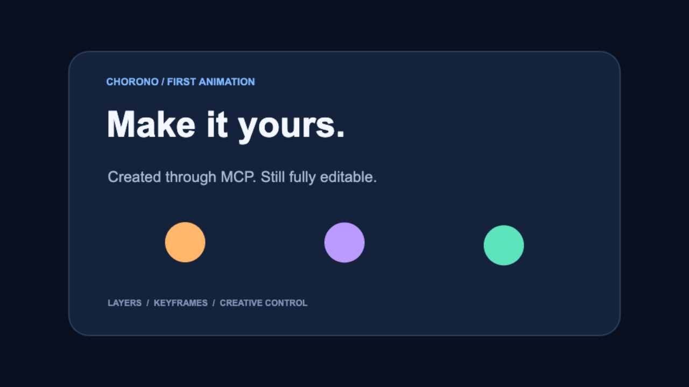

# First editable animation

A four-second Chorono scene with eight named layers, 13 tracks and 51 keyframes. The example includes a headline, caption, three animated circles and a card background.

## Download and open

You can also [download the example ZIP](https://github.com/codie1982/chorono-editor/raw/refs/heads/main/examples/first-animation/first-animation.zip), which includes the project, preview, prompt, opening instructions and license.

1. [Download the project JSON](https://raw.githubusercontent.com/codie1982/chorono-editor/main/examples/first-animation/first-animation.chorono.json). Save the page as `first-animation.chorono.json` if your browser displays the JSON.
2. Start Chorono using the [installation guide](../../docs/en/installation.md) ([Türkçe](../../docs/tr/installation.md)).
3. In the editor, choose **Menu → Open Scene JSON** and select the downloaded file.
4. Select the `first-animation` timeline and press **Play**. Pause around **1800 ms** to inspect the fully visible scene.

The example has no external image, audio or font assets. It opens without a model-provider API key. Creating new content with an agent still requires your chosen agent client and the local MCP connection.

## Make a change

- Select **Editable headline** and change **Text Content**.
- Select **Motion dot 1** and change **Fill Color**.
- Use **Menu → Save Scene JSON** to save your revision, then reopen that file through **Open Scene JSON**.

The included edited headline is “Make it yours.” and the first circle is orange. All layers and keyframes remain editable.

## Try the agent workflow

After connecting an empty editor through MCP, send this brief to your agent:

> Create a 4-second animation with the title “Make ideas move.” and three colorful circles. Keep every layer and keyframe editable. Inspect preview frames and save a portable project.

This is the same type of scene as the downloadable example; an agent may choose different timing and styling.

## Share feedback

[Tell us how your first animation went](https://github.com/codie1982/chorono-editor/issues/new?template=first-animation-feedback.yml). Include where setup, connection, editing or reopening became unclear.

The project and preview are provided under the repository's [MIT license](../../LICENSE).
